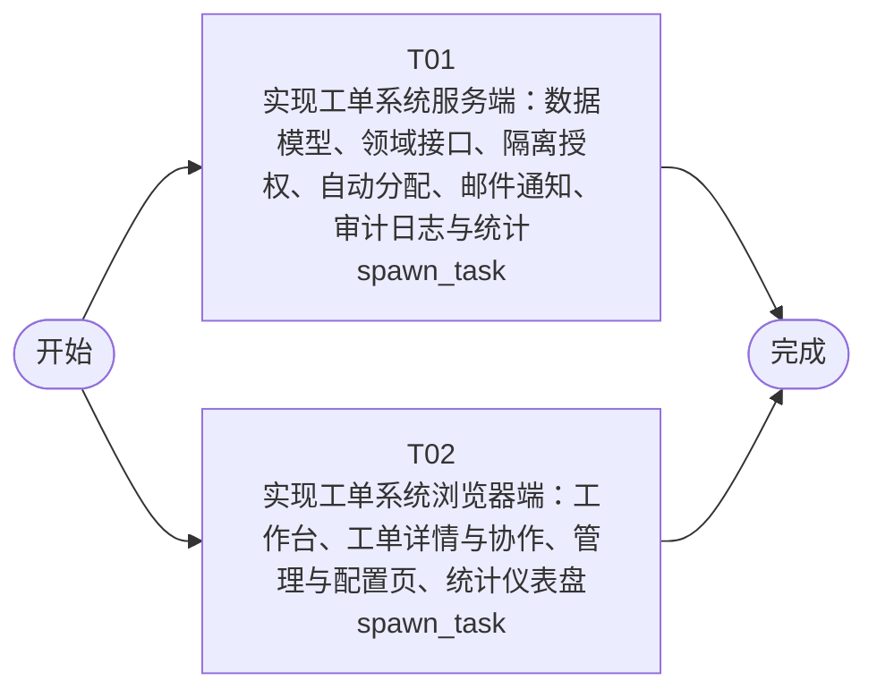

# 开发任务编排

<!-- sourcePlanId: plan:1396b0a3-4a4d-4172-87be-b5c100f43e7a | rendererVersion: 4 -->

## 任务

| 任务 | 一句话目标 | 执行模式 | 依赖 | 能力 |
| --- | --- | --- | --- | --- |
| T01 | 实现工单系统服务端：数据模型、领域接口、隔离授权、自动分配、邮件通知、审计日志与统计 | spawn_task | - | engineering.implementation |
| T02 | 实现工单系统浏览器端：工作台、工单详情与协作、管理与配置页、统计仪表盘 | spawn_task | - | engineering.implementation |

## 依赖执行图

## 任务契约

### T01

**目标**

## 范围

- 在 `app/ticket-system/src/server/` 内实现工单系统服务端，包含 SQLite 版本化迁移与业务路由、领域服务：公司/部门/分类、用户业务属性、业务组与成员、分类→业务组分配规则、工单、回复、转派、满意度评价。
- 以 `docs/wi-t1000002/technical-contract.md` 为唯一接口契约：路径、请求/响应字段、状态码与错误码保持一致，不新增契约外接口。
- 公司隔离以服务端可信数据为准：当前登录用户的公司来自用户业务属性记录，而非请求参数；工单、业务组、分配规则、部门、统计口径均按该公司过滤，跨公司访问返回 403 且不返回内容。
- 工单生命周期：创建即由 `created` 流转至 `pending_assignment`；创建时按该公司 `(company_id, category_id)` 匹配分配规则，命中则设归属业务组并流转至 `pending_processing`，未命中停留 `pending_assignment` 并支持手动分配；`completed` 与 `cancelled` 为终态，终态上的状态变更、回复、转派、分配均返回 409。
- 多轮回复记录回复人与回复时间；处理方首条回复写入首条响应时间，作为平均响应时间口径。
- 转派记录转派人、转派目标与时间，且不改变工单状态。
- 完成操作记录处理人与处理时间，并在成功后发送完成通知邮件；邮件发送结果记入审计日志，邮件不可用时不阻塞完成。
- 满意度评价：仅 `completed` 工单可评价，每工单至多一条且不可修改。
- 提交人完整信息接口返回姓名、公司、部门及该提交人的历史工单（主题、状态、创建时间）。
- 工单操作日志覆盖创建、分配（自动/手动）、转派、回复、完成、取消、评价，含操作类型、操作人、操作时间与工单标识，并遵守公司隔离。
- 统计分析接口：按公司/部门维度的工单分布，以及工单量、平均响应时间、满意度、热点分类的仪表盘指标。
- 在 `app/ticket-system/test/` 增加覆盖上述服务端行为的 HTTP 集成测试，复用包内既有的隔离测试服务器辅助工具。

## 跨任务分工

- 与前端任务 T02 共同贡献 AC-01 至 AC-15；本任务负责服务端权威数据、校验、隔离授权与持久化这一半。
- 前端依据同一份技术契约并行实现，本任务不等待 T02。
- 面向用户的完整端到端验收由后续验证阶段负责，不在本任务范围内。

## 验证

- 按包内现有配置自行选择并运行服务端聚焦检查：服务端类型检查、服务端 HTTP 集成测试与迁移启动验证，并如实报告结果。

**角色:** general-app-development-expert  \  **失败策略:** block

**需求**

- AC-01
- AC-02
- AC-03
- AC-04
- AC-05
- AC-06
- AC-07
- AC-08
- AC-09
- AC-10
- AC-11
- AC-12
- AC-13
- AC-14
- AC-15

**输入**

- docs/wi-t1000002/requirements.md
- docs/wi-t1000002/architecture-baseline.md
- docs/wi-t1000002/technical-contract.md

**产物**

- app/ticket-system/src/server/

**可写范围**

- app/ticket-system/src/server/
- app/ticket-system/test/

**阻塞码**

- TASK_FAILED

### T02

**目标**

## 范围

- 在 `app/ticket-system/src/client/` 内实现工单系统浏览器端界面，沿用包内既有 React + Vite + Tailwind 接线与 `src/client/platform/api-client.ts` 作为唯一请求边界。
- 依据 `docs/wi-t1000002/technical-contract.md` 定义与服务端一致的请求与响应类型并接线；不臆造契约外接口行为，缺失能力以契约声明的错误码反馈给用户。
- 应用壳：左侧导航（工单工作台、统计分析、业务组管理、分类管理），顶部上下文栏展示当前用户与所属公司；沿用现有本地账号登录流程。
- 工单工作台：待处理工单列表，支持关键字搜索、按状态/分类/优先级筛选、按公司维度筛选、排序切换，并可与右侧工单详情协同（split-master-detail）。
- 工单详情：完整字段与当前状态、多轮回复录入与回复记录（回复人、回复时间）、转派操作、无匹配规则工单的手动分配、完成与取消操作、工单操作日志查看。
- 工单创建：录入主题、描述、分类与 SLA 优先级（P0–P4），提交后在列表与详情中可见。
- 处理视角：提交人完整信息面板，展示姓名、公司、部门与该提交人的历史工单列表。
- 满意度评价：对已完成工单提交 1–5 星评分与可选文字说明，已评价的工单不再提供重复提交入口。
- 管理页：业务组新增与成员设置、分类→业务组分配规则维护、公司/部门/分类基础数据维护、用户业务属性维护。
- 统计分析：按公司/部门维度的工单分布视图，以及展示工单量、平均响应时间、满意度、热点分类的运营仪表盘。
- 状态反馈：加载态、空态、表单内联错误、操作失败提示，以及跨公司访问被拒绝时的明确提示且不暴露他公司内容。
- 视觉遵循架构基线的 Modern SaaS 方向：紧凑可扫读的运营型布局，不使用装饰性图标字或营销式首屏。

## 跨任务分工

- 与后端任务 T01 共同贡献 AC-01 至 AC-15；本任务负责界面呈现、交互与请求接线这一半，不实现服务端业务逻辑。
- 依据同一份技术契约并行推进，不等待 T01；不在本任务内改动服务端源码。
- 面向用户的完整端到端验收由后续验证阶段负责，不在本任务范围内。

## 验证

- 按包内现有配置自行选择并运行前端聚焦检查：客户端类型检查与前端构建，并如实报告结果。

**角色:** general-app-development-expert  \  **失败策略:** block

**需求**

- AC-01
- AC-02
- AC-03
- AC-04
- AC-05
- AC-06
- AC-07
- AC-08
- AC-09
- AC-10
- AC-11
- AC-12
- AC-13
- AC-14
- AC-15

**输入**

- docs/wi-t1000002/requirements.md
- docs/wi-t1000002/architecture-baseline.md
- docs/wi-t1000002/technical-contract.md

**产物**

- app/ticket-system/src/client/

**可写范围**

- app/ticket-system/src/client/
- app/ticket-system/dist/

**阻塞码**

- TASK_FAILED
