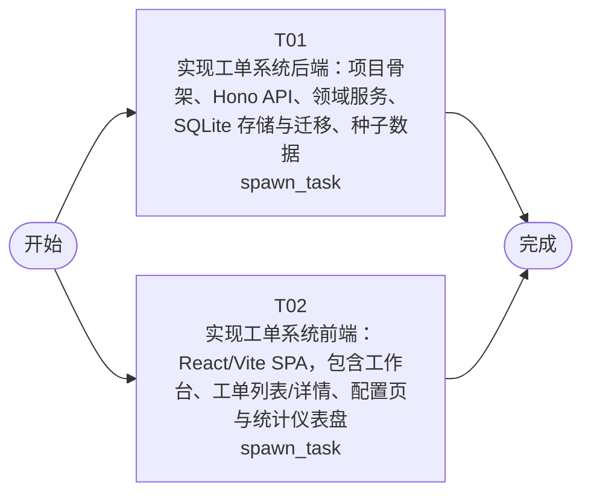

# 开发任务编排

<!-- sourcePlanId: plan:bce61346-3210-4c09-8633-591508094966 | rendererVersion: 4 -->

## 任务

| 任务 | 一句话目标 | 执行模式 | 依赖 | 能力 |
| --- | --- | --- | --- | --- |
| T01 | 实现工单系统后端：项目骨架、Hono API、领域服务、SQLite 存储与迁移、种子数据 | spawn_task | - | engineering.implementation |
| T02 | 实现工单系统前端：React/Vite SPA，包含工作台、工单列表/详情、配置页与统计仪表盘 | spawn_task | - | engineering.implementation |

## 依赖执行图

## 任务契约

### T01

**目标**

## 目标

实现工单系统的服务端全栈后端，依据 `technical-contract.md` 的字段级契约完成 API、领域逻辑与存储。

### 范围

- **项目骨架**：`package.json`（含前后端全部依赖与 scripts）、`tsconfig.json`、`vite.config.ts`（dev 代理 + 生产构建）、`.gitignore`
- **数据层**：SQLite 连接管理（WAL、外键、自动建目录）、版本化 SQL 迁移（`migrations/`）
- **领域服务**：ticket（创建/查询/回复/状态机/完成/取消/评价/提交人资料/日志）、assignment（业务组/成员/分配规则/自动分配）、collaboration（转派）、notification（完成通知出站记录）、statistics（分布/仪表盘指标）
- **API 层**：Hono 路由，会话 Cookie 身份解析、公司隔离强制求交、入参校验、统一错误映射、能力守卫
- **访问控制**：用户与公司目录、操作者身份解析、作用域派生、越界拒绝
- **种子数据**：多公司、多部门、用户、业务组、分配规则与示例工单
- **验收脚本**：`scripts/verify.mjs`——选空闲端口、独立 DB_PATH、等待就绪、结束后清理

### 公司隔离

所有查询与写入以操作者所属公司为强制过滤条件；越界资源按 404 处理。

### 状态机

创建→待分配→待处理→完成/取消，非法流转返回 `INVALID_TRANSITION`。

### 验证

- TypeScript 类型检查通过
- `npm run verify` 脚本可启动隔离实例并通过基本 API 自检
- 邮件通知以出站记录形式可核对

### 前端协作

T01 同时设置 `vite.config.ts` 中的 dev 代理（`/api` → 后端端口）并声明前端所需依赖（React、React-DOM、React-Router-Dom 等），使 T02 无需修改 `package.json`。

**角色:** general-app-development-expert  \  **失败策略:** block

**需求**

- AC-01
- AC-02
- AC-03
- AC-04
- AC-05
- AC-06
- AC-07
- AC-08
- AC-09
- AC-10
- AC-11
- AC-12
- AC-14

**输入**

- docs/wi-t1000007/requirements.md
- docs/wi-t1000007/architecture-baseline.md
- docs/wi-t1000007/technical-contract.md

**产物**

- src/server/
- src/shared/
- migrations/
- scripts/

**可写范围**

- src/server
- src/shared
- migrations
- scripts
- package.json
- tsconfig.json
- vite.config.ts
- .gitignore

**阻塞码**

- （无）

### T02

**目标**

## 目标

实现工单系统的浏览器端 SPA，依据 `technical-contract.md` 的接口与字段契约完成全部页面与交互。

### 范围

- **应用入口**：`index.html`、Vite SPA 挂载
- **应用壳**：左侧主导航 + 顶部上下文栏 + 主工作区
- **身份切换**：操作者选择/登录入口，读取 `GET /api/session` 渲染所属公司与能力
- **工单工作台**：待处理列表、关键字搜索、分类/优先级/公司筛选、创建时间排序、分页
- **工单列表与详情**：列表与详情 split-master-detail 布局；详情含回复线程、转派记录、处理动作、日志
- **工单提交表单**：主题、描述、分类、SLA 优先级选择
- **业务组配置**：新增业务组、设置成员、读回
- **分配规则配置**：分类→业务组规则增删改查
- **处理页面**：提交人完整信息面板（姓名/公司/部门/历史工单）、回复、转派、完成
- **评价**：完成后满意度评分（1–5）、重复评价拒绝反馈
- **统计仪表盘**：工单量、平均响应时间、满意度、热点问题；按公司/部门维度分布
- **通知核对**：完成通知发送记录可查看
- **全局状态**：加载/空态/错误/无权限/成功/业务拒绝反馈

### 契约约定

- 统一 `fetch` 封装，解析错误体并按错误码呈现对应反馈
- `NOT_FOUND`/`FORBIDDEN` 呈现"资源不存在或不可见"；`INVALID_TRANSITION`/`ALREADY_RATED`/`DUPLICATE_RULE` 呈现实体原因
- 不缓存权威业务数据，视图状态保留在前端

### 验证

- TypeScript 类型检查通过
- Vite 构建成功
- 依赖由 T01 的 `package.json` 声明，T02 仅写入 `index.html` 与 `src/client/`

**角色:** general-app-development-expert  \  **失败策略:** block

**需求**

- AC-01
- AC-02
- AC-03
- AC-04
- AC-05
- AC-06
- AC-07
- AC-08
- AC-09
- AC-10
- AC-11
- AC-12
- AC-13

**输入**

- docs/wi-t1000007/requirements.md
- docs/wi-t1000007/architecture-baseline.md
- docs/wi-t1000007/technical-contract.md

**产物**

- src/client/
- index.html

**可写范围**

- src/client
- index.html

**阻塞码**

- （无）
