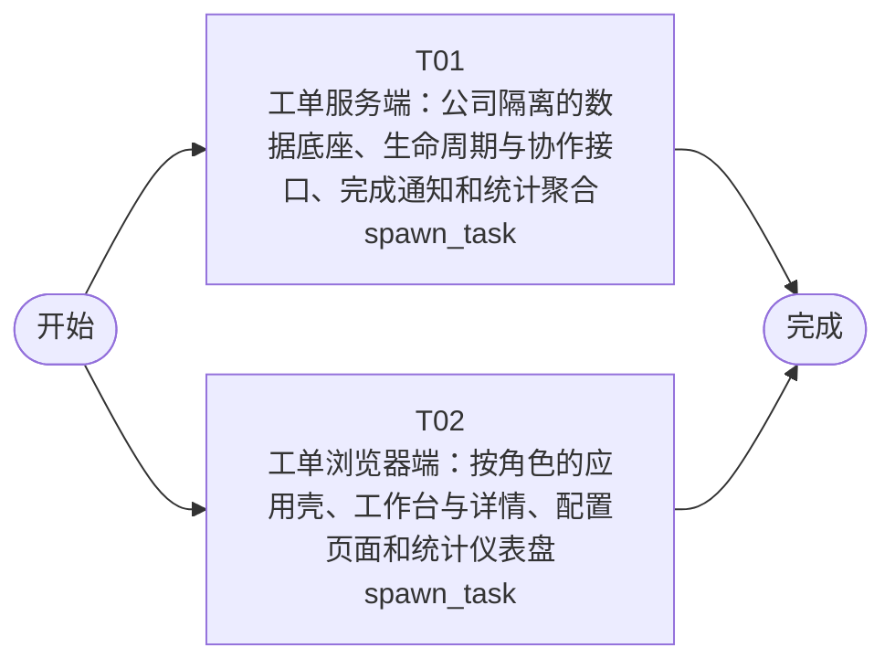

# 开发任务编排

<!-- sourcePlanId: plan:6523f6c5-7195-40c6-915f-84ce68cebf64 | rendererVersion: 4 -->

## 任务

| 任务 | 一句话目标 | 执行模式 | 依赖 | 能力 |
| --- | --- | --- | --- | --- |
| T01 | 工单服务端：公司隔离的数据底座、生命周期与协作接口、完成通知和统计聚合 | spawn_task | - | engineering.implementation |
| T02 | 工单浏览器端：按角色的应用壳、工作台与详情、配置页面和统计仪表盘 | spawn_task | - | engineering.implementation |

## 依赖执行图

## 任务契约

### T01

**目标**

## 交付范围

应用包 `app/ticket/` 的服务端与跨端基础：`src/server/`、`src/shared/`、`test/`。

## 实现内容

- 数据库迁移：按 `docs/wi-t1000009/architecture-baseline.md` 第 3 节，从 `0101` 起新增版本化 SQLite 迁移（公司、用户业务属性、分类、业务组、组成员、分配规则、取号序列、工单、回复、日志、评价、通知及所列索引）。
- 身份与授权：按设计决策 D2 收口脚手架自带的 `/api/admin/users*`，改为公司管理员守卫并限制在本公司用户范围；提供当前用户解析（公司、部门、角色、所属业务组）与公司管理员、业务组成员、提交人归属守卫。
- 业务服务：按架构基线 2.1 的职责边界实现组织配置、工单、通知、统计四个服务及其路由；端点、请求/响应字段、枚举、状态机、权限矩阵、错误码、分页与幂等规则一律以 `docs/wi-t1000009/technical-contract.md` 为唯一来源，不在代码中另立口径。
- 完成通知：工单完成事务提交后经 emailkit 发送完成通知并记录 `sent`/`failed`/`skipped`，发送失败或未配置不改变完成状态，支持手动重试。
- 演示与验收支撑：幂等种子数据（两家公司、含多部门的账号、业务组与成员、问题分类、自动分配规则、示例工单与评价）；本地 SMTP 收件桩（`fail@` 前缀返回 550）与可登录测试身份夹具，供统计口径核对、工作台筛选演示和后续验收使用。

## 写入边界

`package.json` 与锁文件由前端任务独占；本期所需 `seed`、`mail:sink` 脚本条目由该任务按架构基线 1.3 写入，本任务直接以 `node --import tsx` 运行对应入口完成自检。

## 验收贡献

AC-01～AC-15 的服务端权威行为：必填校验与取号、状态机与终态守卫、多轮回复留痕、公司隔离与越权拒绝、业务组与分配规则、指派与转派、提交人信息与历史工单、完成通知、评价唯一性、工作台查询筛选排序、公司与部门分布、运营指标口径、只追加操作日志。

## 自检

在 `app/ticket` 下执行适用检查（服务端类型检查、`node:test` 用例），并以隔离的数据库路径与空闲端口启动真实 HTTP 服务，对关键端点验证成功、越权与非法状态路径；报告真实命令、工作目录与结果。

**角色:** general-app-development-expert  \  **失败策略:** block

**需求**

- AC-01
- AC-02
- AC-03
- AC-04
- AC-05
- AC-06
- AC-07
- AC-08
- AC-09
- AC-10
- AC-11
- AC-12
- AC-13
- AC-14
- AC-15

**输入**

- docs/wi-t1000009/requirements.md
- docs/wi-t1000009/architecture-baseline.md
- docs/wi-t1000009/technical-contract.md

**产物**

- app/ticket/src/server/
- app/ticket/src/shared/
- app/ticket/test/

**可写范围**

- app/ticket/src/server/
- app/ticket/src/shared/
- app/ticket/test/

**阻塞码**

- （无）

### T02

**目标**

## 交付范围

应用包 `app/ticket/` 的浏览器端与包级配置：`src/client/`、`package.json`、`package-lock.json`、`tsconfig.json`、`tsconfig.client.json`、`index.html`、`vite.config.ts`。

## 实现内容

- 依赖与脚本：写入 `antd` 与 `@ant-design/icons`（本任务唯一新增的运行时依赖），并按架构基线 1.3 写入 `seed`、`mail:sink` 两个脚本条目（其实现文件由服务端任务提供）。
- 应用壳：按架构基线 1.4 实现深色侧边导航、顶部上下文栏与按角色可见的入口；提交人默认进入「我的工单」，配置类入口仅公司管理员可见。
- 页面：登录、我的工单、工单工作台（左列表右详情分栏）、工单详情（提交人信息卡与历史工单、回复流、操作区、通知记录、操作日志、评价区）、业务组与成员、分类与分配规则、用户管理、统计分析与仪表盘。
- 请求边界：沿用脚手架 `src/client/platform/api-client.ts` 作为唯一请求入口，统一处理 Bearer 令牌、错误体解码与中文提示；wire 类型在本任务范围内定义于 `src/client/`，不写入 `src/shared/`。
- 交互基线：表单即时校验仅作反馈，服务端错误按字段回显；写操作成功后以响应中的最新对象刷新详情；空态、加载态、错误重试、越权提示与终态工单隐藏操作入口按架构基线 1.4 落实。

## 契约约束

接口路径、字段、枚举、错误码与 `allowedActions` 完全以 `docs/wi-t1000009/technical-contract.md` 为准，前端不自行推断权限、不新增契约外行为；服务端尚未就绪时按契约样例验证交互与成功/空/错误状态，真实联调交给后续验收阶段。

## 验收贡献

AC-01～AC-15 的用户界面与交互证据：提交与必填提示、状态与操作按钮随生命周期变化、回复流展示、跨公司与越权提示、业务组与规则配置、指派与转派表单、提交人信息与历史工单区、完成与通知记录展示、评价入口与重复评价提示、工作台筛选搜索排序、分布与指标展示、只读日志展示。

## 自检

在 `app/ticket` 下执行适用的客户端类型检查与客户端构建，确认新增依赖可解析、路由与页面可编译；报告真实命令、工作目录与结果。

**角色:** general-app-development-expert  \  **失败策略:** block

**需求**

- AC-01
- AC-02
- AC-03
- AC-04
- AC-05
- AC-06
- AC-07
- AC-08
- AC-09
- AC-10
- AC-11
- AC-12
- AC-13
- AC-14
- AC-15

**输入**

- docs/wi-t1000009/requirements.md
- docs/wi-t1000009/architecture-baseline.md
- docs/wi-t1000009/technical-contract.md

**产物**

- app/ticket/src/client/

**可写范围**

- app/ticket/src/client/
- app/ticket/package.json
- app/ticket/package-lock.json
- app/ticket/tsconfig.json
- app/ticket/tsconfig.client.json
- app/ticket/index.html
- app/ticket/vite.config.ts

**阻塞码**

- （无）
