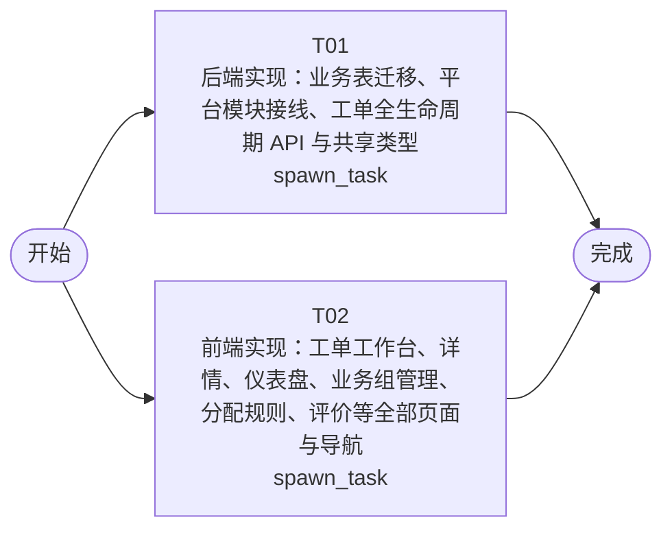

# 开发任务编排

<!-- sourcePlanId: plan:e98ebd8c-7abe-4686-a0c1-8cd33d7953de | rendererVersion: 4 -->

## 任务

| 任务 | 一句话目标 | 执行模式 | 依赖 | 能力 |
| --- | --- | --- | --- | --- |
| T01 | 后端实现：业务表迁移、平台模块接线、工单全生命周期 API 与共享类型 | spawn_task | - | engineering.implementation |
| T02 | 前端实现：工单工作台、详情、仪表盘、业务组管理、分配规则、评价等全部页面与导航 | spawn_task | - | engineering.implementation |

## 依赖执行图

## 任务契约

### T01

**目标**

## 目标

实现工单系统全部后端功能，使所有 API 端点按技术契约 `docs/wi-t1000016/technical-contract.md` 正确响应。

### 范围

1. **数据库迁移** (`0004_business_tables.sql`)：创建 companies、business_groups、business_group_members、categories、assignment_rules、tickets、ticket_replies、ticket_transfers、ticket_evaluations 表及索引；ALTER TABLE users 增加 department 和 role 列。
2. **平台模块接线** (`bootstrap.ts`)：在 `initializePlatform()` 中接入 permissionkit（`createPermissionKit` + `syncRegistry` 注册 submitter/handler/admin 角色与权限）、auditkit（`createAuditKit`）、emailkit（`createEmailClient` 从 SMTP_* 环境变量创建，未配置时返回 skip）。
3. **认证上下文增强** (`auth.ts`)：在登录响应和 `GET /api/auth/me` 中返回 `companyId`、`department`、`role` 字段，使前端能获取当前用户的完整上下文。
4. **业务路由** (`routes.ts` → `registerProtectedRoutes`)：实现技术契约第 3-6 节全部端点：
   - 工单：POST/GET /api/tickets、GET/PATCH /api/tickets/:id、POST replies/transfer/evaluation、GET submitter-info/logs
   - 业务组：POST/GET /api/business-groups、POST /:id/members
   - 分类与规则：POST/GET /api/categories、POST/GET /api/assignment-rules
   - 统计：GET /api/dashboard/stats、GET /api/dashboard/distribution
5. **业务服务层** (`src/server/services/`)：按领域拆分 TicketService、AssignmentService、CollaborationService、StatsService，封装 SQL 查询、公司隔离 WHERE 条件、auditkit 日志记录和 emailkit 邮件发送。
6. **共享类型** (`src/shared/types.ts`)：定义 TicketDTO、TicketDetailDTO、TicketReplyDTO、EvaluationDTO、UserDTO、SubmitterInfoDTO、BusinessGroupDTO、MemberDTO、CategoryDTO、AssignmentRuleDTO、LogEntryDTO、DashboardStatsDTO、DistributionDTO 等 TypeScript 类型，供前后端共用。
7. **package.json**：添加 `dev` 脚本（concurrently 运行 dev:web + dev:server）和 `migrate` 脚本；如需新增 `concurrently` 开发依赖。

### 公司隔离

所有业务查询从认证上下文提取 `companyId` 并附加 `WHERE company_id = ?`。

### 验证

- `npm run typecheck:server`（tsconfig.server.json）通过
- `npm run build` 整体构建通过（含前端构建产物）
- 现有 `npm test`（test/*.test.mjs）仍通过

**角色:** general-app-development-expert  \  **失败策略:** block

**需求**

- AC-01
- AC-02
- AC-03
- AC-04
- AC-05
- AC-06
- AC-07
- AC-08
- AC-09
- AC-10
- AC-11
- AC-12
- AC-13
- AC-14
- AC-15

**输入**

- docs/wi-t1000016/technical-contract.md

**产物**

- app/ticket-system/src/server/routes.ts
- app/ticket-system/src/server/migrations/sqlite/0004_business_tables.sql
- app/ticket-system/src/shared/types.ts
- app/ticket-system/src/server/services/

**可写范围**

- app/ticket-system/src/server/routes.ts
- app/ticket-system/src/server/migrations/sqlite/0004_business_tables.sql
- app/ticket-system/src/shared/types.ts
- app/ticket-system/src/server/services/
- app/ticket-system/src/server/platform/bootstrap.ts
- app/ticket-system/src/server/platform/auth.ts
- app/ticket-system/src/server/app.ts
- app/ticket-system/package.json

**阻塞码**

- （无）

### T02

**目标**

## 目标

实现工单系统全部前端页面，使工单创建、分配、处理、协作、评价和统计分析功能在浏览器中可操作，所有页面消费技术契约 `docs/wi-t1000016/technical-contract.md` 定义的 API。

### 范围

1. **应用导航** (`App.tsx`)：重构为左侧固定导航栏 + 顶部上下文栏 + 右侧主工作区布局；导航项按角色显示（提交人可见工单工作台与个人设置；处理人可见工单工作台与统计仪表盘；管理员可见全部）。保留现有登录/Bootstrap 流程。
2. **工单工作台** (`src/client/pages/TicketWorkspace.tsx`)：split-master-detail 布局，左侧工单列表支持按公司筛选、按主题/工单ID搜索、按创建时间/优先级排序；右侧展示选中工单详情。
3. **工单详情** (`src/client/pages/TicketDetail.tsx`)：展示工单信息、多轮回复（按时间顺序）、提交人完整信息（含历史工单），提供转派/完成/取消操作和满意度评价入口。
4. **统计仪表盘** (`src/client/pages/Dashboard.tsx`)：KPI 卡片（工单量/平均响应时间/满意度）、工单分布（公司/部门维度切换）、热点问题排名。
5. **业务组管理** (`src/client/pages/BusinessGroupManagement.tsx`)：业务组列表、创建业务组、添加/查看成员。
6. **分配规则管理** (`src/client/pages/AssignmentRuleManagement.tsx`)：分类列表、创建分类、配置分类→业务组映射规则。
7. **数据 Hooks** (`src/client/hooks/`)：封装 API 调用逻辑（useTickets、useTicket、useDashboard 等），基于 `apiRequest` 客户端。
8. **样式** (`index.css`)：扩展现有 CSS，增加工单列表、详情面板、仪表盘、状态色映射（P0红/P1橙/P2黄/P3蓝/P4灰）等样式。

### 契约遵守

前端严格按 technical-contract.md 定义的 DTO 字段和 API 行为开发，使用 `src/shared/types.ts` 中的共享类型，不自行发明 API 行为。前端不传递 company_id 参数（后端自动绑定）。

### 验证

- `npm run typecheck:client`（tsconfig.client.json）通过
- `npm run build:client`（vite build）通过

**角色:** general-app-development-expert  \  **失败策略:** block

**需求**

- AC-01
- AC-02
- AC-03
- AC-04
- AC-05
- AC-06
- AC-07
- AC-08
- AC-09
- AC-10
- AC-11
- AC-12
- AC-13
- AC-14
- AC-15

**输入**

- docs/wi-t1000016/technical-contract.md

**产物**

- app/ticket-system/src/client/

**可写范围**

- app/ticket-system/src/client/
- app/ticket-system/src/client/App.tsx
- app/ticket-system/src/client/index.css

**阻塞码**

- （无）
