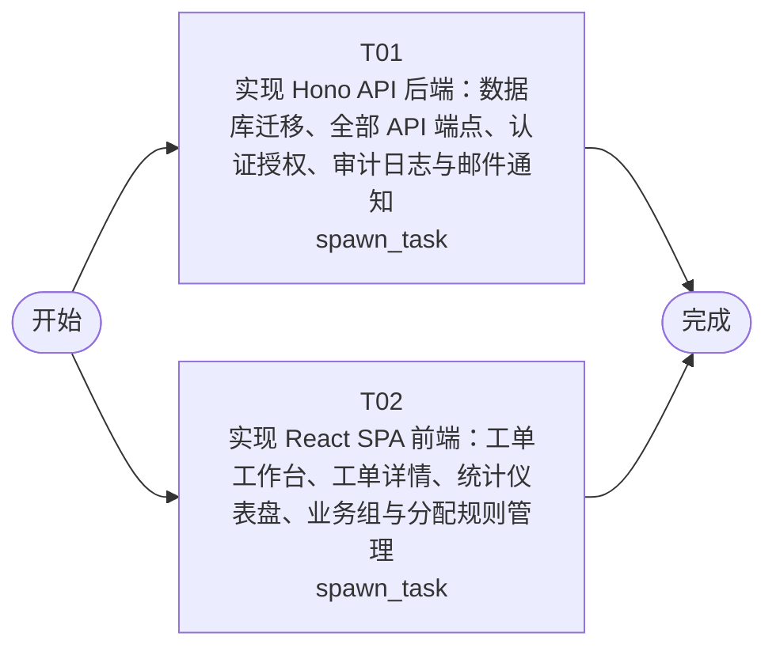

# 开发任务编排

<!-- sourcePlanId: plan:7fec8c95-1cdf-4953-bc7c-bdef6ff8e124 | rendererVersion: 4 -->

## 任务

| 任务 | 一句话目标 | 执行模式 | 依赖 | 能力 |
| --- | --- | --- | --- | --- |
| T01 | 实现 Hono API 后端：数据库迁移、全部 API 端点、认证授权、审计日志与邮件通知 | spawn_task | - | engineering.implementation |
| T02 | 实现 React SPA 前端：工单工作台、工单详情、统计仪表盘、业务组与分配规则管理 | spawn_task | - | engineering.implementation |

## 依赖执行图

## 任务契约

### T01

**目标**

## 后端实现

基于技术契约实现工单系统完整后端服务，包括：

### 数据层
- SQLite 数据库迁移脚本（companies、departments、users、categories、tickets、ticket_replies、business_groups、business_group_members、category_assignment_rules、satisfaction_evaluations）
- 引用数据种子脚本（公司、部门、用户、分类的基础数据）

### API 端点
- 认证：`POST /api/auth/login`、`GET /api/auth/me`（authkit 集成）
- 工单 CRUD：`POST /api/tickets`（含自动分配逻辑）、`GET /api/tickets`（筛选/搜索/排序/分页）、`GET /api/tickets/:id`（含回复和评价）
- 工单状态流转：`PATCH /api/tickets/:id/status`（手动分配）、`POST /api/tickets/:id/transfer`（转派）、`POST /api/tickets/:id/complete`（完成+邮件通知）、`POST /api/tickets/:id/cancel`（取消）
- 工单回复：`POST /api/tickets/:id/replies`、`GET /api/tickets/:id/replies`
- 用户评价：`POST /api/tickets/:id/evaluation`、`GET /api/tickets/:id/evaluation`
- 提交人信息：`GET /api/tickets/:id/submitter-info`（含历史工单）
- 业务组管理：`GET/POST /api/business-groups`、`POST /api/business-groups/:id/members`、`DELETE /api/business-groups/:id/members/:userId`
- 分配规则：`GET/POST /api/assignment-rules`、`DELETE /api/assignment-rules/:id`
- 工作台：`GET /api/workbench/tickets`（handler 看本组待处理，admin 看本公司待处理）
- 统计分析：`GET /api/statistics/overview`、`GET /api/statistics/distribution`、`GET /api/statistics/hot-topics`
- 操作日志：`GET /api/tickets/:id/logs`（auditkit 集成）

### 横切关注点
- 公司隔离：所有查询按 company_id 过滤
- RBAC 授权：permissionkit 中间件，提交人/处理人/管理员三角色
- 审计日志：工单生命周期关键操作通过 auditkit 写入
- 邮件通知：工单完成时通过 emailkit 发送 SMTP 邮件

### CommonApp 模块集成
- dbkit（数据库连接与迁移）、authkit（认证）、permissionkit（授权）、auditkit（审计）、emailkit（邮件）

### 验证
- TypeScript 类型检查通过
- 后端构建成功
- API 端点可通过 curl 或测试脚本调用验证基本功能

**角色:** general-app-development-expert  \  **失败策略:** block

**需求**

- AC-01
- AC-02
- AC-03
- AC-04
- AC-05
- AC-06
- AC-07
- AC-08
- AC-09
- AC-10
- AC-11
- AC-12

**输入**

- docs/wi-t1000017/technical-contract.md
- docs/wi-t1000017/architecture-baseline.md

**产物**

- src/server/
- migrations/sqlite/
- src/shared/

**可写范围**

- src/server/
- migrations/sqlite/
- src/shared/
- package.json
- tsconfig.json
- scripts/seed.ts
- vendor/@commonapp/

**阻塞码**

- （无）

### T02

**目标**

## 前端实现

基于技术契约实现工单系统完整前端 SPA，使用 React + Vite，采用 split-master-detail 展示模板和 Modern SaaS 视觉风格。

### 页面与组件
- **应用壳**：左侧导航栏（工单工作台、统计仪表盘、业务组管理、分配规则管理）、顶部上下文栏（当前用户/公司/角色）
- **工单工作台**：待处理工单列表，支持按公司/SLA优先级/分类筛选、关键词搜索、排序（创建时间/优先级），分页
- **工单详情（split-master-detail）**：列表+详情分栏，展示工单完整信息
  - 提交人信息面板（姓名、公司、部门、历史工单列表）
  - 多轮回复链（按时间正序）
  - 工单操作区：回复、转派（选择同公司业务组成员）、完成处理、取消
  - 满意度评价区（已完成工单，提交人可评价）
  - 操作日志时间线
- **统计仪表盘**：工单量/完成量/待处理量、平均响应时间、满意度评分、热点问题（按分类）、按公司/部门维度的工单分布图表
- **业务组管理**：创建业务组、添加/移除成员
- **分配规则管理**：配置分类→业务组自动分配规则，删除规则
- **工单创建表单**：主题、描述、分类选择、SLA 优先级选择
- **登录页**：邮箱+密码登录

### 状态与交互
- 加载中骨架屏、空数据引导、错误重试、无权限提示
- 基于技术契约的类型定义（src/shared/types 或前端本地类型）
- 使用 contract-based types 和 mock 数据，不臆造 API 行为
- HTTP 客户端封装，携带 Bearer Token

### 验证
- TypeScript 类型检查通过
- 前端构建成功（vite build）
- 页面可渲染，导航和工单列表基本可用

**角色:** general-app-development-expert  \  **失败策略:** block

**需求**

- AC-01
- AC-02
- AC-04
- AC-05
- AC-06
- AC-08
- AC-09
- AC-10
- AC-12

**输入**

- docs/wi-t1000017/technical-contract.md
- docs/wi-t1000017/architecture-baseline.md

**产物**

- src/client/
- index.html

**可写范围**

- src/client/
- index.html
- vite.config.ts

**阻塞码**

- （无）
