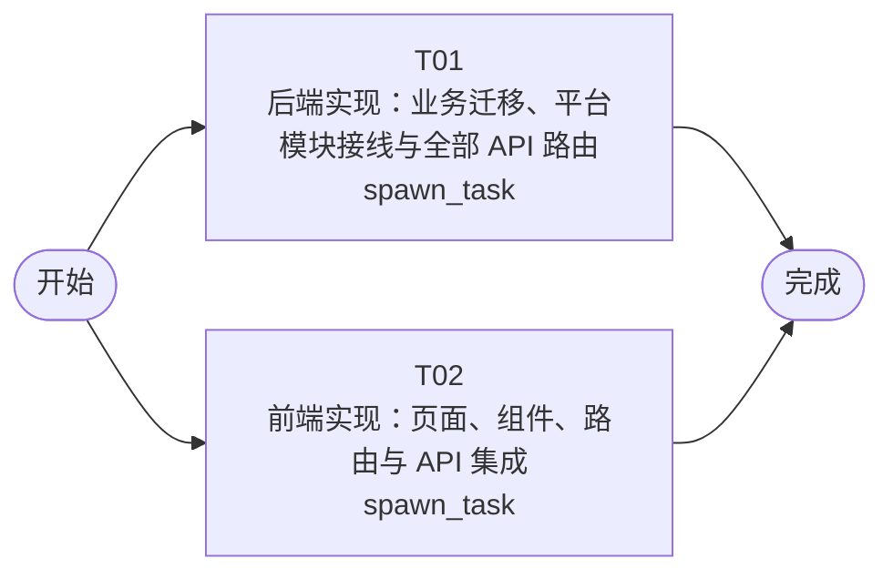

# 开发任务编排

<!-- sourcePlanId: plan:9e700545-7ac6-4ea3-bbd8-87a6a9d8e6ba | rendererVersion: 4 -->

## 任务

| 任务 | 一句话目标 | 执行模式 | 依赖 | 能力 |
| --- | --- | --- | --- | --- |
| T01 | 后端实现：业务迁移、平台模块接线与全部 API 路由 | spawn_task | - | engineering.implementation |
| T02 | 前端实现：页面、组件、路由与 API 集成 | spawn_task | - | engineering.implementation |

## 依赖执行图

## 任务契约

### T01

**目标**

## 后端实现

实现工单系统全部服务端代码，覆盖技术契约第 2-13 节定义的所有 API 端点。

### 范围

1. **数据库迁移**：创建 `0004_business_tables.sql`，包含 companies、departments、business_groups、business_group_members、categories、assignment_rules、tickets、ticket_replies、ticket_transfers、ticket_evaluations 表，以及 users 表 department_id 扩展列。表结构严格遵循架构基线第 3 节。
2. **平台接线**：
   - 在 `bootstrap.ts` 中初始化 permissionkit（syncRegistry 注册 submitter/handler/admin 角色及权限）、auditkit（createAuditKit）、emailkit（createEmailClient，从 SMTP_* 环境变量读取配置，未配置时降级为日志记录）
   - 在 `auth.ts` 中扩展身份解析，从 user_role_assignments 表加载用户角色，附加到 currentUser 上下文
3. **业务路由**：在 `routes.ts` 中实现以下全部端点（参照 technical-contract.md 字段级契约）：
   - 公司 CRUD：`GET/POST/PATCH /api/companies`
   - 部门 CRUD：`GET/POST/PATCH /api/companies/:companyId/departments`
   - 业务组 CRUD 及成员管理：`GET/POST/PATCH/DELETE /api/companies/:companyId/groups`、`POST/DELETE /api/groups/:groupId/members`
   - 分类 CRUD：`GET/POST/PATCH/DELETE /api/companies/:companyId/categories`
   - 分配规则：`GET/POST/DELETE /api/companies/:companyId/assignment-rules`
   - 工单管理：`GET/POST /api/tickets`、`GET /api/tickets/:id`、`POST /api/tickets/:id/assign\|transfer\|complete\|cancel`
   - 工单回复：`GET/POST /api/tickets/:id/replies`
   - 提交人信息：`GET /api/tickets/:id/submitter-info`
   - 用户评价：`GET/POST /api/tickets/:id/evaluation`
   - 统计分析：`GET /api/stats/distribution\|dashboard`
   - 工作台：`GET /api/workbench/tickets`
   - 操作日志：`GET /api/tickets/:id/logs`
4. **业务逻辑**：
   - 工单创建时自动匹配分类-业务组分配规则（assignment_rules 按 company_id + category_id 查询）
   - 公司隔离：服务端从当前用户 company_id 强制过滤所有查询
   - 工单完成时调用 emailkit 发送邮件通知提交人
   - 工单生命周期操作通过 auditkit.record 记录审计事件（ticket.created/assigned/replied/transferred/completed/cancelled/evaluated）
   - 角色授权中间件：admin 管理配置、handler 处理工单、submitter 创建工单
5. **共享类型**：在 `src/shared/` 中创建前后端共享的 API 类型定义（Company、Department、BusinessGroup、Category、AssignmentRule、Ticket、TicketReply、Evaluation、AuditLogEntry 等接口）

### 验证

- `npm run typecheck:server` 通过
- `npm test` 通过
- `npm run build` 整体类型检查 + 前端构建通过

### 跨任务贡献

- 本任务实现全部 API 端点的服务端逻辑，为所有 AC 提供后端层支撑
- 前端任务 T02 基于同一技术契约独立实现 UI，不依赖本任务产物
- 后续 QA 阶段负责端到端集成验证

**角色:** general-app-development-expert  \  **失败策略:** block

**需求**

- AC-01
- AC-02
- AC-03
- AC-04
- AC-05
- AC-06
- AC-07
- AC-08
- AC-09
- AC-10

**输入**

- docs/wi-t1000018/requirements.md
- docs/wi-t1000018/architecture-baseline.md
- docs/wi-t1000018/technical-contract.md

**产物**

- app/ticket-system/src/shared/

**可写范围**

- app/ticket-system/src/shared/
- app/ticket-system/src/server/migrations/sqlite/0004_business_tables.sql
- app/ticket-system/src/server/platform/bootstrap.ts
- app/ticket-system/src/server/platform/auth.ts
- app/ticket-system/src/server/routes.ts

**阻塞码**

- （无）

### T02

**目标**

## 前端实现

实现工单系统全部浏览器端代码，基于 technical-contract.md 的字段级 API 契约创建前端类型和页面。

### 范围

1. **应用壳与路由**：
   - 改造 `App.tsx` 为左侧导航栏 + 顶部上下文栏 + 主工作区的应用壳
   - 使用 react-router-dom 实现路由：工单工作台、工单管理、统计分析、管理后台（业务组/分类/分配规则/公司/部门）
   - split-master-detail 展示模板：工单列表与详情协同布局
2. **页面实现**：
   - 工单工作台：待处理工单列表，支持筛选（含公司维度）、关键字搜索、排序
   - 工单管理：全部工单列表 + 工单详情（含生命周期操作：分配、转派、完成、取消）
   - 工单详情：多轮回复列表与回复表单、提交人完整信息面板（姓名/公司/部门/历史工单）、操作日志列表、满意度评价表单
   - 统计分析：工单分布（公司/部门维度切换）+ 运营仪表盘（工单量、平均响应时间、满意度、热点问题 Top 5）
   - 管理后台：业务组管理（含成员增删）、分类管理、分配规则管理、公司管理、部门管理
3. **类型定义**：基于 technical-contract.md 的响应对象定义前端 TypeScript 类型，不发明 API 行为
4. **组件**：工单卡片、回复项、提交人信息面板、评价表单、统计卡片、筛选/搜索/排序控件、加载骨架屏、空数据提示、内联错误提示、操作反馈 Toast
5. **样式**：Modern SaaS 风格（Tailwind CSS），柔和中性色、细边界、少阴影、中等圆角、一个主色与状态色
6. **API 客户端**：复用现有 `api-client.ts` 的 `apiRequest` 函数，封装各端点的调用

### 验证

- `npm run typecheck:client` 通过
- `npm run build:client` 通过

### 跨任务贡献

- 本任务实现全部前端 UI，为所有 AC 提供浏览器交互层支撑
- 后端任务 T01 基于同一技术契约独立实现 API，不依赖本任务产物
- 后续 QA 阶段负责端到端集成验证

**角色:** general-app-development-expert  \  **失败策略:** block

**需求**

- AC-01
- AC-02
- AC-03
- AC-04
- AC-05
- AC-06
- AC-07
- AC-08
- AC-09
- AC-10

**输入**

- docs/wi-t1000018/requirements.md
- docs/wi-t1000018/architecture-baseline.md
- docs/wi-t1000018/technical-contract.md

**产物**

- （无）

**可写范围**

- app/ticket-system/src/client/App.tsx
- app/ticket-system/src/client/index.css

**完整写入路径**

- app/ticket-system/src/client/App.tsx
- app/ticket-system/src/client/index.css

**阻塞码**

- （无）
