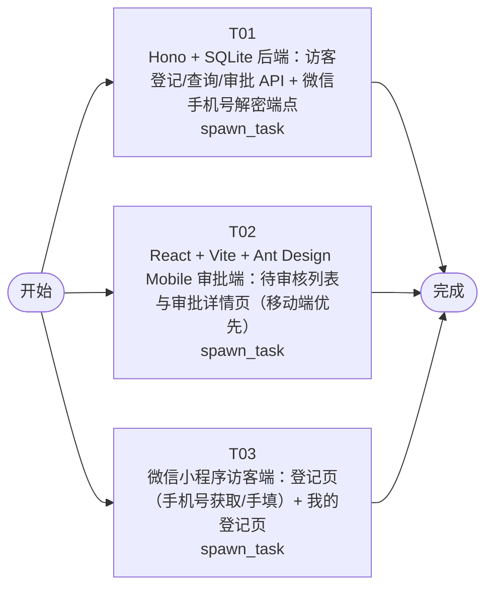

# 开发任务编排

<!-- sourcePlanId: plan:ad84eb32-d976-44dc-ab94-32ed7eb7d916 | rendererVersion: 4 -->

## 任务

| 任务 | 一句话目标 | 执行模式 | 依赖 | 能力 |
| --- | --- | --- | --- | --- |
| T01 | Hono + SQLite 后端：访客登记/查询/审批 API + 微信手机号解密端点 | spawn_task | - | engineering.implementation |
| T02 | React + Vite + Ant Design Mobile 审批端：待审核列表与审批详情页（移动端优先） | spawn_task | - | engineering.implementation |
| T03 | 微信小程序访客端：登记页（手机号获取/手填）+ 我的登记页 | spawn_task | - | engineering.implementation |

## 依赖执行图

## 任务契约

### T01

**目标**

## 后端服务实现

实现 Hono + Node.js + TypeScript 后端服务，使用 better-sqlite3 持久化访客数据。

### 范围

- 按 `docs/wi-t1000020/technical-contract.md` 实现全部 5 个 API 端点：
  - `POST /api/visitors` — 提交访客登记
  - `GET /api/visitors` — 查询登记列表（支持 status / phone 过滤）
  - `GET /api/visitors/{id}` — 获取登记详情
  - `PATCH /api/visitors/{id}/status` — 更新审核状态
  - `POST /api/wechat/phone` — 微信手机号解密
- 实现 visitors 表 schema（按架构基线 §3 数据模型），使用版本化迁移脚本
- 实现字段校验规则（手机号正则、身份证号正则、字符长度限制等，按契约 §4）
- 实现状态机：pending → approved/rejected（终态不可变更，违反返回 409）
- 实现统一错误响应格式（按契约 §5）
- ULID 生成访客记录 ID
- 启动时自动创建 `data/` 目录并执行迁移
- 配置 `PORT`（默认 3000）和 `DB_PATH`（默认 `data/visitors.db`）环境变量
- 创建根 `package.json` 作为 npm workspace 根，包含 `server/` 和 `admin/`
- 创建 `README.md` 记录项目结构和运行方式

### 验证

- TypeScript 类型检查通过（`tsc --noEmit`）
- 后端服务可正常启动
- 使用隔离测试数据库（`DB_PATH=data/test-visitors.db`）运行 API 冒烟测试：提交登记 → 查询列表 → 查询详情 → 审批 → 状态校验
- 微信手机号解密端点在无微信环境时返回合理错误

### 不包含

- 不实现前端页面（由 T02、T03 负责）
- 不执行端到端集成验证（由后续 QA 阶段负责）

**角色:** general-app-development-expert  \  **失败策略:** block

**需求**

- AC-01
- AC-02
- AC-03

**输入**

- docs/wi-t1000020/requirements.md
- docs/wi-t1000020/architecture-baseline.md
- docs/wi-t1000020/technical-contract.md

**产物**

- （无）

**可写范围**

- package.json
- README.md
- server/

**阻塞码**

- （无）

### T02

**目标**

## 审批端移动 SPA 实现

实现 React + Vite + TypeScript 移动端优先审批系统 SPA，使用 Ant Design Mobile 组件库。

### 范围

- 按 `docs/wi-t1000020/architecture-baseline.md` §5 UI 基线和 `technical-contract.md` API 契约实现：
  - **待审核列表页**：调用 `GET /api/visitors?status=pending`，卡片列表展示人名、公司、访问事由、提交时间；点击进入详情
  - **审批详情页**：调用 `GET /api/visitors/{id}`，展示完整访客信息；底部固定操作栏提供「通过」「拒绝」按钮，调用 `PATCH /api/visitors/{id}/status`
- 使用 Ant Design Mobile（`antd-mobile`）组件库
- 移动端优先布局，最小宽度 320px
- 实现关键状态：加载中骨架屏/Spinner、空数据空态文案、页面级错误提示+重试、审批成功 Toast 返回列表、审批失败内联错误
- Vite 开发代理 `/api` → `http://localhost:3000`
- 创建 `admin/package.json`、`admin/tsconfig.json`、`admin/vite.config.ts`、`admin/index.html`
- API 客户端层基于技术契约定义的类型和端点，不臆造 API 行为

### 验证

- TypeScript 类型检查通过
- Vite 构建成功（`npm run build`）
- 页面结构在移动端视口（375px 宽度）下列表与详情可正常渲染
- API 客户端调用路径与契约一致

### 不包含

- 不实现后端 API（由 T01 负责）
- 不执行端到端集成验证（由后续 QA 阶段负责）
- 不修改根 `package.json`（由 T01 负责）

**角色:** general-app-development-expert  \  **失败策略:** block

**需求**

- AC-03
- AC-04

**输入**

- docs/wi-t1000020/requirements.md
- docs/wi-t1000020/architecture-baseline.md
- docs/wi-t1000020/technical-contract.md

**产物**

- （无）

**可写范围**

- admin/

**阻塞码**

- （无）

### T03

**目标**

## 微信小程序访客端实现

实现微信小程序原生框架（WXML/WXSS/JS）访客登记与状态查看客户端。

### 范围

- 按 `docs/wi-t1000020/architecture-baseline.md` §2.1 和 §5 UI 基线实现：
  - **登记页**（`pages/register/`）：
    - 手机号获取：使用微信 `button` 组件 `open-type="getPhoneNumber"`，获取 code 后调用 `POST /api/wechat/phone` 解密手机号
    - 获取失败时（用户拒绝或环境不支持）回退手工填写，`phone_source` 标记为 `manual`
    - 必填字段：人名、身份证号、公司信息、访问事由
    - 选填字段：被访人、预计到访时间
    - 提交调用 `POST /api/visitors`，成功后 toast 提示并跳转到「我的登记」页
    - 失败时表单页内联错误提示
  - **我的登记页**（`pages/my-visits/`）：
    - 调用 `GET /api/visitors?phone={phone}` 查询登记记录
    - 展示登记列表及当前状态（待审核/通过/拒绝）
    - 空列表显示空态文案
- tabBar 导航：登记、我的登记两个 tab 页
- `app.js`/`app.json`/`app.wxss` 应用级配置
- `config.js` 配置后端 API 地址
- 开发环境无法调用微信真实接口时直接使用手工填写路径

### 验证

- 小程序项目结构完整，`app.json` 配置正确
- 页面 WXML/WXSS/JS 文件结构符合微信小程序规范
- 登记页表单字段与技术契约 §2.1 一致
- API 调用路径与契约一致
- 手工填写路径可正常使用（不依赖微信环境）

### 不包含

- 不实现后端 API（由 T01 负责）
- 不执行真机调试或端到端验证（由后续 QA 阶段负责）

**角色:** general-app-development-expert  \  **失败策略:** block

**需求**

- AC-01
- AC-02

**输入**

- docs/wi-t1000020/requirements.md
- docs/wi-t1000020/architecture-baseline.md
- docs/wi-t1000020/technical-contract.md

**产物**

- （无）

**可写范围**

- miniprogram/

**阻塞码**

- （无）
