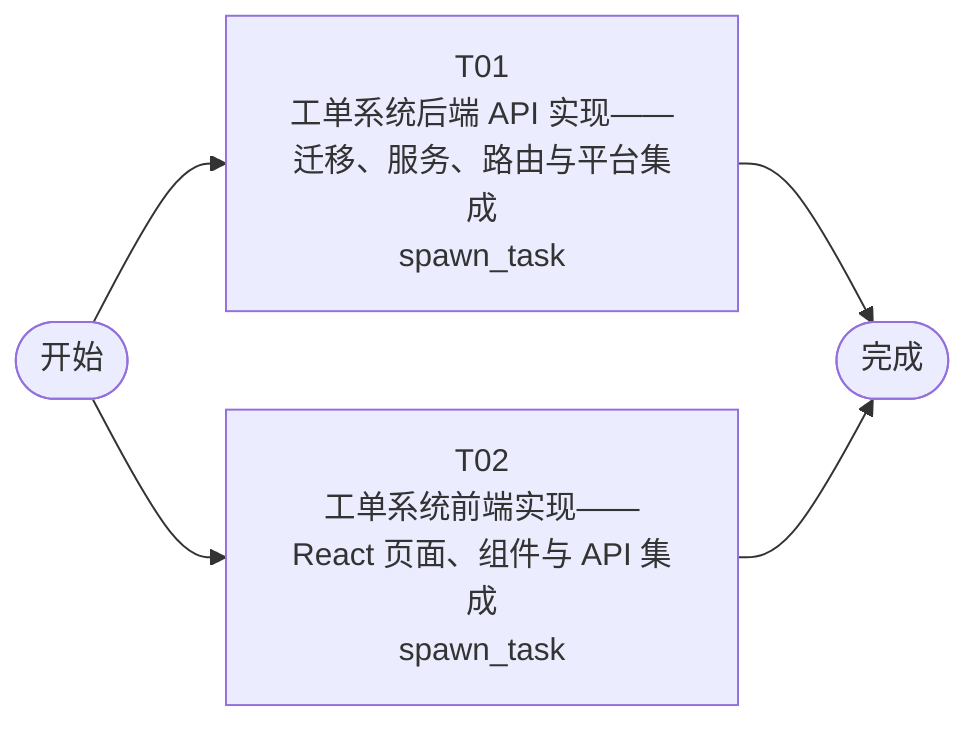

# 开发任务编排

<!-- sourcePlanId: plan:49a01dce-12bf-40e5-bff4-75a3f7d627c4 | rendererVersion: 4 -->

## 任务

| 任务 | 一句话目标 | 执行模式 | 依赖 | 能力 |
| --- | --- | --- | --- | --- |
| T01 | 工单系统后端 API 实现——迁移、服务、路由与平台集成 | spawn_task | - | engineering.implementation |
| T02 | 工单系统前端实现——React 页面、组件与 API 集成 | spawn_task | - | engineering.implementation |

## 依赖执行图

## 任务契约

### T01

**目标**

## 目标

实现工单系统全部后端 API，覆盖技术契约中定义的所有接口。

### 范围

1. **数据库迁移**：在 `src/server/migrations/sqlite/` 新增 `0004_ticket_system.sql`，创建 companies、business_groups、business_group_members、ticket_categories、assignment_rules、tickets、ticket_replies、ticket_transfers、ticket_evaluations 表。users 表已有 company_id 字段，通过 ALTER TABLE 补充 department 列（若不存在）。

2. **平台集成**：
   - 在 `src/server/platform/bootstrap.ts` 中集成 permissionkit（syncRegistry 注册角色与权限、loadAuthorizationContext）、auditkit（createAuditKit）、emailkit（createEmailClient，从 SMTP_* 环境变量构建配置，未配置时 send 返回 skipped）。
   - 在 `src/server/platform/auth.ts` 中通过 permissionkit 的 getRoles 作为 userResolver 的 getRoles 回调，使认证后 currentUser 携带 roles 与 companyId。

3. **RBAC 权限**：注册三种角色（submitter、handler、admin）及其权限键。实现 requireRole 中间件，在受保护路由上按角色限制访问。

4. **业务路由**：在 `src/server/routes.ts` 的 registerProtectedRoutes 中实现全部技术契约接口：
   - 认证：`GET /api/auth/me`（补充返回 companyId、department、roles）
   - 工单管理：`POST /api/tickets`、`GET /api/tickets`、`GET /api/tickets/:id`、`PATCH /api/tickets/:id/status`、`POST /api/tickets/:id/replies`、`POST /api/tickets/:id/complete`
   - 工单分配：`POST /api/business-groups`、`GET /api/business-groups`、`POST /api/business-groups/:id/members`、`DELETE /api/business-groups/:id/members/:userId`、`POST /api/ticket-categories`、`GET /api/ticket-categories`、`POST /api/assignment-rules`、`GET /api/assignment-rules`
   - 工单协作：`POST /api/tickets/:id/transfer`
   - 工单处理：`GET /api/tickets/:id/submitter`、`POST /api/tickets/:id/complete`
   - 用户评价：`POST /api/tickets/:id/evaluation`、`GET /api/tickets/:id/evaluation`
   - 统计分析：`GET /api/statistics/distribution`、`GET /api/statistics/dashboard`
   - 工单工作台：`GET /api/workbench/tickets`
   - 审计日志：`GET /api/audit-logs`

5. **公司隔离**：所有工单相关查询从 token 解析当前用户 companyId 并强制注入 WHERE company_id = ? 条件。跨公司访问返回 403。

6. **审计日志**：通过 auditkit.record() 记录关键操作（ticket_create、ticket_assign、ticket_transfer、ticket_complete、ticket_cancel、ticket_evaluate），包含 actorUserId、eventType、metadata（targetTicketId 等）。

7. **邮件通知**：工单完成时通过 emailkit 向提交人邮箱发送通知。邮件发送失败不阻塞完成流程，记录到审计日志。

### 验证

- `npm run typecheck:server` 通过（无 TypeScript 错误）
- `npm run test` 通过（现有平台测试不被破坏）
- 启动服务后关键接口可响应（手动或测试验证）

### 约束

- 不修改 `src/client/` 下任何文件
- 不修改 `index.html`、`vite.config.ts`、`tailwind.config.js`、`postcss.config.js`
- 保持现有 auth/login/bootstrap 路由不变，仅扩展 auth/me 返回字段

**角色:** general-app-development-expert  \  **失败策略:** block

**需求**

- AC-01
- AC-02
- AC-03
- AC-04
- AC-05
- AC-06
- AC-07
- AC-08
- AC-09
- AC-10
- AC-11
- AC-12
- AC-13
- AC-15

**输入**

- docs/wi-t1000021/requirements.md
- docs/wi-t1000021/architecture-baseline.md
- docs/wi-t1000021/technical-contract.md

**产物**

- app/ticket-system/src/server/
- app/ticket-system/src/server/migrations/sqlite/

**可写范围**

- app/ticket-system/src/server/
- app/ticket-system/src/server/migrations/sqlite/
- app/ticket-system/package.json
- app/ticket-system/tsconfig.json
- app/ticket-system/tsconfig.server.json
- app/ticket-system/tsconfig.client.json

**阻塞码**

- （无）

### T02

**目标**

## 目标

实现工单系统全部前端界面，基于技术契约定义的 API 接口构建完整的用户交互体验。

### 范围

1. **应用导航与布局**：
   - 重写 `src/client/App.tsx`，从当前用户管理首页改为工单系统主壳：左侧导航（工单工作台、工单管理、统计分析、业务组管理、分配规则、操作日志）+ 顶部上下文栏（公司名称、用户信息、登出）。
   - 保持登录/引导/密码变更流程不变。

2. **工单工作台页**（`src/client/pages/WorkbenchPage.tsx`）：
   - 调用 `GET /api/workbench/tickets` 获取待处理工单列表
   - 支持按公司筛选、优先级筛选、分类筛选、关键词搜索、排序
   - 分页展示

3. **工单管理页**（`src/client/pages/TicketsPage.tsx`）：
   - 调用 `GET /api/tickets` 获取工单列表，支持筛选/搜索/排序/公司筛选
   - 左侧列表 + 右侧详情的分栏布局（split-master-detail）
   - 工单详情显示完整信息 + 回复列表
   - 创建工单表单（主题、描述、分类、优先级 P0-P4）
   - 添加回复
   - 完成工单操作
   - 取消工单操作
   - 转派工单操作
   - 查看提交人完整信息（姓名、公司、部门、历史工单）
   - 满意度评价

4. **统计分析页**（`src/client/pages/StatisticsPage.tsx`）：
   - 按公司/部门维度统计工单分布（`GET /api/statistics/distribution`）
   - 仪表盘展示运营指标（`GET /api/statistics/dashboard`）：工单量、平均响应时间、满意度、热点问题、状态分布

5. **业务组管理页**（`src/client/pages/BusinessGroupsPage.tsx`）：
   - 创建业务组、查看业务组列表含成员（`POST/GET /api/business-groups`）
   - 添加/移除成员
   - 创建问题分类（`POST/GET /api/ticket-categories`）

6. **分配规则页**（`src/client/pages/AssignmentRulesPage.tsx`）：
   - 配置分类→业务组自动分配规则（`POST/GET /api/assignment-rules`）

7. **操作日志页**（`src/client/pages/AuditLogsPage.tsx`）：
   - 查询操作日志（`GET /api/audit-logs`），支持按工单ID、操作类型筛选

8. **视觉风格**：Modern SaaS 风格，使用现有 Tailwind + CSS 变量。状态色映射：创建（蓝灰）、待分配（琥珀）、待处理（蓝）、完成（绿）、取消（灰）。最小宽度 1024px 桌面布局。

### 验证

- `npm run typecheck:client` 通过（无 TypeScript 错误）
- `npm run build:client` 通过（Vite 构建成功）

### 约束

- 不修改 `src/server/` 下任何文件
- 不修改 `package.json`（不新增依赖）
- 不修改 `tsconfig.json`、`tsconfig.server.json`
- 前端使用技术契约中定义的类型和接口行为，不臆造 API 行为

**角色:** general-app-development-expert  \  **失败策略:** block

**需求**

- AC-01
- AC-02
- AC-03
- AC-04
- AC-05
- AC-06
- AC-07
- AC-08
- AC-09
- AC-10
- AC-11
- AC-12
- AC-13
- AC-14
- AC-15

**输入**

- docs/wi-t1000021/requirements.md
- docs/wi-t1000021/architecture-baseline.md
- docs/wi-t1000021/technical-contract.md

**产物**

- app/ticket-system/src/client/

**可写范围**

- app/ticket-system/src/client/
- app/ticket-system/index.html
- app/ticket-system/vite.config.ts
- app/ticket-system/tailwind.config.js
- app/ticket-system/postcss.config.js

**阻塞码**

- （无）
