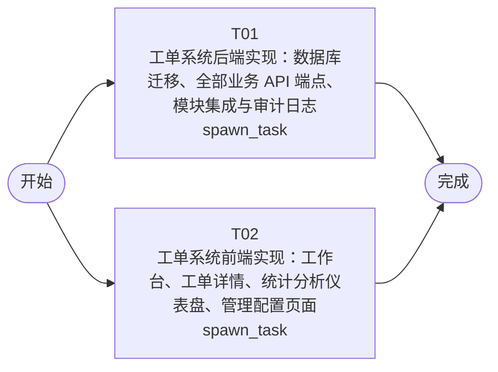

# 开发任务编排

<!-- sourcePlanId: plan:b6ca8016-72cd-4875-895e-d9b39d51f8e8 | rendererVersion: 4 -->

## 任务

| 任务 | 一句话目标 | 执行模式 | 依赖 | 能力 |
| --- | --- | --- | --- | --- |
| T01 | 工单系统后端实现：数据库迁移、全部业务 API 端点、模块集成与审计日志 | spawn_task | - | engineering.implementation |
| T02 | 工单系统前端实现：工作台、工单详情、统计分析仪表盘、管理配置页面 | spawn_task | - | engineering.implementation |

## 依赖执行图

## 任务契约

### T01

**目标**

## 后端实现目标

基于已批准的技术契约 (`docs/wi-t1000022/technical-contract.md`) 实现工单系统全部后端业务逻辑。

### 实现范围

1. **数据库迁移**：在 `src/server/migrations/sqlite/` 新增业务表迁移文件
   - `companies` 表（公司信息）
   - `business_groups` / `business_group_members` / `assignment_rules` 表（工单分配）
   - `tickets` / `ticket_replies` / `ticket_transfers` / `ticket_evaluations` 表（工单核心）
   - 扩展 `users` 表增加 `department` 字段（已有 `company_id`）

2. **API 端点实现**：在 `src/server/routes.ts` 注册全部技术契约定义的端点
   - 认证已有（login/me），需调整 `auth/me` 返回 `companyId`、`department`、`role`
   - 工单管理：`POST/GET/PATCH /api/tickets`、`GET /api/tickets/:id`、`POST /api/tickets/:id/replies`
   - 工单分配：`POST/GET /api/business-groups`、`PUT /api/business-groups/:id/members`、`POST/GET /api/assignment-rules`
   - 工单协作：`POST /api/tickets/:id/transfer`
   - 工单处理：`GET /api/tickets/:id/submitter`、`POST /api/tickets/:id/complete`
   - 用户评价：`POST/GET /api/tickets/:id/evaluation`
   - 统计分析：`GET /api/statistics/distribution`、`GET /api/statistics/dashboard`
   - 工单工作台：`GET /api/workbench/tickets`
   - 操作日志：`GET /api/tickets/:id/logs`

3. **模块集成**
   - `permissionkit`：在 `src/server/migrations/sqlite/0002_platform_permissions.sql` 注册角色（submitter/handler/admin）并实现权限检查中间件
   - `auditkit`：在各业务操作后通过 `auditKit.record` 写入审计事件
   - `emailkit`：在工单完成时调用 SMTP 发送通知邮件到提交人邮箱，发送失败降级处理

4. **公司隔离**：服务层中间件统一按当前用户 `company_id` 过滤

5. **共享类型**：在 `src/shared/` 定义前后端共用的枚举常量（状态、优先级）和 API 类型契约

### 验证

- `npm run typecheck:server` — 服务端类型检查通过
- `npm run test` — 现有平台测试与新增业务测试通过
- 全量 `npm run build` — 类型检查与客户端构建通过

**角色:** general-app-development-expert  \  **失败策略:** block

**需求**

- AC-01
- AC-02
- AC-03
- AC-04
- AC-05
- AC-06
- AC-07
- AC-08
- AC-09
- AC-10
- AC-11
- AC-12
- AC-13

**输入**

- docs/wi-t1000022/requirements.md
- docs/wi-t1000022/architecture-baseline.md
- docs/wi-t1000022/technical-contract.md

**产物**

- app/ticket-system/src/server/routes.ts
- app/ticket-system/src/server/migrations/sqlite/
- app/ticket-system/src/shared/

**可写范围**

- app/ticket-system/src/server/routes.ts
- app/ticket-system/src/server/migrations/sqlite/
- app/ticket-system/src/shared/
- app/ticket-system/src/server/services/
- app/ticket-system/src/server/migrations/sqlite/0004_ticket_companies.sql
- app/ticket-system/src/server/migrations/sqlite/0005_ticket_business.sql
- app/ticket-system/src/server/migrations/sqlite/0006_ticket_core.sql
- app/ticket-system/src/server/platform/permissions.ts
- app/ticket-system/src/server/platform/email.ts
- app/ticket-system/src/server/platform/audit.ts
- app/ticket-system/src/shared/types.ts
- app/ticket-system/src/shared/enums.ts

**阻塞码**

- （无）

### T02

**目标**

## 前端实现目标

基于已批准的技术契约 (`docs/wi-t1000022/technical-contract.md`) 和设计基线 (`docs/wi-t1000022/architecture-baseline.md`) 实现工单系统全部前端页面。

### 实现范围

1. **应用壳与导航**：重构 `src/client/App.tsx`，实现左侧导航栏 + 顶部上下文栏 + 主工作区布局
   - 导航项：工单工作台、统计分析、管理配置
   - 保留现有登录/认证流程

2. **工单工作台页面**（`split-master-detail` 布局）
   - 待处理工单列表，支持筛选（状态/优先级/分类）、搜索（主题/描述）、排序（创建时间/优先级）、按公司筛选
   - 选中工单后右侧面板展示工单详情（主题、描述、分类、优先级、状态、提交人信息）
   - 回复流：多轮回复列表 + 回复输入
   - 操作按钮：转派、完成、取消（按角色显示）
   - 提交人信息面板：姓名、公司、部门、历史工单
   - 满意度评价区域（工单完成后）

3. **统计分析页面**（`command-command-dashboard` 布局）
   - 工单分布：按公司/部门维度切换展示
   - 运营指标仪表盘：工单量、平均响应时间、满意度、热点问题分类

4. **管理配置页面**
   - 业务组管理：创建业务组、设置成员
   - 分配规则配置：创建分类→业务组规则

5. **API 客户端**：在 `src/client/platform/api-client.ts` 基础上实现业务 API 调用封装

6. **全局状态**：加载态骨架屏、空态引导、错误态 toast、成功态 toast

### 验证

- `npm run typecheck:client` — 客户端类型检查通过
- `npm run build:client` — Vite 构建通过
- 全量 `npm run build` — 完整类型检查与构建通过

**角色:** general-app-development-expert  \  **失败策略:** block

**需求**

- AC-01
- AC-02
- AC-03
- AC-04
- AC-05
- AC-06
- AC-07
- AC-08
- AC-09
- AC-10
- AC-11
- AC-12
- AC-13

**输入**

- docs/wi-t1000022/requirements.md
- docs/wi-t1000022/architecture-baseline.md
- docs/wi-t1000022/technical-contract.md

**产物**

- app/ticket-system/src/client/App.tsx
- app/ticket-system/src/client/pages/
- app/ticket-system/src/client/components/

**可写范围**

- app/ticket-system/src/client/App.tsx
- app/ticket-system/src/client/pages/
- app/ticket-system/src/client/components/
- app/ticket-system/src/client/pages/Workbench.tsx
- app/ticket-system/src/client/pages/Statistics.tsx
- app/ticket-system/src/client/pages/AdminConfig.tsx
- app/ticket-system/src/client/components/TicketDetail.tsx
- app/ticket-system/src/client/components/TicketList.tsx
- app/ticket-system/src/client/components/SubmitterInfo.tsx
- app/ticket-system/src/client/components/ReplyStream.tsx
- app/ticket-system/src/client/components/EvaluationPanel.tsx
- app/ticket-system/src/client/hooks/useTickets.ts
- app/ticket-system/src/client/api/ticket-api.ts

**阻塞码**

- （无）
