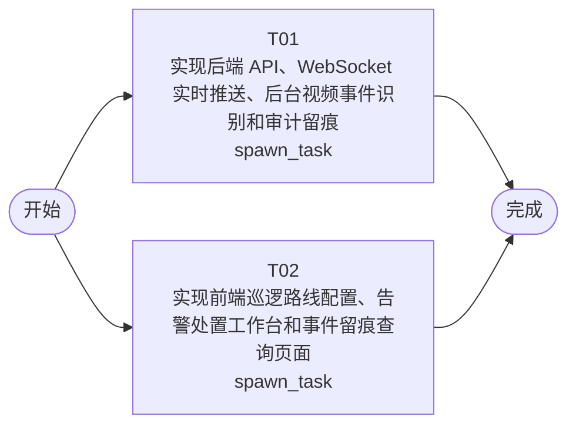

# 开发任务编排

<!-- sourcePlanId: plan:e3d63dfb-6e41-4031-a4f4-27bbe9db1e2d | rendererVersion: 4 -->

## 任务

| 任务 | 一句话目标 | 执行模式 | 依赖 | 能力 |
| --- | --- | --- | --- | --- |
| T01 | 实现后端 API、WebSocket 实时推送、后台视频事件识别和审计留痕 | spawn_task | - | engineering.implementation |
| T02 | 实现前端巡逻路线配置、告警处置工作台和事件留痕查询页面 | spawn_task | - | engineering.implementation |

## 依赖执行图

## 任务契约

### T01

**目标**

## 后端实现

实现巡逻机器人告警系统的完整后端，覆盖全部 5 个验收标准的后端贡献。

### 业务模块

- **巡逻路线管理**：实现 `GET/POST/PUT/DELETE /api/patrol-routes` 全套 CRUD 接口，校验 name 非空和 waypoints 至少 1 个
- **视频事件识别**：后台定时任务（15 秒间隔），模拟巡逻视频分析，自动为已配置路线生成随机类型的视频事件
- **告警管理**：实现 `GET /api/alerts`（含 status 筛选，冗余 eventType/location/routeName）、`GET /api/alerts/:id`（含关联视频事件和路线详情）、`PATCH /api/alerts/:id/handle`（处置告警，含 409 状态冲突和 400 参数校验）
- **实时推送**：实现 `WS /ws/alerts` WebSocket 端点，告警生成时推送 `alert:new` 消息给所有已连接客户端
- **事件留痕**：在 bootstrap.ts 中集成 auditkit，在视频事件生成（video_event_detected）、告警创建（alert_created）、告警处置（alert_handled）三个节点写入审计记录；实现 `GET /api/audit-trail` 和 `GET /api/audit-trail/:id` 查询接口

### 数据层

- 创建迁移文件 `0001_patrol_routes.sql`（patrol_routes 表）和 `0002_video_events_alerts.sql`（video_events 和 alerts 表）
- 在 `src/server/platform/bootstrap.ts` 中集成 `createAuditKit(db)`，返回 auditKit 实例
- 后端序列化响应时统一 snake_case → camelCase 转换

### 共享类型

- 在 `src/shared/` 下创建平台无关的类型定义（PatrolRoute、VideoEvent、Alert、AuditTrail 等），供后端使用

### 关键文件

- 修改 `src/server/index.ts` 添加 WebSocket upgrade
- 修改 `src/server/routes.ts` 注册全部业务路由
- 修改 `src/server/platform/bootstrap.ts` 集成 auditkit
- 新建 repositories、services、websocket 等后端模块文件
- 修改 `vite.config.ts` 添加 `/ws` WebSocket 代理（dev 模式）

### 跨任务 AC 贡献

- AC-01：提供路线 CRUD API
- AC-02：后台事件识别 + 自动生成告警（后端独立完成）
- AC-03：WebSocket 实时推送告警
- AC-04：告警处置 API（含状态冲突检查）
- AC-05：auditkit 审计记录 + 留痕查询 API（后端独立完成）

### 后续 QA owner

验证阶段负责 E2E 全流程验收（路线配置→事件识别→告警推送→处置→留痕查询）

### 验证

- `npm run typecheck:server` 通过
- `npm test` 通过

**角色:** general-app-development-expert  \  **失败策略:** block

**需求**

- AC-01
- AC-02
- AC-03
- AC-04
- AC-05

**输入**

- docs/wi-t1000023/requirements.md
- docs/wi-t1000023/architecture-baseline.md
- docs/wi-t1000023/technical-contract.md

**产物**

- app/robotwarning/src/server/
- app/robotwarning/src/shared/

**可写范围**

- app/robotwarning/src/server/
- app/robotwarning/src/shared/
- app/robotwarning/vite.config.ts

**阻塞码**

- （无）

### T02

**目标**

## 前端实现

实现巡逻机器人告警系统的完整前端 SPA，覆盖 AC-01、AC-03、AC-04、AC-05 的前端贡献。使用技术契约中定义的接口类型，不臆造 API 行为。

### 应用壳与导航

- 左侧导航栏：巡逻路线、告警处置、事件留痕三个区域
- 顶部上下文栏：显示当前区域名称和未处置告警计数
- 使用 react-router-dom 实现页面路由

### 巡逻路线配置页（AC-01 前端贡献）

- 路线列表表格：展示已配置路线，支持点击查看详情
- 创建/编辑表单：名称输入 + 路径点序列编辑器（位置名称、纬度、经度）
- 详情页：展示路线名称和路径点信息
- 删除操作：带确认提示，防止误删

### 告警处置工作台（AC-03、AC-04 前端贡献）

- split-master-detail 布局：左侧告警列表，右侧告警详情
- 未处置告警列表：显示告警时间、事件类型、关联路线/位置
- 告警详情：含关联视频事件信息和视频片段引用
- 处置表单：处置人姓名、处置结果（resolved/escalated/false-alarm）、处置说明
- 处置成功后告警状态更新为已处置，可在历史记录中查看

### 实时告警推送（AC-03 前端贡献）

- WebSocket 客户端：连接 `/ws/alerts`，发送 `alert:subscribe` 订阅消息
- 收到 `alert:new` 后更新未处置告警列表和顶部计数
- 断线自动重连
- 告警通知淡入动效

### 事件留痕查询页（AC-05 前端贡献）

- 按时间范围（startTime/endTime）和事件类型（video_event_detected/alert_created/alert_handled）检索
- 留痕记录列表：显示事件类型、时间戳、关联实体 ID、摘要
- 详情查看：展示完整 details 信息
- 留痕记录不可编辑或删除（只读展示）

### 设计基线

- Tailwind CSS，Modern SaaS 视觉风格
- 柔和中性色背景、细边界、少阴影、中等圆角
- 主色蓝色系，状态色：pending=琥珀，handled=绿
- 加载态（骨架/加载指示器）、空态（引导文案）、错误态（错误信息+重试）、成功态（短暂成功提示）

### 关键文件

- 修改 `src/client/App.tsx` 添加路由和导航壳
- 新建页面组件（PatrolRoutes、AlertWorkbench、AuditTrail）
- 新建 hooks（useAlerts、useWebSocket 等）
- 使用 `src/client/platform/api-client.ts` 的 `apiRequest` 函数

### 跨任务 AC 贡献

- AC-01：路线配置 UI（创建、列表、详情、删除）
- AC-03：WebSocket 客户端 + 告警通知 UI
- AC-04：告警处置 UI（详情查看、处置表单、状态更新）
- AC-05：留痕查询 UI（检索、列表、详情）

### 验证

- `npm run typecheck:client` 通过
- `npm run build:client` 通过

**角色:** general-app-development-expert  \  **失败策略:** block

**需求**

- AC-01
- AC-03
- AC-04
- AC-05

**输入**

- docs/wi-t1000023/requirements.md
- docs/wi-t1000023/architecture-baseline.md
- docs/wi-t1000023/technical-contract.md

**产物**

- app/robotwarning/src/client/

**可写范围**

- app/robotwarning/src/client/

**阻塞码**

- （无）
