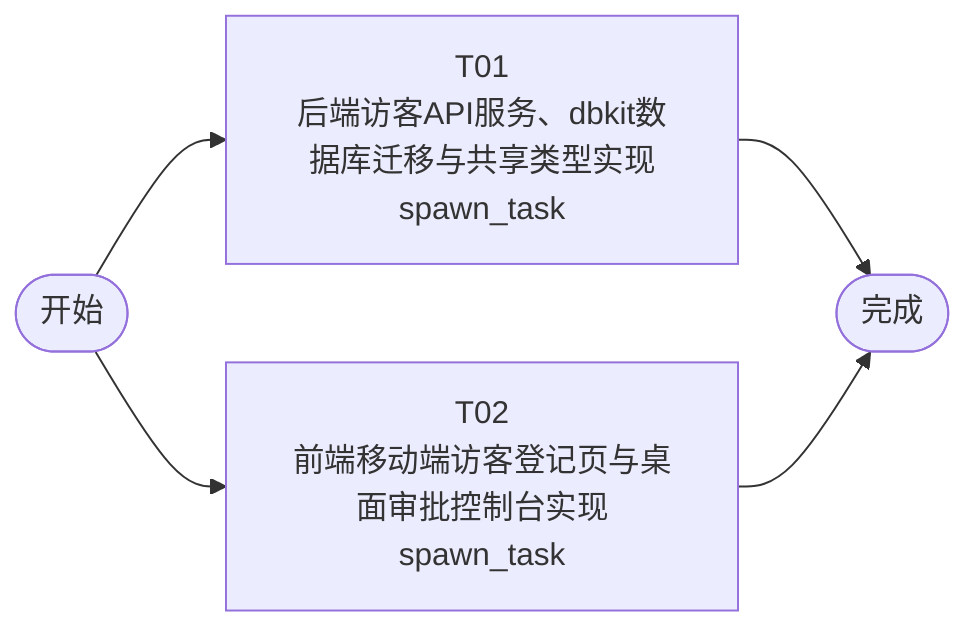

# 开发任务编排

<!-- sourcePlanId: plan:7148c8e2-39b6-4d2e-9994-6bcecd3d8d74 | rendererVersion: 4 -->

## 任务

| 任务 | 一句话目标 | 执行模式 | 依赖 | 能力 |
| --- | --- | --- | --- | --- |
| T01 | 后端访客API服务、dbkit数据库迁移与共享类型实现 | spawn_task | - | engineering.implementation |
| T02 | 前端移动端访客登记页与桌面审批控制台实现 | spawn_task | - | engineering.implementation |

## 依赖执行图

## 任务契约

### T01

**目标**

## 目标

实现访客系统的完整后端 API 服务层，包括数据库迁移、dbkit 数据持久化、四个访客 API 端点及共享 TypeScript 类型。

## 实现范围

### 数据库迁移
- 在 `src/server/migrations/sqlite/` 下创建初始迁移 SQL，建立 `visitors` 表，字段与 `technical-contract.md` 第2节数据模型一致（id, name, phone, id_card, company, visit_reason, host_person, expected_arrival_time, license_plate, status, created_at, updated_at, reviewed_at）
- status 列包含 CHECK 约束：`pending` / `approved` / `rejected`

### 共享类型（src/shared/）
- 创建 `src/shared/types.ts`，定义 Visitor 实体类型、VisitorStatus 联合类型、POST/PATCH 请求体类型及校验常量
- 此文件为 src/shared/ 的唯一写入产物，前端任务只读取不写入

### API 路由实现
- 在 `src/server/routes.ts` 的 `registerPublicRoutes` 中注册访客 API 路由（当前阶段无身份认证，注册为公开路由）
- 按 `technical-contract.md` 第1节实现四个端点：
  - `POST /api/visitors` — 校验必填字段，缺失返回 400 + fields 列表；成功返回 201 + 完整记录
  - `GET /api/visitors` — 支持 status 筛选、page/limit 分页，返回 {items, total, page, limit}
  - `GET /api/visitors/:id` — 返回单条详情，不存在返回 404
  - `PATCH /api/visitors/:id/status` — 校验目标状态合法性与状态流转规则（pending→approved/rejected，终态不可变更），成功返回 200 + 更新后记录
- 通过 platform.db（dbkit）执行 SQL 读写，审批状态变更使用 db.transaction 确保事务完整性
- 错误响应格式遵循 technical-contract.md（非全局 error handler 的 {error:{code,message}} 格式）

## 验证
- 运行 `npm run typecheck:server`（server 层 TypeScript 类型检查通过）
- 运行 `npm test`（现有平台测试 + 可选的访客 API 测试通过）
- 确认迁移在干净数据库上可正确执行

**角色:** general-app-development-expert  \  **失败策略:** block

**需求**

- AC-01
- AC-02
- AC-03
- AC-04

**输入**

- docs/wi-t1000026/requirements.md
- docs/wi-t1000026/architecture-baseline.md
- docs/wi-t1000026/technical-contract.md

**产物**

- app/jlgguest/src/server/routes.ts

**可写范围**

- app/jlgguest/src/server/routes.ts
- app/jlgguest/src/server/migrations/sqlite/001-create-visitors-table.sql
- app/jlgguest/src/shared/types.ts

**完整写入路径**

- app/jlgguest/src/server/routes.ts
- app/jlgguest/src/server/migrations/sqlite/001-create-visitors-table.sql
- app/jlgguest/src/shared/types.ts

**阻塞码**

- （无）

### T02

**目标**

## 目标

实现访客系统的完整前端界面，包含移动端访客登记页和桌面审批控制台，基于 `technical-contract.md` 的 API 契约进行集成。

## 实现范围

### 路由与应用壳
- 在 `src/client/main.tsx` 中添加 BrowserRouter
- 在 `src/client/App.tsx` 中配置路由：`/register`（访客登记页）和 `/admin`（审批控制台），根路径重定向到 `/register`

### 访客登记页（/register）
- 创建移动端优化的单列表单页面
- 表单字段与 `technical-contract.md` POST 请求体一致：姓名、手机号、身份证号、公司、访问事由、被访人、预计到访时间、车牌号（选填）
- 必填字段为空时阻止提交并提示对应字段（前端校验）
- 提交调用 `POST /api/visitors`，成功后显示登记已提交提示
- 使用 Tailwind CSS 构建移动端样式

### 审批控制台（/admin）
- 创建桌面 Web 管理界面，采用 split-master-detail 布局
- 左侧侧栏：待审核 / 已通过 / 已拒绝三个分类入口
- 主工作区：列表 + 详情协同 — 列表展示访客摘要，选中后右侧展示完整信息与审批操作
- 列表数据通过 `GET /api/visitors?status=xxx` 获取
- 详情通过 `GET /api/visitors/:id` 获取
- 审批操作调用 `PATCH /api/visitors/:id/status`，成功后刷新列表
- 使用 Ant Design 组件（Table、Descriptions、Button、Tag 等）
- 状态色：待审核-橙色、已通过-绿色、已拒绝-红色

### API 客户端集成
- 复用 `src/client/platform/api-client.ts` 的 apiRequest 函数
- 注意 api-client 自动将响应字段从 snake_case 转为 camelCase；POST 请求体需按 technical-contract 的 snake_case 字段名发送
- 如需类型化请求，可从 `src/shared/types.ts` 导入共享类型（只读不写）

### 依赖管理
- 在 `package.json` 中添加 `antd` 和 `@ant-design/icons` 依赖并执行 `npm install`
- 本任务为 package.json 的唯一写入 owner

## 验证
- 运行 `npm run typecheck:client`（client 层 TypeScript 类型检查通过）
- 运行 `npm run build:client`（Vite 构建成功）
- 确认登记页表单校验逻辑覆盖所有必填字段

**角色:** general-app-development-expert  \  **失败策略:** block

**需求**

- AC-01
- AC-02
- AC-04

**输入**

- docs/wi-t1000026/requirements.md
- docs/wi-t1000026/architecture-baseline.md
- docs/wi-t1000026/technical-contract.md

**产物**

- app/jlgguest/src/client/App.tsx

**可写范围**

- app/jlgguest/src/client/App.tsx
- app/jlgguest/package.json
- app/jlgguest/src/client/main.tsx
- app/jlgguest/src/client/platform/api-client.ts
- app/jlgguest/src/client/index.css
- app/jlgguest/index.html
- app/jlgguest/tailwind.config.js
- app/jlgguest/src/client/pages/
- app/jlgguest/src/client/components/

**阻塞码**

- （无）
