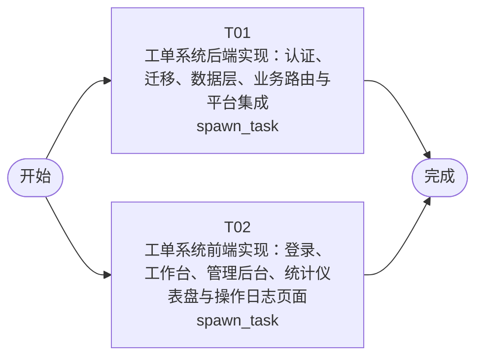

# 开发任务编排

<!-- sourcePlanId: plan:b32fa4bc-ceb3-4fb2-85f2-629d43c78ec0 | rendererVersion: 4 -->

## 任务

| 任务 | 一句话目标 | 执行模式 | 依赖 | 能力 |
| --- | --- | --- | --- | --- |
| T01 | 工单系统后端实现：认证、迁移、数据层、业务路由与平台集成 | spawn_task | - | engineering.implementation |
| T02 | 工单系统前端实现：登录、工作台、管理后台、统计仪表盘与操作日志页面 | spawn_task | - | engineering.implementation |

## 依赖执行图

## 任务契约

### T01

**目标**

## 目标

基于批准的技术契约，实现工单系统完整后端，包括认证边界、数据库迁移、数据访问层、业务服务层和全部 API 路由。

### 实现范围

1. **认证与用户管理（项目内实现）**
   - 实现 `src/server/platform/auth.ts` 中的 Bearer token 认证中间件（JWT）
   - 密码使用 bcrypt 哈希存储
   - 用户表（users）、公司表（companies）迁移
   - `platform.auth.userStore`、`platform.auth.hashPassword`、`platform.auth.userResolver` 供 QA fixture 使用
   - POST /api/auth/login 登录端点

2. **数据库迁移（src/server/migrations/sqlite/）**
   - 0004_tickets.sql: tickets、ticket_replies 表
   - 0005_business_groups.sql: business_groups、business_group_members、auto_assignment_rules、ticket_transfers 表
   - 0006_evaluations.sql: ticket_evaluations 表
   - 在 bootstrap.ts 中集成 permissionkit、auditkit、emailkit

3. **数据访问与业务逻辑（src/server/services/）**
   - 工单核心：CRUD、状态机（created→pending_assignment→pending_processing→completed/cancelled）、自动分配触发、公司隔离
   - 多轮回复
   - 业务组与成员管理
   - 分类自动分配规则
   - 工单转派
   - 提交人完整信息（含历史工单）
   - 工单完成 + emailkit 邮件通知（异步，失败仅记日志）
   - 用户满意度评价
   - 统计分析（分布统计 + 仪表盘指标）
   - 审计日志（auditkit 记录关键操作）

4. **API 路由（src/server/routes.ts）**
   - 注册全部技术契约定义的端点
   - permissionkit RBAC 中间件校验角色
   - 公司隔离自动注入
   - INTEGER 主键序列化为 string

5. **共享类型（src/shared/）**
   - API 契约类型定义（请求/响应 DTO、枚举、常量）
   - 供前端引用

### 验证

- `npm run typecheck:server` 通过
- `npm test` 通过（含平台测试和 dbkit 测试）
- 工单 CRUD、状态流转、公司隔离、自动分配、转派、完成+邮件、评价、统计、审计日志等 API 端点可通过真实 HTTP 请求验证

**角色:** general-app-development-expert  \  **失败策略:** block

**需求**

- AC-01
- AC-02
- AC-03
- AC-04
- AC-05
- AC-06
- AC-07
- AC-08
- AC-09
- AC-10

**输入**

- docs/wi-t1000028/requirements.md
- docs/wi-t1000028/architecture-baseline.md
- docs/wi-t1000028/technical-contract.md

**产物**

- src/server/routes.ts
- src/server/platform/auth.ts
- src/server/platform/bootstrap.ts
- src/server/migrations/sqlite/
- src/shared/

**可写范围**

- src/server/routes.ts
- src/server/platform/auth.ts
- src/server/platform/bootstrap.ts
- src/server/migrations/sqlite/
- src/shared/
- src/server/services/
- src/server/migrations/sqlite/0004_tickets.sql
- src/server/migrations/sqlite/0005_business_groups.sql
- src/server/migrations/sqlite/0006_evaluations.sql

**阻塞码**

- （无）

### T02

**目标**

## 目标

基于批准的技术契约和后端 API 定义，实现工单系统完整前端 SPA，覆盖全部用户界面验收场景。

### 实现范围

1. **认证与路由（src/client/）**
   - 登录页面（邮箱+密码）
   - Bearer token 存储与请求注入（扩展 api-client.ts）
   - 认证守卫与角色路由
   - 退出登录

2. **应用壳与导航（split-master-detail 布局）**
   - 顶部上下文栏（公司名/用户信息/退出）
   - 左侧固定导航栏（工单工作台、管理后台、统计分析、操作日志）
   - Modern SaaS 视觉风格（Tailwind，蓝色主色，状态色）

3. **工单工作台（AC-09）**
   - 左侧待处理工单列表（筛选：公司/状态/分类/SLA；搜索：主题/ID；排序：创建时间/优先级）
   - 右侧工单详情面板（工单属性、回复列表、提交人信息、操作按钮）
   - 骨架屏加载、空数据提示、toast 反馈

4. **工单详情与操作**
   - 工单属性展示（ID、主题、描述、分类、SLA优先级、状态、提交人信息）
   - 多轮回复列表（时间排序）与回复输入
   - 提交人信息面板（姓名、公司、部门、历史工单）
   - 操作：分配/转派/完成/取消
   - 已完成工单显示评价入口

5. **管理后台（AC-03, AC-04）**
   - 业务组列表与成员管理（增删成员）
   - 自动分配规则配置（分类→业务组）

6. **统计分析（AC-08）**
   - 公司/部门维度工单分布统计
   - 运营仪表盘：KPI 卡片（工单量/平均响应时间/满意度）、热点问题列表

7. **操作日志（AC-10）**
   - 日志表格列表（按工单ID/操作类型/时间筛选）

8. **满意度评价（AC-07）**
   - 已完成工单评价表单（1-5 评分 + 备注）

### 验证

- `npm run typecheck:client` 通过
- `npm run build:client` 通过（Vite 构建）
- 页面可正常渲染、导航、筛选、搜索、排序、表单提交等交互功能验证

**角色:** general-app-development-expert  \  **失败策略:** block

**需求**

- AC-01
- AC-02
- AC-03
- AC-04
- AC-05
- AC-06
- AC-07
- AC-08
- AC-09
- AC-10

**输入**

- docs/wi-t1000028/requirements.md
- docs/wi-t1000028/architecture-baseline.md
- docs/wi-t1000028/technical-contract.md

**产物**

- src/client/App.tsx
- src/client/pages/
- src/client/components/
- src/client/hooks/
- src/client/platform/api-client.ts

**可写范围**

- src/client/App.tsx
- src/client/pages/
- src/client/components/
- src/client/hooks/
- src/client/platform/api-client.ts

**阻塞码**

- （无）
