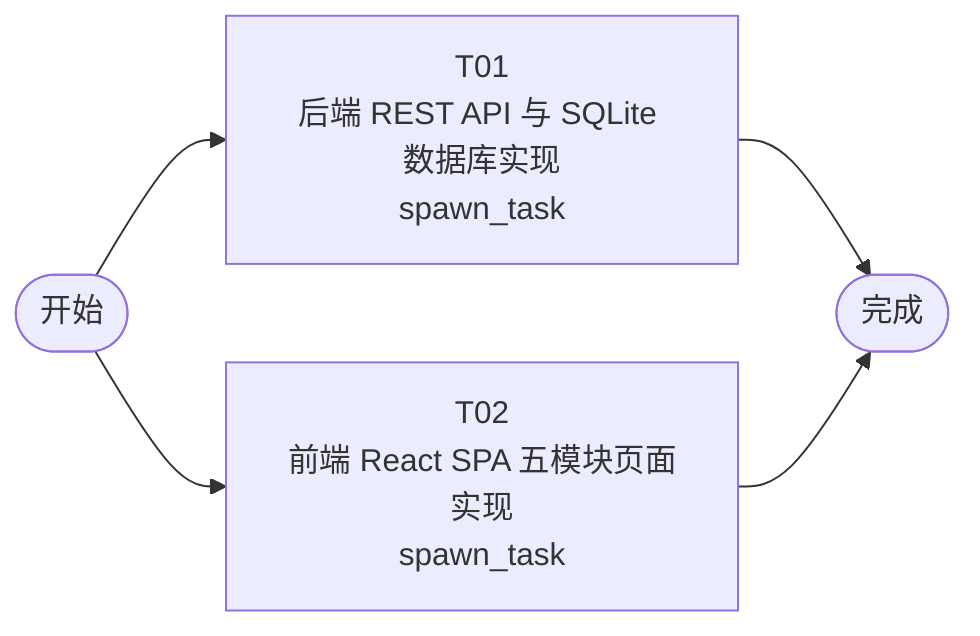

# 开发任务编排

<!-- sourcePlanId: plan:7fbbd35f-5278-418e-878e-58e1b91e8872 | rendererVersion: 4 -->

## 任务

| 任务 | 一句话目标 | 执行模式 | 依赖 | 能力 |
| --- | --- | --- | --- | --- |
| T01 | 后端 REST API 与 SQLite 数据库实现 | spawn_task | - | engineering.implementation |
| T02 | 前端 React SPA 五模块页面实现 | spawn_task | - | engineering.implementation |

## 依赖执行图

## 任务契约

### T01

**目标**

## 后端实现：Hono REST API + SQLite 数据库

### 范围

基于已批准的 technical-contract.md，实现完整的后端服务端：

- **项目脚手架**：package.json（依赖：hono、better-sqlite3、@hono/node-server、zod 等）、tsconfig.json、vite.config.ts（前端构建产物静态托管）、src/server/ 目录结构
- **数据库层**：SQLite schema 初始化迁移脚本（plots、maturity_assessments、picking_tasks、progress_reports、exception_reports 五张表）、better-sqlite3 连接与查询封装
- **7 组 API 端点**：
  1. 地块管理（GET/POST /api/plots）
  2. 成熟度评估（GET/POST /api/assessments）
  3. 采摘任务（GET/POST /api/tasks、PATCH /api/tasks/:id）
  4. 作业进度（POST/GET /api/tasks/:id/progress）
  5. 进度监控概览（GET /api/monitoring/overview）
  6. 异常报告（GET/POST /api/exceptions、PATCH /api/exceptions/:id）
  7. 产量统计（GET /api/statistics）
- **业务规则**：可采摘状态计算（最新评估等级属于接近成熟/成熟/过熟）、任务编号生成（PT-YYYYMMDD-NNN）、任务创建约束（仅可采摘地块）、累计采摘量聚合查询、任务状态流转校验、异常状态流转校验、产量统计聚合（仅已完成任务）
- **共享类型定义**：src/shared/types.ts — 前后端共用的 TypeScript 类型（Plot、Assessment、PickingTask、ProgressReport、ExceptionReport 及其列表/创建/响应变体）
- **开发启动**：npm run dev 脚本（前后端热更新），npm start 生产入口

### 验证

- TypeScript 类型检查通过（tsc --noEmit）
- 后端编译成功
- 核心 API 逻辑的单元测试或集成测试通过（如可采摘状态计算、任务编号生成、状态流转校验、累计采摘量聚合、产量统计聚合）

### 写入范围

独占：package.json、package-lock.json、tsconfig.json、vite.config.ts、src/server/、src/shared/、migrations/、scripts/

### 跨任务贡献

AC-01~AC-05 全部 API 端点与业务规则由本任务实现；前端 T02 通过契约类型消费后端 API。

**角色:** general-app-development-expert  \  **失败策略:** block

**需求**

- AC-01
- AC-02
- AC-03
- AC-04
- AC-05

**输入**

- docs/wi-t1000029/requirements.md
- docs/wi-t1000029/architecture-baseline.md
- docs/wi-t1000029/technical-contract.md

**产物**

- src/server/
- src/shared/
- migrations/
- package.json
- tsconfig.json
- vite.config.ts

**可写范围**

- src/server/
- src/shared/
- migrations/
- package.json
- tsconfig.json
- vite.config.ts
- src/server/index.ts
- src/server/db.ts
- src/server/routes/plots.ts
- src/server/routes/assessments.ts
- src/server/routes/tasks.ts
- src/server/routes/progress.ts
- src/server/routes/monitoring.ts
- src/server/routes/exceptions.ts
- src/server/routes/statistics.ts
- src/server/lib/taskNo.ts
- src/server/lib/maturity.ts
- src/shared/types.ts
- migrations/001_init.sql
- scripts/dev.ts

**阻塞码**

- （无）

### T02

**目标**

## 前端实现：React 18 + Vite + TypeScript SPA

### 范围

基于已批准的 technical-contract.md 的 API 契约，实现完整的前端 SPA：

- **项目脚手架**：index.html、src/client/ 目录结构、前端构建配置（通过 vite.config.ts 由 T01 提供）
- **应用壳**：saas-ops-console 布局 — 左侧导航栏（五个功能模块入口 + 应用标题「农业采摘管理系统」）、顶部上下文栏（当前模块标题 + 筛选区）、主工作区；绿色主色，状态色（成功/警告/危险），Lucide 图标
- **API 客户端层**：src/client/api/ — 基于 technical-contract.md 定义的前端类型（从 src/shared/types.ts 导入或本地定义契约类型），fetch 封装，支持错误提取
- **五个功能模块页面**：
  1. **成熟度识别**：地块列表 + 评估记录筛选表格、「新建评估」表单弹窗（地块选择、成熟度等级、评估时间、评估人、备注）
  2. **采摘任务规划**：任务列表表格（紧急任务视觉高亮行 — 行背景/边框标识）、「创建任务」表单弹窗（可采摘地块选择、计划采摘量、作业人员、计划日期、优先级、备注）、任务状态操作
  3. **作业进度监控**：顶部 KPI 汇总卡片（各状态任务数量）、进行中任务进度列表、待处理异常提示标识
  4. **异常上报**：异常列表表格、「上报异常」表单弹窗（关联任务可选、异常类型、描述、上报人、上报时间）、状态更新操作
  5. **产量统计**：筛选条件（地块、品种、时间范围）、统计概览卡片（总采摘量、完成任务数、参与作业人员数）、地块维度产量明细表格
- **通用组件**：表格（含空态、骨架屏）、表单弹窗（含验证、loading 禁用）、Toast 提示、筛选栏
- **全局状态处理**：加载骨架屏、空数据文案、错误 Toast、成功 Toast + 列表自动刷新

### 验证

- TypeScript 类型检查通过
- Vite 前端构建成功（npm run build）
- 五个模块页面可独立渲染，使用契约类型/mock 数据

### 写入范围

独占：index.html、src/client/、src/components/、src/pages/、src/styles/、src/lib/

### 跨任务贡献

AC-01~AC-05 全部用户界面交互和渲染验证由本任务实现；后端 T01 提供 API 端点支撑。

### QA 归属

最终 E2E 集成验证（前后端联调、验收场景测试）由后续 QA 阶段负责。

**角色:** general-app-development-expert  \  **失败策略:** block

**需求**

- AC-01
- AC-02
- AC-03
- AC-04
- AC-05

**输入**

- docs/wi-t1000029/requirements.md
- docs/wi-t1000029/architecture-baseline.md
- docs/wi-t1000029/technical-contract.md

**产物**

- index.html
- src/client/
- src/components/
- src/pages/
- src/styles/
- src/lib/

**可写范围**

- index.html
- src/client/
- src/components/
- src/pages/
- src/styles/
- src/lib/
- src/client/main.tsx
- src/client/App.tsx
- src/client/api/client.ts
- src/client/api/plots.ts
- src/client/api/assessments.ts
- src/client/api/tasks.ts
- src/client/api/progress.ts
- src/client/api/monitoring.ts
- src/client/api/exceptions.ts
- src/client/api/statistics.ts
- src/client/context/ToastContext.tsx
- src/components/Layout/Sidebar.tsx
- src/components/Layout/TopBar.tsx
- src/components/Table/DataTable.tsx
- src/components/Modal/Modal.tsx
- src/components/Modal/FormModal.tsx
- src/components/Filter/FilterBar.tsx
- src/components/Toast/Toast.tsx
- src/pages/MaturityPage.tsx
- src/pages/TasksPage.tsx
- src/pages/MonitoringPage.tsx
- src/pages/ExceptionsPage.tsx
- src/pages/StatisticsPage.tsx

**阻塞码**

- （无）
