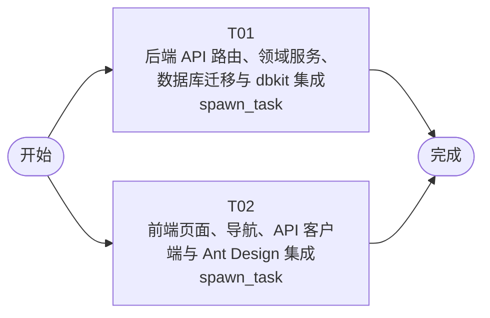

# 开发任务编排

<!-- sourcePlanId: plan:20db9d24-06be-4164-817c-63dd3db7fc20 | rendererVersion: 4 -->

## 任务

| 任务 | 一句话目标 | 执行模式 | 依赖 | 能力 |
| --- | --- | --- | --- | --- |
| T01 | 后端 API 路由、领域服务、数据库迁移与 dbkit 集成 | spawn_task | - | engineering.implementation |
| T02 | 前端页面、导航、API 客户端与 Ant Design 集成 | spawn_task | - | engineering.implementation |

## 依赖执行图

## 任务契约

### T01

**目标**

## 目标

实现园区安防系统全部后端功能：数据库 schema、API 路由和领域服务，所有业务数据通过 dbkit 持久化到 SQLite。

### 数据库层
- 创建 `src/server/migrations/sqlite/001-init.sql`，按架构基线定义 7 张表（patrol_routes, patrol_points, video_sources, events, alerts, handling_records, event_trails）及 video_sources 种子数据（3 条：园区大门、停车场、仓库通道）
- 修改 `src/server/platform/bootstrap.ts` 初始化 dbkit 并在启动时执行迁移

### API 路由
按 technical-contract.md 定义实现全部端点：
- 巡逻路线 CRUD（GET/POST/PUT/DELETE /api/patrol-routes）
- 视频源查询（GET /api/video-sources）
- 事件识别与查询（POST /api/events/recognize, GET /api/events）
- 告警查询与详情（GET /api/alerts, GET /api/alerts/:id）
- 告警处置（POST /api/alerts/:id/handling）
- 留痕查询（GET /api/trails）

### 领域服务
- 在 `src/server/services/` 下实现各模块的业务逻辑、数据校验和事务
- 事件识别在同一事务中创建事件、告警和留痕记录
- 处置操作在同一事务中创建处置记录、更新告警状态并写入留痕
- 告警状态流转：pending → handling → handled，非法转换返回 400 invalid_state_transition
- 删除巡逻路线时级联删除关联巡逻点位（ON DELETE CASCADE）

### 共享类型
- 在 `src/shared/` 下定义前后端共享的 API 类型与常量（告警状态枚举、处置操作类型、留痕操作类型）

### 路由注册与错误处理
- 修改 `src/server/routes.ts` 注册全部业务路由
- 确保 `src/server/app.ts` 错误响应格式为 `{error:{code,message}}`

### 验证
- `npm run typecheck:server` 通过
- `npm run test` 通过（含新增业务 API 测试）
- 使用隔离 DB_PATH 测试数据库验证持久化读写

**角色:** general-app-development-expert  \  **失败策略:** block

**需求**

- AC-01
- AC-02
- AC-03
- AC-04
- AC-05

**输入**

- docs/wi-t1000029/requirements.md
- docs/wi-t1000029/architecture-baseline.md
- docs/wi-t1000029/technical-contract.md

**产物**

- （无）

**可写范围**

- app/park-security/src/server/migrations/sqlite/001-init.sql
- app/park-security/src/server/routes.ts
- app/park-security/src/server/platform/bootstrap.ts
- app/park-security/src/server/app.ts
- app/park-security/src/server/index.ts
- app/park-security/src/server/routes/
- app/park-security/src/server/services/
- app/park-security/src/shared/
- app/park-security/test/

**阻塞码**

- （无）

### T02

**目标**

## 目标

实现园区安防系统全部前端页面和交互，基于 Ant Design 组件体系和 technical-contract.md 定义的 API 契约。前端使用 contract-based 类型，不发明 API 行为。

### UI 框架集成
- 修改 `package.json` 添加 antd 和 @ant-design/icons 依赖
- 修改 `tailwind.config.js` 配置内容扫描路径覆盖 pages 和 components
- 修改 `src/client/main.tsx` 挂载 Ant Design ConfigProvider
- 修改 `src/client/index.css` 集成 Tailwind 基础样式

### 应用壳与导航
- 修改 `src/client/App.tsx` 实现左侧深色侧栏导航（巡逻路线、视频事件、实时告警、处置管理、事件留痕五个入口）和右侧主工作区 split-master-detail 布局

### API 客户端
- 修改 `src/client/platform/api-client.ts` 实现 technical-contract.md 定义的全部 API 调用，基于 src/shared/ 共享类型，处理统一响应格式 `{data:...}` 和错误格式 `{error:{code,message}}`

### 业务页面
在 `src/client/pages/` 下实现 5 个页面：
- **PatrolRoutes.tsx**：路线列表表格 → 选中路线详情（含有序点位列表）→ 创建/编辑表单（支持点位增删与顺序调整）→ 删除确认
- **Events.tsx**：事件列表表格（含事件类型、视频来源、发生时间）→ 触发识别按钮（POST /api/events/recognize）→ 事件详情
- **Alerts.tsx**：告警列表（按状态筛选：待处置/处置中/已处置）→ 告警详情（含关联事件信息和处置记录）
- **Handling.tsx**：待处置告警队列 → 确认接收（状态→处置中）→ 记录处置结果并完成（状态→已处置）
- **Trails.tsx**：留痕记录列表（按操作类型筛选）→ 留痕详情

### 组件
在 `src/client/components/` 下按需提取复用组件

### 全局状态
- 加载中：Spin 或骨架屏
- 空数据：表格空态提示
- 错误：Message 错误提示
- 成功：Message 成功提示

### 验证
- `npm run typecheck:client` 通过
- `npm run build:client` 前端构建通过

**角色:** general-app-development-expert  \  **失败策略:** block

**需求**

- AC-01
- AC-03
- AC-04
- AC-05

**输入**

- docs/wi-t1000029/requirements.md
- docs/wi-t1000029/architecture-baseline.md
- docs/wi-t1000029/technical-contract.md

**产物**

- （无）

**可写范围**

- app/park-security/package.json
- app/park-security/tailwind.config.js
- app/park-security/src/client/main.tsx
- app/park-security/src/client/App.tsx
- app/park-security/src/client/platform/api-client.ts
- app/park-security/src/client/index.css
- app/park-security/src/client/pages/
- app/park-security/src/client/components/

**阻塞码**

- （无）
