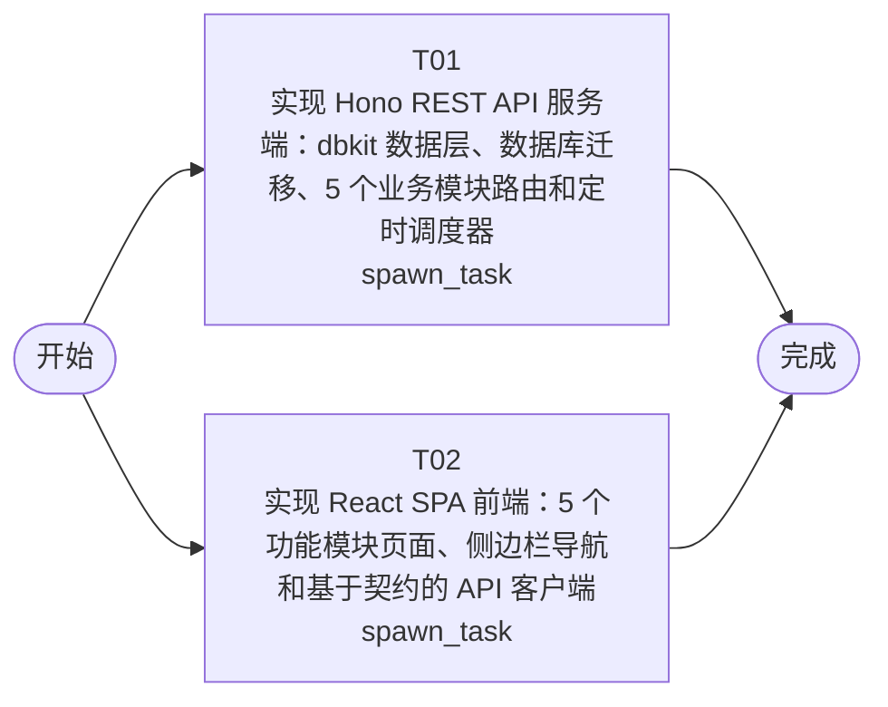

# 开发任务编排

<!-- sourcePlanId: plan:ad25fe15-fcda-4094-b2bb-e30086c4a3d7 | rendererVersion: 4 -->

## 任务

| 任务 | 一句话目标 | 执行模式 | 依赖 | 能力 |
| --- | --- | --- | --- | --- |
| T01 | 实现 Hono REST API 服务端：dbkit 数据层、数据库迁移、5 个业务模块路由和定时调度器 | spawn_task | - | engineering.implementation |
| T02 | 实现 React SPA 前端：5 个功能模块页面、侧边栏导航和基于契约的 API 客户端 | spawn_task | - | engineering.implementation |

## 依赖执行图

## 任务契约

### T01

**目标**

### 后端实现

基于技术契约实现完整后端服务：

- **数据层**：dbkit 初始化、SQLite 迁移脚本（cleaning_areas、scheduled_jobs、task_instances、obstacles、supply_items、supply_alerts 共 6 张表）、数据库连接管理
- **REST API 路由**：
  - 清洁区域 CRUD（GET/POST/PUT/DELETE /api/areas）
  - 定时作业管理（GET/POST/PUT /api/jobs、GET /api/task-instances）
  - 障碍处理（GET/POST /api/obstacles、PUT /api/obstacles/:id/resolve）
  - 耗材管理与提醒（GET/POST/PUT/DELETE /api/supplies、GET /api/supply-alerts、PUT /api/supply-alerts/:id/resolve）
  - 作业质量报告（GET /api/reports/quality）
- **定时调度器**：每 60 秒扫描活跃作业，匹配调度周期和起始时间，生成当日任务实例（按 job_id + scheduled_date 去重）
- **库存自动检测**：耗材创建和更新时检查 quantity < threshold，自动创建或消除 supply_alerts
- **数据映射**：schedule_days 的 JSON 序列化/反序列化、active 的 INTEGER 与 boolean 转换、low_stock 计算字段
- **UUID 生成**：所有主键由服务端 crypto.randomUUID() 生成

### 写入归属

- 独占：src/server.js、src/server/、migrations/、package.json、vite.config.js

### 验证

- npm start 可启动 Hono 服务（端口 3000）
- 通过 typecheck 和构建
- 后端逻辑通过单元测试

**角色:** general-app-development-expert  \  **失败策略:** block

**需求**

- AC-01
- AC-02
- AC-03
- AC-04
- AC-05

**输入**

- docs/wi-t1000030/technical-contract.md
- docs/wi-t1000030/architecture-baseline.md
- docs/wi-t1000030/requirements.md

**产物**

- src/server.js
- src/server/
- migrations/

**可写范围**

- src/server.js
- src/server/
- migrations/
- package.json
- vite.config.js

**阻塞码**

- （无）

### T02

**目标**

### 前端实现

基于技术契约的 API 定义构建 React 18 + Vite SPA，视觉基线为 SaaS 运营管理台（saas-ops-console）：

- **应用壳**：左侧侧边栏导航（清洁区域、定时作业、任务实例、障碍处理、耗材管理、质量报告），顶部上下文栏显示当前模块标题与关键操作按钮
- **清洁区域页面**：区域列表表格 + 创建/编辑/删除表单（区域名称、位置描述、清洁要求）
- **定时作业页面**：作业列表（含关联区域名称）+ 创建表单（区域选择、执行人、调度周期 daily/weekly、schedule_days、起始时间）+ 任务实例列表查看
- **任务实例页面**：任务实例列表（含状态、执行人、区域名称），可按作业和状态筛选
- **障碍处理页面**：待处理障碍列表 + 上报表单（关联任务实例、障碍描述）+ 标记处理表单（处理方式、处理结果）
- **耗材管理页面**：耗材列表（含 low_stock 状态）+ 库存管理表单 + 库存不足提醒列表
- **质量报告页面**：区域和时间范围筛选 + 报告展示（作业完成率、障碍统计、耗材消耗汇总）
- **API 客户端**：基于技术契约定义的接口和类型，不发明 API 行为
- **全局状态**：加载骨架屏、空状态提示与创建入口、操作成功/错误反馈

### 写入归属

- 独占：src/client/、src/index.html

### 验证

- 通过 typecheck 和 Vite 构建
- 页面组件符合 SaaS 运营管理台视觉基线

**角色:** general-app-development-expert  \  **失败策略:** block

**需求**

- AC-01
- AC-02
- AC-03
- AC-04
- AC-05

**输入**

- docs/wi-t1000030/technical-contract.md
- docs/wi-t1000030/architecture-baseline.md
- docs/wi-t1000030/requirements.md

**产物**

- src/client/

**可写范围**

- src/client/
- src/index.html

**阻塞码**

- （无）
