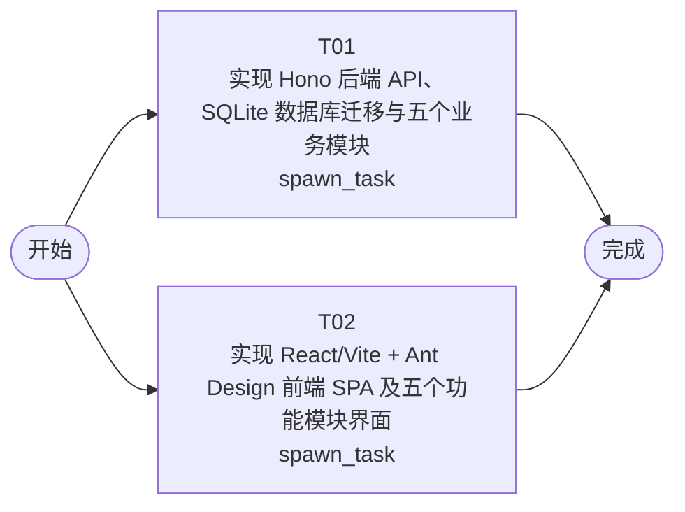

# 开发任务编排

<!-- sourcePlanId: plan:641b9289-80fd-48ee-9ed5-231a3c490372 | rendererVersion: 4 -->

## 任务

| 任务 | 一句话目标 | 执行模式 | 依赖 | 能力 |
| --- | --- | --- | --- | --- |
| T01 | 实现 Hono 后端 API、SQLite 数据库迁移与五个业务模块 | spawn_task | - | engineering.implementation |
| T02 | 实现 React/Vite + Ant Design 前端 SPA 及五个功能模块界面 | spawn_task | - | engineering.implementation |

## 依赖执行图

## 任务契约

### T01

**目标**

## 目标

基于已批准的技术契约，实现设备管理平台的完整后端。

### 数据库层

- 在 `src/server/platform/bootstrap.ts` 中初始化 SQLite 数据库实例（dbkit），创建 DB_PATH 父目录，执行版本化迁移
- 在 `src/server/migrations/sqlite/001_initial_schema.sql` 创建 `devices`、`fault_diagnoses`、`upgrade_records`、`repair_orders` 四张表，列定义与约束严格遵循架构基线第 3 节数据模型，启用 `PRAGMA foreign_keys = ON`

### 共享类型

- 在 `src/shared/types.ts` 定义所有实体和 API 的 TypeScript 类型：Device、FaultDiagnosis、UpgradeRecord、RepairOrder、HistoryEvent、HistoryResponse 及各 API 请求/响应类型

### API 路由

在 `src/server/routes.ts` 注册以下路由，每条路由的请求参数、响应体和错误码严格遵循技术契约第 2 节：

- **设备管理**：GET /api/devices、POST /api/devices、GET /api/devices/:id、PATCH /api/devices/:id/status
- **故障诊断**：GET /api/devices/:deviceId/faults、POST /api/devices/:deviceId/faults
- **远程升级**：GET /api/devices/:deviceId/upgrades、POST /api/devices/:deviceId/upgrades
- **维修工单**：GET /api/devices/:deviceId/work-orders、POST /api/devices/:deviceId/work-orders
- **设备履历**：GET /api/devices/:deviceId/history（跨表聚合 fault_diagnoses、upgrade_records、repair_orders 及 devices 状态变更，按 timestamp 降序返回统一格式事件列表）

### 服务组装

- `src/server/app.ts`：全局中间件、API 错误处理（返回 `{error:{code,message}}`）、生产环境 SPA fallback
- `src/server/index.ts`：初始化资源、组装 Hono app、启动 HTTP（PORT 默认 3000）

### 依赖管理

- 在 `package.json` 中添加 `antd` 和 `@ant-design/icons` 到 dependencies（供前端任务使用）

## 验证

- `npm run typecheck:server` 通过
- `npm test` 通过（含 dbkit 启动、迁移执行和 API 行为验证）

## 写入范围

- 独占：`app/jlgrobot/src/server/**`、`app/jlgrobot/src/shared/**`、`app/jlgrobot/test/**`
- 独占配置文件：`app/jlgrobot/package.json`、`app/jlgrobot/tsconfig.json`、`app/jlgrobot/tsconfig.server.json`

## AC 贡献

- AC-01：设备列表/详情 API + 状态持久化到 SQLite
- AC-02：故障诊断 CRUD API + 持久化
- AC-03：远程升级 API + 升级记录持久化
- AC-04：维修工单 CRUD API + 持久化
- AC-05：设备履历聚合查询 API

**角色:** general-app-development-expert  \  **失败策略:** block

**需求**

- AC-01
- AC-02
- AC-03
- AC-04
- AC-05

**输入**

- docs/wi-t1000031/requirements.md
- docs/wi-t1000031/architecture-baseline.md
- docs/wi-t1000031/technical-contract.md

**产物**

- （无）

**可写范围**

- app/jlgrobot/package.json
- app/jlgrobot/tsconfig.json
- app/jlgrobot/tsconfig.server.json
- app/jlgrobot/test/

**阻塞码**

- （无）

### T02

**目标**

## 目标

基于已批准的技术契约，实现设备管理平台的完整前端 SPA。

### 应用布局

- 在 `src/client/App.tsx` 实现 split-master-detail 布局：左侧设备列表（含搜索/创建），右侧选中设备的详情面板，详情面板内按 Tab 切换五个功能模块
- UI 风格：Modern SaaS——深色侧栏、浅色工作区、顶部上下文栏、Ant Design 组件（Layout/Table/Tabs/Form/Tag/Modal 等）

### API 客户端

- 在 `src/client/platform/api-client.ts` 实现浏览器请求边界，统一 fetch 封装、响应规范化和 API 错误解码（`{error:{code,message}}`）

### 类型定义

- 在 `src/client/` 内基于技术契约定义前端使用的 TypeScript 类型，不依赖 src/shared/，不发明 API 行为

### 五个功能模块 Tab

每个 Tab 的交互严格对应技术契约定义的 API：

- **设备状态监测**：设备列表 Table、创建设备 Modal/Form、状态更新操作；Tag 显示设备当前状态（online/offline/running/standby/fault/unknown 对应不同颜色）
- **故障诊断**：故障记录列表 Table、创建故障诊断 Form（fault_description + diagnosis_result）
- **远程升级**：升级记录列表 Table（含 status Tag）、发起升级 Form（target_version）
- **维修工单**：工单列表 Table（含 status Tag）、创建工单 Form（content + result）
- **设备履历**：聚合展示该设备的状态、故障、升级和工单历史事件时间线（按 timestamp 降序）

### 全局状态

- 加载中（Skeleton/Table loading）、空数据（Empty）、错误（message.error）、成功（message.success）

## 验证

- `npm run typecheck:client` 通过
- `npm run build:client` 通过

## 写入范围

- 独占：`app/jlgrobot/src/client/**`
- 独占配置文件：`app/jlgrobot/index.html`、`app/jlgrobot/vite.config.ts`、`app/jlgrobot/tsconfig.client.json`

## AC 贡献

- AC-01：设备状态监测界面（列表 + 状态展示 + 状态更新）
- AC-02：故障诊断记录界面（列表 + 创建）
- AC-03：远程升级界面（记录列表 + 发起升级）
- AC-04：维修工单界面（列表 + 创建）
- AC-05：设备履历界面（聚合时间线展示）

**角色:** general-app-development-expert  \  **失败策略:** block

**需求**

- AC-01
- AC-02
- AC-03
- AC-04
- AC-05

**输入**

- docs/wi-t1000031/requirements.md
- docs/wi-t1000031/architecture-baseline.md
- docs/wi-t1000031/technical-contract.md

**产物**

- （无）

**可写范围**

- app/jlgrobot/index.html
- app/jlgrobot/vite.config.ts
- app/jlgrobot/tsconfig.client.json

**完整写入路径**

- app/jlgrobot/index.html
- app/jlgrobot/vite.config.ts
- app/jlgrobot/tsconfig.client.json

**阻塞码**

- （无）
