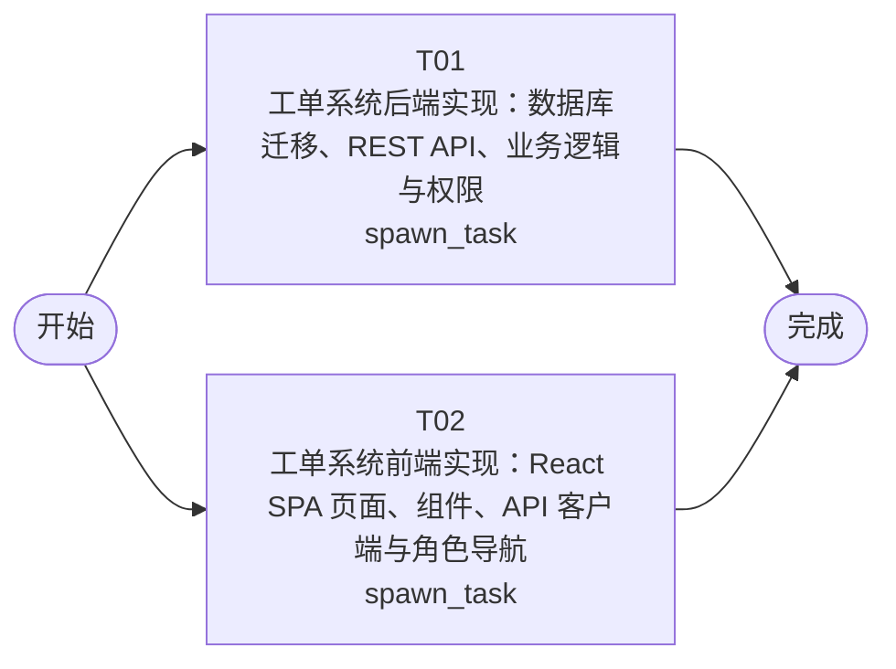

# 开发任务编排

<!-- sourcePlanId: plan:ab5b1cf1-425e-4744-8943-3c6fde5f0b12 | rendererVersion: 4 -->

## 任务

| 任务 | 一句话目标 | 执行模式 | 依赖 | 能力 |
| --- | --- | --- | --- | --- |
| T01 | 工单系统后端实现：数据库迁移、REST API、业务逻辑与权限 | spawn_task | - | engineering.implementation |
| T02 | 工单系统前端实现：React SPA 页面、组件、API 客户端与角色导航 | spawn_task | - | engineering.implementation |

## 依赖执行图

## 任务契约

### T01

**目标**

## 目标

实现工单系统完整后端，覆盖工单管理、分配、协作、处理和评价的全部 API 端点与业务逻辑。

## 实现范围

### 数据库迁移
- 在 `src/server/migrations/sqlite/` 下新增业务表迁移文件：`tickets`、`ticket_replies`、`ticket_transfers`、`ticket_evaluations`、`companies`、`business_groups`、`business_group_members`、`category_assignment_rules`
- 表结构严格遵循架构基线数据模型定义

### 共享类型与常量
- 在 `src/shared/` 定义工单状态枚举、SLA 优先级枚举、角色枚举、API 请求/响应类型和常量
- 前端任务通过这些共享类型与后端契约保持一致

### 后端业务模块
- 在 `src/server/` 下实现：
  - 工单 CRUD + 创建时自动分配逻辑
  - 工单回复（多轮）
  - 工单状态变更（取消）与完成处理（记录处理人/处理时间）
  - 工单转派（记录转派历史）
  - 提交人完整信息查询（含历史工单）
  - 用户满意度评价
  - 公司/业务组/成员管理
  - 分类分配规则管理
- 在 `src/server/routes.ts` 注册所有业务路由
- 权限检查通过 permissionkit 实现 submitter/handler/admin 三角色矩阵

### 验证
- `npm run typecheck:server` 通过
- `npm test` 通过（含平台基线测试和业务测试）
- API 行为符合技术契约定义的请求/响应格式和错误码

**角色:** general-app-development-expert  \  **失败策略:** block

**需求**

- AC-01
- AC-02
- AC-03
- AC-04
- AC-05
- AC-06

**输入**

- docs/wi-t1000047/requirements.md
- docs/wi-t1000047/architecture-baseline.md
- docs/wi-t1000047/technical-contract.md

**产物**

- （无）

**可写范围**

- app/ticket-system/package.json
- app/ticket-system/tsconfig.json
- app/ticket-system/tsconfig.server.json
- app/ticket-system/test/fixtures/qa-environment.mjs
- app/ticket-system/test/fixtures/README.md

**完整写入路径**

- app/ticket-system/package.json
- app/ticket-system/tsconfig.json
- app/ticket-system/tsconfig.server.json
- app/ticket-system/test/fixtures/qa-environment.mjs
- app/ticket-system/test/fixtures/README.md

**阻塞码**

- （无）

### T02

**目标**

## 目标

实现工单系统完整前端 React SPA，覆盖提交人、处理人、管理员三种角色的全部页面和交互流程。

## 实现范围

### 应用壳与导航
- 在 `src/client/` 下实现：
  - 登录页（密码登录）
  - 按角色的左侧导航栏和顶部上下文栏
  - split-master-detail 列表-详情分栏布局
  - 全局加载、空数据、错误、成功 toast 状态

### 提交人页面
- 工单列表（自己的工单）
- 创建工单表单（主题、描述、分类、SLA 优先级 P0-P4）
- 工单详情：回复区域（多轮）、取消工单、满意度评价

### 处理人页面
- 待处理工单队列
- 工单详情：提交人完整信息面板（姓名、公司、部门、历史工单列表）
- 回复工单、完成处理、转派操作

### 管理员页面
- 工单管理（全部工单列表）
- 业务组管理（为公司添加业务组、设置成员）
- 分配规则配置（分类 → 业务组映射）

### API 客户端
- 在 `src/client/platform/api-client.ts` 实现基于 technical-contract.md 的类型化 API 调用
- 使用 `src/shared/` 中的共享类型，不自行发明 API 行为

### 验证
- `npm run typecheck:client` 通过
- `npm run build:client` 通过
- 前端基于契约类型实现，不依赖后端运行即可构建

**角色:** general-app-development-expert  \  **失败策略:** block

**需求**

- AC-01
- AC-02
- AC-03
- AC-04
- AC-05
- AC-06

**输入**

- docs/wi-t1000047/requirements.md
- docs/wi-t1000047/architecture-baseline.md
- docs/wi-t1000047/technical-contract.md

**产物**

- （无）

**可写范围**

- app/ticket-system/vite.config.ts
- app/ticket-system/tsconfig.client.json
- app/ticket-system/index.html
- app/ticket-system/tailwind.config.js
- app/ticket-system/postcss.config.js

**完整写入路径**

- app/ticket-system/vite.config.ts
- app/ticket-system/tsconfig.client.json
- app/ticket-system/index.html
- app/ticket-system/tailwind.config.js
- app/ticket-system/postcss.config.js

**阻塞码**

- （无）
