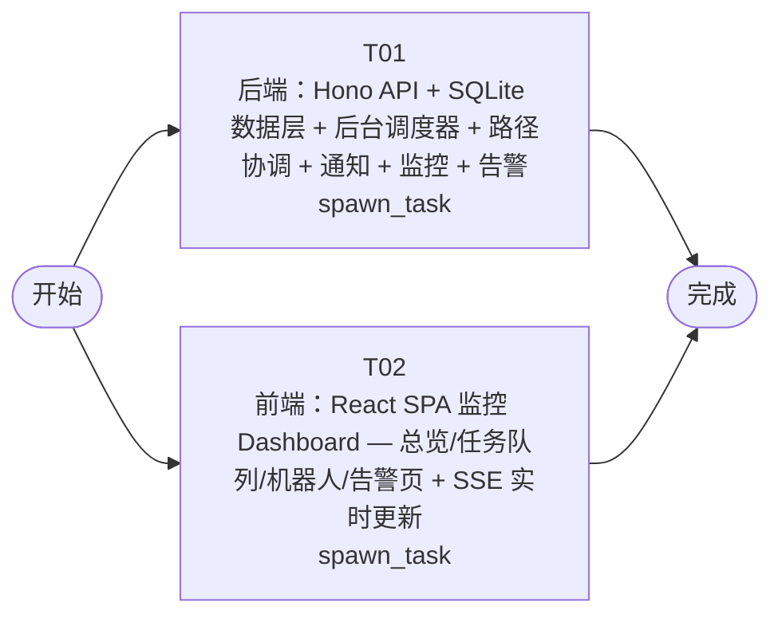

# 开发任务编排

<!-- sourcePlanId: plan:86f7058e-532a-41de-b4aa-a69577820431 | rendererVersion: 4 -->

## 任务

| 任务 | 一句话目标 | 执行模式 | 依赖 | 能力 |
| --- | --- | --- | --- | --- |
| T01 | 后端：Hono API + SQLite 数据层 + 后台调度器 + 路径协调 + 通知 + 监控 + 告警 | spawn_task | - | engineering.implementation |
| T02 | 前端：React SPA 监控 Dashboard — 总览/任务队列/机器人/告警页 + SSE 实时更新 | spawn_task | - | engineering.implementation |

## 依赖执行图

## 任务契约

### T01

**目标**

### 后端实现

实现 Hono HTTP API 服务、SQLite 持久化层、后台调度器和全部后端业务模块，严格遵循 `technical-contract.md` 定义的端点、字段、错误码与 SSE 事件。

#### 实现范围

- **任务队列模块**：`POST /api/tasks` 创建任务入队、`GET /api/tasks` 查询列表（FIFO 按 createdAt 升序）、`POST /api/tasks/:id/cancel` 取消任务（待分配移除出队、配送中释放机器人与路径锁）；状态机 pending → delivering → delivered / cancelled
- **机器人管理模块**：`POST /api/robots` 注册、`GET /api/robots` 查询、`PATCH /api/robots/:id/status` 状态更新（idle/delivering/offline；设 idle 触发 Dispatcher、设 offline 生成告警）、`POST /api/robots/:id/arrive` 到达触发通知并释放路径锁
- **路径协调模块**：BFS 最短路径规划、段锁模型（segment_locks 唯一约束同段同时一个活跃锁）、冲突检测与避免（延迟启动 / 等待释放 / 重新规划）、运行中持续检查前方段占用
- **通知模块**：到达时创建通知记录（含 taskId、robotId、tableId、sentAt）、`GET /api/notifications` 查询（按 taskId 过滤、sentAt 降序）
- **监控模块**：`GET /api/monitor/overview` KPI 汇总、`GET /api/monitor/queue` 待分配+配送中任务列表（含 pathProgress）、`GET /api/monitor/robots` 机器人状态、`GET /api/monitor/alerts` 告警列表、`GET /api/monitor/events` SSE 实时推送
- **后台调度器**：1 秒间隔轮询，检测 idle 机器人 + pending 任务时自动分配并规划路径
- **告警生成**：机器人离线生成 robot_offline 告警、路径冲突无法解决生成 path_conflict_unresolved 告警
- **数据库迁移**：建表（delivery_tasks、robots、path_nodes、path_segments、segment_locks、notifications、alerts）+ 初始路径图数据（厨房节点 + 桌位节点 + 交叉口节点 + 连接段）

#### 运行约定

- 启动命令 `npm start`：执行迁移 → 构建前端 dist/ → 启动 Hono 服务监听 PORT（默认 3000）
- 开发命令 `npm run dev`：Vite 热更新 + tsx watch 后端
- 数据库路径 DB_PATH 环境变量，默认 `./data/catering.db`，启动前自动创建父目录
- Hono 同时提供 API 和 dist/ 静态文件托管

#### 写入归属

- 独占：`src/server/`（全部后端源码）、`package.json`（全量依赖与脚本）、`tsconfig.json`（后端 TypeScript 配置）、`migrations/001_init.sql`（建表与初始数据）

#### 验证

- TypeScript 类型检查通过
- 后端构建成功（tsc / tsx 编译无错）
- API 端点测试：任务创建/查询/取消、机器人注册/状态更新/到达、通知查询、监控各接口、SSE 事件
- 路径协调单元测试：两台机器人同时配送时段锁互斥、冲突检测与避免逻辑

**角色:** general-app-development-expert  \  **失败策略:** block

**需求**

- AC-01
- AC-02
- AC-03
- AC-04
- AC-05
- AC-06
- AC-07

**输入**

- docs/wi-t1000048/requirements.md
- docs/wi-t1000048/architecture-baseline.md
- docs/wi-t1000048/technical-contract.md

**产物**

- src/server/

**可写范围**

- src/server/
- package.json
- tsconfig.json
- migrations/001_init.sql

**阻塞码**

- （无）

### T02

**目标**

### 前端实现

实现 React + Vite SPA 运行监控 Dashboard，严格遵循 `technical-contract.md` 定义的 API 响应格式与 SSE 事件类型，使用契约类型不臆造 API 行为。

#### 实现范围

- **应用壳与导航**：左侧边栏（总览、任务队列、机器人、告警）、顶部上下文栏（模块标题 + 系统状态指示灯 + SSE 连接状态灯）、桌面 Web 最小宽度 1024px
- **总览页**：顶部 KPI 行（待分配任务数、配送中任务数、空闲机器人数、活跃告警数）；下方三栏（队列摘要表、机器人状态卡片网格、活跃告警列表）
- **任务队列页**：上半部分待分配任务表格（序号、桌位、创建时间、状态、取消按钮）；下半部分配送中任务列表（机器人、桌位、进度状态 pathProgress、取消按钮）；创建任务表单（输入桌位标识）
- **机器人页**：机器人卡片网格（名称、状态色标绿/橙/红、当前任务、操作按钮置空闲/置离线）；注册机器人表单
- **告警页**：告警列表（类型、描述、关联机器人、时间、解决状态）
- **SSE 实时更新**：`GET /api/monitor/events` 连接，监听 task.created/assigned/delivered/cancelled、robot.status_changed、alert.created、path.conflict 事件并更新对应页面状态；断线自动重连
- **全局状态**：加载骨架屏/旋转图标、空数据占位提示、错误提示条+重试按钮
- **视觉风格**：Modern SaaS — 柔和中性色背景、细边界、少阴影、中等圆角、主色蓝、状态色（绿=空闲、橙=配送中、红=离线/告警）、清晰无衬线字体

#### 技术契约

- 所有 API 调用遵循 `technical-contract.md` 的响应格式（Task、Robot、Notification、Alert、ActiveTask 对象字段）
- SSE 事件类型与 data 结构遵循契约定义
- 实体 ID 对照：任务 ID / 机器人 ID 为 number，桌位标识为 string

#### 写入归属

- 独占：`src/client/`（全部前端源码）、`index.html`（Vite 入口）、`vite.config.ts`（Vite 构建配置）

#### 验证

- Vite 构建成功（`npm run build` 产出 dist/）
- TypeScript 类型检查通过
- 页面渲染验证：各页面布局符合 UI 基线，导航切换正常
- SSE 连接与状态更新逻辑验证

**角色:** general-app-development-expert  \  **失败策略:** block

**需求**

- AC-05
- AC-06
- AC-07

**输入**

- docs/wi-t1000048/requirements.md
- docs/wi-t1000048/architecture-baseline.md
- docs/wi-t1000048/technical-contract.md

**产物**

- src/client/

**可写范围**

- src/client/
- index.html
- vite.config.ts

**阻塞码**

- （无）
