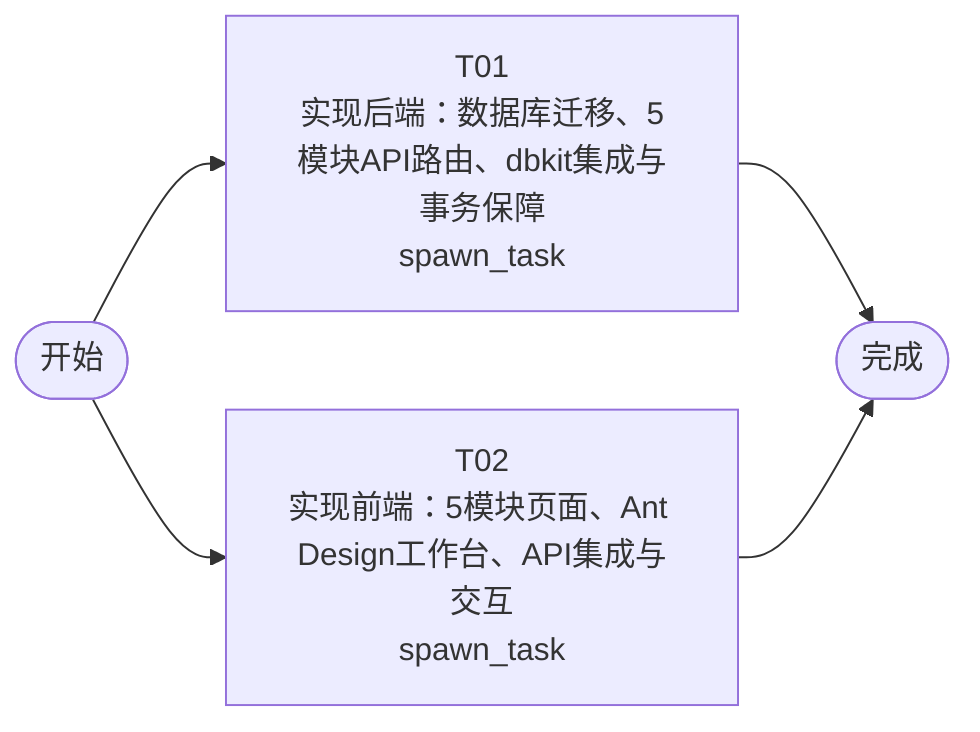

# 开发任务编排

<!-- sourcePlanId: plan:a5941934-73fb-419d-8f66-3117b760110d | rendererVersion: 4 -->

## 任务

| 任务 | 一句话目标 | 执行模式 | 依赖 | 能力 |
| --- | --- | --- | --- | --- |
| T01 | 实现后端：数据库迁移、5模块API路由、dbkit集成与事务保障 | spawn_task | - | engineering.implementation |
| T02 | 实现前端：5模块页面、Ant Design工作台、API集成与交互 | spawn_task | - | engineering.implementation |

## 依赖执行图

## 任务契约

### T01

**目标**

## 后端实现任务

实现设备管理平台的服务端全部业务逻辑，数据持久化基于 dbkit + SQLite。

### 实现范围

- **数据库迁移**：在 `src/server/migrations/sqlite/` 创建初始迁移文件，建立 `devices`、`device_status_logs`、`faults`、`upgrade_tasks`、`repair_orders` 五张表及外键索引，schema 严格遵循架构基线第3节。
- **dbkit 集成**：在 `src/server/platform/bootstrap.ts` 中初始化 dbkit 数据库连接，配置默认路径 `./data/application.db`，启动时自动创建数据目录并执行 `runMigrations`。
- **API 路由**：在 `src/server/routes.ts` 中实现技术契约定义的全部 REST API 端点，覆盖设备监测、故障诊断、远程升级、维修工单和设备履历五个模块。
- **事务边界**：设备状态更新在单事务中完成 `devices` 更新 + `device_status_logs` 插入；`runningStatus` 为 `error` 时自动置 `isAbnormal=true`。
- **状态流转校验**：升级任务（pending→in_progress→success/failed）和维修工单（created→in_progress→completed）的状态流转规则校验，终态不可变更。
- **错误响应**：统一使用 `{error:{code,message}}` 格式，400/404/500 对应 bad_request/not_found/internal_error。
- **共享类型**：在 `src/shared/` 定义 API 请求/响应的 TypeScript 类型，供前后端共用。
- **服务端装配**：更新 `src/server/index.ts`、`src/server/app.ts` 完成服务启动、全局中间件、API 路由挂载和生产环境 SPA 静态资源回退。
- **测试**：在 `test/` 中编写 API 集成测试，通过真实 HTTP 服务器验证各模块端点的 CRUD 和状态流转。

### 验证

- `npm run typecheck:server` 通过
- `npm run test` 通过（含 API 集成测试）
- 干净目录启动服务后数据库自动迁移完成

### 参考文档

严格遵循 `docs/wi-t1000049/technical-contract.md` 的字段级定义和状态流转规则，不发明 API 行为。

**角色:** general-app-development-expert  \  **失败策略:** block

**需求**

- AC-01
- AC-02
- AC-03
- AC-04
- AC-05

**输入**

- docs/wi-t1000049/requirements.md
- docs/wi-t1000049/architecture-baseline.md
- docs/wi-t1000049/technical-contract.md

**产物**

- app/k12-robot/src/server/
- app/k12-robot/src/shared/
- app/k12-robot/src/server/migrations/sqlite/
- app/k12-robot/test/

**可写范围**

- app/k12-robot/src/server/
- app/k12-robot/src/shared/
- app/k12-robot/src/server/migrations/sqlite/
- app/k12-robot/test/
- app/k12-robot/tsconfig.json
- app/k12-robot/tsconfig.server.json

**阻塞码**

- （无）

### T02

**目标**

## 前端实现任务

实现设备管理平台的浏览器 SPA 前端，基于 React + Vite + Ant Design。

### 实现范围

- **依赖安装**：在 `package.json` 中添加 `antd` 和 `@ant-design/icons` 依赖。
- **应用壳与导航**：在 `src/client/App.tsx` 实现左侧深色导航栏（5个模块入口）+ 顶部上下文栏 + 浅色主工作区的 SaaS 工作台布局。
- **API 客户端**：更新 `src/client/platform/api-client.ts`，封装全部技术契约定义的 API 调用，处理 wire 响应归一化和错误解码。
- **设备状态监测页**：设备表格（名称、型号、在线状态、运行状态、异常标记、操作列）+ 注册设备弹窗 + 状态更新弹窗。对应 AC-01。
- **故障诊断页**：故障表格（设备、描述、发生时间、关联工单、操作列）+ 设备筛选下拉 + 记录故障弹窗。对应 AC-02。
- **远程升级页**：升级任务表格（设备、状态、结果、时间、操作列）+ 设备筛选 + 发起升级弹窗 + 状态推进操作（pending→in_progress→success/failed）。对应 AC-03。
- **维修工单页**：工单表格（设备、描述、状态、结果、时间、操作列）+ 状态筛选 + 创建工单弹窗 + 状态流转操作（created→in_progress→completed）。对应 AC-04。
- **设备履历页**：设备选择下拉 + Timeline 时间线视图，按时间倒序展示状态变更、故障、升级、工单记录。对应 AC-05。
- **全局状态**：加载中 Skeleton/Spin、空数据 Empty+引导操作、错误 Alert+重试、成功 message.success。
- **路由配置**：使用 react-router-dom 配置 5 个模块页面路由。
- **契约类型**：基于技术契约在 `src/client/` 内定义前端 API 类型，不发明 API 行为。

### 验证

- `npm run typecheck:client` 通过
- `npm run build:client` 通过（Vite 构建）

### 参考文档

严格遵循 `docs/wi-t1000049/technical-contract.md` 的 API 字段定义和 `docs/wi-t1000049/architecture-baseline.md` 第4节 UI 基线，不发明 API 行为。

**角色:** general-app-development-expert  \  **失败策略:** block

**需求**

- AC-01
- AC-02
- AC-03
- AC-04
- AC-05

**输入**

- docs/wi-t1000049/requirements.md
- docs/wi-t1000049/architecture-baseline.md
- docs/wi-t1000049/technical-contract.md

**产物**

- app/k12-robot/src/client/

**可写范围**

- app/k12-robot/src/client/
- app/k12-robot/index.html
- app/k12-robot/package.json
- app/k12-robot/package-lock.json
- app/k12-robot/vite.config.ts
- app/k12-robot/tsconfig.client.json

**阻塞码**

- （无）
