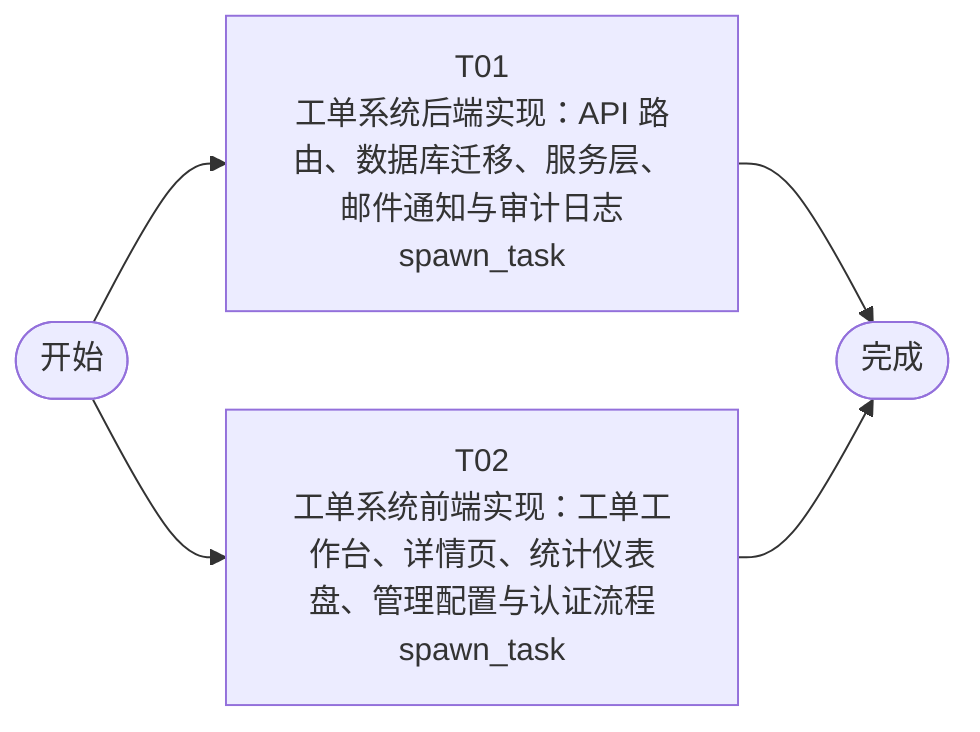

# 开发任务编排

<!-- sourcePlanId: plan:d986638a-2a41-4103-abbc-3be07b904d57 | rendererVersion: 4 -->

## 任务

| 任务 | 一句话目标 | 执行模式 | 依赖 | 能力 |
| --- | --- | --- | --- | --- |
| T01 | 工单系统后端实现：API 路由、数据库迁移、服务层、邮件通知与审计日志 | spawn_task | - | engineering.implementation |
| T02 | 工单系统前端实现：工单工作台、详情页、统计仪表盘、管理配置与认证流程 | spawn_task | - | engineering.implementation |

## 依赖执行图

## 任务契约

### T01

**目标**

## 后端实现目标

基于已批准的技术契约 `technical-contract.md`，在现有 Hono 脚手架上实现工单系统全部后端 API 与数据持久化。

### 数据库迁移

- 新增迁移文件 `src/server/migrations/sqlite/0004_business_tables.sql`，创建 `companies`、`departments`、`business_groups`、`business_group_members`、`categories`、`assignment_rules`、`tickets`、`ticket_replies`、`satisfaction_ratings` 表，字段与 `architecture-baseline.md` 数据模型一致

### 服务层与路由

在 `src/server/` 下实现以下业务路由（注册到现有 `registerProtectedRoutes`），所有查询按当前用户 `companyId` 隔离：

- **工单 CRUD**：`GET/POST /api/tickets`、`GET /api/tickets/:id`
- **工单回复**：`POST /api/tickets/:id/replies`
- **工单转派**：`POST /api/tickets/:id/transfer`
- **工单完成**：`POST /api/tickets/:id/complete`（触发 emailkit 邮件通知）
- **工单取消**：`POST /api/tickets/:id/cancel`
- **满意度评价**：`POST /api/tickets/:id/rating`（一次性约束）
- **提交人信息**：`GET /api/tickets/:id/submitter-info`（含历史工单）
- **业务组管理**：`GET/POST /api/business-groups`、`POST /api/business-groups/:id/members`、`DELETE /api/business-groups/:id/members/:userId`
- **分类自动分配规则**：`GET/POST /api/assignment-rules`、`DELETE /api/assignment-rules/:id`
- **统计仪表盘**：`GET /api/statistics/dashboard`
- **工单分布**：`GET /api/statistics/distribution`
- **操作日志**：`GET /api/audit-logs`

### 平台绑定

- 在 `src/server/platform/bootstrap.ts` 中初始化 permissionkit（RBAC 角色注册）、auditkit（审计事件记录）、emailkit（SMTP 邮件发送），按环境变量配置
- 在 `src/server/platform/auth.ts` 中扩展角色解析，将用户角色从单一 `user` 扩展为 `submitter`/`admin`/`processor`

### 共享类型

- 在 `src/shared/` 下创建平台中立的枚举常量与类型定义（TicketStatus、Priority、Role 等），供前后端引用

### 验证

- `npm run typecheck:server` 通过
- `npm run build` 通过
- 路由按技术契约字段和错误格式实现

**角色:** general-app-development-expert  \  **失败策略:** block

**需求**

- AC-01
- AC-02
- AC-03
- AC-04
- AC-05
- AC-06
- AC-07
- AC-08
- AC-09
- AC-10
- AC-11
- AC-12

**输入**

- docs/wi-t1000050/requirements.md
- docs/wi-t1000050/architecture-baseline.md
- docs/wi-t1000050/technical-contract.md

**产物**

- （无）

**可写范围**

- app/ticket-system/src/server/migrations/sqlite/0004_business_tables.sql
- app/ticket-system/src/server/routes.ts
- app/ticket-system/src/server/platform/bootstrap.ts
- app/ticket-system/src/server/platform/auth.ts
- app/ticket-system/src/server/
- app/ticket-system/src/shared/

**阻塞码**

- （无）

### T02

**目标**

## 前端实现目标

基于已批准的技术契约 `technical-contract.md` 和 `architecture-baseline.md` UI 基线，在现有 React + Vite 脚手架上实现工单系统全部前端页面与交互。

### 应用导航与壳

- 重写 `src/client/App.tsx`，构建左侧导航栏 + 顶部上下文栏的应用壳，支持路由切换：工单工作台、统计仪表盘、管理配置、操作日志
- 保持现有认证流程（bootstrap、login、password change），认证后进入工单主界面

### 页面实现

- **工单工作台**：左侧工单列表（搜索、筛选状态/分类/优先级、排序创建时间/优先级、按公司筛选），右侧选中工单详情
- **工单详情**：展示主题、描述、分类、优先级、状态、提交人信息区域、多轮回复列表与回复输入、操作按钮（转派、完成、取消、评价）
- **工单创建**：模态表单（主题、描述、分类、SLA 优先级）
- **提交人信息**：在工单详情中展示提交人姓名、公司、部门、历史工单列表
- **统计仪表盘**：KPI 卡片行（工单量、平均响应时间、满意度）、热点问题列表、公司/部门维度分布
- **管理配置**：业务组列表与成员管理、分类自动分配规则配置
- **操作日志**：操作日志查询页面

### API 集成

- 通过 `src/client/platform/api-client.ts` 调用后端 API，前端使用契约定义的类型，不自行发明 API 行为
- 从 `src/shared/` 引用枚举常量与类型

### 全局状态

- 加载骨架屏、空数据空态、错误提示卡片、成功 Toast 通知
- Tailwind CSS 样式，Modern SaaS 风格

### 验证

- `npm run typecheck:client` 通过
- `npm run build:client` 通过

**角色:** general-app-development-expert  \  **失败策略:** block

**需求**

- AC-01
- AC-02
- AC-03
- AC-04
- AC-05
- AC-06
- AC-07
- AC-08
- AC-09
- AC-10
- AC-11

**输入**

- docs/wi-t1000050/requirements.md
- docs/wi-t1000050/architecture-baseline.md
- docs/wi-t1000050/technical-contract.md

**产物**

- （无）

**可写范围**

- app/ticket-system/src/client/App.tsx
- app/ticket-system/src/client/

**阻塞码**

- （无）
