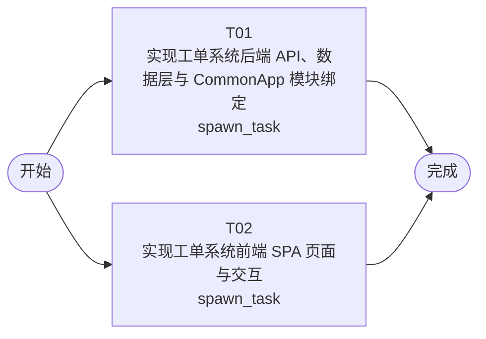

# 开发任务编排

<!-- sourcePlanId: plan:01fd812a-aa1e-486a-8e42-ca23e825adcb | rendererVersion: 4 -->

## 任务

| 任务 | 一句话目标 | 执行模式 | 依赖 | 能力 |
| --- | --- | --- | --- | --- |
| T01 | 实现工单系统后端 API、数据层与 CommonApp 模块绑定 | spawn_task | - | engineering.implementation |
| T02 | 实现工单系统前端 SPA 页面与交互 | spawn_task | - | engineering.implementation |

## 依赖执行图

## 任务契约

### T01

**目标**

## 目标

实现 Hono 后端全部业务 API 路由、数据库迁移与 CommonApp 模块绑定，覆盖技术契约 3.1–3.8 节全部接口。

### 数据层
- 编写 SQLite 迁移文件（migrations/sqlite/），创建 9 张项目表：companies、departments、user_profiles、business_groups、business_group_members、assignment_rules、tickets、ticket_replies、ticket_transfers、ticket_evaluations
- 实现仓库层（repositories/）封装数据库 CRUD 操作

### API 路由（routes/）
- **工单核心**：创建（含自动分配逻辑 — company_id + category 匹配 assignment_rules）、列表（筛选/搜索/排序）、详情、编辑、状态流转、回复、提交人完整信息
- **工单分配**：业务组 CRUD、成员管理、分配规则管理
- **工单协作**：转派操作（记录 ticket_transfers）
- **工单处理**：完成（设置 completed_at/completed_by，通过 emailkit 发送通知邮件）、取消
- **用户评价**：提交/查看满意度评价
- **统计分析**：仪表盘指标（工单量、平均响应时间、满意度、热点问题 Top 10）、工单分布（按公司/部门）
- **工单工作台**：待处理工单队列（handler 看自己/所在业务组工单，admin 看本公司全部）
- **操作日志**：工单操作日志、全局日志（从 auditkit 读取）

### 模块绑定
- authkit：Bearer 认证中间件，注入 ctx.user.id 和角色
- permissionkit：注册 submitter/handler/admin 角色及权限键
- auditkit：记录 ticket.created/assigned/transferred/processed/completed/cancelled 事件
- emailkit：工单完成时向提交人邮箱发送通知邮件

### 公司隔离
- 所有业务查询按当前用户 company_id（从 user_profiles 获取）自动过滤

### 共享类型（src/shared/）
- 定义 API 请求/响应 TypeScript 类型契约，供前后端复用

### 修改现有文件
- 修改 src/server/routes.ts 注册业务路由
- 修改 src/server/app.ts 挂载业务中间件（如需）
- 可能修改 src/server/platform/auth.ts 或 bootstrap.ts 补充模块绑定

### 验证
- `npm run typecheck:server`（tsconfig.server.json）通过
- `npm test`（test/*.test.mjs）通过
- 新增业务测试文件验证：工单创建+自动分配、公司隔离、状态流转、回复、转派、完成、评价、统计、日志

**角色:** general-app-development-expert  \  **失败策略:** block

**需求**

- AC-01
- AC-02
- AC-03
- AC-04
- AC-05
- AC-06
- AC-07
- AC-08
- AC-09
- AC-10
- AC-11
- AC-12
- AC-13
- AC-14

**输入**

- docs/wi-t1000051/requirements.md
- docs/wi-t1000051/architecture-baseline.md
- docs/wi-t1000051/technical-contract.md

**产物**

- （无）

**可写范围**

- app/ticket-system/src/server/routes.ts
- app/ticket-system/src/server/app.ts
- app/ticket-system/src/server/routes/
- app/ticket-system/src/server/services/
- app/ticket-system/src/server/repositories/
- app/ticket-system/src/shared/
- app/ticket-system/test/

**阻塞码**

- （无）

### T02

**目标**

## 目标

实现 React/Vite SPA 全部页面与交互，基于技术契约调用后端 API，覆盖架构基线 5.5 节全部页面。

### 页面实现（src/client/pages/）
- **工单工作台**：split-master-detail 布局，待处理工单列表 + 工单详情面板，支持筛选（含公司维度）、搜索、排序
- **工单创建**：表单（主题、描述、分类、SLA 优先级 P0-P4 选择）
- **工单详情**：工单信息展示、多轮回复区（回复列表 + 回复输入）、提交人完整信息面板（姓名/公司/部门/历史工单）、操作日志区、满意度评价区
- **业务组管理**：业务组列表、成员管理（添加/移除）、分类分配规则配置
- **统计仪表盘**：KPI 卡片（工单量/平均响应时间/满意度）、工单分布图表、热点问题列表
- **操作日志**：全局审计事件列表，支持筛选

### 应用框架
- 路由导航（react-router-dom），左侧导航栏 + 顶部上下文栏 + 主工作区应用壳
- 修改 src/client/App.tsx 组装顶层应用和导航
- API 客户端（src/client/platform/api-client.ts）：Bearer 认证、错误解码、分页处理
- 全局状态：加载态（骨架屏）、空态（空态提示+创建入口）、错误态（错误提示+重试）、成功态（短暂提示+刷新）

### 契约依赖
- 基于技术契约定义的 API 接口、请求/响应格式、错误码调用后端
- 不自行发明 API 行为，使用契约定义的字段和状态流转
- 可引用 src/shared/ 中的共享类型（后端拥有写入，前端只读引用）

### 验证
- `npm run typecheck:client`（tsconfig.client.json）通过
- `npm run build:client`（vite build）通过
- 重点验证：页面渲染、路由跳转、API 调用类型正确性

**角色:** general-app-development-expert  \  **失败策略:** block

**需求**

- AC-01
- AC-02
- AC-03
- AC-04
- AC-05
- AC-06
- AC-07
- AC-08
- AC-09
- AC-10
- AC-11
- AC-12
- AC-13
- AC-14

**输入**

- docs/wi-t1000051/requirements.md
- docs/wi-t1000051/architecture-baseline.md
- docs/wi-t1000051/technical-contract.md

**产物**

- （无）

**可写范围**

- app/ticket-system/src/client/App.tsx
- app/ticket-system/src/client/platform/api-client.ts
- app/ticket-system/src/client/pages/
- app/ticket-system/src/client/components/
- app/ticket-system/src/client/hooks/
- app/ticket-system/src/client/types/

**阻塞码**

- （无）
