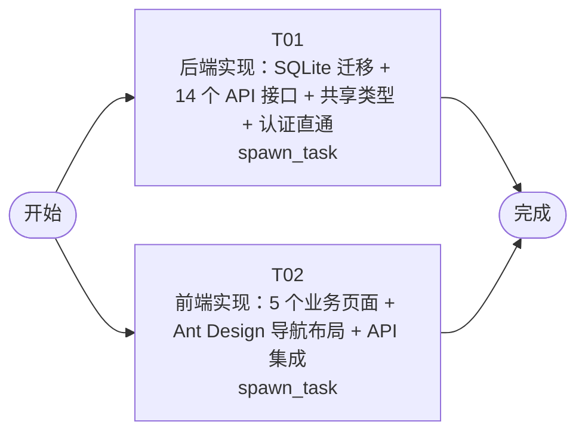

# 开发任务编排

<!-- sourcePlanId: plan:05c95f4e-3826-4155-aa4b-2f435f195aba | rendererVersion: 4 -->

## 任务

| 任务 | 一句话目标 | 执行模式 | 依赖 | 能力 |
| --- | --- | --- | --- | --- |
| T01 | 后端实现：SQLite 迁移 + 14 个 API 接口 + 共享类型 + 认证直通 | spawn_task | - | engineering.implementation |
| T02 | 前端实现：5 个业务页面 + Ant Design 导航布局 + API 集成 | spawn_task | - | engineering.implementation |

## 依赖执行图

## 任务契约

### T01

**目标**

## 后端业务实现

按照 `docs/wi-t1000057/technical-contract.md` 实现全部 14 个 REST API 接口和 SQLite 数据库迁移，覆盖设备状态监测、故障诊断、远程升级、维修工单和设备履历五个模块。

### 数据库迁移
- 在 `app/jlgrobot/src/server/migrations/sqlite/001-init.sql` 创建四张表：`equipment`、`fault_records`、`upgrade_records`、`maintenance_orders`
- 表结构严格遵循架构基线 `docs/wi-t1000057/architecture-baseline.md` 第 4 节数据模型定义

### 共享类型
- 在 `app/jlgrobot/src/shared/types.ts` 定义所有 API 请求和响应的 TypeScript 接口（snake_case，与 API JSON 一致）
- 包含 EquipmentStatus、FaultRecord、UpgradeStatus、UpgradeRecord、MaintenanceOrderStatus、MaintenanceOrder、HistoryEvent 等类型和枚举常量

### 业务路由
- 在 `app/jlgrobot/src/server/routes/` 目录下创建五个路由模块文件：
  - `equipment.ts` — GET/POST /api/equipment, GET/PATCH /api/equipment/:id
  - `faults.ts` — GET/POST /api/equipment/:id/faults
  - `upgrades.ts` — GET/POST /api/equipment/:id/upgrades, PATCH /api/upgrades/:id
  - `work-orders.ts` — GET /api/work-orders, GET/PATCH /api/work-orders/:id, POST /api/equipment/:id/work-orders
  - `history.ts` — GET /api/equipment/:id/history（跨表聚合查询，按 timestamp 降序）
- 使用 dbkit 的 `db` 实例执行 SQL 查询，不引入 ORM
- 所有错误响应使用 `{error:{code,message}}` 格式，HTTP 状态码 400/404/500
- 在 `app/jlgrobot/src/server/routes.ts` 的 `registerProtectedRoutes` 中注册全部业务路由

### 认证边界
- 修改 `app/jlgrobot/src/server/platform/auth.ts`，将 `authBoundary` 改为直通中间件（next()），因为需求未要求认证

### 验证
- 运行 `npm run typecheck:server` 确认服务端类型检查通过
- 运行 `npm test` 确认现有平台测试和 dbkit 测试通过
- 确认迁移文件可被 dbkit 正常执行

**角色:** general-app-development-expert  \  **失败策略:** block

**需求**

- AC-01
- AC-02
- AC-03
- AC-04
- AC-05
- AC-06

**输入**

- docs/wi-t1000057/requirements.md
- docs/wi-t1000057/architecture-baseline.md
- docs/wi-t1000057/technical-contract.md

**产物**

- （无）

**可写范围**

- app/jlgrobot/src/shared/types.ts
- app/jlgrobot/src/server/migrations/sqlite/001-init.sql
- app/jlgrobot/src/server/routes.ts
- app/jlgrobot/src/server/platform/auth.ts
- app/jlgrobot/src/server/routes/

**阻塞码**

- （无）

### T02

**目标**

## 前端业务实现

按照 `docs/wi-t1000057/technical-contract.md` 和 `docs/wi-t1000057/architecture-baseline.md` 第 3 节 UI 基线，实现设备管理平台的完整前端界面，包含五个业务模块页面和全局导航布局。

### 依赖安装
- 在 `app/jlgrobot/package.json` 添加 `antd` 和 `@ant-design/icons` 依赖
- 运行 `npm install` 安装依赖

### 前端类型定义
- 在 `app/jlgrobot/src/client/types.ts` 定义前端使用的 TypeScript 类型（camelCase，因为 `api-client.ts` 自动将 snake_case 响应转为 camelCase）
- 类型基于技术契约定义，不依赖 src/shared/（确保可独立类型检查）

### 应用布局与导航
- 重写 `app/jlgrobot/src/client/App.tsx`，实现左侧深色导航栏（五个模块入口）+ 顶部上下文栏 + 主工作区（master-detail 布局）
- 使用 Ant Design Layout、Menu、ConfigProvider 组件
- 使用 react-router-dom 路由切换页面
- 更新 `app/jlgrobot/src/client/main.tsx`，包裹 ConfigProvider 和 BrowserRouter

### 五个业务页面
在 `app/jlgrobot/src/client/pages/` 目录下创建：
- `EquipmentPage.tsx` — 设备列表（Table）+ 设备详情 + 创建设备 + 更新状态（AC-01）
- `FaultsPage.tsx` — 选择设备后查看故障列表 + 录入故障记录（AC-02）
- `UpgradesPage.tsx` — 选择设备后发起升级 + 查看升级记录 + 更新升级状态（AC-03）
- `WorkOrdersPage.tsx` — 工单列表 + 创建工单 + 状态流转 + 记录维修结果（AC-04）
- `HistoryPage.tsx` — 选择设备后查看聚合履历（Timeline 展示，AC-05）

### API 集成
- 使用现有 `src/client/platform/api-client.ts` 的 `apiRequest` 函数调用后端 API
- 全局状态：加载中显示 Spin，空数据显示 Empty，错误显示错误信息和重试，操作成功后短暂 message 提示

### 验证
- 运行 `npm run typecheck:client` 确认客户端类型检查通过
- 运行 `npm run build:client` 确认前端构建成功

**角色:** general-app-development-expert  \  **失败策略:** block

**需求**

- AC-01
- AC-02
- AC-03
- AC-04
- AC-05

**输入**

- docs/wi-t1000057/requirements.md
- docs/wi-t1000057/architecture-baseline.md
- docs/wi-t1000057/technical-contract.md

**产物**

- （无）

**可写范围**

- app/jlgrobot/package.json
- app/jlgrobot/index.html
- app/jlgrobot/src/client/main.tsx
- app/jlgrobot/src/client/App.tsx
- app/jlgrobot/src/client/types.ts
- app/jlgrobot/src/client/pages/

**阻塞码**

- （无）
