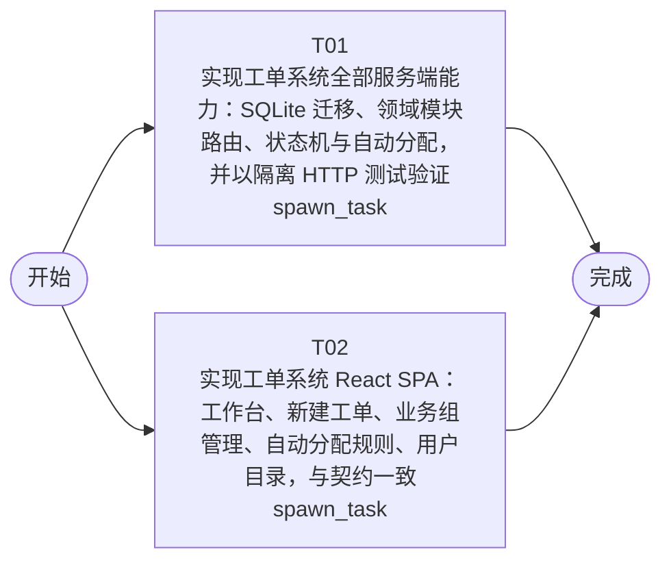

# 开发任务编排

<!-- sourcePlanId: plan:7524069c-03c8-42b2-9161-ad796c36170b | rendererVersion: 4 -->

## 任务

| 任务 | 一句话目标 | 执行模式 | 依赖 | 能力 |
| --- | --- | --- | --- | --- |
| T01 | 实现工单系统全部服务端能力：SQLite 迁移、领域模块路由、状态机与自动分配，并以隔离 HTTP 测试验证 | spawn_task | - | engineering.implementation |
| T02 | 实现工单系统 React SPA：工作台、新建工单、业务组管理、自动分配规则、用户目录，与契约一致 | spawn_task | - | engineering.implementation |

## 依赖执行图

## 任务契约

### T01

**目标**

- 按 technical-contract.md 实现服务端：新增 migrations/sqlite/0001_init.sql（companies、users、business_groups、group_members、assignment_rules、tickets、ticket_replies、ticket_transfers、ticket_evaluations 九表），
  - 在 src/server/ 实现 organizations、ticketing、assignment、collaboration、resolution、evaluation 六个领域模块并注册全部 /api/* 端点（bootstrap、users、groups/members、assignment-rules、tickets 创建/列表/详情/replies/assign/transfer/complete/cancel/evaluation）。服务端强制状态机（非法流转 409）、创建时同事务评估自动分配、提交人按邮箱归并、错误统一 {error:{code,message}}。平台中性契约类型与枚举放 src/shared/（本任务为 src/shared/ 唯一写入 owner）。验证：npm run typecheck:server 通过；
- 以隔离 DB_PATH 启动真实 HTTP 服务，
  - 新增 test/api.test.mjs 覆盖 AC-01..AC-08 的服务端行为并通过。

**角色:** general-app-development-expert  \  **失败策略:** block

**需求**

- AC-01
- AC-02
- AC-03
- AC-04
- AC-05
- AC-06
- AC-07
- AC-08

**输入**

- docs/wi-t1000058/requirements.md
- docs/wi-t1000058/architecture-baseline.md
- docs/wi-t1000058/technical-contract.md

**产物**

- （无）

**可写范围**

- app/ticket-system/src/shared/
- app/ticket-system/test/api.test.mjs

**完整写入路径**

- app/ticket-system/src/shared/
- app/ticket-system/test/api.test.mjs

**阻塞码**

- （无）

### T02

**目标**

- 按 technical-contract.md 与架构 UI 基线实现浏览器端：src/client/platform/api-client.ts 作为唯一请求边界；
- 应用壳（左侧导航：工单工作台/业务组管理/自动分配规则/用户目录；
- 顶部身份选择器与公司切换）；
- 工单工作台列表+详情双栏（提交人信息面板含历史工单入口、回复线程按时间排列显示回复人与回复时间、按状态启用的分配/转派/完成/取消操作区、处理记录、满意度评价区）；
- 新建工单表单页；
- 业务组管理页（多业务组与成员维护）；
- 自动分配规则页（分类→业务组）；
- 用户目录页。前端只消费 /api/* 公开接口，
  - 使用 src/shared/ 中 T01 定义的契约类型（不得发明契约外 API 行为）。验证：npm run typecheck:client 通过；
- npm run build:client 通过。

**角色:** general-app-development-expert  \  **失败策略:** block

**需求**

- AC-01
- AC-02
- AC-03
- AC-04
- AC-05
- AC-06
- AC-07
- AC-08

**输入**

- docs/wi-t1000058/requirements.md
- docs/wi-t1000058/architecture-baseline.md
- docs/wi-t1000058/technical-contract.md

**产物**

- （无）

**可写范围**

- app/ticket-system/src/client/

**完整写入路径**

- app/ticket-system/src/client/

**阻塞码**

- （无）
