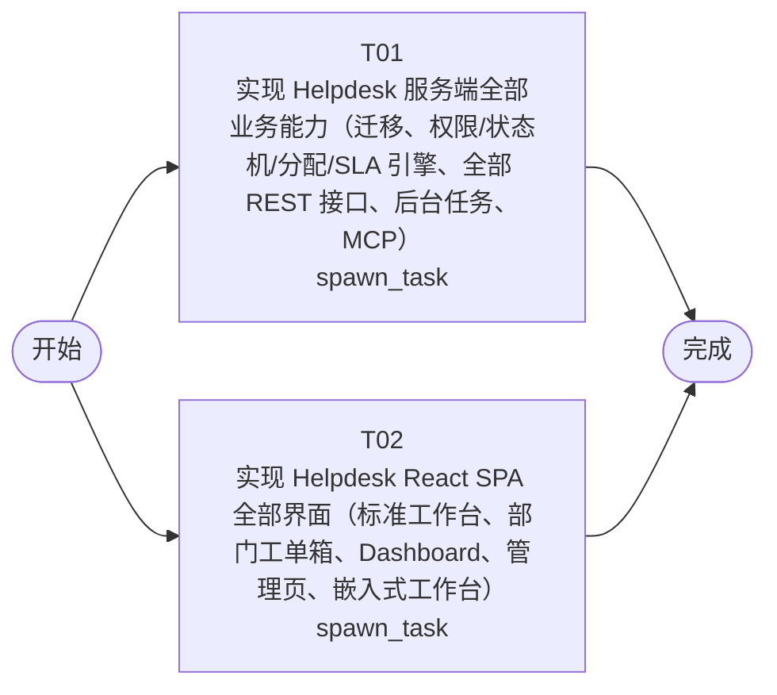

# 开发任务编排

<!-- sourcePlanId: plan:01afd443-151c-4fc9-b39c-35c75116ccee | rendererVersion: 4 -->

## 任务

| 任务 | 一句话目标 | 执行模式 | 依赖 | 能力 |
| --- | --- | --- | --- | --- |
| T01 | 实现 Helpdesk 服务端全部业务能力（迁移、权限/状态机/分配/SLA 引擎、全部 REST 接口、后台任务、MCP） | spawn_task | - | engineering.implementation |
| T02 | 实现 Helpdesk React SPA 全部界面（标准工作台、部门工单箱、Dashboard、管理页、嵌入式工作台） | spawn_task | - | engineering.implementation |

## 依赖执行图

## 任务契约

### T01

**目标**

## 目标

依据已批准的 `docs/wi-t1000063/requirements.md`、`docs/wi-t1000063/architecture-baseline.md` 与字段级契约 `docs/wi-t1000063/technical-contract.md`（唯一 API 契约来源），在 `app/helpdesk` 实现服务端全部业务能力。本任务对 AC-01~AC-22 的全部服务端行为负责（强制权限校验、状态机、分配/SLA 引擎、统计口径、通知、后台任务、MCP、审计写入）；仅写本任务声明路径，`src/client/`、`index.html`、`tailwind.config.js` 归并行任务 T02，禁止写入。

### 范围

- **数据与迁移**：在 `src/server/migrations/sqlite/` 按架构基线 §4.1 追加版本化业务迁移（组织/人员/分类与分配规则/SLA 与日历/工单域/评价/轮询游标等全部业务表与约束）；种子数据：初始管理员账号（在任务报告中注明实际邮箱与密码）、默认工作日历（时区 Asia/Kuala_Lumpur）、系统骨架分类（isSkeleton 标记）。
- **领域服务**：统一权限 guard（角色 + 对象关系 + 状态三重校验，401/403/404/409/413/422 错误结构按契约 §1，越权读一律 404 防枚举）；工单 8 态状态机（含回复例外副作用、回复即认领）；分配引擎（一级分类→分配规则→多 Team 轮询（游标持久化）→成员过滤（启用/非部门经理/非休假）→Team 经理兜底→待分配失败记录；部门分配模式配置不参与路由）；SLA 双时钟引擎（工作日历滚动计算、挂起暂停/恢复整体顺延/未响应补记、在线改分类从原起算点重算、完成判定 met/missed、预警阈值）；统计服务（唯一「今日」口径、草稿排除、KPI/告警/下钻共用同一谓词）；通知（仅工单提交与回复两个动作点异步邮件，无 SMTP 静默跳过、失败仅记日志）；待确认超时自动关闭周期扫描（默认 24 小时/5 分钟，含系统默认好评）；MCP `create_ticket` 工具（attachmentUrl(s) 尽力下载挂接，失败不阻塞创建）。
- **REST 接口**：按契约 §2–§13 实现全部接口与行为（认证会话、工单全组含时间线/导出、组织与用户管理、分类与分配规则含 CSV、SLA 策略/日历/节假日、Dashboard、审计、嵌入工作台聚合、附件 canAccess 绑定）；分页/排序/双语序列化回退/角色数据范围/草稿隐私口径严格按契约。
- **共享契约**：`app/helpdesk/src/shared/`（本任务唯一所有）：平台中立领域类型与枚举；`src/shared/locales/` 更新为服务端消息文案资源。
- **平台绑定**：按 `platform-baseline.json` 的 `modules.*.requiredApplicationBindings` 完成 authkit/userkit/attachment/auditkit 的待完成绑定；如需新增服务端依赖（如 SMTP 客户端），仅由本任务修改 `app/helpdesk/package.json` 并尽早一次性安装。

### 约束

- 遵守 `app/helpdesk/AGENTS.md`：`src/server/` 禁止引用客户端代码；简洁优先，不实现需求 §9 明确排除的能力（AI 识别、归档、审批流、分配模式生效、跨 Team 兜底等）。
- 自检一律使用独立临时 `DB_PATH` 与空闲端口（不占用 3000），结束后清理进程与临时文件；不切换 Git HEAD、不提交代码。
- 并行任务 T02 同时在 `src/client/` 工作：本任务不得读写 `src/client/`。

### 验证

由实现专家从项目实际配置选择服务端层级检查并运行，报告真实命令与结果；重点以隔离 HTTP 服务覆盖：越权/状态不符拒绝（AC-17 口径）、状态机全流转、分配链路（多 Team 轮询重启延续、经理兜底、休假过滤 409）、SLA 双时钟（工作日/节假日、挂起顺延、未响应补记、改分类重算、met/missed 判定）、草稿可见性与统计排除、幂等提交、待确认自动关闭、邮件触发点与无 SMTP 静默跳过、MCP 创建工单与附件挂接。

**角色:** general-app-development-expert  \  **失败策略:** block

**需求**

- AC-01
- AC-02
- AC-03
- AC-04
- AC-05
- AC-06
- AC-07
- AC-08
- AC-09
- AC-10
- AC-11
- AC-12
- AC-13
- AC-14
- AC-15
- AC-16
- AC-17
- AC-18
- AC-19
- AC-20
- AC-21
- AC-22

**输入**

- docs/wi-t1000063/requirements.md
- docs/wi-t1000063/architecture-baseline.md
- docs/wi-t1000063/technical-contract.md

**产物**

- app/helpdesk/src/server/
- app/helpdesk/src/shared/
- app/helpdesk/test/

**可写范围**

- app/helpdesk/src/server/
- app/helpdesk/src/shared/
- app/helpdesk/test/
- app/helpdesk/package.json

**阻塞码**

- TASK_FAILED

### T02

**目标**

## 目标

依据已批准的 `docs/wi-t1000063/requirements.md`、`docs/wi-t1000063/architecture-baseline.md` §3（UI 全局基线）与字段级契约 `docs/wi-t1000063/technical-contract.md`，在 `app/helpdesk/src/client/` 实现 React SPA 全部界面与前端行为。本任务对 AC-01/02/04/05/06/08/09/10/11/12/13/14/15/16/18/19/21 的界面呈现与交互负责（入口按契约 `can` 语义显隐；服务端强制校验由并行任务 T01 交付）；仅写本任务声明路径，`src/server/`、`src/shared/`、`test/`、`package.json` 归并行任务 T01，禁止写入。

### 范围

- **标准工作台 `/`**：应用壳（左侧导航按四角色裁剪入口 + 顶部当前用户/语言切换）与 split-master-detail 主布局；覆盖需求 §6 各模块界面：登录、工单列表（默认 `updatedAt` 倒序且展示该列、筛选/分页 10/20/50/100 默认 20）、工单详情（时间线合并倒序、回复、提交解决（必填说明）、确认/驳回、关闭后评价一次、挂起/恢复/取消、开始处理、在线改分类/优先级下拉即存、指派/转派）、草稿创建/编辑/提交表单（幂等键持久化、附件上传 ≤10MB）、部门工单箱（待分配 + 双维度 SLA 告警聚合视图、管理员全部部门筛选）、Dashboard（KPI 卡/SLA 告警卡/分类/优先级/部门排行与下钻明细对账）、管理页（用户/公司/部门/Team/成员/休假（日历区间选择器、在岗/休假中/已排休三态卡片）、分类与二级分类、分配规则（搜索、跨部门 Team 校验提示、CSV 导入预览/导出、未配置提醒）、SLA 策略（未配置横幅、表头悬浮规则说明）、工作日历/节假日、配置审计日志）。
- **嵌入式工作台 `/embed/workbench`**：无应用外壳独立路由（无侧边导航/面包屑）、仅提交人、看板 4 列与列表视图切换、顶部 KPI、条数上限截断提示、草稿卡片进嵌入式编辑器（复用标准表单逻辑）、其余进嵌入式详情（隐藏编辑草稿入口）、灵基智能体入口以最外层窗口打开（URL 需求未给定，实现为常量并在报告中注明）。
- **API 客户端与契约类型**：在 `src/client/` 内按技术契约实现请求边界、错误解码与契约类型/枚举，不发明 API 行为；联调前可用契约 mock 支撑开发与构建。
- **界面双语**：客户端 i18n 资源置于 `src/client/`（重写 `src/client/platform/i18n.tsx` 资源加载）；双语字段展示直接使用服务端已回退的返回值，不重复判断。
- **视觉与全局状态**：Modern SaaS 基线（Tailwind、SLA 状态徽标体系、加载/空/错误/无权限/成功反馈、长文本截断 title）；图标使用统一内联 SVG 家族，不新增依赖。

### 约束

- 遵守 `app/helpdesk/AGENTS.md`：`src/client/` 禁止引用 `src/server/` 与 Node API；不新增依赖、不修改 `package.json`；简洁优先，不加需求外能力。
- 本阶段不做浏览器验收（后续验证阶段负责）；检查不占用 5173/3000 端口、不启动常驻服务；不切换 Git HEAD、不提交代码。
- 并行任务 T01 同时写 `src/shared/`：客户端类型检查若因该目录并行写入出现瞬时失败，稍后重试并如实报告；仅本任务自有路径内的失败属于本任务阻塞。

### 验证

由实现专家从项目实际配置选择客户端层级检查并运行（如客户端类型检查、前端构建），如实报告命令与结果。

**角色:** general-app-development-expert  \  **失败策略:** block

**需求**

- AC-01
- AC-02
- AC-04
- AC-05
- AC-06
- AC-08
- AC-09
- AC-10
- AC-11
- AC-12
- AC-13
- AC-14
- AC-15
- AC-16
- AC-18
- AC-19
- AC-21

**输入**

- docs/wi-t1000063/requirements.md
- docs/wi-t1000063/architecture-baseline.md
- docs/wi-t1000063/technical-contract.md

**产物**

- app/helpdesk/src/client/

**可写范围**

- app/helpdesk/src/client/
- app/helpdesk/index.html
- app/helpdesk/tailwind.config.js

**阻塞码**

- TASK_FAILED
