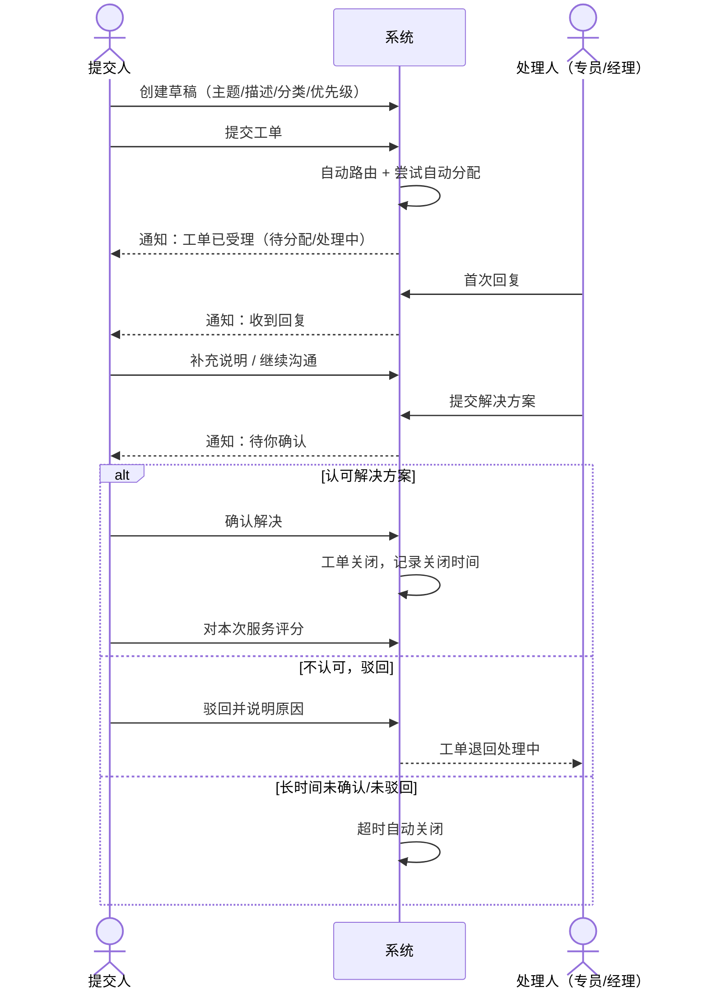
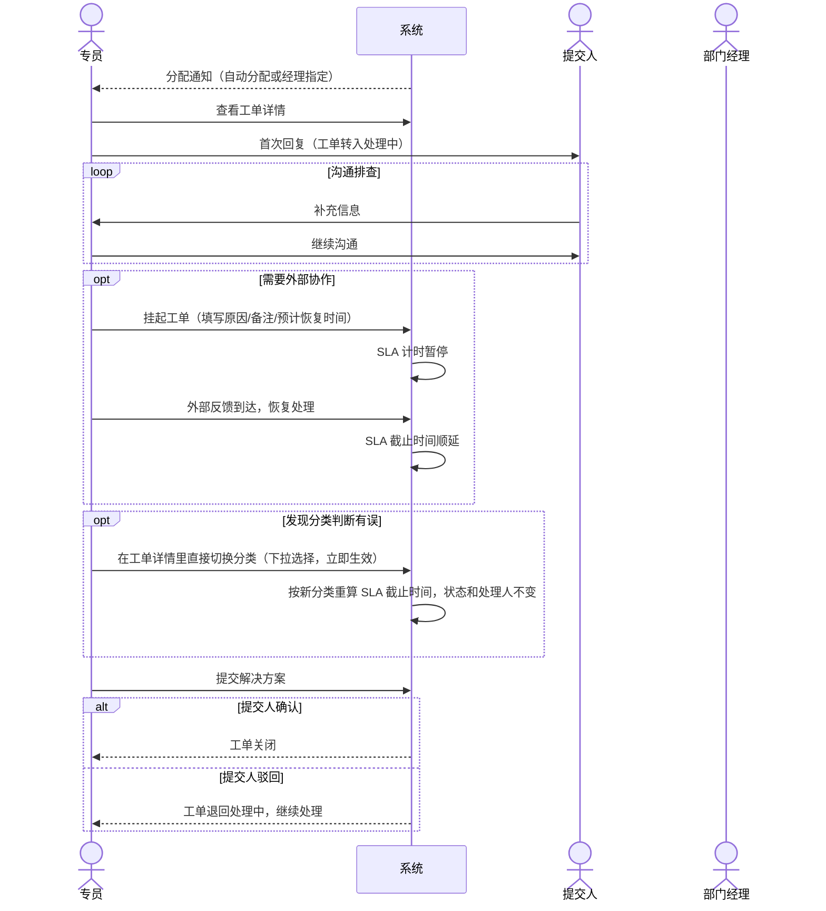
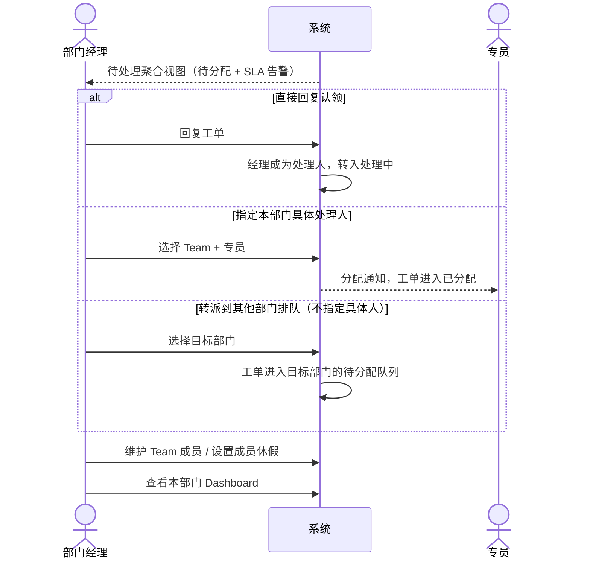
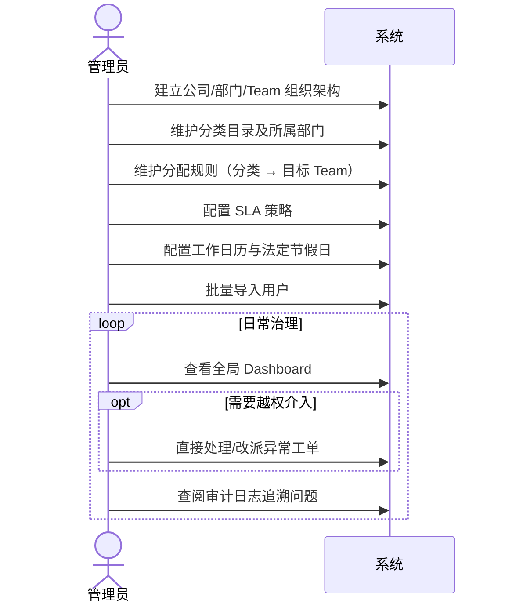
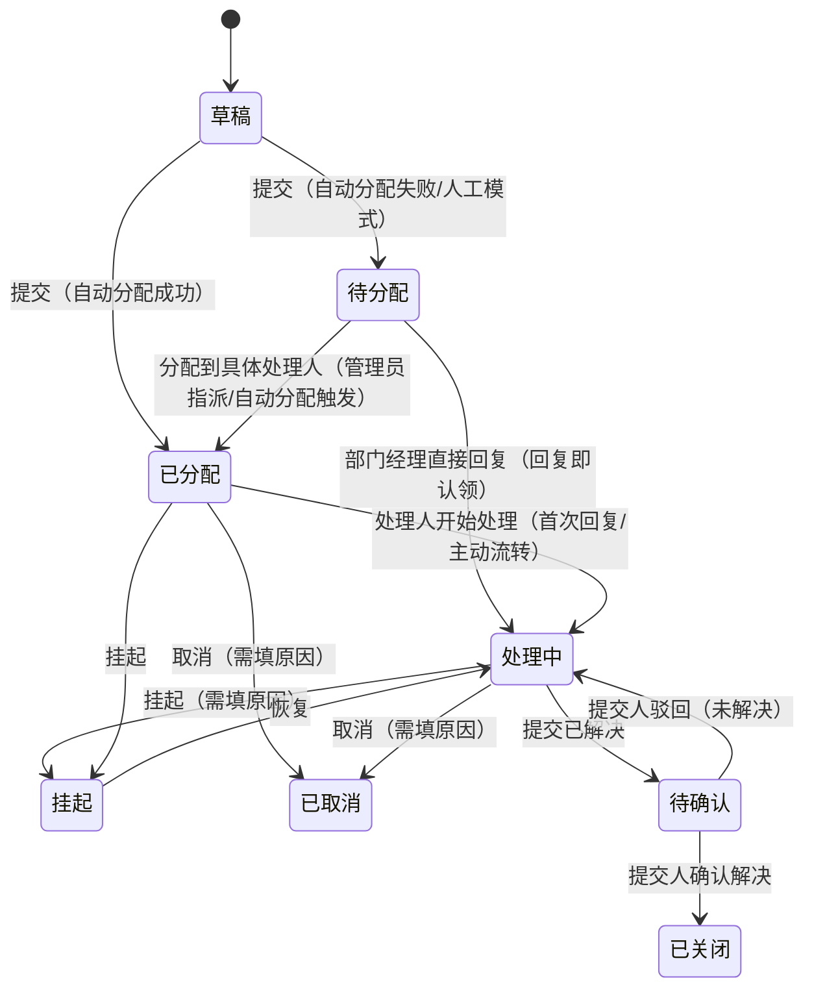

# Helpdesk 企业工单系统需求（WorkItem: wi-t1000063 / 业务任务: ticket-full-1）

> **需求依据**：用户指定的《Helpdesk 需求文档（现状基线版）》V1.0，路径 `/Users/loganjing/work/generalapp/helpdesk/docs/spec/requirements.md`（基于当前系统实际运行行为回填并逐条核实）。
> 除单独标注「未规定」的条目外，本文全部目标、规则与范围排除项均承载自该已确认基线；本文不新增候选增强、不推荐技术方案，仅将基线整理为可实现、可验收的需求，并在 §10 给出验收场景。
> 与本文冲突的历史规划文档（`docs/archive/` 下的 `originreq.md`、`requirements-doc-v2.md`、`requirements-iterations/20260815_*`、`REQUIREMENTS-SPEC.md` 等）一律以本文为准，仅作背景参考，不代表当前系统行为。
> 本文只描述「系统做什么、给谁用、遵循什么业务规则」；不涉及实现设计、数据结构或技术选型。

---

## 1. 背景与目标

Helpdesk 是面向企业内部 IT/HR/行政等多业务处理部门的通用工单系统：员工（提交人）通过系统提交问题或申请，系统按「处理部门 + 一级分类」把工单路由到对应的处理小组（Team），由专员跟进、回复、解决，提交人确认后工单关闭。系统提供部门/团队/人员权限管理、SLA 计时与预警、Dashboard 统计、审计留痕、中英文双语展示。

目标客户场景：一家跨多个业务集团（BG）、多家子公司的企业集团，IT/HR/行政等职能部门需要统一处理来自各子公司员工的工单请求，且各职能部门内部又按业务小组（Team）分工。

---

## 2. 角色与权限

系统固定 4 种角色，登录后角色不可切换（无「多角色」概念）：

| 角色 | 说明 |
|---|---|
| 提交人（Requester） | 普通员工，提交并跟踪自己的工单 |
| 专员（Agent） | 被分配处理工单的一线人员 |
| 部门经理（Manager） | 管理一个或多个处理部门：维护 Team/成员/休假、处理待分配工单、转派、可直接回复工单（回复即认领） |
| 系统管理员（Admin） | 全局配置与全量数据访问 |

### 2.1 权限矩阵

| 权限点 | 提交人 | 专员 | 部门经理 | 管理员 |
|---|:---:|:---:|:---:|:---:|
| 创建/编辑/提交草稿工单（为自己提交请求） | ✅ | ✅ | ✅ | ✅ |
| 查看工单 | 仅本人提交 | 仅分配给本人 | 本组/本部门范围 | 全部 |
| 回复工单 | ✅（本人工单） | ✅（本人处理的） | ✅（本组工单，含未分配的待分配工单——回复即认领） | ✅ |
| 提交已解决 | ❌ | ✅ | ✅（认领后） | ✅ |
| 确认关闭/驳回 | ✅（本人工单） | ❌ | ❌ | ✅ |
| 评价 | ✅（已关闭工单） | ❌ | ❌ | ❌（当前未开放） |
| 修改分类/优先级 | ❌ | ✅（本人处理的） | ✅（本组） | ✅ |
| 转派工单 | ❌ | ✅（本人处理的，「已分配」/「处理中」状态，只能转给本部门同事或本部门经理，不支持跨部门） | ✅（本组） | ✅ |
| 挂起/恢复/取消工单 | ❌ | ✅（本人处理的） | ✅（本组） | ✅ |
| 指定处理人（分配） | ❌ | ❌ | ✅（仅限本部门待分配工单，见 §2.2） | ✅ |
| 导出工单 CSV | ❌ | ✅ | ✅ | ✅ |
| 管理 Team/成员/休假/部门 | ❌ | ❌ | ✅（本部门） | ✅ |
| 管理用户/公司/分类/SLA/日历/节假日 | ❌ | ❌ | ❌ | ✅ |
| 查看审计日志 | ❌ | ❌ | ❌ | ✅ |
| 查看 Dashboard | ✅（本人数据） | ✅（本人数据） | ✅（本部门范围） | ✅（全局） |

角色创建工单口径（已确认变更）：专员/经理/管理员均可以提交人身份为自己创建草稿并提交（场景：他们自己也有需要报的问题），与普通提交人走同一「创建草稿 → 提交」流程，草稿仅创建人本人可见（管理员此前看不到自己草稿的历史缺陷一并修复）。这**不代表**专员/经理处理他人工单的权限边界发生变化，矩阵其余行不受影响。

### 2.2 部门经理指派处理人的范围限定

部门经理可对本部门「待分配」工单执行「指定处理人」（选择本部门的 Team + 具体专员），管理员不受部门限制。部门经理处理待分配工单的完整方式：

- 指定本部门具体专员 → 工单直接进入「已分配」；或
- 直接回复工单 → 系统自动把该经理设为处理人并流转到「处理中」（「回复即认领」）；或
- 整单转派到其他部门排队（仅「已分配」/「处理中」状态可转派到具体人；「待分配」状态下经理也能把工单转出到别的部门排队，但不能指定对方部门的具体人）。

对「指定处理人」动作，服务端必须校验目标处理人确实属于该工单所在部门，防止部门经理把工单派给不相关部门的人。

### 2.3 权限校验原则

- 前端仅做入口隐藏（体验层面），所有写操作在后端必须再次强制校验，两层缺一不可。
- 对象级校验永远基于工单当前状态 + 操作人与工单的关系（是否本人提交/本人处理/本组），角色本身不足以判断是否可操作。
- 部门经理的「本组」范围由系统动态计算：所属 Team ∪ 管辖部门（覆盖没有 Team、采用手动分配的部门）。

---

## 3. 用户旅程

以下时序说明「谁在什么时间点做了什么、系统在中间做了什么」，供重新实现或联调时对照校验交互顺序。各旅程的具体规则见 §6 模块需求。

### 3.1 提交人：提交一张工单并跟进到关闭



要点：

- 提交人可先保存草稿反复编辑，正式提交后才进入路由，首次响应 SLA 计时随即开始；**解决（处理时长）SLA 要等处理人真正开始动手（首次回复，或手工标记开始处理）才起算**（见 §6.4、§6.9）。
- 处理人回复后，提交人可多轮补充信息；驳回会让工单原样退回原处理人，不重新路由。
- 若提交人长时间未确认或驳回，系统会在一段时长后自动关闭工单（见 §6.4），避免工单无限期悬挂。
- 现状观察（薄弱环节）：优先级需提交人自行判断选择，系统无辅助判定；驳回后重新等待处理，体验上容易产生二次落差。

### 3.2 专员：处理一张分配到自己的工单



要点：

- 「已分配」转「处理中」有两条并列触发路径：首次回复，或在工单详情里手工标记「开始处理」（不要求先回复）；哪条先发生就以哪条为准。此后专员和提交人可多轮沟通，回复本身不再改变状态。
- 这一刻（首次回复 / 手工标记开始处理，二者取先）是**解决 SLA 的计时起点**——提交到这之前的等待/排队时间不计入处理时长，避免分配环节的延误由专员承担。
- 挂起用于等待第三方/供应商/硬件等外部因素，SLA 计时同步暂停；恢复时按挂起时长整体顺延，不重新计算（若挂起前从未首次响应过，恢复这一刻会补记为首次响应，从这里现算截止时间，不是顺延）。
- 改派后专员立即失去该工单的处理权，后续走向由目标部门经理决定。
- 现状观察（薄弱环节）：改派和被驳回重新处理都是「已投入的工作被打回」的环节，容易产生返工和摩擦。

### 3.3 部门经理：日常分诊与团队管理



要点：

- 部门经理可直接把待分配工单指派给本部门具体专员（选 Team + 人），可自己回复认领，也可整单转派到其他部门排队——但不能指定其他部门的具体人。
- 系统没有「手动重新触发一次自动分配算法」的操作入口，自动分配只在工单首次提交时执行一次；此后要么被人工指派，要么由经理认领。
- 部门经理的数据范围和可指派范围严格限定在自己管辖的部门/Team 内，不能越权操作其他部门的工单或人员。
- 现状观察（薄弱环节）：指派时系统不提示目标专员当前在办工单量，容易分配不均（休假中的人已被排除在候选范围外，见 §6.6）。

### 3.4 系统管理员：系统初始化与日常治理



要点：

- 初始化顺序存在依赖：分类必须先有归属部门才能建立，SLA 策略挂在分类上，因此组织架构要先于分类目录建立，这一阶段字段多、顺序错了容易返工。
- 管理员是唯一拥有全局数据视角、且能查看完整审计日志（工单操作日志 + 配置变更日志）的角色。

---

## 4. 核心业务实体与术语

| 实体 | 说明 |
|---|---|
| BG（Business Group） | 客户组织最顶层，如 CHBM、CHCE 等；同时也是某些「处理部门」命名的前缀（如 "CHBM Tech BP"） |
| Company（公司/BU） | 隶属于某个 BG 的子公司，树形结构 |
| Department（处理部门） | 工单处理的行政单位，如 "People GBS"、"Tech GBS"、"CHBM Tech BP"。每个部门有一个或多个部门经理；有一个「自动/人工分配模式」的配置项，**当前实际路由并不读取这个配置**（见 §6.2、§9） |
| Team（业务组） | 部门下的最小分配单位，拥有成员列表；工单最终被分配到某个 Team 下的某个人 |
| Category（一级分类） | 问题分类，归属一个处理部门，绑定 SLA 策略。**只是基础数据（名称/编码/归属部门/工单类型），不含任何分配字段**（历史 `defaultTeamId` 已移除，见 §6.7）；分配到哪个/哪些 Team 完全由分配规则决定 |
| SubCategory（二级分类） | 归属某个一级分类，仅用于展示/统计细分，不单独绑定 SLA |
| Ticket（工单） | 核心业务对象，状态机见 §5 |
| Reply（回复） | 工单下的沟通记录，提交人和当前处理人可发 |
| Rating（评价） | 工单关闭后提交人可评一次分 |
| 工单活动日志 | 记录工单全生命周期每一次状态/字段变化 |
| 配置审计日志 | 记录部门/用户/分类/SLA/日历/分配规则等配置类操作，仅管理员可查看 |
| SLA 策略 | 每个一级分类绑定的首次响应/解决时限配置 |
| 工作日历 / 节假日 | 每周工作日、每日工作时段、时区的配置 + 法定节假日清单，SLA 按此计算 |
| 休假（成员维度） | 成员的休假区间 + 自动回复文案；**已接入自动分配、手工分配、转派三条路径的候选人过滤**（休假中的人不会被自动分配、也不能被手工指派/转交，见 §6.2、§6.6） |
| 自动路由规则（Assignment Rule） | 「一级分类 → 目标 Team（可多个）」的映射，是自动分配的实际路由依据；管理员在分配规则页维护（见 §6.8） |

---

## 5. 工单状态机

### 5.1 状态定义（8 态）

| 状态 | 名称 | 说明 |
|---|---|---|
| 草稿 | Draft | 尚未提交，**仅创建人本人可见**（提交人、专员、经理、管理员都可创建草稿，但谁都看不到别人创建的草稿，见 §8） |
| 待分配 | Pending Assign | 已提交但尚未确定处理人；自动分配找不到候选人时进入此态 |
| 已分配 | Assigned | 已指定处理人但处理人尚未开始处理（自动分配成功、经理指派后的过渡态） |
| 处理中 | In Progress | 处理人已实际开始处理（首次回复、或从「已分配」/「挂起」流转） |
| 挂起 | On Hold | 等待第三方/供应商/硬件等外部因素，SLA 计时暂停 |
| 待确认 | Pending Confirm | 处理人已提交解决方案，等提交人确认 |
| 已取消 | Cancelled | 工单作废（终态） |
| 已关闭 | Closed | 提交人确认解决（终态） |

### 5.2 状态转换



> **修改分类/优先级不是一次状态转换，图中特意不画这条线。** 有权限的人（本人处理的专员、本组的部门经理、管理员）在工单详情页直接用下拉框切换分类或优先级，选中即保存、立即生效，工单当前状态和处理人都不受影响，也不会退回待分配、不需要任何人审批确认。历史文档中「分类修改需部门经理审批、且会清空处理人重新路由」的流程未被采纳，重新实现时不要凭空加上审批环节。

### 5.3 通用约束

- 任何「回复」动作本身不改变状态（唯一例外：处于「已分配」状态时，处理人回复会自动流转到「处理中」）。
- 「已关闭」/「已取消」为终态，不可回复、编辑、转派、挂起。
- 挂起/恢复/取消仅「已分配」/「处理中」状态可用。
- 所有状态变化写入活动日志：动作、操作人、前后状态、备注（含中英文）、来源。

---

## 6. 分模块功能需求

### 6.1 工单创建与提交

- 提交人创建草稿：主题（含英文）、描述、一级分类、二级分类（可选）、优先级。
- **优先级由提交人手工选择**，系统**没有 AI 自动识别分类/优先级的能力**，历史文档中的「AI 识别」设想未实现，不得在需求里承诺此能力。
- 草稿可反复编辑；提交后触发自动分配流程（见 §6.2）。
- 支持附件上传，单文件默认上限 10MB。
- 重复提交同一份内容不应产生重复工单（幂等保护）。
- 草稿可删除：仅草稿状态、仅创建人本人或管理员可删；一旦提交则不可删除，只能走取消/正常处理流程。

### 6.2 路由与自动分配

实际路由链路（必须按此实现，不照抄历史文档「废弃独立分配规则」的设想）：

```text
工单一级分类
  → 匹配该分类对应的自动路由规则（categoryId 精确匹配，二级分类不参与判定）
  → 规则的目标 Team（可以是多个）
  → 多个候选 Team 时轮询选一个（游标持久化，服务重启不重置）
  → 该 Team 的成员中过滤出：启用状态 且 角色不是部门经理 且 当前不在休假中
  → 有候选人：轮询选一人（轮询单位是「该 Team 的成员」，不是部门），直接进入「已分配」状态
  → 无候选人（全员休假/停用）：回退分配给该 Team 在岗（启用且不在休假中）的部门经理
  → 经理也不可用：进入「待分配」，记录失败原因，由部门经理人工处理
```

客户侧确认过的两条硬性口径（重新实现时不得改动）：分类到 Team 的匹配粒度是**一级分类**，不是二级分类；轮询的单位是**命中 Team 的成员**，不是部门。

- **部门经理角色永远不参与自动分配轮询**（已修复的历史缺陷——此前部门经理会被误分配工单）。
- **部门的「自动/人工分配模式」配置当前未被路由逻辑读取**，是已录入但未生效的配置项（见 §9）。
- **成员休假状态已接入候选人过滤**：自动分配、部门经理/管理员手工指定处理人、专员转派三条路径都会排除休假中的人员；手工指定/转派命中休假人员时后端返回 409「该处理人正在休假中」。
- **目标 Team 全员不可用时的兜底策略是「回退给该 Team 的经理」，不是「回退到同部门其他 Team」**——后一种方案内部尝试过又被撤销；如需重新引入跨 Team 兜底，须作为新决策单独评审。
- 分配规则有独立管理界面（见 §6.8），按一级分类列出目标 Team、可增删改、支持按分类名/部门名搜索过滤。**目标 Team 只能选该分类所属部门下的 Team**，前后端都做校验。页面支持 CSV 导出/导入（客户端解析 + 预览确认后逐行提交，导入按分类编码匹配、目标 Team 按编码解析并复用同一条部门归属校验），导出不受当前搜索框影响、始终导出全量规则。

### 6.3 部门工单箱（部门经理/管理员工作台）

- 部门经理登录后默认看到「待处理」聚合视图：待分配状态的工单 + SLA 告警工单。
- SLA 告警口径：**首次响应或解决，任一维度**处于预警/超期状态，且工单不处于草稿/已关闭/挂起/已取消/待确认这几种「暂不需要关注」的状态。判定必须同时看两个维度——只看其中一个会导致告警数字和实际能点进去看到的告警工单数不一致（历史上出现过的真实问题）。
- 管理员可切换「全部部门」筛选；部门经理只能看自己管辖的部门。
- 工单列表默认按「更新时间」倒序排列，同时展示「更新时间」这一列（不能只按它排序却不展示对应的列，否则用户看不出排序依据）。

### 6.4 回复、解决与关闭

- 提交人和当前处理人可多次回复；部门经理对未分配工单回复即视为认领。
- 处理人提交「已解决」结果（必填处理说明）→ 进入「待确认」，记录解决时间。
- 提交人确认 →「已关闭」，记录关闭时间；提交人可选择「未解决」驳回 → 回到「处理中」，处理人不变，驳回原因写入日志。
- 多人先后处理同一工单时（例如中途改派或转交），「提交已解决」的历史记录需**完整保留每一次提交**，而不是只保留第一条——需把所有「提交已解决」记录和普通回复合并、按时间倒序展示，才能看清完整处理过程。
- **待确认超时自动关闭**：工单进入「待确认」超过一定时长（当前为 24 小时）仍未被提交人确认或驳回，系统定期自动扫描并将其关闭，同时生成一条系统默认好评，避免工单无限期悬挂。这是已实现且默认开启的行为，不是可选项。

### 6.5 邮件通知

系统在三个动作点会异步发送邮件（不阻塞主流程，发送失败只记日志，不影响工单操作本身）：

- 工单提交：给提交人发「已创建」确认邮件；若自动分配当场成功，额外给处理人发「已分配」通知邮件。
- 工单回复：提交人回复 → 通知当前处理人；处理人（或其他非提交人角色）回复 → 通知提交人。

未覆盖的动作点：分配以外的状态流转（挂起/恢复/取消/待确认/关闭）、SLA 预警/超期，均**不会**触发邮件——不要假设这些场景已经在发信。未配置 SMTP 主机时静默跳过，不报错、不阻塞主流程。

### 6.6 部门 / Team / 成员 / 休假管理

- 部门：拥有一个或多个部门经理，有一个分配模式配置项（当前未生效，见 §6.2），可启停。
- Team：归属某个部门，拥有成员列表，可启停。
- **新增 Team 或给已有 Team 添加成员时，候选人池限定在该部门已有的人员范围内**（该部门下所有其他 Team 成员的并集）；仅当该部门尚无任何 Team 成员时（全新部门/第一次建组），才放开为全公司候选，作为启动缺口。这是为了防止管理员把无关部门的人错误地加进 Team。
- 从「部门」维度直接添加成员（而不是从具体 Team 添加）时，候选池不受此限制，可选全公司任意人员——这是「往部门里引入新人」的入口，和「往 Team 里挑部门内已有人」的入口是两个不同场景，交互上分开处理。
- 休假：记录起止日期 + 自动回复文案，在 Team 成员卡片里维护，无需独立页面。设置起止日期用日历区间选择器（点第一下定开始、第二下定结束，自动排序），不是两个独立的日期输入框。**休假状态已接入自动分配、手工分配、转派三条路径的候选人过滤**（见 §6.2）。
- 成员卡片的休假状态分三种展示：**在岗**（无生效或未来的休假记录）/ **休假中**（今天落在休假区间内，含具体日期范围）/ **已排休**（休假区间在未来还没开始，同样展示具体日期范围）——早期版本只识别「今天生效」的休假，未来日期的休假设置后界面上和没设置过一样，这是已修复的真实体验问题；「取消休假」按钮对「休假中」和「已排休」两种状态都可用。
- **自动回复文案字段目前只是存储，没有接入任何工单流程**——没有任何路径会在提交人给休假中的处理人发消息时触发自动回复，是已知的未接线能力，不要假设它已生效。

### 6.7 分类目录

- 一级分类：编码、中英文名、所属部门、工单类型（服务请求/事件请求）、排序、启停——**不含任何分配相关字段**。分类页只负责「这个分类归哪个部门、叫什么名字」，不负责「分给哪个 Team」。
- **分配团队统一在「分配规则」页维护（见 §6.8），和分类的归属部门是两件独立的事、两个独立的管理入口。** 历史上分类曾有 `defaultTeamId` 字段试图兼顾两者（新建分类时顺手指定默认 Team，还联动生成一条初始规则），实践下来它和分配规则各自维护、容易不同步，管理员也分不清哪个才生效，该字段已移除。新建分类后，如果该分类还没配分配规则，「分配规则」页会用醒目提示列出来提醒管理员去配，不再依赖分类页联动。
- 二级分类：编码、中英文名、所属一级分类、排序、启停。
- 系统预置了一批「系统骨架分类」作为迁移/测试兜底数据，这些分类不归属任何真实处理部门，**不应出现在任何面向业务用户的分类列表、SLA 配置列表或工单创建下拉里**（历史上出现过的真实问题：这类分类曾和真实分类混在一起，必须在查询环节过滤掉）。

### 6.8 分配规则管理

- 独立管理界面（管理员可见，路由 `/settings/assignment-rules`）：按一级分类列出目标 Team，可增删改，支持按分类名/部门名搜索过滤（此前只有后端 API、没有前端入口的缺口已补上）。
- **目标 Team 只能选该分类所属部门下的 Team**，前后端都做校验，防止把工单路由到不相关部门的团队。
- CSV 导出/导入：客户端解析 + 预览确认后逐行提交；导入按分类编码匹配、目标 Team 按编码解析并复用同一条部门归属校验；导出不受当前搜索框影响、始终导出全量规则。
- 未配置分配规则的一级分类在页面上醒目列出，提醒管理员补配（与 SLA 配置页的未配置提醒是同一种模式，见 §6.9）。

### 6.9 SLA 与工作日历

- SLA 有两条独立时钟：**首次响应**和**解决**，互不影响，界面上分两列展示。
- 两条时钟的截止时间都按工作日历计算（排除周末、法定节假日、非工作时段）。
- 首次响应/解决两个维度的展示要求：
  - 尚未完成（未响应/未关闭）：展示状态徽标（正常/预警/超期）+ 剩余或超期的具体倒计时文案（如「剩余 1 天 11 小时」/「超时 3 小时 5 分」）。
  - 已完成（已响应/已关闭）：按**实际完成时间**与截止时间比较，展示「按时」或「超时」的结果徽标，**不能一律显示空白**——旧逻辑一旦事件完成就不再判定结果，导致列表里几乎所有已处理工单的首次响应列都是空的，必须按实际完成时间重新给出明确结果（已修复的真实问题）。
- 工作日历：每周工作日集合、每日工作起止时间、时区（默认马来西亚吉隆坡时区）。
- 挂起期间 SLA 时钟暂停：恢复时把首次响应/解决截止时间按挂起时长整体顺延，而不是重新计算。
- SLA 配置页（`/settings/sla`）对齐分配规则页的「未配置」提醒：哪些分类还没有 SLA 配置用醒目横幅列出；响应时间列、解决时间列表头各有 `?` 图标，悬浮展示两条时钟各自的计算规则说明。

### 6.10 用户与公司管理

- 用户：姓名/英文名、邮箱、手机号、角色、所属公司、启停状态；支持批量导入导出。
- 公司：树形结构（BG → 公司），编码唯一，支持导入导出。
- 用户、部门、公司、SLA 配置四个管理列表均分页展示，**每页默认 20 条**（此前这几个列表不分页，数据量大时体验差，属近期补齐的能力）。

### 6.11 Dashboard

- KPI 卡片：总数、今日新增、处理中、挂起、已关闭（按角色调整展示顺序和口径）。
- **「今日」的判定必须有唯一、统一的口径**，不能由不同页面各自按各自理解的时区独立计算——否则会出现「卡片上写的数字」和「点进去看到的工单条数」对不上的真实问题（已确认并修复的缺陷，重新实现时务必从一开始就用统一口径）。
- SLA 超期告警卡片：点击后应看到与卡片数字完全一致的工单列表；判定口径同 §6.3。
- 分类/优先级/部门排行图表，支持下钻查看对应明细。
- **草稿工单不计入任何统计口径**（总数、今日新增等），因为草稿只是提交人自己还没交上来的内容，不是系统需要处理的工单（见 §8）。

### 6.12 审计

- 工单活动日志：所有角色可见自己有权限查看的工单对应的日志。
- 配置审计日志：仅管理员可查看，记录部门/用户/分类/SLA/日历等配置类变更。

### 6.13 国际化

- 所有用户可维护的名称类字段（人名、部门名、分类名等）都同时维护中文和英文两个版本，展示时按当前界面语言优先取值，缺失则回退到另一语言。
- 描述、评论、回复正文等用户输入内容不要求维护双语版本。

---

## 7. 嵌入式工作台（灵基场景）

除标准工作台（`/`，见 §6.3）外，系统提供独立路由 `/embed/workbench`，专供嵌入到第三方「灵基」AI 智能体页面内使用，只服务提交人（Requester）角色的自助查询/跟进场景，不含任何管理操作。

### 7.1 约束与定位

- 无应用外壳（无侧边导航、无面包屑），不依赖站内路由跳转，作为可被第三方页面 `iframe` 嵌入的独立视图。
- 唯一的对外跳转是灵基 AI 智能体入口，跳转发生在最外层窗口（避免灵基页面套灵基页面）。
- 仅提交人角色可用；管理/处理类操作（分配、转派、SLA 管理等）不在此视图暴露。

### 7.2 看板视图与列表视图

提供两种视图切换，看的都是「我提交的工单」：

- **看板视图**：按提交人视角把工单分到 4 列——草稿 / 团队处理中（含待分配、已分配、处理中、挂起）/ 待我确认 / 已完成（含已关闭、已取消）。一次性拉取（有条数上限），超过上限提示切换列表视图查看全部。卡片展示编码、优先级、状态、标题、分类、SLA 预警/超时提示，点击打开详情。
- **列表视图**：搜索 + 状态 Tab 筛选 + 分页，展示更完整的字段（含 SLA 倒计时列）。
- 顶部 KPI 汇总：待我处理（草稿+待确认）、处理中、已完成、平均处理时长。
- 草稿工单点击后进入嵌入式草稿编辑器（复用标准工单表单的创建/编辑逻辑），其余状态点击打开嵌入式详情（复用标准详情内容，隐藏「编辑草稿」入口）。

### 7.3 AI 智能体与自动创建工单

- 视图内提供跳转灵基 AI 智能体的入口，用户可在智能体对话中描述问题，由智能体判断是否需要创建工单。
- 智能体一侧通过 MCP 协议调用工单创建/提交接口时，除常规字段外可携带一个或多个附件下载链接（`attachmentUrl`/`attachmentUrls`），系统会下载后自动挂到工单/回复名下——让「对话中产生的截图/文件」无需用户手动重新上传，直接带入工单。

---

## 8. 非功能要求

- **权限双重校验**：所有写操作前端隐藏入口只是体验优化，后端必须再次强制校验，禁止仅靠前端拦截。
- **数据看板必须可对账**：任何一个统计数字（KPI 卡片、图表、角标）点进对应明细列表后，条数必须完全一致；实现和测试都要覆盖（历史上因统计口径和列表筛选口径分别独立实现，出现过多次不一致的真实问题）。
- **多语言回退**：任何双语字段展示时都要有回退逻辑，不能因缺失翻译而显示空白。
- **分页**：管理类列表统一 20 条/页；工单列表页支持 10/20/50/100 可切换，默认 20。
- **审计留痕**：关键写操作（分配、转派、挂起、取消、分类修改、状态变化）必须写活动日志，记录操作人、前后值、时间、来源。
- **草稿隐私**：草稿状态的工单只对创建人本人可见，其余任何角色（包括管理员）在列表查询和统计查询中都不应看到别人的草稿，除非查询本身就是「查这个创建人自己的工单」——提交人、专员、经理、管理员创建的草稿都遵循同一条规则，不因角色而异。

---

## 9. 明确不在当前范围内的能力

以下能力在历史规划文档中出现过，但**当前系统未实现**；基于本文档重建系统时，除非客户明确重新提出，否则不需要实现。若下游要补齐任意一项，须作为明确的新增需求单独评审，不要默认它们「应该已经在系统里」：

1. **AI 自动识别分类/优先级**：当前优先级由提交人手工选择，没有任何 AI/规则引擎自动判定分类的能力。
2. **已关闭工单知识库自动归档**：没有定时任务、没有归档状态、没有对外知识库接口。
3. ~~邮件通知~~：**已从本节移除**——邮件通知实际生效，见 §6.5（此前「没有找到任何路径生效」的判断有误）。
4. **分类修改的审批流**：当前的改派是直接生效的写操作，不存在待审批的中间状态或独立请求记录。
5. **邮件内链接跳转补充资料**、**独立 IT Requisition 模块**：历史文档标注为二期，当前完全没有相关实现。
6. **部门级自动/人工分配模式的实际生效**：配置项存在、界面可配置，但路由逻辑不读取它（见 §6.2）。
7. **跨 Team 的休假兜底**：目标 Team 全员不可用时只回退给该 Team 的经理，不会去找同部门其他 Team；该方案内部实际实现过又被撤销（见 §6.2），如客户需要恢复须单独评审。

> 已从本节移除的项：「休假感知的自动分配」——已实现（自动分配、手工分配、转派三条路径均接入休假过滤，见 §6.2）；「邮件通知」——已实现（提交、回复两个动作点会发信，见 §6.5）。

---

## 10. 验收场景

以下 AC 覆盖用户核心目标与影响结果的关键规则；未逐条验收的普通字段与展示细节以 §6 各模块需求为准。

### AC-01：提交人可创建、编辑并提交工单
- 验收条件：提交人（含以提交人身份操作的专员/经理/管理员）能保存草稿、反复编辑、上传附件并正式提交；提交后系统按分类自动路由并发出受理通知；重复提交同一内容不产生重复工单。
- 入口类型：用户界面
- 验证动作：以提交人登录，创建草稿（主题中英文、描述、一级/二级分类、优先级、附件≤10MB），保存后再次编辑修改字段，提交后连续快速重复点击提交。
- 预期结果：草稿可反复编辑保存；提交成功后产生唯一一张工单（幂等，无重复）；工单进入「待分配」或「已分配」；提交人收到「已受理」通知；附件随工单保存。
- 证据类型：interaction, runtime-render
- 共享流程组：工单主流程

### AC-02：草稿仅创建人本人可见
- 验收条件：草稿状态工单在任何角色的列表与统计查询中只对创建人可见；草稿仅草稿状态可由创建人或管理员删除，提交后不可删除。
- 入口类型：用户界面
- 验证动作：分别以提交人、专员、部门经理、管理员各自创建一张草稿，互相查看各角色工单列表与 Dashboard 统计；由创建人删除草稿、由管理员删除他人草稿、尝试删除已提交工单。
- 预期结果：任何角色都看不到他人工单的草稿（包括管理员）；草稿不计入统计；删除仅对草稿状态生效（创建人或管理员可删）；已提交工单无删除入口且删除请求被拒绝。
- 证据类型：authorization, error-feedback

### AC-03：工单按一级分类自动路由并分配处理人
- 验收条件：提交后系统按「一级分类→分配规则目标 Team→过滤（启用、非部门经理、非休假）→轮询」链路自动分配；无候选人回退该 Team 在岗部门经理；经理也不可用则进入「待分配」并记录失败原因；多 Team 轮询游标持久化、服务重启不重置；部门「自动/人工分配模式」配置不参与路由。
- 入口类型：用户界面
- 验证动作：为某一级分类配置指向 2 个 Team 的分配规则并连续提交多张工单观察分配分布；把目标 Team 成员全部置为休假/停用后提交观察回退；再将该 Team 经理也置休假后提交；重启服务后继续提交观察轮询延续；修改部门分配模式配置后重复提交。
- 预期结果：多候选 Team 轮询分配（重启后游标延续、不重置）；候选过滤排除部门经理、停用与休假人员；全员不可用时分配给该 Team 在岗经理；经理不可用时工单停在「待分配」且记录失败原因；分配模式配置改变不影响以上任何行为。
- 证据类型：runtime-render, session-persistence

### AC-04：处理人开始处理后进入处理中，多轮沟通不改状态
- 验收条件：「已分配」工单经处理人首次回复或手工标记「开始处理」（二者取先）进入「处理中」；此后双方多轮回复不改变状态；该时刻为解决 SLA 计时起点，提交后到此之前的排队时间不计入处理时长。
- 入口类型：用户界面
- 验证动作：以处理人登录打开「已分配」工单，直接点「开始处理」（不先回复）后双方多轮回复；另取一张工单先首次回复再观察状态；对比提交时间与解决 SLA 截止时间。
- 预期结果：任一触发即转入「处理中」；多轮回复后状态保持「处理中」；解决 SLA 时钟从首次回复/开始处理时刻起算。
- 证据类型：interaction, runtime-render
- 共享流程组：工单主流程

### AC-05：挂起暂停 SLA 并在恢复时整体顺延
- 验收条件：「已分配」/「处理中」工单可挂起（必填原因）；挂起期间首次响应与解决双时钟暂停；恢复时按挂起时长整体顺延截止时间；若挂起前从未首次响应，恢复时刻补记首次响应并现算截止时间（非顺延）。
- 入口类型：用户界面
- 验证动作：对「处理中」工单挂起（填原因/备注/预计恢复时间）并观察 SLA 倒计时变化，恢复后核对两维度截止时间；另取一张从未回复过的「已分配」工单挂起再恢复，核对首次响应起点。
- 预期结果：挂起后倒计时停止变化；恢复后截止时间为原截止时间加挂起时长（不重新计算）；未首次响应的工单恢复时以恢复时刻补记首次响应并重新计算该时钟。
- 证据类型：interaction, runtime-render

### AC-06：提交人可确认解决、驳回，关闭后可评价一次
- 验收条件：处理人提交「已解决」（必填处理说明）后进入「待确认」并记解决时间；提交人确认后「已关闭」并记关闭时间；驳回则回到「处理中」、处理人不变、原因写入日志；多人先后处理产生的多次「提交已解决」记录与普通回复合并、按时间倒序完整展示；已关闭工单的提交人可评分一次。
- 入口类型：用户界面
- 验证动作：处理人提交解决（经转派/转交产生多次解决记录），提交人查看合并时间线后驳回一次，处理人再提交解决，提交人确认关闭，随后评分一次并尝试再次评分。
- 预期结果：「待确认」→「已关闭」流转正确并记录时间；驳回后原处理人继续处理且原因入日志；时间线完整保留所有解决记录与回复且按时间倒序；关闭后评分成功且仅一次；评分入口仅对已关闭工单的提交人开放。
- 证据类型：interaction, runtime-render
- 共享流程组：工单主流程

### AC-07：待确认工单超时自动关闭并生成默认好评
- 验收条件：进入「待确认」超过配置时长（当前 24 小时）仍未被提交人确认或驳回的工单，系统定期自动扫描并关闭，同时生成一条系统默认好评；该行为默认开启。
- 入口类型：后台任务
- 验证动作：将工单提交解决进入「待确认」后不做任何操作，保持超过超时窗口后观察系统行为。
- 预期结果：工单被系统自动关闭（记录关闭时间）并生成系统默认好评；自动扫描周期性执行而非一次性。

### AC-08：有权限者在线修改分类/优先级立即生效
- 验收条件：本人处理的专员、本组部门经理、管理员可在工单详情页用下拉框切换分类或优先级；选中即保存、立即生效，工单状态与处理人不变、不退回待分配、无需审批；分类变更按新分类的 SLA 策略重算截止时间。
- 入口类型：用户界面
- 验证动作：以处理人身份在「处理中」工单详情切换一级分类，核对状态、处理人与 SLA 截止时间；再以提交人身份尝试修改。
- 预期结果：切换即保存生效；状态与处理人不变；SLA 截止时间按新分类重算；全程无审批环节；提交人无修改入口且请求被拒绝。
- 证据类型：interaction, runtime-render, authorization

### AC-09：专员可将工单转派给本部门同事或经理
- 验收条件：仅「已分配」/「处理中」状态且本人处理的工单可转派；目标限本部门同事或本部门经理（不支持跨部门指定人）；目标处于休假中被拒绝（409）；改派后原处理人立即失去该工单处理权。
- 入口类型：用户界面
- 验证动作：以专员身份对「已分配」/「处理中」工单转派给本部门同事；尝试跨部门转派到具体人；尝试转给休假中同事；转派成功后再尝试操作原工单（查看、回复、提交解决）。
- 预期结果：转派给本部门同事/经理成功；跨部门指定人被拒绝；休假目标返回「该处理人正在休假中」错误提示；转派后原处理人无法继续操作该工单。
- 证据类型：interaction, error-feedback, authorization

### AC-10：部门经理对待分配工单完成分诊
- 验收条件：部门经理可对本部门「待分配」工单：指派本部门具体专员（服务端校验目标属该工单所在部门；休假人员 409）→「已分配」；直接回复 → 系统自动设其为处理人并转「处理中」；整单转出到其他部门排队（不能指定对方具体人）；管理员不受部门限制。
- 入口类型：用户界面
- 验证动作：对待分配工单分别执行三种动作：选 Team+专员指派、直接回复认领、转出到其他部门；指派时尝试选择其他部门人员与休假人员。
- 预期结果：指派成功后工单进入「已分配」且目标收到分配通知；越部门指派被服务端拒绝；休假人员返回 409 提示；回复后经理成为处理人且状态为「处理中」；转出后工单进入目标部门「待分配」队列且无法指定对方部门具体人。
- 证据类型：interaction, error-feedback

### AC-11：部门工单箱展示待处理工单与双维度 SLA 告警
- 验收条件：部门经理登录默认进入「待处理」聚合视图（待分配 + SLA 告警工单）；告警判定为首次响应或解决**任一维度**预警/超期，且排除草稿/已关闭/挂起/已取消/待确认状态；列表按「更新时间」倒序并展示该列；管理员可「全部部门」筛选，经理仅限管辖部门。
- 入口类型：用户界面
- 验证动作：构造仅首次响应超期、仅解决预警、双维度正常、处于挂起/已关闭等排除状态的工单；部门经理登录查看工作台并点击告警数字核对列表；管理员切换部门筛选。
- 预期结果：聚合视图仅含待分配与告警工单；单维度告警的工单也出现；排除状态工单不出现；告警数字与点入后的列表条数一致；列表按更新时间倒序且「更新时间」列可见；管理员可跨部门筛选、经理看不到非管辖部门。
- 证据类型：runtime-render

### AC-12：Team/成员管理限定候选池，休假三态可视可取消
- 验收条件：新增 Team 或向已有 Team 添加成员时候选池限定为该部门已有人员（该部门所有 Team 成员并集）；仅当部门尚无任何 Team 成员时放开全公司候选；从「部门」维度添加成员不受此限制；休假在 Team 成员卡片维护（日历区间选择器）；卡片三态展示在岗/休假中/已排休（含具体日期范围），「取消休假」对后两态可用。
- 入口类型：用户界面
- 验证动作：在已有 Team 成员的部门新建 Team 并查看候选范围；在全新部门建第一个 Team；从部门维度添加成员；为成员分别设置当前休假与未来休假，观察卡片状态与取消按钮。
- 预期结果：已有成员部门的候选池仅限本部门人员；全新部门可全公司选人；部门维度入口可选全公司；「已排休」与「休假中」均展示具体日期范围且可取消；未来休假设置后界面可确认生效。
- 证据类型：interaction, runtime-render

### AC-13：管理员维护分类目录且分类不含分配字段
- 验收条件：一级分类维护编码、中英文名、所属部门、工单类型、排序、启停，不含任何分配相关字段；二级分类挂接一级分类仅用于展示/统计；系统骨架分类不出现在任何面向业务用户的分类列表、SLA 配置列表或工单创建下拉。
- 入口类型：用户界面
- 验证动作：管理员维护一级与二级分类并检查分类表单字段集；以业务用户打开工单创建下拉、SLA 配置列表并搜索骨架分类名称。
- 预期结果：分类字段符合定义且无默认 Team 等分配字段；骨架分类在所有业务可见列表中被过滤；二级分类仅作展示/统计细分。
- 证据类型：runtime-render, interaction

### AC-14：管理员在分配规则页维护分类到 Team 的路由规则
- 验收条件：分配规则管理页（管理员可见）按一级分类列出目标 Team、可增删改、按分类名/部门名搜索；目标 Team 只能选该分类所属部门的 Team（前后端校验）；未配规则的分类醒目提醒；CSV 导出始终全量（不受搜索影响），导入按分类编码匹配、目标 Team 按编码解析并复用部门归属校验、客户端解析预览确认后逐行提交。
- 入口类型：用户界面
- 验证动作：管理员新增/修改/删除规则；尝试为规则选择其他部门的 Team；搜索过滤后导出 CSV；修改后导入并预览确认提交。
- 预期结果：规则维护生效并驱动自动路由（联动 §AC-03）；跨部门 Team 选择被前后端拒绝；未配置分类被醒目列出；导出内容为全量规则；导入先预览再逐行提交且校验口径一致。
- 证据类型：interaction, runtime-render, error-feedback

### AC-15：SLA 双时钟按工作日历计算并完整展示结果
- 验收条件：首次响应与解决两条独立时钟分两列展示；截止时间按工作日历（每周工作日、每日工作时段、节假日、时区）计算；未完成维度展示状态徽标（正常/预警/超期）+ 剩余或超时倒计时文案；已完成维度按实际完成时间展示「按时」或「超时」结果徽标，不能显示空白；挂起顺延规则见 AC-05；SLA 配置页列出未配置分类并有表头规则悬浮说明。
- 入口类型：用户界面
- 验证动作：配置 SLA 策略与工作日历（含节假日），提交工单使计时跨越节假日，观察两维度倒计时；触发首次响应后观察响应列徽标；工单关闭后观察解决列徽标；检查未配置分类的提示横幅与表头 `?` 悬浮说明。
- 预期结果：截止时间排除周末/节假日/非工作时段；未完成显示徽标与具体倒计时/超时文案；已响应/已关闭维度显示明确结果徽标而非空白；未配置分类被列出；悬浮说明展示两条时钟各自的计算规则。
- 证据类型：runtime-render, visual-style

### AC-16：Dashboard 统计数字与明细完全可对账
- 验收条件：KPI 卡片（总数、今日新增、处理中、挂起、已关闭）、SLA 超期告警卡片、分类/优先级/部门排行图表，点击下钻后的明细条数与数字完全一致；「今日」口径全局唯一；草稿不计入任何统计；各角色数据范围符合权限矩阵（本人/本人/本部门/全局）。
- 入口类型：用户界面
- 验证动作：构造多状态工单（含草稿、今日新增、SLA 超期），分别以提交人、专员、部门经理、管理员查看 Dashboard，逐一点击 KPI 卡片、告警卡片与排行图表下钻核对条数。
- 预期结果：每个统计数字与下钻列表条数一致；「今日新增」在不同页面一致；草稿不出现在任何统计；各角色 Dashboard 数据范围与权限矩阵一致。
- 证据类型：runtime-render, interaction, authorization

### AC-17：所有写操作在后端强制校验权限
- 验收条件：全部写操作（创建/回复/提交解决/确认/驳回/评价/改分类/改优先级/转派/挂起/恢复/取消/指派/导出/各类配置管理）在后端独立强制校验：角色 + 对象关系（本人提交/本人处理/本组，经理「本组」为所属 Team ∪ 管辖部门动态计算）+ 工单当前状态；前端隐藏入口仅为体验层；越权或状态不符的请求被拒绝。
- 入口类型：API
- 验证动作：绕过前端以无权限身份直接调用各写操作接口：提交人调用「提交已解决」与「确认关闭他人工单」、专员调用确认关闭、经理 A 操作非管辖部门工单、对已关闭工单回复、提交人修改分类。
- 预期结果：所有越权与状态不符请求被服务端拒绝并返回明确错误信息；对象级校验基于工单状态与操作人关系，角色本身不足以通过校验。
- 证据类型：authorization, error-feedback

### AC-18：关键写操作写入审计日志并按权限可见
- 验收条件：分配、转派、挂起、取消、分类修改、状态变化等关键写操作写入工单活动日志（动作、操作人、前后状态与值、中英文备注、来源）；活动日志按工单查看权限开放给各角色；配置审计日志记录部门/用户/分类/SLA/日历/分配规则变更，仅管理员可查看。
- 入口类型：用户界面
- 验证动作：执行一轮关键操作（含状态流转与在线改分类），各角色查看工单活动日志；以非管理员角色尝试访问配置审计日志。
- 预期结果：每次操作留痕且含前后值与来源；各角色只能看到自己有权查看的工单日志；配置审计日志仅管理员可访问，其他角色无入口且请求被拒绝。
- 证据类型：runtime-render, authorization

### AC-19：双语字段展示带回退
- 验收条件：人名、部门名、分类名等可维护名称字段维护中文/英文两版；展示按当前界面语言优先取值，缺失时回退另一语言不显示空白；描述/回复正文等用户输入不要求双语。
- 入口类型：用户界面
- 验证动作：分别维护仅有中文名、仅英文名、双语的分类/部门/用户，切换界面语言后查看列表、下拉、详情、日志中的名称展示。
- 预期结果：当前语言缺失时回退另一语言显示原值而非空白；用户输入正文不受语言切换影响。
- 证据类型：runtime-render, visual-style

### AC-20：提交与回复触发异步邮件通知
- 验收条件：工单提交给提交人发「已创建」确认邮件，当场自动分配成功时给处理人发「已分配」通知；提交人回复通知当前处理人，处理人（或非提交人角色）回复通知提交人；发送异步、不阻塞主流程、失败仅记日志；未配置 SMTP 时静默跳过不报错；分配以外的状态流转（挂起/恢复/取消/待确认/关闭）与 SLA 预警/超期不发信。
- 入口类型：后台任务
- 验证动作：配置测试 SMTP 后提交工单（当场分配成功）并双向回复一轮，随后执行挂起、关闭、等待 SLA 超期并收集邮件；移除 SMTP 配置后重复提交与回复。
- 预期结果：仅提交与回复动作点产生对应邮件，其余动作无邮件；未配置 SMTP 时提交、回复等操作正常完成且无报错；发送失败不影响工单操作本身。
- 证据类型：other

### AC-21：提交人可在嵌入式工作台自助跟进工单
- 验收条件：`/embed/workbench` 无应用外壳、可被第三方页面 iframe 嵌入、仅提交人可用、不含管理操作；看板 4 列（草稿/团队处理中/待我确认/已完成）与列表视图（搜索+状态 Tab+分页）切换；顶部 KPI（待我处理、处理中、已完成、平均处理时长）；卡片/列表展示编码、优先级、状态、标题、分类、SLA 提示；看板一次性拉取超上限提示切换列表；草稿点击进入嵌入式草稿编辑器（复用标准表单逻辑），其余状态进入嵌入式详情（隐藏「编辑草稿」入口）；唯一对外跳转是灵基智能体入口且发生在最外层窗口。
- 入口类型：用户界面
- 验证动作：以提交人访问 `/embed/workbench`，切换看板/列表视图，点击各列卡片、草稿卡片与非草稿工单详情；以专员/管理员访问该路由；检查页面结构与跳转行为。
- 预期结果：看板按 4 列正确分组（团队处理中含待分配/已分配/处理中/挂起，已完成含已关闭/已取消）；列表可搜索/筛选/分页；草稿打开嵌入式编辑器、其余打开嵌入式详情且隐藏编辑入口；非提交人角色无法使用该视图；页面无侧边导航/面包屑、不依赖站内路由；智能体跳转发生在最外层窗口。
- 证据类型：runtime-render, interaction, authorization

### AC-22：智能体经 MCP 创建工单并自动挂接附件
- 验收条件：智能体通过 MCP 协议调用工单创建/提交接口时，除常规字段外可携带一个或多个附件下载链接（`attachmentUrl`/`attachmentUrls`），系统下载后自动挂到工单/回复名下；不带链接时行为与常规创建一致。
- 入口类型：API
- 验证动作：通过 MCP 接口提交携带多个附件下载链接的工单创建请求，查看工单详情与附件列表；再提交一次不带链接的创建请求。
- 预期结果：工单创建成功且附件已下载并挂接在工单/回复名下，无需用户手动上传；不带链接时工单正常创建。
- 证据类型：other

---

## 附：AC 与核心目标/关键规则覆盖对照

- 提交与草稿：AC-01、AC-02；路由与分配（含休假过滤、经理兜底、轮询）：AC-03；处理与沟通：AC-04、AC-05、AC-08；解决与关闭（含评价）：AC-06、AC-07；转派与分诊：AC-09、AC-10、AC-11；组织与配置管理：AC-12、AC-13、AC-14、AC-15；统计与对账：AC-16；权限与审计：AC-17、AC-18；国际化：AC-19；邮件：AC-20；嵌入式工作台与 MCP：AC-21、AC-22。
- 其余普通展示与字段细节（分页规格、工单列表排序、导入导出入口等）不单独成条，按 §6/§8 模块规则随相应 AC 一并抽查。
