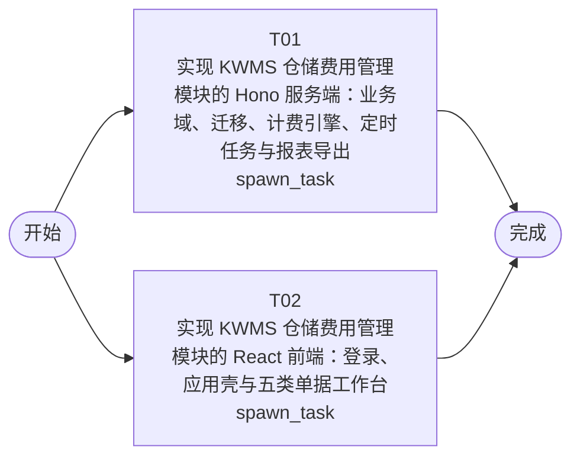

# 开发任务编排

<!-- sourcePlanId: plan:7b25c83a-1430-42e3-bcb5-48cce3983c43 | rendererVersion: 4 -->

## 任务

| 任务 | 一句话目标 | 执行模式 | 依赖 | 能力 |
| --- | --- | --- | --- | --- |
| T01 | 实现 KWMS 仓储费用管理模块的 Hono 服务端：业务域、迁移、计费引擎、定时任务与报表导出 | spawn_task | - | engineering.implementation |
| T02 | 实现 KWMS 仓储费用管理模块的 React 前端：登录、应用壳与五类单据工作台 | spawn_task | - | engineering.implementation |

## 依赖执行图

## 任务契约

### T01

**目标**

## 目标

按已批准架构基线与技术契约，实现 KWMS 仓储费用管理模块（app/kwms-billing）的 Hono 服务端全部业务能力，使「报价配置 → 自动计费 → 费用调整 → 对账 → 结算开票核销」的服务端闭环可用，并以服务端集成测试提供真实行为证据。

## 写入责任（唯一 owner）

- 独占拥有 `app/kwms-billing/src/server/`、`app/kwms-billing/src/shared/`、`app/kwms-billing/test/`。
- 作为 `app/kwms-billing/package.json` 与根 `package-lock.json` 的唯一写入 owner（新增 node-cron、xlsx 运行时依赖并完成安装）。
- 不修改 `app/kwms-billing/src/client/` 与 `app/kwms-billing/index.html`（前端任务所有）。

## 交付内容

- 数据迁移（自 0004 起编号）：主数据（organizations/warehouses/owners/contracts/fee_types/goods_categories/goods/inventory）、报价单（cc_quotes/cc_quote_lines/cc_quote_discounts）、计费（receivable_details/job_runs/notifications）、调整（fee_adjustments/fee_adjustment_lines）、对账（recon_statements/recon_statement_lines）、结算（settle_statements/invoices/writeoffs）、change_logs；迁移后种子脚本（四类角色与权限点绑定、费用类型与货品类别基础档案、示例主数据与库存）。
- 业务域服务（对齐架构第 2 节模块划分）：主数据维护；报价单全部保存校验与状态流转（审核生效/终止、修改前后快照日志）；计费引擎（三种计费模式、MeasureProvider 月度口径策略点、分段优惠区间匹配、最低收费、单一舍入策略点）；按天计费、按月计费、合同过期检测三个定时任务（node-cron 进程内调度、job_runs 防重、异常记录与库存缺失通知）；费用重算（清空重算、已对账拦截）；费用调整单（周期加载暂存明细、审核事务内回写应收明细金额）；对账单（汇总暂存明细、审核单事务锁定明细并自动创建一一绑定结算单）；结算单（结算金额微调校验、开票与核销累计约束事务）；审计事件与 change_logs 查询；计费/对账/结算 Excel 报表导出（xlsx 流式输出）。
- 平台绑定：在 `src/server/platform/authorization.ts` 注册技术契约 1.1 节全部权限点与四类角色默认绑定（quote:audit、adjustment:audit 默认不绑定任何角色）；应答金额字段级角色过滤策略点；单据编码事务内取号（CCHT/YSTZ/YSDZ/YSJS-YYYYMMDD-NNNNN，页面只读）。
- 全部金额字段整数「分」存储与传输；组织隔离、错误码与错误结构严格按 technical-contract.md 第 13 节。

## 验证

- 在 app/kwms-billing 内运行 `npm run typecheck:server` 与 `npm test`（新增服务端测试覆盖：三种计费模式与分段优惠计算、保存校验逐条拦截、状态流转约束、对账审核事务与自动结算单、开票/核销累计拦截、组织隔离与权限点拒绝、定时任务过滤与防重），报告真实命令结果。
- 整包 `npm run build` 与浏览器端到端验收属后续 verification 阶段，不在本任务执行。

## 跨任务 AC 贡献

- 本任务承担 AC-01～AC-13 全部验收条件的服务端权威校验、计算与事务承载；AC-13 性能由按仓库/货主分组的分块事务批量计费实现。
- AC-01/05/06/07/08/09 的用户界面交互与 AC-10/11/12 的前端呈现由并行前端任务 T02 承担；合并后的端到端验收由后续 verification 阶段负责。

**角色:** general-app-development-expert  \  **失败策略:** block

**需求**

- AC-01
- AC-02
- AC-03
- AC-04
- AC-05
- AC-06
- AC-07
- AC-08
- AC-09
- AC-10
- AC-11
- AC-12
- AC-13

**输入**

- docs/wi-t1000065/requirements.md
- docs/wi-t1000065/architecture-baseline.md
- docs/wi-t1000065/technical-contract.md

**产物**

- app/kwms-billing/src/server/
- app/kwms-billing/src/shared/
- app/kwms-billing/test/

**可写范围**

- app/kwms-billing/src/server/
- app/kwms-billing/src/shared/
- app/kwms-billing/test/
- app/kwms-billing/package.json
- package-lock.json

**阻塞码**

- （无）

### T02

**目标**

## 目标

按技术契约实现 KWMS 仓储费用管理模块（app/kwms-billing）的 React/Vite 浏览器端全部页面与交互：登录、应用壳与「仓储费用管理」一级菜单下的五类单据工作台、报表导出、基础档案与系统管理，前端第一道校验与中文提示齐备，PC 端（≥1280px）业务后台形态。

## 写入责任（唯一 owner）

- 独占拥有 `app/kwms-billing/src/client/` 与 `app/kwms-billing/index.html`（页面标题等 Vite shell 微调）。
- 不修改 `app/kwms-billing/src/server/`、`app/kwms-billing/src/shared/`、`app/kwms-billing/test/`、`app/kwms-billing/package.json` 与根 `package-lock.json`（后端任务 T01 所有）；不新增前端依赖，操作按钮使用文字样式；前端类型与 API 调用完全按 technical-contract.md 定义于 src/client/ 内，不虚构 API 行为。

## 交付内容

- 应用壳：左侧导航（仓储合同报价单、应收费用明细、应收费用调整单、应收对账单、应收结算单、报表导出、基础档案、系统管理）+ 顶部上下文栏（当前用户、所属组织、角色）+ 主工作区（列表+筛选+表格+行操作/弹窗表单）。
- 页面：登录页；报价单列表/详情/新建编辑（头部字段联动：组织→仓库、货主类型→货主；费用明细行增删；分段优惠弹窗增删与区间约束；一口价模式单价置灰、金额可编辑；billNo 只读；审核/终止操作）；应收费用明细查询（周期/组织/仓库/货主/费用类型/状态筛选）与批量【费用重算】；费用调整单（业务周期选择、【添加费用明细】加载暂存明细、带出行费用类型锁定、手动空白行、调整金额仅正数拦截、审核生效）；对账单生成（按组织/仓库/结算方/业务周期）与审核后锁定态展示；结算单（头部四个金额字段只读、【开票】弹窗（开票人/发票号码/金额）累计超额前端拦截、【核销】弹窗无有效开票拦截、费用明细/开票明细标签页）；报表导出（按货主/仓库/业务周期，浏览器下载 xlsx）；基础档案（费用类型、货品类别维护）；用户与角色管理（复用并扩展 starter 用户管理页，承载角色权限配置）；定时任务执行记录与审计事件/变更日志查询页。
- 交互基线：必填、数值超限、区间冲突给出明确中文提示（按错误码总表映射 error.code/message，字段定位）；金额元↔分换算展示（2 位小数）；403 权限提示、404、加载骨架与空态提示；按登录会话 permissions 控制操作入口可见性；单元格超长文本悬停标题。
- 视觉遵循架构设计第 4 节 saas-ops-console 模板：Modern SaaS 风格（柔和中性色、细边界、少阴影、中等圆角、单一主色+状态色），基于现有 Tailwind 配置实现。

## 验证

- 在 app/kwms-billing 内运行 `npm run typecheck:client` 与 `npm run build:client`，报告真实命令结果。
- 整包 `npm run build` 与浏览器端到端验收属后续 verification 阶段，不在本任务执行（不连接真实后端联调）。

## 跨任务 AC 贡献

- 承担 AC-01 前端第一道校验与置灰控制；AC-02/03 应收明细金额展示（元换算）；AC-05/06 重算与调整单界面交互及拦截提示；AC-07 对账单界面与审核锁定态；AC-08/09 开票/核销弹窗与前端累计拦截；AC-10 组织下拉过滤与跨组织访问错误提示；AC-11 按权限渲染操作与 403 提示；AC-12 审计/变更日志查询与报表导出入口。
- 服务端计算、事务与性能承载（AC-04、AC-13 及各 AC 服务端权威复验）由并行后端任务 T01 承担；合并后的端到端验收由后续 verification 阶段负责。

**角色:** general-app-development-expert  \  **失败策略:** block

**需求**

- AC-01
- AC-02
- AC-03
- AC-05
- AC-06
- AC-07
- AC-08
- AC-09
- AC-10
- AC-11
- AC-12

**输入**

- docs/wi-t1000065/requirements.md
- docs/wi-t1000065/architecture-baseline.md
- docs/wi-t1000065/technical-contract.md

**产物**

- app/kwms-billing/src/client/

**可写范围**

- app/kwms-billing/src/client/
- app/kwms-billing/index.html

**阻塞码**

- （无）
