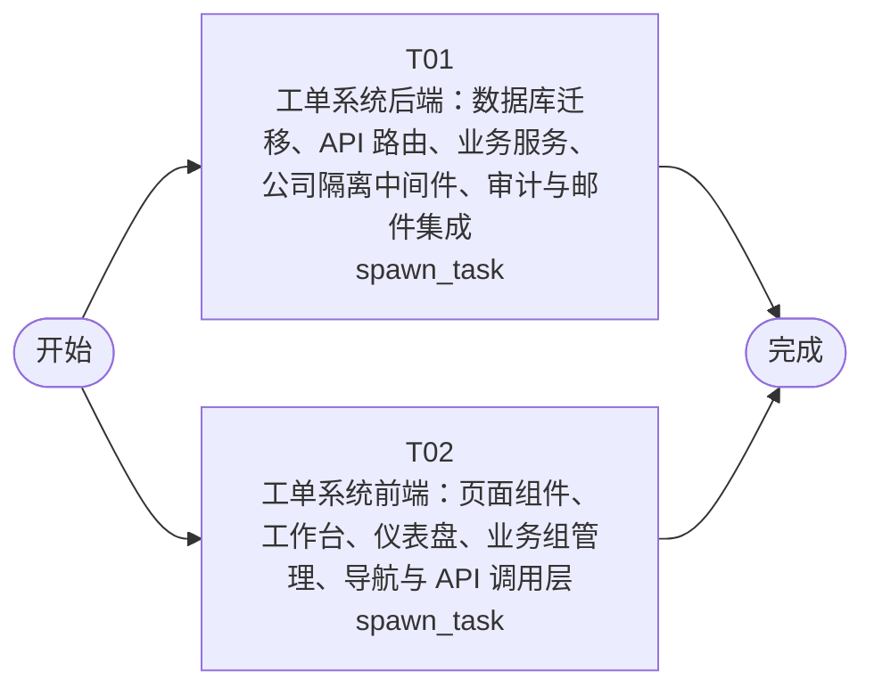

# 开发任务编排

<!-- sourcePlanId: plan:e7cc1a61-bda8-4e4e-8ab9-3173488cba26 | rendererVersion: 4 -->

## 任务

| 任务 | 一句话目标 | 执行模式 | 依赖 | 能力 |
| --- | --- | --- | --- | --- |
| T01 | 工单系统后端：数据库迁移、API 路由、业务服务、公司隔离中间件、审计与邮件集成 | spawn_task | - | engineering.implementation |
| T02 | 工单系统前端：页面组件、工作台、仪表盘、业务组管理、导航与 API 调用层 | spawn_task | - | engineering.implementation |

## 依赖执行图

## 任务契约

### T01

**目标**

## 目标

实现工单系统完整后端，覆盖技术契约定义的全部服务端 API 和数据模型。

## 范围

### 数据库迁移
- 新增迁移文件 `0004_ticket_system.sql`，创建以下表：companies、departments、ticket_categories、tickets、ticket_replies、business_groups、business_group_members、auto_assign_rules、ticket_transfers、ticket_evaluations
- 在 users 表上扩展 company_id、department_id、role 字段（若 userkit 迁移未包含）
- 所有业务表包含 company_id 字段以实现公司隔离

### 共享类型与枚举
- 在 `src/shared/` 创建平台中立的 TypeScript 类型定义：TicketStatus、SLAPriority、UserRole、TransferTargetType 枚举；Ticket、TicketDetail、TicketReply、BusinessGroup、BusinessGroupMember、AutoAssignRule、TicketCategory、TicketEvaluation、SubmitterInfo、OperationLog、TicketTransfer 接口
- 所有类型严格遵循 technical-contract.md 定义

### 公司隔离中间件
- 实现请求级公司隔离中间件，从当前用户注入 company_id 过滤
- 路径参数中的 :companyId 必须与当前用户公司一致，否则返回 403

### 工单 API 路由
- `POST /api/tickets` — 创建工单，触发自动分配规则匹配
- `GET /api/tickets` — 分页查询，支持 status/slaPriority/categoryId/keyword 筛选和 sortBy/sortOrder 排序
- `GET /api/tickets/:id` — 工单详情含回复列表
- `PUT /api/tickets/:id` — 更新工单基本信息
- `POST /api/tickets/:id/replies` — 添加回复
- `GET /api/tickets/:id/replies` — 回复列表按时间升序
- `POST /api/tickets/:id/assign` — 手动分配
- `POST /api/tickets/:id/transfer` — 转派，记录 ticket_transfer
- `POST /api/tickets/:id/complete` — 完成工单，记录处理人/时间，异步发送邮件
- `POST /api/tickets/:id/cancel` — 取消工单
- `GET /api/tickets/:id/submitter-info` — 提交人完整信息含历史工单
- `GET /api/tickets/:id/logs` — 工单操作日志
- `GET /api/tickets/:id/evaluation` — 获取评价
- `POST /api/tickets/:id/evaluation` — 提交满意度评价（1-5 分）

### 业务组与分配 API
- `GET/POST /api/companies/:companyId/groups` — 业务组列表与创建
- `GET/POST /api/companies/:companyId/groups/:groupId/members` — 成员管理
- `DELETE /api/companies/:companyId/groups/:groupId/members/:userId` — 移除成员
- `GET/POST /api/companies/:companyId/auto-assign-rules` — 自动分配规则（幂等：同 categoryId 仅一条）
- `GET/POST /api/companies/:companyId/categories` — 问题分类管理

### 统计分析与工作台 API
- `GET /api/statistics/distribution` — 按公司/部门维度统计工单分布
- `GET /api/statistics/dashboard` — 仪表盘：工单量、平均响应时间、满意度、热点问题
- `GET /api/workbench/tickets` — 待处理工单列表，支持筛选/搜索/排序

### 审计日志集成
- 在工单创建、分配、转派、回复、完成、取消各操作点写入 audit_event
- 通过 auditkit 的 record 接口持久化

### 邮件通知集成
- 工单完成时通过 emailkit 异步发送邮件到提交人邮箱
- SMTP 未配置时降级为日志记录，不阻塞工单完成

### 权限控制
- 基于 permissionkit 实现 RBAC：submitter/handler/admin 角色权限校验
- 各 API 端点按 technical-contract.md 定义的授权角色校验

### 用户扩展
- 扩展用户模型以承载公司、部门、角色信息
- `GET /api/users` — 按公司筛选用户列表
- `POST /api/users` — 管理员创建用户（含公司、部门、角色）

### package.json
- 添加 `migrate` 脚本执行 dbkit 版本化迁移

## 验证
- `npm run typecheck:server` 通过
- `npm test` 通过（含平台基线测试和新增工单业务测试）
- 服务可启动并响应 API 请求

## 输入
- 遵循 technical-contract.md 的全部 API 契约、类型定义和枚举值
- 遵循 architecture-baseline.md 的数据模型、公司隔离策略和运行约定

**角色:** general-app-development-expert  \  **失败策略:** block

**需求**

- AC-01
- AC-02
- AC-03
- AC-04
- AC-05
- AC-06
- AC-07
- AC-08
- AC-09
- AC-10

**输入**

- docs/wi-t1000074/requirements.md
- docs/wi-t1000074/architecture-baseline.md
- docs/wi-t1000074/technical-contract.md

**产物**

- app/ticket-system/src/server/
- app/ticket-system/src/shared/

**可写范围**

- app/ticket-system/src/server/
- app/ticket-system/src/shared/
- app/ticket-system/package.json
- app/ticket-system/test/

**阻塞码**

- TASK_FAILED

### T02

**目标**

## 目标

实现工单系统完整前端界面，覆盖需求定义的全部用户交互功能。

## 范围

### 应用壳与导航
- 左侧固定导航栏：工单工作台、工单管理、统计分析、业务组管理、分类管理
- 顶部上下文栏：当前用户信息、公司显示
- 替换现有 App.tsx 的用户管理主界面为工单系统主界面
- 保留登录/引导流程

### API 调用层
- 在 `src/client/platform/api-client.ts` 基础上扩展工单系统 API 调用函数
- 覆盖 technical-contract.md 定义的全部前端→后端接口
- 使用契约定义的 TypeScript 类型（前端可基于契约自定义类型）

### 工单工作台页面
- 展示待处理工单列表，默认按 SLA 优先级降序
- 支持按公司维度筛选（管理员）
- 支持关键词搜索（title/description）
- 支持字段排序（slaPriority/createdAt/updatedAt）
- 支持按状态、优先级、分类筛选

### 工单管理页面（split-master-detail 布局）
- 左侧：工单列表含筛选、搜索、排序
- 右侧：选中工单详情面板
- 工单详情展示：工单字段、回复列表（按时间排列）、操作按钮
- 工单创建表单：主题、描述、分类、SLA 优先级
- 工单操作：分配、转派、完成、取消
- 回复功能：在详情中添加回复

### 提交人信息查看
- 在工单详情中展示提交人完整信息：姓名、公司、部门
- 展示提交人历史工单列表

### 用户评价
- 工单完成后展示评价入口
- 满意度评价表单（1-5 分评分 + 可选评论）
- 评价结果展示

### 业务组管理页面
- 业务组列表与创建
- 业务组成员管理（添加/移除）
- 自动分配规则配置（分类→业务组）

### 分类管理页面
- 问题分类列表与创建

### 统计分析仪表盘
- 工单分布统计：按公司/部门维度切换
- 运营指标卡片：工单量、平均响应时间、满意度
- 热点问题列表
- 使用 ECharts 或简洁 CSS 图表展示

### 全局状态
- 列表和详情加载时显示骨架屏
- 无工单时显示空态提示和创建入口
- API 错误时显示错误提示，支持重试
- 无权限时显示无权限提示

### 视觉风格
- Modern SaaS 风格：柔和中性色、细边界、少阴影、中等圆角
- 使用 Tailwind CSS 和 Lucide 图标
- 状态色用于工单状态和优先级标识
- 桌面 Web，最小宽度 1280px

## 验证
- `npm run typecheck:client` 通过
- `npm run build:client` 通过
- 前端开发服务器可启动并渲染页面

## 输入
- 遵循 technical-contract.md 的全部 API 契约和类型定义
- 遵循 architecture-baseline.md 的 UI 全局基线和展示模板
- 使用契约定义的类型，不臆造 API 行为

**角色:** general-app-development-expert  \  **失败策略:** block

**需求**

- AC-01
- AC-02
- AC-03
- AC-04
- AC-05
- AC-06
- AC-07
- AC-08
- AC-09
- AC-10

**输入**

- docs/wi-t1000074/requirements.md
- docs/wi-t1000074/architecture-baseline.md
- docs/wi-t1000074/technical-contract.md

**产物**

- app/ticket-system/src/client/

**可写范围**

- app/ticket-system/src/client/
- app/ticket-system/index.html
- app/ticket-system/tailwind.config.js

**阻塞码**

- TASK_FAILED
