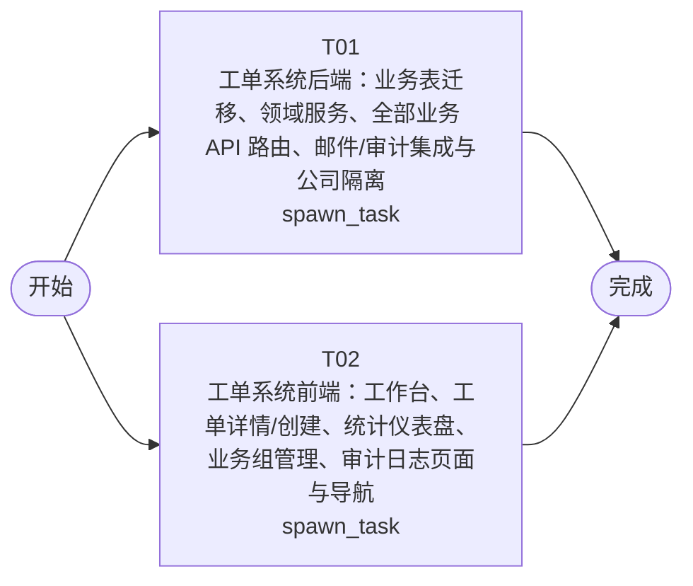

# 开发任务编排

<!-- sourcePlanId: plan:972af39a-845b-48ef-a375-fd202b3f08c4 | rendererVersion: 4 -->

## 任务

| 任务 | 一句话目标 | 执行模式 | 依赖 | 能力 |
| --- | --- | --- | --- | --- |
| T01 | 工单系统后端：业务表迁移、领域服务、全部业务 API 路由、邮件/审计集成与公司隔离 | spawn_task | - | engineering.implementation |
| T02 | 工单系统前端：工作台、工单详情/创建、统计仪表盘、业务组管理、审计日志页面与导航 | spawn_task | - | engineering.implementation |

## 依赖执行图

## 任务契约

### T01

**目标**

## 范围

实现工单系统的完整后端，覆盖 AC-01 至 AC-10 的服务端行为。

### 数据库迁移
- 创建 `0002_business_tables.sql` 迁移文件，建立以下业务表：companies、departments、user_profiles、tickets、ticket_replies、business_groups、business_group_members、category_assignment_rules、ticket_evaluations
- 表结构遵循架构基线 §4.2 的数据模型定义
- user_profiles 扩展 userkit 管理的 users 表，补充 company_id、department_id、full_name

### 平台集成
- 在 `platform/bootstrap.ts` 中接入 emailkit（createEmailClient）和 auditkit（createAuditKit）— 无 SMTP 配置时 emailkit 降级为控制台输出
- auditkit 提供审计事件记录能力，供业务服务调用

### 公司隔离中间件
- 创建公司隔离中间件，从认证用户上下文提取 companyId 并注入请求上下文
- 所有工单相关查询自动附加公司过滤条件

### 领域服务与路由
在 `routes.ts` 或新建 `services/` 目录中实现以下全部 API（接口定义见 technical-contract.md）：
- 工单管理：POST/GET/PATCH /api/tickets，POST/GET /api/tickets/:id/replies，POST /api/tickets/:id/evaluation，GET /api/tickets/:id/submitter，POST /api/tickets/:id/transfer
- 组织管理：GET/POST /api/companies，GET/POST /api/companies/:companyId/departments，GET/POST /api/companies/:companyId/groups，GET/POST/DELETE 成员管理，GET/POST /api/companies/:companyId/assignment-rules
- 统计分析：GET /api/statistics/distribution，GET /api/statistics/dashboard
- 审计日志：GET /api/audit-logs

### 工单分配引擎
- 工单创建时检查当前公司的分类分配规则，匹配则自动分配到对应业务组并进入 pending_process 状态
- 未匹配则进入 pending_assign 状态

### 工单完成与邮件通知
- 工单完成时设置 handlerUserId 和 processedAt
- 调用 emailkit 向提交人邮箱发送完成通知
- 邮件发送失败时记录错误日志，不影响工单完成状态

### 审计日志记录
- 在工单创建、分配、转派、完成、取消操作后调用 auditkit.record 记录审计事件
- 审计事件类型：ticket.created、ticket.assigned、ticket.transferred、ticket.completed、ticket.cancelled

### 共享类型
- 在 `src/shared/` 创建平台中立的 TypeScript 类型定义和常量（工单状态枚举、SLA优先级、API请求/响应类型）
- 仅使用纯 TypeScript，不依赖 Node API、Hono、React 或 DOM

### 验证
- 运行 `npm run typecheck:server` 通过服务端类型检查
- 运行 `npm test` 确保现有测试和新增业务测试通过
- 编写 `test/ticket.test.mjs` 验证工单创建、分配、转派、完成、取消、回复、评价等核心流程

**角色:** general-app-development-expert  \  **失败策略:** block

**需求**

- AC-01
- AC-02
- AC-03
- AC-04
- AC-05
- AC-06
- AC-07
- AC-08
- AC-10

**输入**

- docs/wi-t1000076/requirements.md
- docs/wi-t1000076/architecture-baseline.md
- docs/wi-t1000076/technical-contract.md

**产物**

- app/ticket-system/src/shared/
- app/ticket-system/src/server/
- app/ticket-system/test/

**可写范围**

- app/ticket-system/src/shared/
- app/ticket-system/src/server/
- app/ticket-system/test/

**阻塞码**

- TASK_FAILED

### T02

**目标**

## 范围

实现工单系统的完整前端 SPA，覆盖 AC-01 至 AC-09 和 AC-10 的用户界面行为。

### 应用导航与布局
- 改造 `App.tsx`，添加左侧导航栏（工单工作台、创建工单、统计分析、业务组管理、分类分配规则、审计日志）
- 顶部上下文栏显示当前用户信息和登出
- 使用 react-router-dom 实现页面路由
- 遵循 split-master-detail 布局风格（工作台左侧列表、右侧详情）

### 工单工作台 (AC-09)
- 左侧待处理工单列表，支持按公司筛选、关键词搜索、按创建时间/优先级排序
- 右侧选中工单的详情面板
- 列表支持分页

### 工单创建 (AC-01)
- 表单填写主题、描述、分类、SLA优先级（P0-P4下拉）
- 创建后显示工单ID和初始状态

### 工单详情与处理 (AC-01, AC-02, AC-05, AC-06)
- 显示工单完整信息和状态
- 多轮回复列表（按时间排序），支持添加回复
- 工单分配操作（选择业务组或处理人）
- 工单转派操作（待处理状态下）
- 工单完成操作（记录处理人和处理时间）
- 工单取消操作
- 查看提交人完整信息（姓名、公司、部门、历史工单）

### 用户评价 (AC-07)
- 已完成工单显示满意度评价入口
- 使用 1-5 星级评价

### 统计分析 (AC-08)
- 工单分布统计：按公司维度和部门维度展示
- 运营仪表盘：工单量（含状态分布）、平均响应时间、满意度汇总、热点问题分类排名
- 使用简洁的表格或卡片展示，不引入额外图表库

### 业务组管理 (AC-04)
- 创建业务组、添加/移除成员
- 配置分类自动分配规则（分类→业务组映射）

### 审计日志 (AC-10)
- 审计日志列表页面，支持按工单ID和事件类型筛选

### 样式
- 使用 Tailwind CSS，遵循 Modern SaaS 视觉风格
- 状态色：绿色（完成）、琥珀色（待处理/待分配）、红色（取消/P0）、灰色（创建）
- 桌面 Web 布局（最小宽度 1024px）

### 验证
- 运行 `npm run typecheck:client` 通过客户端类型检查
- 运行 `npm run build:client` 通过前端构建
- 前端使用 technical-contract.md 定义的 API 契约类型，不臆造 API 行为

**角色:** general-app-development-expert  \  **失败策略:** block

**需求**

- AC-01
- AC-02
- AC-03
- AC-04
- AC-05
- AC-06
- AC-07
- AC-08
- AC-09
- AC-10

**输入**

- docs/wi-t1000076/requirements.md
- docs/wi-t1000076/architecture-baseline.md
- docs/wi-t1000076/technical-contract.md

**产物**

- app/ticket-system/src/client/

**可写范围**

- app/ticket-system/src/client/

**阻塞码**

- TASK_FAILED
