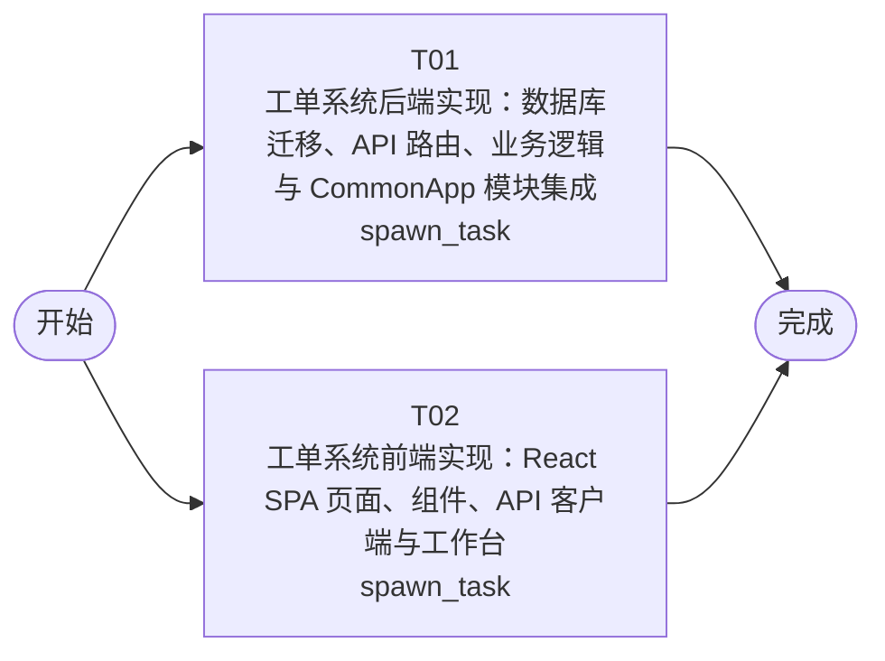

# 开发任务编排

<!-- sourcePlanId: plan:f25d61de-ed8d-445e-bbba-b5aba4905e37 | rendererVersion: 4 -->

## 任务

| 任务 | 一句话目标 | 执行模式 | 依赖 | 能力 |
| --- | --- | --- | --- | --- |
| T01 | 工单系统后端实现：数据库迁移、API 路由、业务逻辑与 CommonApp 模块集成 | spawn_task | - | engineering.implementation |
| T02 | 工单系统前端实现：React SPA 页面、组件、API 客户端与工作台 | spawn_task | - | engineering.implementation |

## 依赖执行图

## 任务契约

### T01

**目标**

### 后端实现目标

实现工单系统完整后端，覆盖 technical-contract.md 定义的全部 API 端点。

#### 范围

- **数据库迁移**：创建业务表（companies, departments, business_groups, business_group_members, ticket_categories, category_assignment_rules, tickets, ticket_replies, ticket_transfers, ticket_satisfactions, user_profiles），与已安装 CommonApp 模块迁移（0001_platform_users, 0002_platform_permissions, 0003_platform_audit_events）协调编号
- **API 路由**：按 technical-contract.md 实现认证、用户、组织管理、工单、工作台、统计、日志全部端点
- **业务逻辑**：工单创建时按分类规则自动分配、转派回退至待分配、完成时邮件通知（emailkit）、全生命周期审计日志（auditkit）
- **公司隔离**：Company Scope 中间件注入 company_id，所有业务查询自动过滤；admin 可通过查询参数跨公司
- **权限控制**：基于 permissionkit 实现 submitter/handler/admin 角色与端点级权限检查

#### 写入范围

- `src/server/`：路由、服务、仓储、中间件、平台绑定
- `src/shared/`：共享类型、枚举、常量（后端拥有此目录）
- `src/server/migrations/sqlite/`：业务表迁移文件
- `test/`：工单系统测试与 QA fixture 扩展
- `package.json`、`tsconfig.json`、`tsconfig.server.json`：依赖与编译配置

#### 验证

- `npx tsc --noEmit -p tsconfig.server.json` 类型检查通过
- `node --test test/` 测试通过
- 启动服务后 API 响应符合技术契约字段与错误码

#### 跨任务协调

- 前端任务（T02）引用同一 technical-contract.md，使用 src/shared/ 中的类型定义；后端完成后前端可独立类型检查
- `package.json` 由后端唯一拥有，前端依赖声明通过后端管理
- 最终 E2E 集成与 QA 由后续验证阶段覆盖

**角色:** general-app-development-expert  \  **失败策略:** block

**需求**

- AC-01
- AC-02
- AC-03
- AC-04
- AC-05
- AC-06
- AC-07
- AC-08
- AC-09
- AC-10
- AC-11

**输入**

- docs/wi-t1000077/requirements.md
- docs/wi-t1000077/architecture-baseline.md
- docs/wi-t1000077/technical-contract.md

**产物**

- app/ticket-system/src/server/
- app/ticket-system/src/shared/
- app/ticket-system/src/server/migrations/sqlite/

**可写范围**

- app/ticket-system/src/server/
- app/ticket-system/src/shared/
- app/ticket-system/src/server/migrations/sqlite/
- app/ticket-system/package.json
- app/ticket-system/tsconfig.json
- app/ticket-system/tsconfig.server.json
- app/ticket-system/test/

**阻塞码**

- （无）

### T02

**目标**

### 前端实现目标

实现工单系统完整前端 SPA，覆盖需求定义的全部用户界面，使用 technical-contract.md 定义的类型和接口契约。

#### 范围

- **应用壳与导航**：左侧导航栏（工单工作台、创建工单、统计分析、业务组管理、分类与规则管理、操作日志），顶部上下文栏（用户信息、公司名称、角色标识）
- **工单工作台（split-master-detail）**：左侧待处理工单列表（公司筛选、状态/优先级/分类筛选、关键词搜索、列头排序），右侧详情面板（工单基本信息、提交人信息含历史工单、回复列表、处理操作区、满意度评价区）
- **工单创建**：表单填写主题、描述、分类、SLA 优先级
- **业务组管理**：admin 页面，创建业务组、管理成员、配置分类分配规则
- **统计分析仪表盘**：KPI 卡片（工单量、平均响应时间、满意度），图表区（工单分布按公司/部门、热点问题 Top 5）
- **操作日志**：日志查询页面，支持按工单、操作类型、时间范围筛选
- **API 客户端**：基于 technical-contract.md 封装全部 API 调用，使用 src/shared/ 类型定义
- **全局状态**：加载骨架屏、空数据状态、错误提示、无权限提示、成功 toast

#### 写入范围

- `src/client/`：页面、组件、hooks、API 客户端、样式
- `index.html`、`vite.config.ts`、`tsconfig.client.json`、`tailwind.config.js`、`postcss.config.js`

#### 验证

- `npx tsc --noEmit -p tsconfig.client.json` 类型检查通过
- `npm run build` Vite 构建通过
- 页面交互覆盖 AC-01 至 AC-10 验收场景

#### 跨任务协调

- 引用同一 technical-contract.md 和 src/shared/ 类型，不自行发明 API 行为
- `package.json` 由后端任务（T01）拥有，前端不修改
- 最终 E2E 集成与 QA 由后续验证阶段覆盖

**角色:** general-app-development-expert  \  **失败策略:** block

**需求**

- AC-01
- AC-02
- AC-03
- AC-04
- AC-05
- AC-06
- AC-07
- AC-08
- AC-09
- AC-10
- AC-11

**输入**

- docs/wi-t1000077/requirements.md
- docs/wi-t1000077/architecture-baseline.md
- docs/wi-t1000077/technical-contract.md

**产物**

- app/ticket-system/src/client/

**可写范围**

- app/ticket-system/src/client/
- app/ticket-system/index.html
- app/ticket-system/vite.config.ts
- app/ticket-system/tsconfig.client.json
- app/ticket-system/tailwind.config.js
- app/ticket-system/postcss.config.js

**阻塞码**

- （无）
