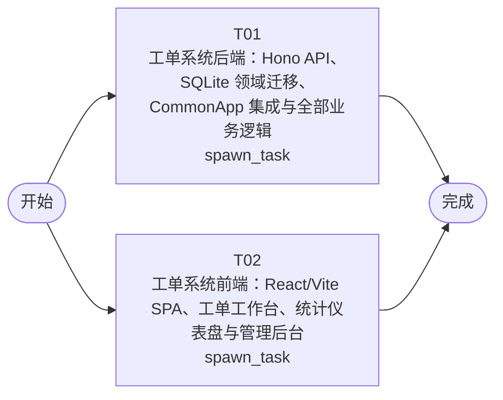

# 开发任务编排

<!-- sourcePlanId: plan:589875c6-5c14-4e9b-9ccc-4b2c81cd19b9 | rendererVersion: 4 -->

## 任务

| 任务 | 一句话目标 | 执行模式 | 依赖 | 能力 |
| --- | --- | --- | --- | --- |
| T01 | 工单系统后端：Hono API、SQLite 领域迁移、CommonApp 集成与全部业务逻辑 | spawn_task | - | engineering.implementation |
| T02 | 工单系统前端：React/Vite SPA、工单工作台、统计仪表盘与管理后台 | spawn_task | - | engineering.implementation |

## 依赖执行图

## 任务契约

### T01

**目标**

## 目标

实现工单系统完整后端，覆盖技术契约定义的全部 API 端点、10 张领域表迁移和 6 个 CommonApp 模块集成。

### 实现范围

- **领域迁移**（`src/server/migrations/sqlite/` 0004-0010）：companies、departments、user_profiles、tickets、ticket_replies、business_groups、business_group_members、assignment_rules、ticket_evaluations、ticket_transfer_records
- **平台绑定**：dbkit（数据库初始化与 runMigrations）、authkit（Bearer 认证中间件）、userkit（用户账户与 user_profiles 映射）、permissionkit（submitter/handler/admin 三角色 RBAC）、auditkit（操作日志 record）、emailkit（SMTP createEmailClient 发送通知）
- **认证与授权**：POST /api/auth/login、POST /api/auth/logout、GET /api/auth/me；认证中间件从 authkit 会话解析 user_id，通过 user_profiles 映射 company_id 和 role；所有查询附加 company_id 过滤；角色权限检查中间件
- **工单管理 API**：GET /api/tickets（筛选/搜索/排序/分页）、POST /api/tickets（创建并触发自动分配）、GET /api/tickets/:id（详情含回复/评价/日志）、PATCH /api/tickets/:id/status（状态流转校验）、POST /api/tickets/:id/replies（多轮回复）
- **工单分配 API**：GET/POST /api/business-groups、POST/DELETE /api/business-groups/:id/members、GET/POST/DELETE /api/assignment-rules；创建工单时按 company_id + category 匹配分配规则，命中则分配到目标业务组并流转到 pending_processing
- **工单协作 API**：POST /api/tickets/:id/transfer（转派到目标业务组，记 ticket_transfer_records，状态保持 pending_processing）
- **工单处理 API**：GET /api/users/:id/profile（提交人完整信息含历史工单）、POST /api/tickets/:id/complete（记录 handler_id/completed_at，触发 emailkit 发送邮件到 submitter_email，邮件失败不回滚工单状态仅记日志）
- **用户评价 API**：POST /api/tickets/:id/evaluation（1-5 星，仅 completed 工单，一对一）、GET /api/tickets/:id/evaluation
- **统计分析 API**：GET /api/statistics/overview（工单量/平均响应时间=创建到首次回复/平均满意度/热点分类 Top5）、GET /api/statistics/distribution（按 company/department 维度）
- **操作日志 API**：GET /api/tickets/:id/logs（auditkit 审计事件查询，action 枚举：ticket_created/assigned/transferred/processed/completed/cancelled）
- **共享类型**（`src/shared/`）：API 请求/响应 TypeScript 类型、Ticket/TicketDetail 接口、错误码常量、状态/优先级枚举
- **错误格式**：统一 `{error:{code,message,details?}}` 格式，按技术契约错误表实现

### 验证

- `npm run typecheck:server` 通过
- `npm start` 服务正常启动并监听
- test/ 下集成测试覆盖核心 API 端点（认证、工单 CRUD、自动分配、转派、完成、评价、统计）

### 写入范围与所有权

- 拥有 `app/ticket-system/src/server/`（routes、services、repositories、platform bindings、middleware、migrations）
- 拥有 `app/ticket-system/src/shared/`（共享类型与常量，前端只读引用）
- 拥有 `app/ticket-system/test/`（测试 fixture 与集成测试）
- 拥有 `app/ticket-system/package.json`、`app/ticket-system/tsconfig.json`、`app/ticket-system/tsconfig.server.json`

**角色:** general-app-development-expert  \  **失败策略:** block

**需求**

- AC-01
- AC-02
- AC-03
- AC-04
- AC-05
- AC-06
- AC-07
- AC-08

**输入**

- docs/wi-t1000078/requirements.md
- docs/wi-t1000078/architecture-baseline.md
- docs/wi-t1000078/technical-contract.md

**产物**

- app/ticket-system/src/server/
- app/ticket-system/src/shared/

**可写范围**

- app/ticket-system/src/server/
- app/ticket-system/src/shared/
- app/ticket-system/package.json
- app/ticket-system/tsconfig.json
- app/ticket-system/tsconfig.server.json
- app/ticket-system/test/

**阻塞码**

- （无）

### T02

**目标**

## 目标

实现工单系统完整前端 SPA，覆盖架构基线定义的全部页面与交互，严格基于技术契约实现 API 调用。

### 实现范围

- **应用壳**：左侧导航栏 + 顶部上下文栏 + 主工作区，Modern SaaS 视觉风格（柔和中性色、细边界、少阴影、中等圆角、一个主色与状态色）
- **登录页**：用户名密码登录，调用 POST /api/auth/login，存储 token
- **工单工作台**（默认首页）：split-master-detail 布局
  - 左侧：待处理工单列表，支持按公司筛选、关键词搜索、字段排序（created_at/priority/status）
  - 右侧：工单详情面板——基本信息、提交人信息（姓名/公司/部门/历史工单）、多轮回复列表、操作按钮（回复/转派/完成/取消）、满意度评价区域（1-5 星）
- **工单管理**：创建工单表单（主题/描述/分类/SLA优先级 P0-P4）、全部工单列表
- **统计分析**：command-center-dashboard 布局
  - 顶部维度切换（公司/部门）
  - KPI 卡片行：工单量、平均响应时间、满意度、热点分类
  - 明细图表与列表（使用 CSS/SVG 轻量图表）
- **管理后台**（仅 admin 可见）：业务组管理（创建/成员增删）、分配规则配置（创建/删除）
- **API 客户端**：基于 `src/client/platform/api-client.ts` 封装全部 API 端点调用，Bearer token 自动注入，错误解码
- **全局状态**：加载中骨架屏、空数据引导文案+创建入口、错误提示+重试按钮、无权限提示
- **图标**：使用 Lucide React 图标库（如需新增依赖，向 package.json owner 协调）

### 前后端协调

- 前端基于 `docs/wi-t1000078/technical-contract.md` 定义 API 类型，可从 `src/shared/` 导入共享类型（后端任务 T01 拥有 `src/shared/`，前端只读引用）
- 前端不发明 API 行为，严格按契约实现请求参数和响应处理
- 聚合 build（`npm run build`）和最终 E2E 集成由后续 QA 验证

### 验证

- `npm run typecheck:client` 通过
- `npm run build:client` 构建成功

### 写入范围与所有权

- 拥有 `app/ticket-system/src/client/`（React 应用、页面、组件、hooks、API 客户端、样式）
- 拥有 `app/ticket-system/index.html`、`app/ticket-system/vite.config.ts`、`app/ticket-system/tsconfig.client.json`、`app/ticket-system/tailwind.config.js`、`app/ticket-system/postcss.config.js`

**角色:** general-app-development-expert  \  **失败策略:** block

**需求**

- AC-01
- AC-02
- AC-03
- AC-04
- AC-05
- AC-06
- AC-07
- AC-08

**输入**

- docs/wi-t1000078/requirements.md
- docs/wi-t1000078/architecture-baseline.md
- docs/wi-t1000078/technical-contract.md

**产物**

- app/ticket-system/src/client/

**可写范围**

- app/ticket-system/src/client/
- app/ticket-system/index.html
- app/ticket-system/vite.config.ts
- app/ticket-system/tsconfig.client.json
- app/ticket-system/tailwind.config.js
- app/ticket-system/postcss.config.js

**阻塞码**

- （无）
