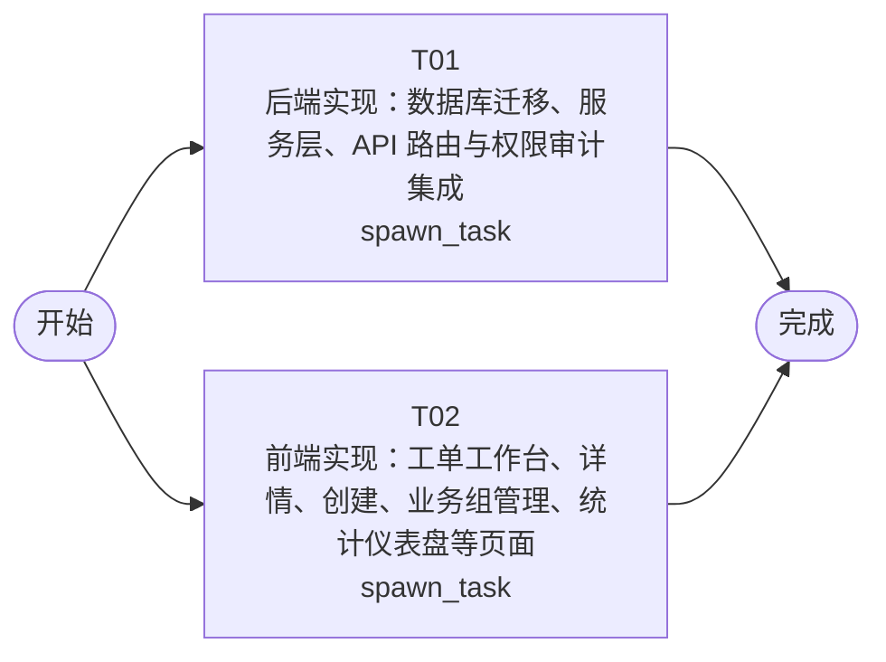

# 开发任务编排

<!-- sourcePlanId: plan:535c8834-dc8c-4e96-bbf1-241a19e8bcf6 | rendererVersion: 4 -->

## 任务

| 任务 | 一句话目标 | 执行模式 | 依赖 | 能力 |
| --- | --- | --- | --- | --- |
| T01 | 后端实现：数据库迁移、服务层、API 路由与权限审计集成 | spawn_task | - | engineering.implementation |
| T02 | 前端实现：工单工作台、详情、创建、业务组管理、统计仪表盘等页面 | spawn_task | - | engineering.implementation |

## 依赖执行图

## 任务契约

### T01

**目标**

## 目标

实现工单系统后端全部业务逻辑，覆盖技术契约定义的所有 API 接口。

### 范围

1. **数据库迁移**（`src/server/migrations/sqlite/0004_ticket_system.sql`）：创建 companies、departments、user_departments、tickets、ticket_replies、business_groups、business_group_members、category_routing_rules、ticket_evaluations 共 9 张项目自有表，遵循架构基线的数据模型定义。

2. **共享类型与常量**（`src/shared/`）：定义工单状态枚举（created/pending_assignment/pending_processing/completed/cancelled）、SLA 优先级枚举（P0-P4）、API 请求/响应 TypeScript 类型、权限键常量。

3. **平台模块集成**（`src/server/platform/bootstrap.ts` 扩展）：初始化 permissionkit（同步角色与权限注册表）、auditkit（审计事件记录）、emailkit（SMTP 客户端）。`src/server/platform/auth.ts` 扩展：在认证中间件中加载用户的公司 ID、角色与权限上下文。

4. **路由实现**（`src/server/routes.ts` 扩展 `registerProtectedRoutes`）：按技术契约实现全部接口：
   - 工单：`GET/POST /api/tickets`、`GET /api/tickets/:id`、`POST /api/tickets/:id/replies`、`POST /api/tickets/:id/transfer`、`POST /api/tickets/:id/complete`、`POST /api/tickets/:id/cancel`、`POST /api/tickets/:id/evaluation`、`GET /api/tickets/:id/logs`
   - 工作台：`GET /api/workbench/tickets`
   - 公司与部门：`GET/POST /api/companies`、`GET/POST /api/companies/:companyId/departments`
   - 业务组：`GET/POST /api/companies/:companyId/business-groups`、`POST /api/business-groups/:groupId/members`、`DELETE /api/business-groups/:groupId/members/:userId`
   - 路由规则：`GET/POST /api/companies/:companyId/routing-rules`
   - 用户：`GET/POST /api/users`
   - 统计：`GET /api/stats/distribution`、`GET /api/stats/dashboard`

5. **业务逻辑**：工单创建时自动匹配 category_routing_rules 分配业务组；工单完成时通过 emailkit 发送邮件通知、通过 auditkit 记录审计事件；公司隔离在所有查询中以 tickets.company_id 为边界；提交人详情含历史工单查询。

### 验证
- `npm run typecheck:server` 通过
- `npm run test` 通过（含已有平台测试与新增业务测试）
- 启动服务后 API 可正常响应

**角色:** general-app-development-expert  \  **失败策略:** block

**需求**

- AC-01
- AC-02
- AC-03
- AC-04
- AC-05
- AC-06
- AC-07
- AC-08
- AC-09
- AC-10
- AC-11
- AC-12
- AC-13

**输入**

- docs/wi-t1000079/architecture-baseline.md
- docs/wi-t1000079/technical-contract.md
- docs/wi-t1000079/requirements.md

**产物**

- app/ticket-system/src/server/migrations/sqlite/0004_ticket_system.sql
- app/ticket-system/src/shared/

**可写范围**

- app/ticket-system/src/server/migrations/sqlite/0004_ticket_system.sql
- app/ticket-system/src/shared/
- app/ticket-system/src/server/routes.ts
- app/ticket-system/src/server/platform/bootstrap.ts
- app/ticket-system/src/server/platform/auth.ts
- app/ticket-system/src/shared/types.ts
- app/ticket-system/src/shared/constants.ts
- app/ticket-system/src/server/services/
- app/ticket-system/src/server/repositories/

**阻塞码**

- （无）

### T02

**目标**

## 目标

实现工单系统前端全部页面与交互，基于技术契约的 API 定义完成 UI 集成。

### 范围

1. **应用壳与导航**（`src/client/App.tsx` 扩展）：左侧导航栏（工单工作台、创建工单、业务组管理、统计分析、用户管理），顶部上下文栏显示当前用户与公司。使用 react-router-dom 路由。视觉预设：Modern SaaS（柔和中性色、细边界、少阴影、中等圆角）。

2. **工单工作台**（`src/client/pages/WorkbenchPage.tsx`）：列表-详情分栏布局，展示待处理工单列表，支持状态/优先级/分类筛选、公司维度筛选、关键词搜索、字段排序。选中工单展示详情。

3. **工单详情**（`src/client/pages/TicketDetailPage.tsx` 或组件）：展示工单完整信息、多轮回复列表（按时间排列）、操作区（转派/完成/取消/评价）、提交人完整信息（姓名、公司、部门、历史工单）、操作日志。

4. **创建工单**（`src/client/pages/CreateTicketPage.tsx`）：表单填写主题、描述、分类、SLA 优先级（P0-P4 选择）。

5. **业务组管理**（`src/client/pages/BusinessGroupPage.tsx`）：业务组列表+成员管理+路由规则配置（分类→业务组映射）。

6. **统计分析**（`src/client/pages/StatsPage.tsx`）：KPI 卡片（工单量/待处理/已完成/已取消）、平均响应时间、满意度评分、热点问题分类列表、按公司/部门维度分布统计。

7. **用户管理**（扩展 `src/client/admin/UsersPage.tsx`）：用户列表+创建用户（含公司、部门设置）。

8. **API 客户端扩展**（`src/client/platform/api-client.ts`）：增加工单、业务组、统计等业务 API 调用方法。

9. **共享类型引用**：从 `src/shared/` 导入类型定义（只读，不写入）。

### 验证
- `npm run typecheck:client` 通过
- `npm run build:client` 通过
- 页面可正常渲染，交互符合技术契约

**角色:** general-app-development-expert  \  **失败策略:** block

**需求**

- AC-01
- AC-02
- AC-03
- AC-04
- AC-05
- AC-06
- AC-07
- AC-08
- AC-09
- AC-10
- AC-11
- AC-12
- AC-13

**输入**

- docs/wi-t1000079/architecture-baseline.md
- docs/wi-t1000079/technical-contract.md
- docs/wi-t1000079/requirements.md

**产物**

- app/ticket-system/src/client/App.tsx

**可写范围**

- app/ticket-system/src/client/App.tsx
- app/ticket-system/src/client/platform/api-client.ts
- app/ticket-system/src/client/index.css
- app/ticket-system/src/client/pages/
- app/ticket-system/src/client/components/

**阻塞码**

- （无）
