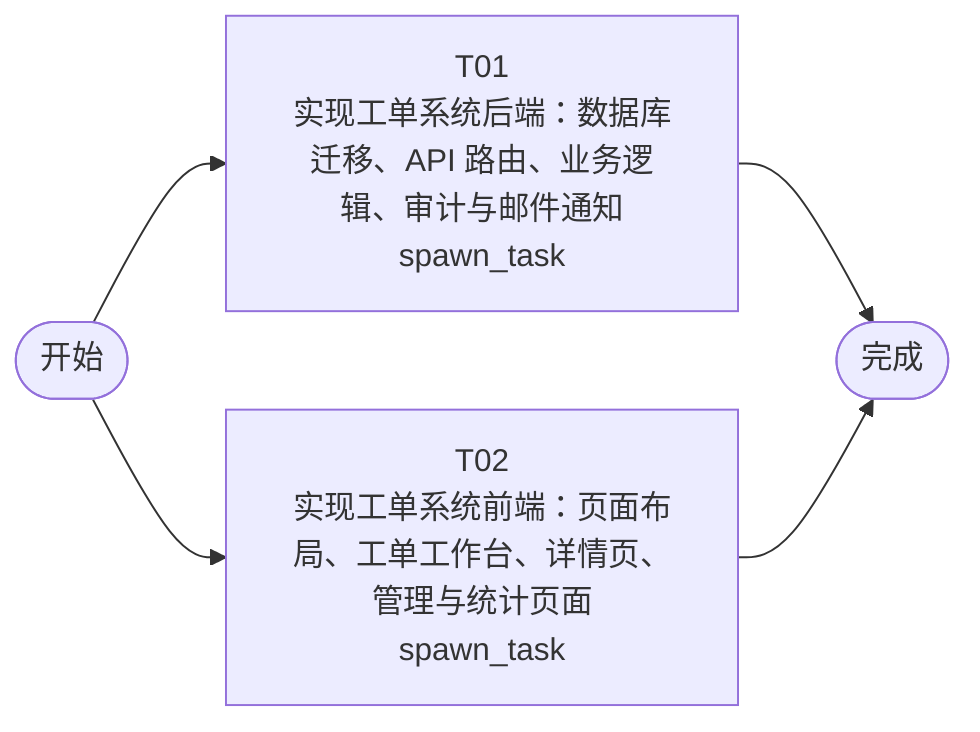

# 开发任务编排

<!-- sourcePlanId: plan:45fe00aa-77cb-47b1-ba73-568a62b3d8e2 | rendererVersion: 4 -->

## 任务

| 任务 | 一句话目标 | 执行模式 | 依赖 | 能力 |
| --- | --- | --- | --- | --- |
| T01 | 实现工单系统后端：数据库迁移、API 路由、业务逻辑、审计与邮件通知 | spawn_task | - | engineering.implementation |
| T02 | 实现工单系统前端：页面布局、工单工作台、详情页、管理与统计页面 | spawn_task | - | engineering.implementation |

## 依赖执行图

## 任务契约

### T01

**目标**

## 范围

实现工单系统完整后端，覆盖 Hono 服务端所有业务 API 路由、数据库 schema 迁移、公司隔离查询、工单生命周期状态机、自动分配规则、转派、满意度评价、统计分析聚合、审计日志记录与邮件通知。

### 数据库迁移
- 新增迁移文件 `src/server/migrations/sqlite/0010_ticket_companies.sql`：创建 companies、departments 表
- 新增迁移文件 `src/server/migrations/sqlite/0011_ticket_profiles.sql`：创建 user_profiles 表（关联 users，含 company_id、department_id、display_name、email、role）
- 新增迁移文件 `src/server/migrations/sqlite/0012_ticket_core.sql`：创建 tickets、ticket_replies、ticket_evaluations 表
- 新增迁移文件 `src/server/migrations/sqlite/0013_ticket_assignment.sql`：创建 business_groups、business_group_members、category_routing_rules、ticket_transfers 表

### 平台接线扩展
- 扩展 `src/server/platform/bootstrap.ts`：初始化 auditkit（createAuditKit）和 emailkit（createEmailClient），注入到 platform 对象
- 扩展 `src/server/platform/auth.ts`：登录响应增加 profileId、companyId、role、displayName 等 user_profiles 字段；注册端点写入 user_profiles；auth 中间件注入 currentUser 含 profileId/companyId/role

### API 路由（在 routes.ts 或新路由文件中注册）
- Auth 扩展：`POST /api/auth/register`（首个用户免认证，后续仅 admin）、`GET /api/auth/me`（返回含公司/部门/角色的完整用户信息）、`POST /api/auth/logout`
- Ticket 路由：`POST /api/tickets`（创建+自动分配匹配）、`GET /api/tickets`（列表筛选/搜索/排序/分页）、`GET /api/tickets/:id`（详情含提交人信息、历史工单、回复、日志、评价）、`POST /api/tickets/:id/replies`、`POST /api/tickets/:id/assign`、`POST /api/tickets/:id/transfer`、`POST /api/tickets/:id/complete`（触发邮件）、`POST /api/tickets/:id/cancel`、`POST /api/tickets/:id/evaluation`、`GET /api/tickets/:id/logs`
- Assignment 路由：`GET/POST /api/business-groups`、`POST /api/business-groups/:id/members`、`DELETE /api/business-groups/:id/members/:profileId`、`GET/POST /api/routing-rules`
- Statistics 路由：`GET /api/statistics/distribution`、`GET /api/statistics/dashboard`

### 业务逻辑
- 工单状态机：created→pending_assignment→pending_processing→completed；pending_assignment/pending_processing→cancelled；pending_processing→pending_processing（转派）
- 公司隔离：所有查询附加 company_id = currentUser.companyId
- 自动分配：工单创建时查询 category_routing_rules 匹配 company_id+category，命中则分配到目标组并转入 pending_processing
- 审计日志：在创建、分配、转派、完成、取消操作后调用 auditKit.record()
- 邮件通知：工单完成时调用 emailClient.send()，SMTP 未配置或失败时降级不阻塞

### 共享类型
- `src/shared/types.ts`：TicketStatus、SLAPriority、UserRole 枚举与 API 类型定义

### 验证
- `npm run typecheck:server` 通过
- `npm test` 通过现有测试和新增测试

**角色:** general-app-development-expert  \  **失败策略:** block

**需求**

- AC-01
- AC-02
- AC-03
- AC-04
- AC-06
- AC-07
- AC-08
- AC-09
- AC-10
- AC-11
- AC-12
- AC-14

**输入**

- docs/wi-t1000080/requirements.md
- docs/wi-t1000080/architecture-baseline.md
- docs/wi-t1000080/technical-contract.md

**产物**

- app/ticket-system/src/server/
- app/ticket-system/src/shared/
- app/ticket-system/test/
- app/ticket-system/package.json
- app/ticket-system/tsconfig.json
- app/ticket-system/tsconfig.server.json

**可写范围**

- app/ticket-system/src/server/
- app/ticket-system/src/shared/
- app/ticket-system/test/
- app/ticket-system/package.json
- app/ticket-system/tsconfig.json
- app/ticket-system/tsconfig.server.json

**阻塞码**

- TASK_FAILED

### T02

**目标**

## 范围

实现工单系统完整前端，覆盖 React SPA 所有页面、组件、路由、API 集成与交互逻辑。前端基于技术契约定义的类型和端点独立开发，不依赖后端运行即可完成类型检查和构建。

### 应用壳与路由
- 重构 `src/client/App.tsx`：基于 React Router 的 SPA 布局，左侧固定导航栏（工作台、创建工单、业务组管理、路由规则、统计分析），顶部上下文栏（当前用户、公司、登出）
- 路由：`/login`（登录）、`/`（工作台）、`/tickets/:id`（工单详情）、`/tickets/new`（创建工单）、`/admin/groups`（业务组管理）、`/admin/routing-rules`（路由规则）、`/statistics`（统计分析）

### 页面实现
- **登录页**：用户名/邮箱密码登录，注册首批用户
- **工单工作台**（`/`）：待处理工单列表，支持状态标签切换（待处理/已完成/已取消/全部）、公司筛选、关键词搜索、字段排序（创建时间/优先级/状态）、分页
- **工单详情**（`/tickets/:id`）：split-master-detail 布局，左侧工单信息+提交人完整信息（姓名/公司/部门/历史工单）+操作日志；右侧回复列表+操作区（分配/转派/完成/取消/评价）
- **创建工单**（`/tickets/new`）：表单含主题、描述、分类、SLA优先级（P0-P4选择）
- **业务组管理**（`/admin/groups`）：业务组列表+创建+成员管理（添加/移除）
- **路由规则管理**（`/admin/routing-rules`）：分类→业务组映射规则配置
- **统计分析**（`/statistics`）：工单分布（按公司/部门维度）+运营仪表盘（工单量/平均响应时间/满意度/热点问题）

### 组件与交互
- 工单列表组件：筛选、搜索、排序、分页交互
- 工单详情组件：回复列表、操作按钮（基于角色和状态显示）、评价表单（1-5满意度评分）
- 提交人信息面板：展示完整信息和历史工单
- 统计图表：简单的柱状图/指标卡片展示
- 全局状态：加载骨架屏、空数据提示、错误提示与重试、成功提示

### API 集成
- 基于技术契约定义 API 类型（在 src/client/types.ts 中）
- 使用现有 `src/client/platform/api-client.ts` 的 apiRequest 函数
- 创建 API hook 封装工单、业务组、路由规则、统计等端点调用

### 样式
- 使用 Tailwind CSS，Modern SaaS 风格（柔和中性色、细边界、少阴影、蓝色主色、状态色）
- 更新 `src/client/index.css` 全局样式

### 验证
- `npm run typecheck:client` 通过
- `npm run build:client` 通过

**角色:** general-app-development-expert  \  **失败策略:** block

**需求**

- AC-01
- AC-02
- AC-03
- AC-04
- AC-05
- AC-06
- AC-07
- AC-08
- AC-09
- AC-10
- AC-11
- AC-12
- AC-13
- AC-14

**输入**

- docs/wi-t1000080/requirements.md
- docs/wi-t1000080/architecture-baseline.md
- docs/wi-t1000080/technical-contract.md

**产物**

- app/ticket-system/src/client/
- app/ticket-system/index.html
- app/ticket-system/vite.config.ts
- app/ticket-system/tsconfig.client.json
- app/ticket-system/tailwind.config.js
- app/ticket-system/postcss.config.js

**可写范围**

- app/ticket-system/src/client/
- app/ticket-system/index.html
- app/ticket-system/vite.config.ts
- app/ticket-system/tsconfig.client.json
- app/ticket-system/tailwind.config.js
- app/ticket-system/postcss.config.js

**阻塞码**

- TASK_FAILED
