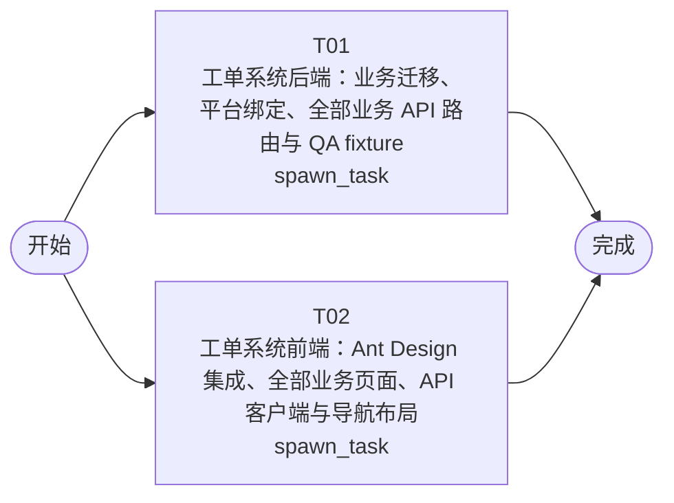

# 开发任务编排

<!-- sourcePlanId: plan:82f363bd-ee9a-4466-9a9a-6aeeaa33520e | rendererVersion: 4 -->

## 任务

| 任务 | 一句话目标 | 执行模式 | 依赖 | 能力 |
| --- | --- | --- | --- | --- |
| T01 | 工单系统后端：业务迁移、平台绑定、全部业务 API 路由与 QA fixture | spawn_task | - | engineering.implementation |
| T02 | 工单系统前端：Ant Design 集成、全部业务页面、API 客户端与导航布局 | spawn_task | - | engineering.implementation |

## 依赖执行图

## 任务契约

### T01

**目标**

## 范围

在已有 Hono 脚手架之上实现工单系统的全部服务端业务逻辑。

### 数据库迁移（0004+）
- 创建 `companies`、`departments` 表
- 为 `users` 表增加 `department_id` 列
- 创建 `business_groups`、`business_group_members`、`category_assignment_rules`、`tickets`、`ticket_replies`、`ticket_transfers`、`ticket_evaluations` 表
- 所有表结构和约束严格遵循 architecture-baseline.md 的数据模型定义

### 平台模块绑定
- **PermissionKit**：定义角色 `ticket_submitter`、`ticket_handler`、`ticket_admin` 及对应权限键；通过 `user_role_assignments` 的 `scope_type='company'` 实现公司维度隔离
- **AuditKit**：在工单创建、分配、回复、转派、完成、取消操作时调用 `auditKit.record` 记录事件，metadata 包含 ticketId
- **EmailKit**：工单完成时通过 `createEmailClient` 发送通知邮件到提交人邮箱；SMTP 配置通过环境变量注入；发送失败记录日志但不阻塞完成流程
- 修改 `bootstrap.ts` 初始化上述模块，修改 `auth.ts` 在 currentUser 中携带 companyId 和 roles

### 业务 API 路由（遵循 technical-contract.md 接口定义）
- 工单管理：`GET/POST /api/tickets`、`GET/PATCH /api/tickets/:id`
- 工单回复：`POST /api/tickets/:id/replies`
- 工单操作：`POST /api/tickets/:id/{assign\|transfer\|complete\|cancel}`
- 工单评价：`POST /api/tickets/:id/evaluation`
- 提交人信息：`GET /api/tickets/:id/submitter-info`
- 业务组管理：`GET/POST /api/business-groups`、`POST/DELETE /api/business-groups/:id/members[/:userId]`
- 分类规则：`GET/POST /api/category-rules`、`DELETE /api/category-rules/:id`
- 工作台：`GET /api/workbench`
- 统计分析：`GET /api/statistics`
- 操作日志：`GET /api/tickets/:id/logs`
- 所有查询附加 `WHERE company_id = currentUser.companyId` 实现公司隔离
- 工单创建后自动按分类规则匹配分配到业务组

### 共享类型
- 在 `src/shared/` 中定义平台中立的类型契约（Ticket、TicketReply、BusinessGroup、CategoryRule 等），供前端消费

### QA fixture 与测试
- 扩展 `test/fixtures/qa-environment.mjs` 预置公司、部门、用户、角色、业务组、分类规则和工单数据
- 编写 `test/tickets.test.mjs` 验证核心业务流程：创建→自动分配→回复→转派→完成→评价→取消，以及公司隔离和操作日志

### 包配置
- 在 `package.json` 中添加 `antd` 和 `@ant-design/icons` 依赖（前端任务需要）

### 验证
- `npm run typecheck:server` 通过
- `npm test` 全部通过

**角色:** general-app-development-expert  \  **失败策略:** block

**需求**

- AC-01
- AC-02
- AC-03
- AC-04
- AC-05
- AC-06
- AC-07
- AC-08
- AC-09
- AC-10
- AC-11

**输入**

- docs/wi-t1000083/requirements.md
- docs/wi-t1000083/architecture-baseline.md
- docs/wi-t1000083/technical-contract.md

**产物**

- app/ticket-system/src/server/
- app/ticket-system/src/shared/
- app/ticket-system/test/
- app/ticket-system/package.json
- app/ticket-system/tsconfig.json
- app/ticket-system/tsconfig.server.json

**可写范围**

- app/ticket-system/src/server/
- app/ticket-system/src/shared/
- app/ticket-system/test/
- app/ticket-system/package.json
- app/ticket-system/tsconfig.json
- app/ticket-system/tsconfig.server.json

**阻塞码**

- TASK_FAILED

### T02

**目标**

## 范围

在已有 React/Vite 脚手架之上实现工单系统的全部客户端业务页面。

### UI 框架与布局
- 集成 Ant Design（`antd` + `@ant-design/icons`）作为组件库
- 实现深色左侧导航栏 + 浅色工作区布局
- 全局状态：加载（Spin/Skeleton）、空数据（Empty）、错误（Result）、无权限（403）、成功（message）
- 替换现有 `App.tsx` 的纯 CSS 布局为 Ant Design Layout + Menu 导航
- 保留现有认证流程（登录/bootstrap/改密码），使用 Ant Design Form 重构

### 业务页面（遵循 technical-contract.md 前端路由）
- **`/` 工作台**：split-master-detail 布局，左侧待处理工单列表，支持按公司筛选、关键字搜索、排序（创建时间/优先级）；右侧选中工单的快速详情
- **`/tickets/new` 创建工单**：表单页，主题+描述+分类+SLA优先级选择
- **`/tickets/:id` 工单详情**：工单信息+回复时间线+提交人信息面板+操作日志+评价表单+转派对话框
- **`/groups` 业务组管理**：列表+抽屉，业务组创建和成员管理
- **`/category-rules` 分类规则**：列表+表单，分配规则配置
- **`/statistics` 统计仪表盘**：KPI 卡片（工单量/平均响应时间/满意度）+ 工单分布图表 + 热点问题 TOP5 表格
- **`/admin/users` 用户管理**：保留并适配 Ant Design

### API 客户端
- 扩展 `api-client.ts`，为所有 technical-contract.md 定义的 API 端点添加类型化请求方法
- 消费 `src/shared/` 中的共享类型（由 T01 产出），不自行发明 API 行为

### 验证
- `npm run typecheck:client` 通过
- `npm run build:client` 构建成功

**角色:** general-app-development-expert  \  **失败策略:** block

**需求**

- AC-01
- AC-02
- AC-03
- AC-04
- AC-05
- AC-06
- AC-07
- AC-08
- AC-09
- AC-10
- AC-11

**输入**

- docs/wi-t1000083/requirements.md
- docs/wi-t1000083/architecture-baseline.md
- docs/wi-t1000083/technical-contract.md

**产物**

- app/ticket-system/src/client/
- app/ticket-system/index.html
- app/ticket-system/vite.config.ts
- app/ticket-system/tsconfig.client.json

**可写范围**

- app/ticket-system/src/client/
- app/ticket-system/index.html
- app/ticket-system/vite.config.ts
- app/ticket-system/tsconfig.client.json

**阻塞码**

- TASK_FAILED
