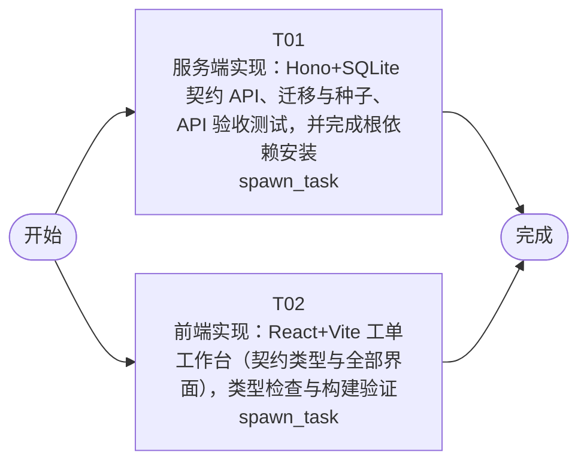

# 开发任务编排

<!-- sourcePlanId: plan:c4535e8f-65f5-439d-b439-6108f7b874b7 | rendererVersion: 4 -->

## 任务

| 任务 | 一句话目标 | 执行模式 | 依赖 | 能力 |
| --- | --- | --- | --- | --- |
| T01 | 服务端实现：Hono+SQLite 契约 API、迁移与种子、API 验收测试，并完成根依赖安装 | spawn_task | - | engineering.implementation |
| T02 | 前端实现：React+Vite 工单工作台（契约类型与全部界面），类型检查与构建验证 | spawn_task | - | engineering.implementation |

## 依赖执行图

## 任务契约

### T01

**目标**

## 目标

从零搭建工单系统服务端（技术栈冻结：Hono + better-sqlite3 + 编号 SQL 迁移），按已批准的 `docs/wi-t1000293/technical-contract.md` 实现全部 REST API，作为系统唯一数据权威与工单状态机执行者。

## 交付范围

- 根 `package.json` / `package-lock.json`（本项目唯一根包，npm 锁定依赖）：
  - 依赖集（前后端一次性声明，前端任务只使用不新增）：dependencies：`hono`、`@hono/node-server`、`better-sqlite3`、`react`、`react-dom`、`lucide-react`；devDependencies：`vite`、`@vitejs/plugin-react`、`typescript`、`@types/react`、`@types/react-dom`、`concurrently`。
  - scripts：`start`=`node src/server.js`、`dev`=`concurrently "node src/server.js" "vite"`、`build`=`vite build`、`test`=`node --test tests/`。
  - 首个动作：写好 `package.json` 后立即执行 `npm install`，成功后在 `node_modules/.install-complete` 写入安装完成标记（供并行的前端任务在构建验证前轮询；该标记位于本任务独占的 node_modules/ 动态目录内）。
- `src/`：`src/server.js`（挂载 /api 路由、托管 `dist/` 静态资源、解析并校验 `X-User-Id`）；`src/domain/`（工单状态机、分类自动分配规则匹配、角色判断、事务边界：状态变更+事件写入+关联字段更新同事务）；`src/db/`（better-sqlite3 连接管理、`DB_PATH` 覆盖与父目录自建、`migrations/sqlite/` 迁移执行器与 `schema_migrations` 登记表）。
- `migrations/sqlite/0001_init.sql`：`docs/wi-t1000293/architecture-baseline.md` 第 3.1 节全部表、约束与索引；`migrations/sqlite/0002_seed.sql`：种子数据（两家公司、覆盖提交人/处理人/公司管理员的用户、初始分类列表），保证干净目录启动即可进入验收场景。
- `tests/`：基于 `node:test` 的 API 验收测试（真实启动服务、独立临时 `DB_PATH`、随机空闲端口、结束清理进程与临时库），覆盖：契约全部端点与响应字段、错误码（401/403/404/400/409 INVALID_STATE/409 CONFLICT）、状态机全部流转（含创建时规则命中自动直达 processing 与未命中停留 created）、多轮回复排序、转派、完成、取消、评价、`GET /api/users/{userId}/tickets` 历史工单、`X-User-Id` 校验。
- `README.md`：安装、构建、启动（常规/开发）、测试命令与验收约定。

## 对验收标准的贡献（服务端部分，AC-01~AC-09 全部）

- AC-01：工单创建与详情读回全部字段（含工单号、提交人信息、创建时间）。
- AC-02：多轮回复落库、按时间升序返回、回复人与回复时间。
- AC-03：`created/pending_assignment/processing/completed/cancelled` 全流转与事件时间线。
- AC-04/AC-05：业务组/成员/分配规则 API；创建时按公司分类规则自动分配到业务组。
- AC-06：转派端点（保持 processing，`reassigned` 事件含转派人/原/新处理方）。
- AC-07：提交人完整信息与历史工单端点。
- AC-08：完成处理记录 `completedBy`/`completedAt`。
- AC-09：满意度评价端点（1–5 分、每工单一次）。

## 验证（真实执行并报告结果）

1. `npm install` 成功并写入安装标记；
2. `node --check` 通过全部 `src/` 源文件；
3. `npm test` 全绿（临时数据库 + 随机端口真实启动）；
4. 报告一份基于种子数据的 API 冒烟结果摘要（创建→自动分配→回复→转派→完成→评价闭环）。

## 边界

- 不写 `frontend/`、`index.html`、`vite.config.js`、`tsconfig.json`、`dist/`（归前端任务 T02）。
- API 行为以 `technical-contract.md` 为唯一基准：可新增可选字段，不得移除或改义契约字段，不做契约外端点。
- 数据库变更一律走 `migrations/sqlite/` 编号迁移；服务启动时自动执行迁移并自建 `data/` 父目录（`DB_PATH` 可覆盖）。

**角色:** general-app-development-expert  \  **失败策略:** block

**需求**

- AC-01
- AC-02
- AC-03
- AC-04
- AC-05
- AC-06
- AC-07
- AC-08
- AC-09

**输入**

- docs/wi-t1000293/requirements.md
- docs/wi-t1000293/architecture-baseline.md
- docs/wi-t1000293/technical-contract.md

**产物**

- src/
- migrations/
- tests/
- package.json
- package-lock.json
- README.md

**可写范围**

- src/
- migrations/
- tests/
- package.json
- package-lock.json
- README.md
- data/
- node_modules/

**阻塞码**

- （无）

### T02

**目标**

## 目标

从零实现工单工作台前端（React + Vite SPA + TypeScript），按 `docs/wi-t1000293/technical-contract.md` 的契约类型消费 `/api`，交付 AC-01~AC-09 的全部用户界面与交互。

## 交付范围

- `frontend/`：SPA 全部源码——契约类型定义（User/BusinessGroup/AssignmentRule/Category/Ticket/Reply/Event/Rating 及优先级、状态、事件类型枚举，逐字段对照 technical-contract.md，不得发明契约外字段）、API 客户端（统一 `X-User-Id` 注入与 `{error:{code,message}}` 错误解析）、当前用户切换的全局状态、视图与组件。
- 根 `index.html`（Vite 入口，引用 frontend 内入口模块）、根 `vite.config.js`（`build.outDir`=`dist`；dev 代理 `/api`→`http://localhost:3000`；`cacheDir` 指向 `dist` 内部以避免写 `node_modules`）、根 `tsconfig.json`。
- 界面（架构基线 1.5 冻结：helpdesk 模板、split-master-detail、Modern SaaS 视觉、桌面布局，图标统一用 lucide-react）：
  - 顶栏当前用户切换器（数据来自 `GET /api/users`）；左侧导航：工单列表、待分配队列、公司管理。
  - 工单 master-detail：可扫读表格（工单号/主题/分类/优先级/状态/提交人/业务组/创建时间）+ 详情区（描述、回复时间线、事件时间线、提交人完整信息：姓名/公司/部门 + 该提交人历史工单）。
  - 工单操作：创建（主题/描述/分类/P0-P4）、多轮回复、分配（dispatch/assign 面板）、转派、完成、取消、满意度评价（1–5 分）；状态徽章（五种状态可区分）与优先级标签；加载/空态/错误态与操作后轻量反馈。
  - 公司管理：业务组与成员设置、分类→业务组分配规则、分类维护。
  - 状态/优先级中文标签映射在前端完成；所有业务合法性以服务端响应为准。

## 对验收标准的贡献（界面部分，AC-01~AC-09 全部）

- AC-01：创建表单 + 详情读回全部字段；AC-02：回复输入与按时间排序的回复列表；AC-03：状态流转在各操作后的可观察呈现与取消入口；AC-04：业务组/成员管理界面；AC-05：分配规则配置界面与自动分配结果呈现；AC-06：转派操作与转派追溯展示；AC-07：提交人信息区与历史工单列表；AC-08：完成操作与处理记录展示；AC-09：评价入口与结果展示。

## 与后端任务（T01）的并行协调

- 根 `package.json` 与依赖安装由 T01 独占负责；本任务不修改根 `package.json`/`package-lock.json`，不运行 `npm install`。
- 先完成全部源码编写；运行构建验证前轮询 `node_modules/.install-complete`（30 秒间隔，上限 20 分钟）确认依赖就绪；超时按阻塞上报而不是自行安装。
- 仅使用 T01 声明的固定依赖集（react/react-dom/lucide-react/vite/@vitejs/plugin-react/typescript/@types/*），不新增依赖。

## 验证（真实执行并报告结果）

1. `node_modules/.bin/tsc --noEmit` 类型检查通过；
2. `npm run build`（vite build）成功产出 `dist/`，入口引用正确（index.html → frontend 入口）。

## 边界

- 不写 `src/`、`migrations/`、`tests/`、`package.json`、`package-lock.json`、`README.md`（归 T01）。
- 需求/设计文档中的目录名 `client/` 不在本 WorkItem 可写范围内：SPA 源码一律放 `frontend/`，其余架构决策（React+Vite、`dist/` 由服务端托管、`/api` 单向调用）不变。
- 浏览器端运行时验收由本 WorkItem 后续 verification 阶段负责，本任务以类型检查与构建通过为验证边界。

**角色:** general-app-development-expert  \  **失败策略:** block

**需求**

- AC-01
- AC-02
- AC-03
- AC-04
- AC-05
- AC-06
- AC-07
- AC-08
- AC-09

**输入**

- docs/wi-t1000293/requirements.md
- docs/wi-t1000293/architecture-baseline.md
- docs/wi-t1000293/technical-contract.md

**产物**

- frontend/
- index.html
- vite.config.js
- tsconfig.json
- dist/

**可写范围**

- frontend/
- index.html
- vite.config.js
- tsconfig.json
- dist/

**阻塞码**

- （无）
