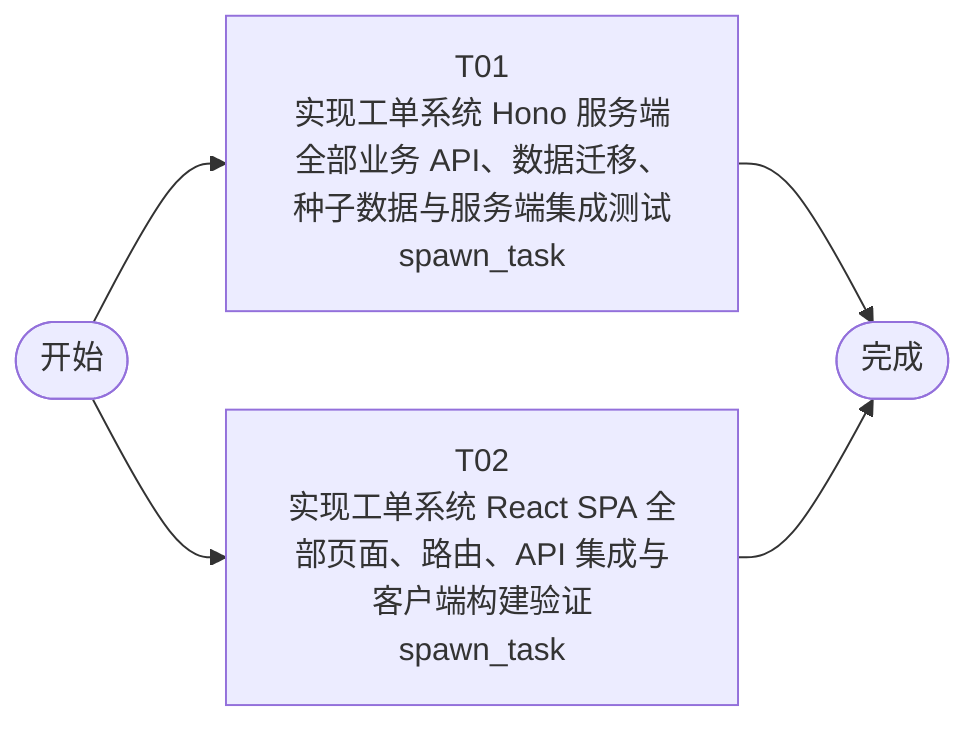

# 开发任务编排

<!-- sourcePlanId: plan:e5b1f7d2-e82b-43cd-b34c-c2d5f8c127e0 | rendererVersion: 4 -->

## 任务

| 任务 | 一句话目标 | 执行模式 | 依赖 | 能力 |
| --- | --- | --- | --- | --- |
| T01 | 实现工单系统 Hono 服务端全部业务 API、数据迁移、种子数据与服务端集成测试 | spawn_task | - | engineering.implementation |
| T02 | 实现工单系统 React SPA 全部页面、路由、API 集成与客户端构建验证 | spawn_task | - | engineering.implementation |

## 依赖执行图

## 任务契约

### T01

**目标**

## 目标

在 `app/ticket-system` 的 `src/server/` 内实现工单系统服务端全部业务能力。接口行为以已批准的 `docs/wi-t1000312/technical-contract.md` 为唯一契约来源（method/path、字段、错误码、授权、幂等、状态机、名称映射责任均以契约为准，不另行发明）；数据模型、迁移编号（自 0002 起）与事务边界遵循 `docs/wi-t1000312/architecture-baseline.md` §4。

## 范围

- 身份与用户：登录/`me`/用户列表查询，userkit 用户 + 项目 `user_profiles` 角色/部门扩展（同一事务创建用户）。
- 工单域：创建（事务内发号 `TK-`+6 位零填充 + 分类规则自动分配 + 日志）、列表（状态/公司/分类/优先级筛选、关键词搜索、排序、分页、公司行级隔离）、详情、人工分配、转派、完成、取消、提交人完整信息（含历史工单）。
- 回复与评价、工单日志、通知（emailkit 发送 + `notifications` outbox 记录，事务提交后发送）、统计分布与仪表盘聚合。
- 版本化迁移：companies、user_profiles、groups、group_members、category_rules、tickets、ticket_sequence、replies、ratings、ticket_logs、notifications；幂等种子数据（公司、各角色用户与密码凭证、业务组/成员/分类规则示例、已知分布的工单样本）。
- `src/shared/` 平台中立契约类型与枚举常量（本任务是该目录唯一 owner；前端任务不写该目录）。
- `app/ticket-system/test/` 下新增服务端业务集成测试，基于 `test/with-http-server.mjs` 以真实 HTTP 验证契约关键行为（公司隔离、自动分配、状态流转、回复、评价、完成通知记录、统计口径）。

## 贡献的验收条件

对 AC-01～AC-13 提供服务端行为：数据持久化与读回（AC-01/02/04/05/09/10/13 的 session-persistence 证据）、公司行级隔离与 404 不泄露语义（AC-03）、分类自动分配事务（AC-06）、转派归属变更与日志（AC-07）、提交人完整信息与历史工单（AC-08）、完成处理记录与邮件发送记录（AC-09）、工作台筛选/搜索/排序/公司维度查询（AC-11）、按公司/部门分布与四类运营指标聚合（AC-12）。

## 验证

- `npm run typecheck:server`（server 局部类型检查，在 `app/ticket-system` 内执行）
- `npm test`（node --test 运行 `test/` 套件，含新增业务测试，真实 HTTP 服务）

不修改 `src/client/`；`package.json` 如需依赖/脚本变更由本任务唯一执行。

**角色:** general-app-development-expert  \  **失败策略:** block

**需求**

- AC-01
- AC-02
- AC-03
- AC-04
- AC-05
- AC-06
- AC-07
- AC-08
- AC-09
- AC-10
- AC-11
- AC-12
- AC-13

**输入**

- docs/wi-t1000312/requirements.md
- docs/wi-t1000312/architecture-baseline.md
- docs/wi-t1000312/technical-contract.md

**产物**

- app/ticket-system/src/server/
- app/ticket-system/src/shared/
- app/ticket-system/test/

**可写范围**

- app/ticket-system/src/server/
- app/ticket-system/src/shared/
- app/ticket-system/test/
- app/ticket-system/package.json

**阻塞码**

- （无）

### T02

**目标**

## 目标

在 `app/ticket-system` 的 `src/client/` 内实现工单系统 React/Vite SPA 的全部用户界面。页面清单、布局与视觉基线遵循 `docs/wi-t1000312/architecture-baseline.md` §3（左侧导航应用壳 + master-detail 主工作区、Modern SaaS 视觉、状态徽章、桌面 Web）；接口调用严格遵循 `docs/wi-t1000312/technical-contract.md`——前端基于契约转写类型与请求封装，不发明 API 行为。

## 范围

- 登录页与认证状态（Bearer token 持有、401 统一处理、按角色显隐导航）。
- 工作台（handler/admin：待处理/待分配队列，筛选、关键词搜索、排序、公司维度筛选）。
- 我的工单（submitter 视角）与工单详情页（基础信息、提交人完整信息卡含历史工单入口、多轮回复流、按角色与状态渲染的处理操作与满意度评价区、操作日志、通知记录）。
- 统计分析页（按公司/部门分布 + 工单量/平均响应时间/满意度/热点问题 KPI 仪表盘）。
- 配置管理页（admin：业务组与成员、分类分配规则维护）。
- `src/client/platform/api-client.ts` 之上的业务请求层与契约类型定义（类型在 `src/client` 内从 technical-contract.md 转写，不依赖并行任务的 `src/shared/` 产物，不写该目录）。
- 全局状态基线：加载骨架、空数据文案、错误条、无权限（403/404）提示、操作 toast；主题/描述等可截断文本提供全文查看。

## 贡献的验收条件

对 AC-01～AC-13 提供用户界面呈现与交互入口：各 UI 类验收场景的创建/查看/回复/分配/转派/完成/取消/评价操作与字段读回界面（AC-01/02/04/05/06/07/08/10/11/12/13 的 runtime-render 与 interaction 证据）、公司隔离在列表/搜索/详情的界面不可见性（AC-03）、完成通知记录区（AC-09）、配置保存读回（AC-05）。

## 验证

- `npm run typecheck:client`（client 局部类型检查，在 `app/ticket-system` 内执行）
- `npm run build:client`（Vite 生产构建）

不修改 `src/server/`、`src/shared/` 与 `test/`；现有依赖已满足前端需求，不修改 `package.json`。

**角色:** general-app-development-expert  \  **失败策略:** block

**需求**

- AC-01
- AC-02
- AC-03
- AC-04
- AC-05
- AC-06
- AC-07
- AC-08
- AC-09
- AC-10
- AC-11
- AC-12
- AC-13

**输入**

- docs/wi-t1000312/requirements.md
- docs/wi-t1000312/architecture-baseline.md
- docs/wi-t1000312/technical-contract.md

**产物**

- app/ticket-system/src/client/

**可写范围**

- app/ticket-system/src/client/
- app/ticket-system/index.html
- app/ticket-system/tailwind.config.js
- app/ticket-system/postcss.config.js
- app/ticket-system/vite.config.ts

**阻塞码**

- （无）
