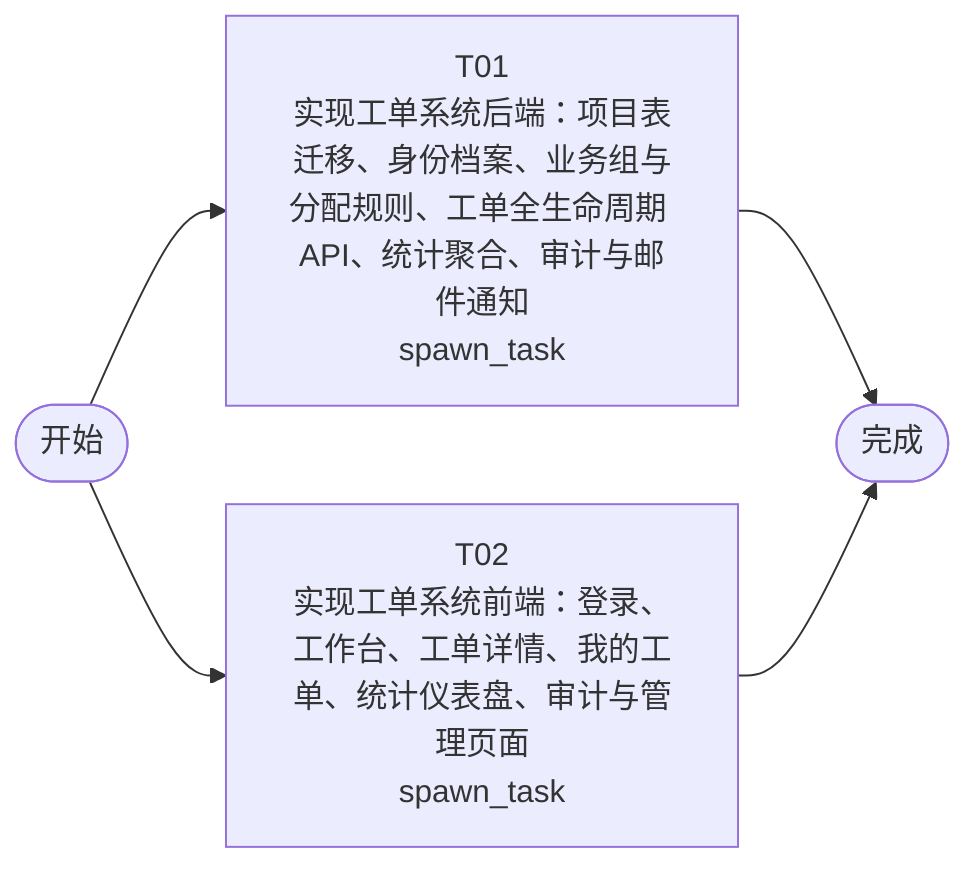

# 开发任务编排

<!-- sourcePlanId: plan:29df2af3-c0aa-441b-aca5-27611e05f76d | rendererVersion: 4 -->

## 任务

| 任务 | 一句话目标 | 执行模式 | 依赖 | 能力 |
| --- | --- | --- | --- | --- |
| T01 | 实现工单系统后端：项目表迁移、身份档案、业务组与分配规则、工单全生命周期 API、统计聚合、审计与邮件通知 | spawn_task | - | engineering.implementation |
| T02 | 实现工单系统前端：登录、工作台、工单详情、我的工单、统计仪表盘、审计与管理页面 | spawn_task | - | engineering.implementation |

## 依赖执行图

## 任务契约

### T01

**目标**

## 目标

在 `app/ticket-system/src/server/`（packageRoot `app/ticket-system`）实现已批准技术契约 `docs/wi-t1000313/technical-contract.md` 定义的全部服务端行为，并以 `src/server/index.ts` 启动的 Hono 服务对外提供 `/api`。

## 范围

- 数据迁移（`src/server/migrations/sqlite/`）：按契约第 3 节建立项目表 `companies`、`user_profiles`、`business_groups`、`business_group_members`、`assignment_rules`、`tickets`、`ticket_replies`、`ticket_ratings`，并写入推荐基线分类种子；模块表（`platform_users`、`platform_audit_events`）沿用 vendor 迁移，不重复定义。
- 身份与授权：在既有 authkit/userkit 登录基础上绑定 `user_profiles`（角色 submitter/handler/ops、公司、部门），按契约第 2 节实施数据域校验（越域 404、越权 403、非 ops 传 company_id 403）。
- 业务端点：管理端（公司/用户档案）、业务组与成员、分配规则、工单创建（含创建请求内自动分配决策与 `TKT-NNNNNN` 工单号）、工作台/我的工单列表（筛选、搜索、排序、分页）、详情、多轮回复、手动分配、转派、完成（事务内记录处理人/处理时间，事务提交后 best-effort 邮件通知）、取消、满意度评价、提交人完整视图。
- 统计：分布（公司/部门维度）与仪表盘（工单量、平均响应时间、满意度、热点分类）实时聚合。
- 审计：经 auditkit 记录契约第 9.1 节动作枚举，提供 `/api/audit-events` 检索；邮件发送结果写 `email.notification_sent\|failed`。
- 邮件：经 emailkit 按契约第 10 节发送完成通知，SMTP 未配置时如实记录失败。
- 共享契约：在 `src/shared/` 放置平台中立类型与常量（角色、状态、优先级、分类等）。
- 测试：在 `app/ticket-system/test/` 基于真实 HTTP 服务与隔离 SQLite 库覆盖核心业务流（创建+自动分配、公司隔离 404、状态机终态 409、回复、转派、完成+邮件审计、评价、统计口径、审计检索）。

## 验证

- 在 packageRoot 下运行 `npm run typecheck:server` 与 `npm test`，如实报告结果；不新增契约之外的端点或字段，不修改 `src/client/`、`vendor/` 与其他 WorkItem 文件。

**角色:** general-app-development-expert  \  **失败策略:** block

**需求**

- AC-01
- AC-02
- AC-03
- AC-04
- AC-05
- AC-06
- AC-07
- AC-08
- AC-09
- AC-10
- AC-11
- AC-12
- AC-13
- AC-14

**输入**

- docs/wi-t1000313/requirements.md
- docs/wi-t1000313/architecture-baseline.md
- docs/wi-t1000313/technical-contract.md

**产物**

- app/ticket-system/src/server/
- app/ticket-system/src/shared/
- app/ticket-system/test/

**可写范围**

- app/ticket-system/src/server/
- app/ticket-system/src/shared/
- app/ticket-system/test/

**阻塞码**

- （无）

### T02

**目标**

## 目标

在 `app/ticket-system/src/client/` 实现 `ticket-system` 的 React/Vite SPA 界面，按架构基线第 3 节 UI 全局基线（split-master-detail、Modern SaaS、Tailwind）呈现工单系统全部用户旅程。

## 范围

- 登录与全局壳：本地密码登录、当前用户上下文（姓名、公司、角色）、左侧导航（工作台、我的工单、统计、审计、管理）。
- 工单工作台：待处理工单列表（默认 in_progress），支持公司筛选（仅 ops 可见）、状态/分类/优先级筛选、工单号/主题/提交人搜索、创建时间与优先级排序、分页。
- 工单详情：完整工单字段、提交人信息面板（处理视角含姓名、公司、部门与历史工单）、回复时间线（多轮）、操作区（分配、转派、完成、取消、满意度评价）。
- 我的工单：提交人视角的工单列表与详情入口；完成后提交 1–5 分满意度评价。
- 统计与仪表盘：公司/部门维度分布切换，KPI 卡（工单量、平均响应时间、满意度）与热点分类列表。
- 审计页：按工单/公司/动作检索审计事件（ops/handler 可见）。
- 管理页：公司、用户档案、业务组与成员、分配规则的维护（仅 ops）。
- API 集成：所有请求经 `src/client/platform/api-client.ts` 单一边界；请求/响应字段、错误码与状态语义严格以 `docs/wi-t1000313/technical-contract.md` 为准，在客户端内定义契约推导类型，不发明 API 行为；越域 404 与越权 403 给出明确文案，不暴露越域内容。

## 验证

- 在 packageRoot 下运行 `npm run typecheck:client` 与 `npm run build:client`，如实报告结果；可按需在 `app/ticket-system/package.json` 增加纯前端依赖（如图标库 lucide-react，唯一 owner）；不修改 `src/server/`、`src/shared/`、`test/` 与 `vendor/`。

**角色:** general-app-development-expert  \  **失败策略:** block

**需求**

- AC-01
- AC-02
- AC-03
- AC-04
- AC-05
- AC-06
- AC-07
- AC-08
- AC-09
- AC-10
- AC-11
- AC-12
- AC-13
- AC-14

**输入**

- docs/wi-t1000313/requirements.md
- docs/wi-t1000313/architecture-baseline.md
- docs/wi-t1000313/technical-contract.md

**产物**

- app/ticket-system/src/client/

**可写范围**

- app/ticket-system/src/client/
- app/ticket-system/package.json
- app/ticket-system/package-lock.json
- app/ticket-system/index.html
- app/ticket-system/tailwind.config.js

**阻塞码**

- （无）
