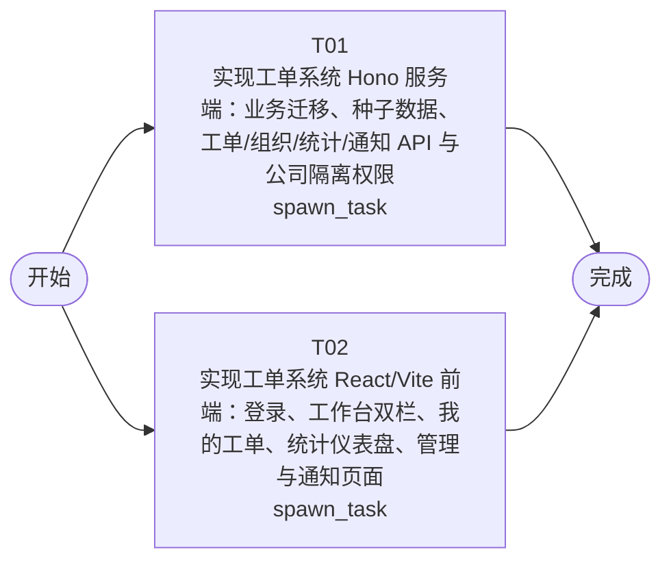

# 开发任务编排

<!-- sourcePlanId: plan:3bd92da2-9c9b-4218-9325-36182aad6ef1 | rendererVersion: 4 -->

## 任务

| 任务 | 一句话目标 | 执行模式 | 依赖 | 能力 |
| --- | --- | --- | --- | --- |
| T01 | 实现工单系统 Hono 服务端：业务迁移、种子数据、工单/组织/统计/通知 API 与公司隔离权限 | spawn_task | - | engineering.implementation |
| T02 | 实现工单系统 React/Vite 前端：登录、工作台双栏、我的工单、统计仪表盘、管理与通知页面 | spawn_task | - | engineering.implementation |

## 依赖执行图

## 任务契约

### T01

**目标**

## 目标

在 `app/ticket-system` 服务端完整落地工单系统业务能力。字段级 API、DDL、枚举、种子与统计口径以 `docs/wi-t1000327/technical-contract.md` 为唯一来源；模块边界、运行顺序与事务约定遵循 `docs/wi-t1000327/architecture-baseline.md`。

### 实现范围

- 数据层：按契约第 5 节 DDL 在 `src/server/migrations/sqlite/` 新增编号业务迁移（公司、用户业务档案、业务组与成员、分类、分配规则、工单、回复、操作日志、满意度评价、本地发件箱），不修改 userkit 既有迁移；首次启动空库时按契约 4.7 执行种子数据（不种子工单）。
- 工单能力：创建（含按分类自动分配事务）、列表查询（筛选、搜索、排序、角色可见性、scope/mine）、详情、多轮回复（含首次回复时间）、人工分配、转派、完成（同事务写处理记录与完成通知）、取消、满意度评价、操作日志查询、提交人完整信息（含历史工单）。
- 组织与分配：业务组与成员管理、分类管理、分配规则管理、平台公司列表。
- 统计分析：公司/部门维度工单分布与运营指标仪表盘，platform_ops 跨公司只读视角。
- 通知：当前登录用户为收件人的完成通知列表。
- 公司隔离与权限：所有业务查询与写入按会话用户公司强制过滤（不信任前端公司参数）；端点级角色授权与统一错误码语义按契约第 1 节。

### 验证方式

- 以应用包现有的服务端分层类型检查与 node 测试框架（隔离 DB_PATH、真实 HTTP 服务）验证迁移、种子、关键事务（创建自动分配、完成与通知同事务、评价唯一约束）及公司隔离/角色权限行为，并报告真实结果。

### 验收贡献

- 为 AC-01~AC-14 全部验收条件提供 API 行为、数据持久化、公司隔离与授权的服务端实现；界面由并行任务 T02 提供。

**角色:** general-app-development-expert  \  **失败策略:** block

**需求**

- AC-01
- AC-02
- AC-03
- AC-04
- AC-05
- AC-06
- AC-07
- AC-08
- AC-09
- AC-10
- AC-11
- AC-12
- AC-13
- AC-14

**输入**

- docs/wi-t1000327/requirements.md
- docs/wi-t1000327/architecture-baseline.md
- docs/wi-t1000327/technical-contract.md

**产物**

- app/ticket-system/src/server/

**可写范围**

- app/ticket-system/src/server/
- app/ticket-system/package.json
- app/ticket-system/test/

**阻塞码**

- （无）

### T02

**目标**

## 目标

在 `app/ticket-system` 前端完整实现工单系统页面与交互。API 行为、字段与类型以 `docs/wi-t1000327/technical-contract.md` 为唯一来源（契约类型在客户端边界内建模，不发明 API 行为）；布局与视觉遵循 `docs/wi-t1000327/architecture-baseline.md` 1.5 的 UI 基线（helpdesk 应用模板、split-master-detail 工作台、Modern SaaS 视觉预设、左侧导航 + 顶部上下文栏、桌面 Web ≥1280px）。

### 实现范围

- 全局壳与登录：登录页；左侧导航（工作台、我的工单、统计、管理、我的通知）与顶部上下文栏（当前用户、公司、角色、登出）；保留 starter 用户管理入口作为账户引导。
- 工作台（split-master-detail）：待处理工单列表与当前工单详情双栏协同；状态、优先级、分类筛选与公司维度筛选（platform_ops），主题与工单号搜索，创建时间/优先级排序，条件可组合。
- 工单详情：完整字段与长文本可读呈现、多轮回复时间线与回复输入、提交人完整信息区（姓名、公司、部门、历史工单）、操作日志区；按角色与状态提供分配、转派、完成、取消、评价等动作入口。
- 我的工单：提交人本人全部状态工单列表与已完成工单的满意度评价入口。
- 统计分析：运营指标 KPI（工单量、平均响应时间、满意度）、公司/部门维度分布图表、热点问题列表；platform_ops 可按公司切换。
- 管理：业务组与成员、分类、分配规则管理（company_admin）。
- 我的通知：完成通知收件箱（提交人视角）。
- 全局状态：加载骨架、空数据引导、错误提示与重试、无权限 403 文案、成功 toast。

### 验证方式

- 以应用包现有的客户端分层类型检查与客户端构建完成开发期验证；API 集成基于契约字段的类型化客户端边界，不依赖运行中的服务端。

### 验收贡献

- 为 AC-01~AC-13 提供全部用户界面与交互实现，为 AC-14 提供操作日志查看界面；服务端行为由并行任务 T01 提供。

**角色:** general-app-development-expert  \  **失败策略:** block

**需求**

- AC-01
- AC-02
- AC-03
- AC-04
- AC-05
- AC-06
- AC-07
- AC-08
- AC-09
- AC-10
- AC-11
- AC-12
- AC-13
- AC-14

**输入**

- docs/wi-t1000327/requirements.md
- docs/wi-t1000327/architecture-baseline.md
- docs/wi-t1000327/technical-contract.md

**产物**

- app/ticket-system/src/client/

**可写范围**

- app/ticket-system/src/client/
- app/ticket-system/index.html
- app/ticket-system/tailwind.config.js

**阻塞码**

- （无）
