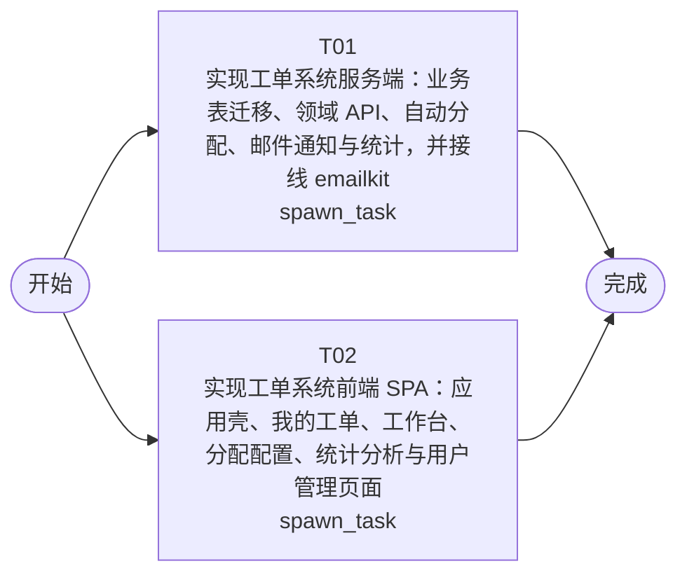

# 开发任务编排

<!-- sourcePlanId: plan:5bfa961f-7bc0-40a7-9b85-734da3626fee | rendererVersion: 4 -->

## 任务

| 任务 | 一句话目标 | 执行模式 | 依赖 | 能力 |
| --- | --- | --- | --- | --- |
| T01 | 实现工单系统服务端：业务表迁移、领域 API、自动分配、邮件通知与统计，并接线 emailkit | spawn_task | - | engineering.implementation |
| T02 | 实现工单系统前端 SPA：应用壳、我的工单、工作台、分配配置、统计分析与用户管理页面 | spawn_task | - | engineering.implementation |

## 依赖执行图

## 任务契约

### T01

**目标**

### 目标

按已批准的架构基线与技术契约实现 `app/ticket-system` 服务端全部业务能力，并完成 emailkit 通知接线，使后端独立具备全部验收条件（AC-01 至 AC-13）所需的服务端行为。

### 实现范围

- **数据迁移**：在 `app/ticket-system/src/server/migrations/sqlite/` 新增项目业务表版本化迁移（companies、user_profiles、categories 含种子、business_groups、group_members、routing_rules、tickets、ticket_replies、ticket_logs、satisfaction_ratings、email_logs），表结构、索引与约束遵循架构基线第 3 节；禁止运行期改 schema。
- **领域服务与路由**：按架构基线第 2 节模块边界实现：auth 会话上下文、user-profile 开户与业务档案（含 userkit 用户管理 API 追加 admin 角色检查的收紧项）、org-config（公司/业务组/成员/分类自动分配规则）、ticket（编号生成、状态机事务、回复、转派、完成、取消、满意度评价、提交人完整信息与历史工单）、notify（emailkit 接线：完成事务提交后发送通知邮件，结果写 email_logs，失败不回滚工单状态）、stats（分布统计与仪表盘口径）、ticket-log（随业务变更同事务写入）。路由按技术契约的 method/path、字段、错误码与授权矩阵落地。
- **授权与隔离**：角色（submitter/agent/admin/viewer）与公司数据隔离全部在服务端强制执行，越权访问返回 404 资源隐藏（AC-03 的服务端贡献；前端不承担隔离）。

### 写入所有权

唯一拥有 `src/server/`（含迁移）、`src/shared/`、`test/`、`package.json`、`tsconfig.json`、`tsconfig.server.json` 的写入；不写 `src/client/` 与任何前端配置文件。`src/shared/` 如需平台中立契约/常量仅由本任务写入，并行前端任务不依赖本任务产物。

### 验证

从项目实际配置选择服务端聚焦检查（服务端类型检查、以隔离数据库与独立端口启动真实 HTTP 服务的测试）并运行，汇报真实运行结果；覆盖上述行为的关键路径与失败边界（状态机非法流转拒绝、越权 404、邮件 skipped/failed 记录、统计口径与契约错误码）。

**角色:** general-app-development-expert  \  **失败策略:** block

**需求**

- AC-01
- AC-02
- AC-03
- AC-04
- AC-05
- AC-06
- AC-07
- AC-08
- AC-09
- AC-10
- AC-11
- AC-12
- AC-13

**输入**

- docs/wi-t1000329/requirements.md
- docs/wi-t1000329/architecture-baseline.md
- docs/wi-t1000329/technical-contract.md

**产物**

- app/ticket-system/src/server/
- app/ticket-system/src/shared/

**可写范围**

- app/ticket-system/src/server/
- app/ticket-system/src/shared/
- app/ticket-system/package.json
- app/ticket-system/tsconfig.json
- app/ticket-system/tsconfig.server.json
- app/ticket-system/test/

**阻塞码**

- （无）

### T02

**目标**

### 目标

按已批准的架构基线、技术契约与 UI 全局基线（helpdesk 业务模板、split-master-detail 展示模板、Modern SaaS 视觉）实现 `app/ticket-system` 前端 SPA，为全部用户界面验收条件提供页面与操作入口。

### 实现范围

- **应用壳**：登录页、按角色渲染的左侧导航（我的工单/工作台/分配配置/统计分析/用户管理/退出）与顶部上下文栏（当前用户姓名、公司、角色）；全局加载骨架屏、空态引导、错误提示、403 页面与行内成功反馈。
- **页面**：我的工单（提交人列表与创建表单，含 SLA 优先级 P0-P4 与问题分类选择）；工单详情（提交人信息卡、历史工单、回复时间线、日志视图，按角色渲染回复/转派/完成/取消/评价操作，展示处理人与处理时间、满意度与邮件发送记录）；工作台（split-master-detail：待处理队列 + 按公司筛选/搜索/排序 + 详情右区）；分配配置（公司 → 业务组 → 成员 → 分类自动分配规则管理）；统计分析（公司/部门维度分布切换 + 仪表盘：工单量、平均响应时间、满意度、热点问题）；用户管理页 admin 专用化。
- **API 集成**：基于技术契约在 `src/client/` 内定义契约类型与统一请求封装（经 `src/client/platform/api-client.ts`），实现真实契约调用，开发期可用契约 mock 自测；不发明契约外的接口行为。状态/优先级/操作类型中文标签由前端静态映射。
- **视觉**：Tailwind CSS + Lucide 图标，Modern SaaS 风格（单一主色 + 语义状态色），桌面 Web。

### 写入所有权

唯一拥有 `src/client/`、`index.html`、`vite.config.ts`、`tailwind.config.js`、`postcss.config.js`、`tsconfig.client.json` 的写入；不写 `src/server/`、`src/shared/`、`test/`、`package.json`（依赖已齐备）。不 import `src/server/`；不依赖 T01 产物，前端类型以技术契约为唯一来源。

### 安全边界

前端不执行角色/公司过滤的安全判断，仅按角色渲染，数据域过滤全部依赖服务端（AC-03 的隔离由 T01 在服务端承担，本任务不列该验收贡献）。

### 验证

从项目实际配置选择客户端聚焦检查（客户端类型检查、客户端构建）并运行，汇报真实运行结果；确认各页面按契约类型完成渲染与操作流转，构建产物可生成。

**角色:** general-app-development-expert  \  **失败策略:** block

**需求**

- AC-01
- AC-02
- AC-04
- AC-05
- AC-06
- AC-07
- AC-08
- AC-09
- AC-10
- AC-11
- AC-12
- AC-13

**输入**

- docs/wi-t1000329/requirements.md
- docs/wi-t1000329/architecture-baseline.md
- docs/wi-t1000329/technical-contract.md

**产物**

- app/ticket-system/src/client/

**可写范围**

- app/ticket-system/src/client/
- app/ticket-system/index.html
- app/ticket-system/vite.config.ts
- app/ticket-system/tailwind.config.js
- app/ticket-system/postcss.config.js
- app/ticket-system/tsconfig.client.json

**阻塞码**

- （无）
