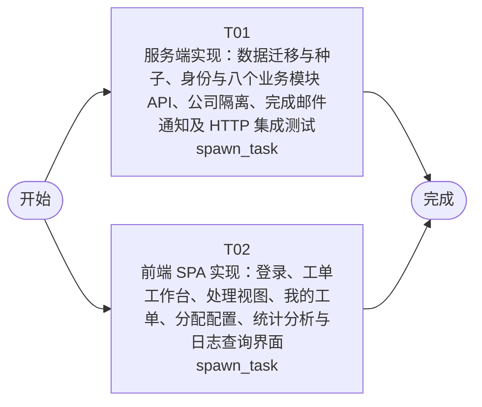

# 开发任务编排

<!-- sourcePlanId: plan:722af3c2-1cef-4fc2-90ad-560320393539 | rendererVersion: 4 -->

## 任务

| 任务 | 一句话目标 | 执行模式 | 依赖 | 能力 |
| --- | --- | --- | --- | --- |
| T01 | 服务端实现：数据迁移与种子、身份与八个业务模块 API、公司隔离、完成邮件通知及 HTTP 集成测试 | spawn_task | - | engineering.implementation |
| T02 | 前端 SPA 实现：登录、工单工作台、处理视图、我的工单、分配配置、统计分析与日志查询界面 | spawn_task | - | engineering.implementation |

## 依赖执行图

## 任务契约

### T01

**目标**

## 目标

实现 `app/ticket-system` 服务端全部业务能力（Hono + better-sqlite3，经 dbkit；模块与数据归属以架构基线 2.1/3.1 为准，字段、枚举、错误码、状态机与公司隔离语义以已批准技术契约为唯一依据）：

- **数据层**：新增项目表迁移（`companies`、`departments`、`user_profiles`、`tickets`、`ticket_replies`、`groups`、`group_members`、`assignment_rules`、`ticket_ratings`），编号排在平台迁移之后；提供幂等种子脚本（两家演示公司、部门、含跨公司视角用户的档案、业务组与分配规则）并在 `package.json` 挂接命令。
- **业务模块**：identity（登录/会话/当前用户/用户列表）、ticket（创建含事务内分类自动分配、列表/详情、多轮回复、取消、提交人完整信息与历史工单）、assignment（业务组与成员、分配规则、人工分配）、processing（接单、转派、完成）、rating（满意度评价）、stats（公司/部门分布与仪表盘聚合）、audit（按工单与全局日志查询）、notification（完成时向提交人邮箱发送 SMTP 通知，`SMTP_HOST` 为空时 `notification.sent=false`，失败不回滚并写审计事件）。
- **隔离与日志**：工单读写一律按当前用户公司过滤，跨公司读仅 `crossCompanyView` 档案放行，越权返回 `403` + `COMPANY_FORBIDDEN`；创建、分配、回复、转派、完成、取消、评价等关键操作全部写审计事件。

## 写入归属

唯一拥有 `src/server/`（含迁移与种子脚本）、`src/shared/`（共享枚举与分类字典）与 `test/`（服务器集成测试）；`package.json` 与 server 侧 tsconfig 由本任务唯一写，前端任务不写这些文件。

## 验收贡献

- AC-01/02/04/06/07/09/10 的服务端行为与持久化；AC-03/13 的公司过滤与 403 语义；AC-05 的业务组配置持久化；AC-08 的提交人完整信息查询；AC-11/12 的聚合统计口径；AC-14 的日志写入与查询。

## 验证

- `npm run typecheck:server` 与 `npm run typecheck` 通过。
- 按 `test/with-http-server.mjs` 既有模式新增真实 HTTP 集成测试并运行 `npm test`，覆盖：登录、创建与分类自动分配、公司隔离 403、多轮回复、人工分配兜底、接单、转派、完成（含 `notification.sent` 结果与本地 SMTP 通知）、评价、统计口径、日志查询。
- `npm start` 冒烟启动（默认 DB 路径自动建父目录），健康检查正常。

**角色:** general-app-development-expert  \  **失败策略:** block

**需求**

- AC-01
- AC-02
- AC-03
- AC-04
- AC-05
- AC-06
- AC-07
- AC-08
- AC-09
- AC-10
- AC-11
- AC-12
- AC-13
- AC-14

**输入**

- docs/wi-t1000330/requirements.md
- docs/wi-t1000330/architecture-baseline.md
- docs/wi-t1000330/technical-contract.md

**产物**

- app/ticket-system/src/server/
- app/ticket-system/src/shared/
- app/ticket-system/test/

**可写范围**

- app/ticket-system/src/server/
- app/ticket-system/src/shared/
- app/ticket-system/test/
- app/ticket-system/package.json
- app/ticket-system/tsconfig.json
- app/ticket-system/tsconfig.server.json

**阻塞码**

- （无）

### T02

**目标**

## 目标

实现 `app/ticket-system` 前端 SPA（React 18 + Vite + Tailwind，视觉基线 Modern SaaS，工作台采用 split-master-detail 布局；页面划分以架构基线 2.2 为准，请求/响应、枚举、分页与错误反馈以已批准技术契约为唯一依据）：

- **应用壳与登录**：左侧导航（工单工作台、我的工单、分配配置、统计分析、操作日志）+ 顶部用户上下文栏（姓名、公司、退出登录）；用户名密码登录与 Bearer 会话管理，失效返回登录页。
- **工单工作台**：左列表右详情；列表支持状态（待处理/待分配）、分类、优先级、公司维度筛选、关键字搜索（主题/描述/工单ID）、排序与分页；公司筛选控件仅 `crossCompanyView` 用户可见。
- **处理视图**：回复流（多轮按时间升序）、提交人完整信息区（姓名、公司、部门、历史工单）、接单/回复/转派/完成/取消操作、完成后的通知结果反馈（`notification.sent=false` 时给出邮件发送失败提示）、该工单操作日志。
- **我的工单**：提交人全状态工单列表、详情与回复、已完成工单满意度评价（1-5 分）。
- **分配配置**：业务组与成员管理、"分类 → 业务组"自动分配规则管理。
- **统计分析**：运营仪表盘（工单量、平均响应时间、满意度、热点问题指标卡）与工单分布视图（公司/部门维度切换）。
- **操作日志**：全局日志查询视图（按工单、操作类型过滤）。
- 契约类型（枚举与 Ticket/UserBrief/Reply/Group/AssignmentRule/LogEntry 等）在 `src/client` 内从契约文件定义，不发明 API 行为；状态与优先级 P0-P4 用状态色标识；加载/空数据/错误/无权限（`COMPANY_FORBIDDEN` 明确反馈）状态齐备。

## 写入归属

唯一拥有 `src/client/`、`index.html`、`vite.config.ts`、`tailwind.config.js`、`postcss.config.js` 与 client 侧 tsconfig；不写 `package.json`、`src/server/`、`src/shared/` 与 `test/`。

## 验收贡献

- AC-01/02/04/05/06/07/10 的用户界面与交互；AC-03 的无权限反馈呈现；AC-08 的处理上下文信息区；AC-09 的完成反馈与通知失败提示；AC-11/12 的统计视图呈现；AC-13 的筛选/搜索/排序交互；AC-14 的日志查询界面。

## 验证

- `npm run typecheck:client` 通过。
- `npm run build:client` 通过。
- 以契约推导的 mock 数据核对各页面可渲染且加载/空数据/错误/无权限状态有反馈（不依赖后端启动）。

**角色:** general-app-development-expert  \  **失败策略:** block

**需求**

- AC-01
- AC-02
- AC-03
- AC-04
- AC-05
- AC-06
- AC-07
- AC-08
- AC-09
- AC-10
- AC-11
- AC-12
- AC-13
- AC-14

**输入**

- docs/wi-t1000330/requirements.md
- docs/wi-t1000330/architecture-baseline.md
- docs/wi-t1000330/technical-contract.md

**产物**

- app/ticket-system/src/client/

**可写范围**

- app/ticket-system/src/client/
- app/ticket-system/index.html
- app/ticket-system/vite.config.ts
- app/ticket-system/tailwind.config.js
- app/ticket-system/postcss.config.js
- app/ticket-system/tsconfig.client.json

**阻塞码**

- （无）
