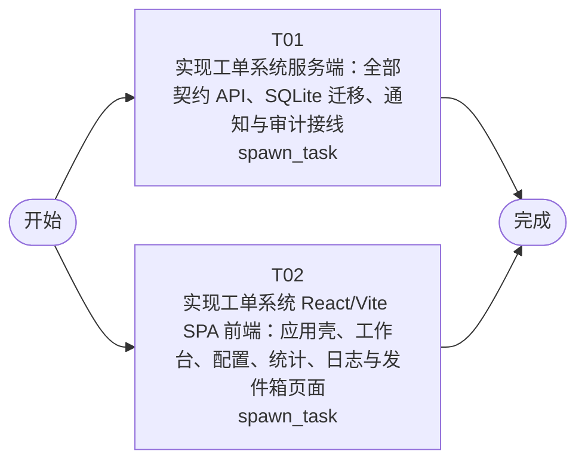

# 开发任务编排

<!-- sourcePlanId: plan:5499aba2-fec5-4523-9480-1ce1b9be5608 | rendererVersion: 4 -->

## 任务

| 任务 | 一句话目标 | 执行模式 | 依赖 | 能力 |
| --- | --- | --- | --- | --- |
| T01 | 实现工单系统服务端：全部契约 API、SQLite 迁移、通知与审计接线 | spawn_task | - | engineering.implementation |
| T02 | 实现工单系统 React/Vite SPA 前端：应用壳、工作台、配置、统计、日志与发件箱页面 | spawn_task | - | engineering.implementation |

## 依赖执行图

## 任务契约

### T01

**目标**

实现工单系统服务端（契约权威侧），输出位于 `app/ticket-system/src/server/` 与 `app/ticket-system/test/`。

## 目标

- 以 `docs/wi-t1000332/technical-contract.md` 为唯一 API 契约，实现工单域、分配配置域、统计域、通知域、审计域全部端点与业务规则，含工单状态机（提交同步自动分配、人工分配、转派、完成、取消、评价）与服务端公司隔离（跨公司单据 403/404，列表天然过滤，跨公司筛选返回空结果集）。
- 按 `docs/wi-t1000332/architecture-baseline.md` 第 4 节新增版本化 SQLite 迁移（编号自 `0004` 起，依赖平台迁移 `0001`/`0003` 先行）：`companies`、`users` 扩展 `company_id`/`department`、`business_groups`、`group_members`、`category_rules`、`tickets`、`ticket_replies`、`ticket_ratings`、`email_outbox`。
- 完成 auditkit 业务接线（按契约第 6 节事件集合记录关键操作，含操作人与时间）与 emailkit 通知接线（未配置 SMTP 时写本地发件箱 `email_outbox`，已配置时真实发送，发送失败不阻塞工单完成主流程）。
- 以 starter 用户端点为基础扩展用户创建/管理：支持公司名（不存在则创建 company）与部门字段（契约第 1 节）。

## 验收贡献（AC → 服务端职责）

- AC-01、AC-03、AC-08：工单字段完整记录与读回、多轮回复、详情聚合（提交人完整信息 + 历史工单 + 回复 + 评价）。
- AC-02：单据级公司强制过滤与 403/NOT_FOUND 拒绝语义。
- AC-04、AC-06：生命周期状态机与分类自动分配（未匹配保持待分配）。
- AC-05：业务组与成员管理端点（公司内唯一性校验）。
- AC-07：转派变更处理归属（仅待处理状态）。
- AC-09：完成记录处理人/处理时间，事务内写审计与发件箱，事务外发送。
- AC-10：仅提交人本人、仅完成态、一单一评的满意度评价。
- AC-11、AC-12：跨公司聚合的公司/部门分布与运营仪表盘指标端点（口径见契约第 4 节）。
- AC-13：列表筛选/搜索/排序/公司维度筛选查询语义。
- AC-14：创建、分配、回复、转派、完成、取消、评价及配置变更审计事件记录与查询端点。

## 写入范围

- 独占 `app/ticket-system/src/server/`（含 `src/server/migrations/sqlite/` 新增迁移）与 `app/ticket-system/test/` 新增业务测试。
- 服务端类型定义在 `src/server/` 内，不写 `src/shared/`。
- 如需依赖或配置变更，独占 `app/ticket-system/package.json`、`app/ticket-system/package-lock.json`、`app/ticket-system/tsconfig.server.json`。
- 遵守应用包 `AGENTS.md`：`src/server/` 禁止依赖 `src/client/`、React、DOM API。

## 验证

- 从应用包实际配置选择并运行 server 层类型检查与业务测试（经 `test/with-http-server.mjs` 启动隔离真实 HTTP 服务器，覆盖契约关键行为：隔离拒绝、状态机、自动分配、完成通知、评价、统计口径、审计事件），报告真实结果。

**角色:** general-app-development-expert  \  **失败策略:** block

**需求**

- AC-01
- AC-02
- AC-03
- AC-04
- AC-05
- AC-06
- AC-07
- AC-08
- AC-09
- AC-10
- AC-11
- AC-12
- AC-13
- AC-14

**输入**

- docs/wi-t1000332/requirements.md
- docs/wi-t1000332/architecture-baseline.md
- docs/wi-t1000332/technical-contract.md

**产物**

- app/ticket-system/src/server/
- app/ticket-system/test/

**可写范围**

- app/ticket-system/src/server/
- app/ticket-system/test/
- app/ticket-system/package.json
- app/ticket-system/package-lock.json
- app/ticket-system/tsconfig.server.json

**阻塞码**

- （无）

### T02

**目标**

实现工单系统 React/Vite SPA（`app/ticket-system/src/client/`），遵循 `docs/wi-t1000332/technical-contract.md` 与 `docs/wi-t1000332/architecture-baseline.md` 第 3 节 UI 全局基线。

## 目标

- 应用壳：左侧导航（工单工作台、我的工单、统计分析、业务组配置、分配规则、操作日志、发件箱）+ 顶部上下文栏（当前用户姓名/公司/部门、退出登录）+ 主工作区，桌面 Web 布局。
- 工单工作台 split-master-detail：左侧待处理工单列表（公司/业务组/优先级/分类筛选，工单号/主题关键字搜索，创建时间/优先级/工单号排序）+ 右侧当前工单详情（提交人完整信息卡、历史工单列表、回复流、人工分配/转派/完成/取消操作）。
- 我的工单（提交表单含分类/优先级、多轮回复、满意度评价）、统计分析页（KPI 指标行 + 公司/部门维度分布 + 明细表，不做营销式首屏）、业务组与成员配置、分配规则配置、操作日志、发件箱页面。
- 扩展 starter 登录/首个账户初始化/用户管理页面，支持公司名与部门字段（契约第 1 节）。
- 前端类型基于契约在 `src/client/` 内定义（contract-based types），不虚构 API 行为；全部请求经 `src/client/platform/api-client.ts` 单一请求边界。
- Modern SaaS 视觉基线（Tailwind、靛蓝主色、P0–P4 与状态状态色），覆盖加载、空数据、错误、隔离 403 反馈（“无权访问其他公司工单”）、成功反馈与长文本展开/收起。

## 验收贡献（AC → 前端职责）

- AC-01、AC-10：提交与满意度评价表单及保存后读回展示。
- AC-02：列表/工作台/搜索界面与跨公司 403/404 隔离反馈文案。
- AC-03、AC-08：多轮回复流与提交人信息卡、历史工单展示。
- AC-04、AC-06、AC-07、AC-09：状态展示与人工分配/转派/完成（含通知结果反馈）/取消操作入口。
- AC-05：业务组与成员配置界面（读回一致）。
- AC-11、AC-12：公司/部门分布与运营指标仪表盘视图。
- AC-13：工作台筛选/搜索/排序交互。
- AC-14：操作日志查看页。

## 写入范围

- 独占 `app/ticket-system/src/client/`；如需调整可写 `app/ticket-system/index.html`、`app/ticket-system/tailwind.config.js`、`app/ticket-system/postcss.config.js`、`app/ticket-system/vite.config.ts`、`app/ticket-system/tsconfig.client.json`。
- 不修改 `src/server/`、`src/shared/`、`test/`、`package.json` 及锁文件。
- 遵守应用包 `AGENTS.md`：`src/client/` 禁止依赖 `src/server/`、Node 内建模块、Hono 运行时。

## 验证

- 从应用包实际配置选择并运行 client 层类型检查与 Vite 构建，报告真实结果；实现阶段不要求真实后端联调。

**角色:** general-app-development-expert  \  **失败策略:** block

**需求**

- AC-01
- AC-02
- AC-03
- AC-04
- AC-05
- AC-06
- AC-07
- AC-08
- AC-09
- AC-10
- AC-11
- AC-12
- AC-13
- AC-14

**输入**

- docs/wi-t1000332/requirements.md
- docs/wi-t1000332/architecture-baseline.md
- docs/wi-t1000332/technical-contract.md

**产物**

- app/ticket-system/src/client/

**可写范围**

- app/ticket-system/src/client/
- app/ticket-system/index.html
- app/ticket-system/tailwind.config.js
- app/ticket-system/postcss.config.js
- app/ticket-system/vite.config.ts
- app/ticket-system/tsconfig.client.json

**阻塞码**

- （无）
