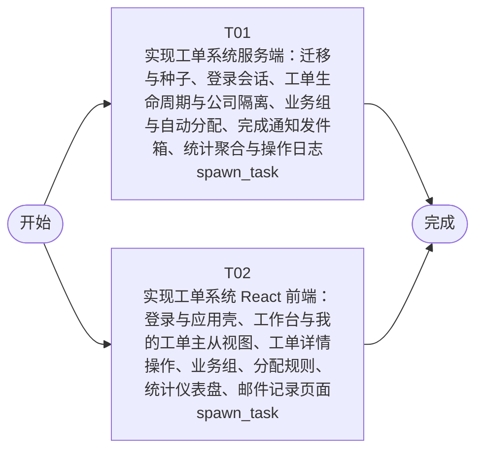

# 开发任务编排

<!-- sourcePlanId: plan:619a514e-5bc0-4955-91c5-394e9b806084 | rendererVersion: 4 -->

## 任务

| 任务 | 一句话目标 | 执行模式 | 依赖 | 能力 |
| --- | --- | --- | --- | --- |
| T01 | 实现工单系统服务端：迁移与种子、登录会话、工单生命周期与公司隔离、业务组与自动分配、完成通知发件箱、统计聚合与操作日志 | spawn_task | - | engineering.implementation |
| T02 | 实现工单系统 React 前端：登录与应用壳、工作台与我的工单主从视图、工单详情操作、业务组、分配规则、统计仪表盘、邮件记录页面 | spawn_task | - | engineering.implementation |

## 依赖执行图

## 任务契约

### T01

**目标**

## 目标

按已批准的架构基线（architecture-baseline.md）与技术契约（technical-contract.md），实现工单系统服务端全部能力，使认证、工单、业务组与分配规则、字典、统计、邮件记录各端点域在真实 SQLite 库上按契约语义可用。

## 范围

- 数据层：在 `app/ticket-system/src/server/migrations/sqlite/` 自 `0004` 起新增工单域迁移与种子（公司、用户、问题分类、演示账号按契约 §8，密码哈希以内嵌预计算常量落地），复用 `0003` 审计表迁移；索引与约束按架构基线 §4.1。
- 领域层：IdentityService（scrypt 校验、会话令牌签发/注销/过期检查）、TicketService（创建含自动分配尝试、多轮回复含首条回复回写、手动分配、转派、完成含同事务发件箱、取消、满意度评价）、AssignmentService（业务组、成员、分类分配规则 upsert/删除、按分类自动分配解析）、NotificationService（完成通知写入 mail_outbox，记录式投递）、StatsService（工单量、平均响应时间、满意度、热点分类、公司/部门分布，口径按契约 §6）、OperationLog 端口（经 auditkit record 写 8 类事件，按工单查询时间线）。
- 接口层：Hono 路由注册、请求参数校验、统一错误映射（401/403/404/409/422），公司隔离与状态机严格按契约 §9 执行，跨公司统一 404 语义。
- 遵守 `app/ticket-system/AGENTS.md`：服务端不依赖 `src/client/`，简洁优先，不为未规定事项（UV-01..UV-09）发明行为；全部业务写与审计事件同事务。

## 验证

- `npm run typecheck:server` 通过。
- `npm test`（node --import tsx --test）通过：保留既有基线测试，新增服务端域测试覆盖状态机流转与终态拒绝、公司隔离 404、按分类自动分配、完成通知发件箱、评价唯一与统计口径等可自动化断言；测试使用独立临时 `DB_PATH` 隔离。

## 验收贡献

- AC-01 至 AC-12 的服务端数据、业务规则与接口部分；界面与交互证据由 T02 承接，端到端浏览器验收归后续 QA。两端合并后的整体 `npm run build` / `npm start` 聚合检查保留在包级脚本中，由后续验证执行。

**角色:** general-app-development-expert  \  **失败策略:** block

**需求**

- AC-01
- AC-02
- AC-03
- AC-04
- AC-05
- AC-06
- AC-07
- AC-08
- AC-09
- AC-10
- AC-11
- AC-12

**输入**

- docs/wi-t1000334/requirements.md
- docs/wi-t1000334/architecture-baseline.md
- docs/wi-t1000334/technical-contract.md

**产物**

- app/ticket-system/src/server/

**可写范围**

- app/ticket-system/src/server/
- app/ticket-system/test

**阻塞码**

- （无）

### T02

**目标**

## 目标

按已批准架构基线的 UI 全局基线（architecture-baseline.md §3）与技术契约（technical-contract.md），实现工单系统 React SPA：登录后可在六个导航域完成工单端到端操作与运营查看。

## 范围

- 应用壳：左侧主导航（工作台、我的工单、业务组、分配规则、统计仪表盘、邮件记录）+ 顶栏当前用户姓名/公司与退出登录；登录页以用户名密码换取 Bearer 会话令牌并持久化，401 统一跳登录。
- 视图域：工作台与我的工单采用 split-master-detail（左侧队列 + 右侧详情）；队列支持状态/分类/优先级筛选、主题关键字与工单编号搜索、创建时间与优先级排序、公司维度筛选并可组合；工单详情展示完整信息、提交人信息面板（姓名、公司、部门、历史工单）、多轮回复、操作时间线，并提供分配、转派、完成、取消、满意度评价操作，终态与冲突错误内联反馈（404 显示工单不存在或无权限）。
- 业务组、分配规则为控制台式管理页（表格 + 表单 + 成员增减）；统计仪表盘展示工单量、平均响应时间、满意度、热点问题指标与公司/部门分布并支持维度切换；邮件记录页分页查询发件箱。
- 视觉：Modern SaaS 预设（柔和中性底、细边界、靛蓝主色、语义状态徽标、紧凑密度）、Tailwind 样式、Lucide 线性图标（需在 `app/ticket-system/package.json` 新增 `lucide-react` 依赖并安装更新根锁文件）；加载骨架、空态文案与错误重试反馈。
- 前端基于 technical-contract.md 的字段与错误契约编写 API 客户端与类型（契约类型放 `src/client/` 内），不发明 API 行为；不读写 `src/server/`，不写 `src/shared/`。

## 验证

- `npm run typecheck:client` 通过。
- `npm run build:client`（vite build）通过。

## 验收贡献

- AC-01 至 AC-12 的用户界面与交互证据；服务端业务规则归 T01，端到端浏览器验收归后续 QA。

**角色:** general-app-development-expert  \  **失败策略:** block

**需求**

- AC-01
- AC-02
- AC-03
- AC-04
- AC-05
- AC-06
- AC-07
- AC-08
- AC-09
- AC-10
- AC-11
- AC-12

**输入**

- docs/wi-t1000334/requirements.md
- docs/wi-t1000334/architecture-baseline.md
- docs/wi-t1000334/technical-contract.md

**产物**

- app/ticket-system/src/client/

**可写范围**

- app/ticket-system/src/client/
- app/ticket-system/index.html
- app/ticket-system/vite.config.ts
- app/ticket-system/tailwind.config.js
- app/ticket-system/postcss.config.js
- app/ticket-system/package.json
- package-lock.json

**阻塞码**

- （无）
