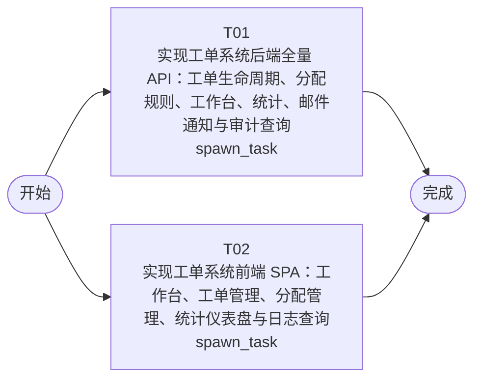

# 开发任务编排

<!-- sourcePlanId: plan:c678d7bd-a953-4855-8505-67d1f073053c | rendererVersion: 4 -->

## 任务

| 任务 | 一句话目标 | 执行模式 | 依赖 | 能力 |
| --- | --- | --- | --- | --- |
| T01 | 实现工单系统后端全量 API：工单生命周期、分配规则、工作台、统计、邮件通知与审计查询 | spawn_task | - | engineering.implementation |
| T02 | 实现工单系统前端 SPA：工作台、工单管理、分配管理、统计仪表盘与日志查询 | spawn_task | - | engineering.implementation |

## 依赖执行图

## 任务契约

### T01

**目标**

### 后端实现任务

基于已批准的技术契约 `docs/wi-t1000335/technical-contract.md` 实现工单系统全部服务端模块，以 `app/ticketing/src/server/` 为写入根。已有 authkit/userkit 登录与用户管理路由保留不动，在其之上新增业务路由。

#### 范围

1. **数据库迁移**（`src/server/migrations/sqlite/`）：新增 `companies`、`groups`、`group_members`、`assignment_rules`、`tickets`、`replies`、`ratings`、`notification_log` 表及关键索引；`users` 表已有 `company_id` 列，需确保外键约束与公司数据完整性。

2. **领域模块**（`src/server/modules/` 或同层 services/repositories）：
   - **ticket**：创建（含同一请求内自动分配）、列表/搜索/排序、详情（含回复/评分/通知记录）、回复、转派、完成、取消、评分、提交人完整信息与历史工单查询
   - **assignment**：业务组 CRUD + 成员管理、分配规则 CRUD
   - **workbench**：待处理工单队列（按用户所属业务组并集 + 公司过滤）
   - **stats**：公司/部门维度分布统计、运营仪表盘（工单量、平均响应时间、满意度、热点问题）
   - **notification**：完成邮件发送（emailkit/nodemailer）+ 发送记录查询
   - **audit**：工单关键操作审计事件写入（auditkit）+ 审计日志查询

3. **路由注册**：在 `src/server/routes.ts` 的 `registerProtectedRoutes` 中注册全部业务端点（4.2–4.6 节），复用现有 `currentUserId` 等辅助函数并扩展公司隔离校验。

4. **平台绑定**：在 `src/server/platform/` 中完成 auditkit 与 emailkit 的初始化绑定（bootstrap.ts 扩展）。

5. **共享契约类型**（`src/shared/`）：定义 `technical-contract.md` 第 3 节的全部数据结构 TypeScript 接口（Ticket、Reply、Rating、Group、AssignmentRule、AuditEntry、CurrentUser 等）与枚举常量，供前端导入。

#### 公司隔离与权限

- 一切工单读取先校验 `ticket.company_id == 当前用户.company_id`，不满足返回 404
- 列表/统计/工作台在 SQL 层带公司过滤
- 权限矩阵按技术契约第 5 节实现（提交人 vs 业务组成员 vs 本公司其他用户）
- `companyId` 筛选参数传入非本公司 ID 时返回空结果集

#### 验证

- `npm run typecheck:server`（`tsc -p tsconfig.server.json`）通过
- `npm test`（`node --import tsx --test test/*.test.mjs`）通过
- 如需要可新增服务端测试覆盖核心业务路径

**角色:** general-app-development-expert  \  **失败策略:** block

**需求**

- AC-01
- AC-02
- AC-03
- AC-04
- AC-05
- AC-06
- AC-07
- AC-08
- AC-09
- AC-10
- AC-11
- AC-12

**输入**

- docs/wi-t1000335/technical-contract.md
- docs/wi-t1000335/requirements.md
- docs/wi-t1000335/architecture-baseline.md

**产物**

- app/ticketing/src/server/routes.ts
- app/ticketing/src/server/platform/bootstrap.ts
- app/ticketing/src/server/migrations/sqlite/
- app/ticketing/src/shared/

**可写范围**

- app/ticketing/src/server/routes.ts
- app/ticketing/src/server/platform/bootstrap.ts
- app/ticketing/src/server/migrations/sqlite/
- app/ticketing/src/shared/
- app/ticketing/src/server/modules/
- app/ticketing/package.json

**阻塞码**

- （无）

### T02

**目标**

### 前端实现任务

基于已批准的技术契约 `docs/wi-t1000335/technical-contract.md` 实现工单系统全部浏览器界面，以 `app/ticketing/src/client/` 为写入根。已有登录/用户管理页面保留，在其之上扩展业务页面与导航。

#### 范围

1. **应用壳与导航**（`src/client/App.tsx`）：左侧导航（工作台、工单、统计、业务组与规则、操作日志、用户管理）+ 顶部上下文栏（当前用户、所属公司）；使用 react-router-dom 路由。

2. **业务页面**（`src/client/pages/` 或同层组件）：
   - **工单工作台**：待处理列表（split-master-detail），支持按公司筛选、关键字搜索、排序
   - **工单列表 + 详情**：列表筛选/搜索/排序 + 详情分栏；详情含基本信息卡、提交人信息卡（含历史工单）、回复时间线、操作区（回复/转派/完成/取消/评价按权限与状态显隐）、内嵌操作日志
   - **工单创建表单**：主题、描述、问题分类、SLA 优先级（P0–P4 选择器）
   - **业务组与规则管理**：业务组 CRUD + 成员管理 + 分配规则 CRUD
   - **统计分析**：分布明细（公司/部门维度切换）+ 运营仪表盘（工单量、平均响应时间、满意度、热点问题 KPI 行）
   - **操作日志查询**：审计日志列表（按操作类型、工单编号、时间范围筛选）

3. **API 客户端集成**（`src/client/platform/api-client.ts`）：复用现有 `apiRequest`，扩展业务端点调用；从 `src/shared/` 导入契约类型，不臆造 API 行为。

4. **UI 视觉**（Tailwind CSS）：Modern SaaS 方向——柔和中性色、细边界、少阴影、中等圆角；优先级徽标（P0 红/P1 橙/P2 黄/P3 蓝/P4 灰）；状态徽标（待分配/待处理/完成/取消）；骨架加载、空态文案、错误 toast、操作成功反馈。

#### 跨任务协作

- 从 T01 产出的 `src/shared/` 导入 API 契约类型（Ticket、Reply、Rating、Group、AssignmentRule、AuditEntry、CurrentUser 等）与枚举常量
- 前端使用契约类型或 mock 数据独立开发，不等待后端完成
- `package.json` 与锁文件由 T01 拥有，T02 不修改

#### 验证

- `npm run typecheck:client`（`tsc -p tsconfig.client.json`）通过
- `npm run build:client`（`vite build`）通过

**角色:** general-app-development-expert  \  **失败策略:** block

**需求**

- AC-01
- AC-02
- AC-03
- AC-04
- AC-05
- AC-06
- AC-07
- AC-08
- AC-09
- AC-10
- AC-11
- AC-12

**输入**

- docs/wi-t1000335/technical-contract.md
- docs/wi-t1000335/requirements.md
- docs/wi-t1000335/architecture-baseline.md

**产物**

- app/ticketing/src/client/App.tsx
- app/ticketing/src/client/pages/

**可写范围**

- app/ticketing/src/client/App.tsx
- app/ticketing/src/client/pages/
- app/ticketing/src/client/components/
- app/ticketing/src/client/platform/api-client.ts

**阻塞码**

- （无）
