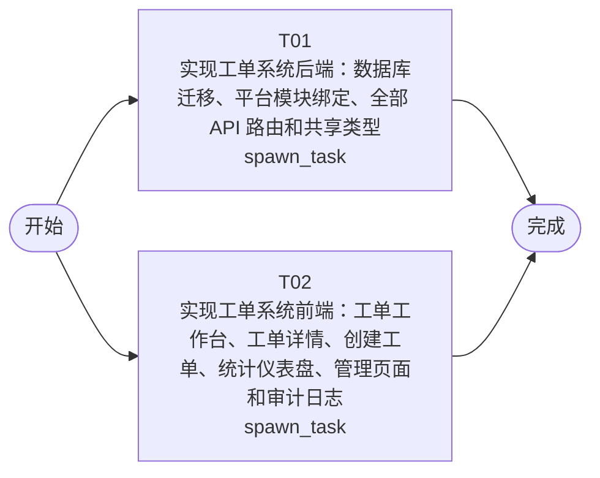

# 开发任务编排

<!-- sourcePlanId: plan:84767a46-c722-434e-864f-c1dff9b3bbcc | rendererVersion: 4 -->

## 任务

| 任务 | 一句话目标 | 执行模式 | 依赖 | 能力 |
| --- | --- | --- | --- | --- |
| T01 | 实现工单系统后端：数据库迁移、平台模块绑定、全部 API 路由和共享类型 | spawn_task | - | engineering.implementation |
| T02 | 实现工单系统前端：工单工作台、工单详情、创建工单、统计仪表盘、管理页面和审计日志 | spawn_task | - | engineering.implementation |

## 依赖执行图

## 任务契约

### T01

**目标**

## 范围

### 数据库迁移
- 创建 `src/server/migrations/sqlite/0004_application_tables.sql`，包含全部应用管理表：companies、departments、user_profiles、business_groups、business_group_members、categories、tickets、ticket_replies、processing_records、satisfaction_ratings、category_assignment_rules、ticket_transfers
- 所有主键使用 TEXT (UUID)，外键约束和索引按架构基线定义

### 平台模块绑定
- 绑定 permissionkit：在 `src/server/platform/` 下创建权限策略，实现公司隔离授权检查（基于 user_profiles.company_id）
- 绑定 auditkit：创建审计记录服务，在工单关键操作（创建、回复、转派、完成、评价、分配）时记录审计事件
- 绑定 emailkit：创建邮件发送服务，工单完成时向提交人邮箱发送通知；验证环境使用控制台输出替代 SMTP
- 更新 `src/server/platform/bootstrap.ts` 初始化新增模块资源

### API 路由实现
- 在 `src/server/routes.ts` 中扩展注册全部业务路由（或拆分到独立路由模块）
- 工单管理：POST/GET/PATCH /api/tickets、GET /api/tickets/:id、POST /api/tickets/:id/replies
- 工单协作：POST /api/tickets/:id/transfer、POST /api/tickets/:id/complete
- 工单处理：GET /api/tickets/:id/submitter
- 用户评价：POST /api/tickets/:id/rating
- 分配管理：GET/POST /api/business-groups、PATCH /api/business-groups/:id/members、GET/POST /api/category-rules
- 统计与工作台：GET /api/statistics/distribution、GET /api/statistics/dashboard、GET /api/workbench/tickets
- 操作日志：GET /api/audit-logs
- 所有 API 遵循 technical-contract.md 的字段级契约
- 创建后自动检查分类分配规则，匹配则自动分配到业务组并流转状态
- 所有查询按公司隔离（WHERE company_id = ?）

### 共享类型
- 在 `src/shared/` 下创建 TypeScript 类型定义，供 server 和 client 导入

### 测试
- 扩展 `test/fixtures/qa-environment.mjs` 添加工单系统种子数据（公司、部门、用户档案、业务组、分类）
- 新增 API 集成测试覆盖核心场景：工单创建、自动分配、公司隔离、回复、转派、完成、评价、统计

## 验证

- `npm run typecheck:server` 通过
- `npm test` 通过（含平台基线测试和新增工单 API 测试）

**角色:** general-app-development-expert  \  **失败策略:** block

**需求**

- AC-01
- AC-02
- AC-03
- AC-04
- AC-05
- AC-06
- AC-07
- AC-08
- AC-09
- AC-10
- AC-11
- AC-12
- AC-13

**输入**

- docs/wi-t1000392/technical-contract.md
- docs/wi-t1000392/architecture-baseline.md
- docs/wi-t1000392/requirements.md

**产物**

- app/ticket-system/src/server/
- app/ticket-system/src/shared/
- app/ticket-system/test/

**可写范围**

- app/ticket-system/src/server/
- app/ticket-system/src/shared/
- app/ticket-system/test/

**阻塞码**

- TASK_FAILED

### T02

**目标**

## 范围

### 页面实现
- **工单工作台**：待处理工单列表，左侧列表支持筛选（状态/分类/优先级/公司）、搜索（主题关键词）、排序（创建时间/优先级），右侧选中工单详情面板
- **工单详情**：展示工单完整信息、回复列表（按时间排序）、回复操作、转派操作（选择目标业务组）、完成操作（触发邮件通知）、提交人完整信息查看（姓名/公司/部门/历史工单）、满意度评价（1-5 分）
- **创建工单**：表单填写主题、描述、分类选择、SLA 优先级（P0-P4）选择
- **统计仪表盘**：KPI 卡片（工单量/待处理/已完成）、平均响应时间、平均满意度评分、热点问题分类排行、按优先级分布
- **管理页面**：业务组管理（创建业务组、查看成员、添加/移除成员）、分类分配规则配置（创建规则：分类→业务组）
- **审计日志**：操作日志列表，支持按工单/事件类型/操作人筛选

### 导航与路由
- 扩展 `src/client/App.tsx` 添加 react-router-dom 路由，左侧导航栏包含：工单工作台、创建工单、统计仪表盘、管理、审计日志
- 保留现有登录/引导流程

### API 集成
- 基于 technical-contract.md 定义前端 TypeScript 类型
- 扩展 `src/client/platform/api-client.ts` 添加全部工单系统 API 调用方法

### UI 基线
- Tailwind CSS，Modern SaaS 视觉预设：柔和中性色、细边界、少阴影
- 状态覆盖：加载态（骨架屏）、空数据、错误（toast）、成功反馈
- 桌面 Web 布局，左侧导航 + 顶部上下文栏 + 主工作区

## 验证

- `npm run typecheck:client` 通过
- `npm run build:client` 通过

**角色:** general-app-development-expert  \  **失败策略:** block

**需求**

- AC-01
- AC-02
- AC-03
- AC-04
- AC-05
- AC-06
- AC-07
- AC-08
- AC-09
- AC-10
- AC-11
- AC-12

**输入**

- docs/wi-t1000392/technical-contract.md
- docs/wi-t1000392/architecture-baseline.md
- docs/wi-t1000392/requirements.md

**产物**

- app/ticket-system/src/client/

**可写范围**

- app/ticket-system/src/client/

**阻塞码**

- TASK_FAILED
