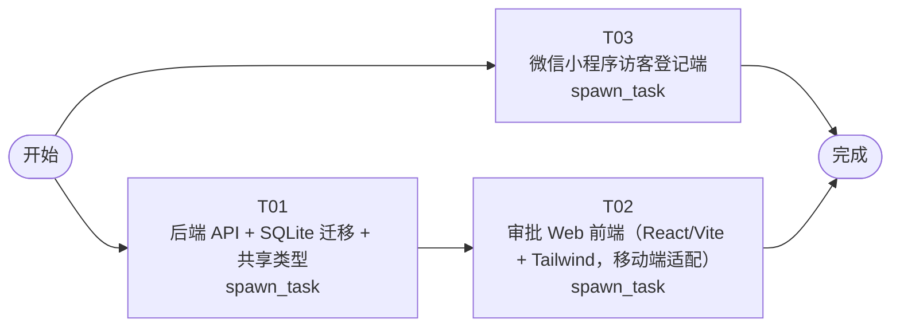

# 开发任务编排

<!-- sourcePlanId: plan:9a427638-8147-43df-9746-dc2e64839ffa | rendererVersion: 4 -->

## 任务

| 任务 | 一句话目标 | 执行模式 | 依赖 | 能力 |
| --- | --- | --- | --- | --- |
| T01 | 后端 API + SQLite 迁移 + 共享类型 | spawn_task | - | engineering.implementation |
| T03 | 微信小程序访客登记端 | spawn_task | - | engineering.implementation |
| T02 | 审批 Web 前端（React/Vite + Tailwind，移动端适配） | spawn_task | T01 | engineering.implementation |

## 依赖执行图

## 任务契约

### T01

**目标**

## 目标

实现访客系统后端 API、数据库迁移和前后端共享类型，使审批前端和小程序均可通过 HTTP API 完成访客登记和审批操作。

## 实现范围

### 共享类型（`app/guest-visitor/src/shared/`）

- 定义 Visitor 实体接口、API 请求/响应类型、状态枚举（pending/approved/rejected），字段命名使用 camelCase（与 API JSON 一致）
- 类型定义严格遵循 `docs/wi-t1000396/technical-contract.md` 的字段级契约

### 数据库迁移（`app/guest-visitor/src/server/migrations/sqlite/001-create-visitors.sql`）

- 创建 `visitors` 表，列定义遵循架构基线的数据库模型（id TEXT PK, name, phone, id_card, company, visit_reason, host_name, expected_visit_time, photo_url, status DEFAULT 'pending', review_comment, reviewed_at, created_at, updated_at）

### 后端路由（`app/guest-visitor/src/server/routes.ts`）

在现有 `registerPublicRoutes` 中注册全部 5 个 API 端点（访客登记为公开端点，无需认证）：

- `POST /api/visitors` — 创建访客登记，校验请求体（字段级校验规则见 technical-contract.md），生成 UUID v4 作为 id，写入数据库，返回 201 和完整记录（status=pending）
- `GET /api/visitors` — 分页查询访客列表，支持 status 筛选、page/limit 参数，返回 items + total + page + limit
- `GET /api/visitors/:id` — 查询单条访客详情，不存在返回 404 NOT_FOUND
- `POST /api/visitors/:id/approve` — 审批通过，校验当前状态为 pending（否则 400 VALIDATION_ERROR），更新 status=approved、review_comment、reviewed_at，返回更新结果
- `POST /api/visitors/:id/reject` — 审批驳回，校验同上，更新 status=rejected

### 数据访问层（`app/guest-visitor/src/server/visitor-repository.ts`）

- 封装 visitors 表的 CRUD 操作，使用 dbkit DbClient 的 queryOne/queryAll/run 方法
- SQL 语句使用 `?` 占位符，参数通过 params 传递
- 实现 snake_case ↔ camelCase 字段转换

### 校验逻辑（`app/guest-visitor/src/server/visitor-validation.ts`）

- 手机号：11 位数字，1 开头
- 身份证号：18 位，符合身份证校验规则（末位 X 大小写兼容）
- 必填字段非空、长度限制按 technical-contract.md 定义
- 校验失败返回 400 VALIDATION_ERROR，错误格式 `{error:{code,message}}`

### 现有模板文件修改

- `app/guest-visitor/package.json`：如需添加 `crypto` 或 UUID 依赖则在此修改（优先使用 Node.js 内置 `crypto.randomUUID()`）
- `app/guest-visitor/src/server/app.ts`：错误处理已就绪，确认 onError 返回的格式与契约一致（VALIDATION_ERROR 使用 HTTPException）
- `app/guest-visitor/src/server/platform/bootstrap.ts`：已就绪，无需修改

### 测试

- 在 `app/guest-visitor/test/visitor-api.test.mjs` 中通过真实 HTTP 服务器测试全部 5 个端点
- 使用 `test/with-http-server.mjs` 启动隔离服务器，DB_PATH 使用 `:memory:` 或临时文件
- 验证：创建访客 → 列表可见 → 详情字段一致 → 审批通过状态更新 → 审批驳回状态更新 → 重复审批返回 400

## 验证

- `npm run typecheck:server`（在 `app/guest-visitor/`）通过
- `npm test`（在 `app/guest-visitor/`）通过

## AC 贡献

- AC-01：POST /api/visitors 端点支持访客信息提交并写入数据库，状态为 pending
- AC-02：GET 列表/详情 + approve/reject 端点支持审批操作并持久化结果
- AC-03：不直接贡献（移动端布局由 T02 实现）

**角色:** general-app-development-expert  \  **失败策略:** block

**需求**

- AC-01
- AC-02

**输入**

- docs/wi-t1000396/requirements.md
- docs/wi-t1000396/architecture-baseline.md
- docs/wi-t1000396/technical-contract.md

**产物**

- app/guest-visitor/src/shared/

**可写范围**

- app/guest-visitor/src/shared/
- app/guest-visitor/src/server/routes.ts
- app/guest-visitor/src/server/visitor-repository.ts
- app/guest-visitor/src/server/visitor-validation.ts
- app/guest-visitor/src/server/migrations/sqlite/001-create-visitors.sql
- app/guest-visitor/src/shared/visitor-types.ts
- app/guest-visitor/test/visitor-api.test.mjs

**阻塞码**

- （无）

### T03

**目标**

## 目标

实现微信原生小程序（WXML/WXSS/JS），访客通过小程序填写访客信息并提交访问申请，手机号优先从微信获取。

## 实现范围

### 小程序基础配置（`miniprogram/`）

- `miniprogram/app.json`：页面注册（pages/visitor-form、pages/submit-success），窗口样式配置
- `miniprogram/app.js`：全局逻辑，API 基地址配置（默认指向 `http://localhost:3000`，可通过全局变量配置）
- `miniprogram/app.wxss`：全局样式，中性色调与审批前端保持一致

### 访客登记页面（`miniprogram/pages/visitor-form/`）

- `visitor-form.wxml`：表单布局，字段垂直排列
  - 手机号获取按钮置于表单顶部，使用 `<button open-type="getPhoneNumber">` 获取微信手机号
  - 获取成功后自动填入手机号输入框（只读）
  - 获取失败时显示手工填写输入框
  - 必填字段：姓名、手机号、身份证号、公司、访问事由、被访人、预计到访时间
  - 预计到访时间使用 `<picker mode="dateTime">` 或日期+时间选择器
  - 访客照片：选填，使用 `wx.chooseMedia` 上传
- `visitor-form.wxss`：表单样式，适配小程序屏幕
- `visitor-form.js`：
  - `getPhoneNumber` 事件处理：从 `e.detail.code` 获取手机号（微信新版接口）
  - 表单提交校验：手机号 11 位、身份证号 18 位、必填字段非空
  - 校验通过后调用 `wx.request` POST `/api/visitors`，请求体使用 camelCase 字段名
  - 提交成功跳转到成功页面，失败显示错误提示

### 提交成功页面（`miniprogram/pages/submit-success/`）

- `submit-success.wxml`：展示提交成功提示和当前状态（待审批）
- `submit-success.wxss`：成功页面样式
- `submit-success.js`：返回首页按钮逻辑

### API 调用

- 使用 `wx.request` 调用后端 API
- API 字段命名使用 camelCase（与 technical-contract.md 一致）
- 请求体 JSON 格式，Content-Type: application/json

## 验证

- 小程序代码结构完整：app.json 注册全部页面，每个页面有 wxml/wxss/js 三件套
- WXML 语法正确，JS 逻辑完整可读
- 无法在 Node.js 环境运行小程序，验证以代码审查和结构完整性为准

## AC 贡献

- AC-01：提供访客登记表单，支持微信获取手机号和手工填写，提交后调用 POST /api/visitors 写入数据库

**角色:** general-app-development-expert  \  **失败策略:** block

**需求**

- AC-01

**输入**

- docs/wi-t1000396/requirements.md
- docs/wi-t1000396/architecture-baseline.md
- docs/wi-t1000396/technical-contract.md

**产物**

- （无）

**可写范围**

- miniprogram/app.json
- miniprogram/app.js
- miniprogram/app.wxss
- miniprogram/pages/visitor-form/visitor-form.wxml
- miniprogram/pages/visitor-form/visitor-form.wxss
- miniprogram/pages/visitor-form/visitor-form.js
- miniprogram/pages/visitor-form/visitor-form.json
- miniprogram/pages/submit-success/submit-success.wxml
- miniprogram/pages/submit-success/submit-success.wxss
- miniprogram/pages/submit-success/submit-success.js
- miniprogram/pages/submit-success/submit-success.json
- miniprogram

**阻塞码**

- （无）

### T02

**目标**

## 目标

实现移动端适配的审批管理 Web 前端，审批人员可在手机浏览器中查看待审批访客列表、查看详情并执行通过/驳回操作。

## 实现范围

### 应用结构与路由（`app/guest-visitor/src/client/`）

- 使用 React Router（已在依赖中）
- 路由：`/` → 访客申请列表页，`/visitors/:id` → 访客申请详情页
- 重写 `App.tsx`，从当前 health-check 模板替换为审批管理界面

### 访客申请列表页（`src/client/pages/VisitorListPage.tsx`）

- 默认筛选 status=pending，提供状态切换 Tab（待审批/已通过/已驳回）
- 调用 `GET /api/visitors?status=...&page=1&limit=20`
- 卡片式列表布局（非表格），每张卡片显示姓名、公司、被访人、预计到访时间、状态标签
- 加载中显示骨架屏，空数据显示"暂无待审批申请"，错误显示页面内提示
- 支持分页加载更多

### 访客申请详情页（`src/client/pages/VisitorDetailPage.tsx`）

- 调用 `GET /api/visitors/:id` 获取完整信息
- 单列垂直排列展示全部字段（姓名、手机号、身份证号、公司、访问事由、被访人、预计到访时间、照片、状态、审批意见）
- status=pending 时底部固定显示"通过"和"驳回"操作按钮
- 点击操作按钮弹出审批意见输入框（选填），确认后调用 `POST /api/visitors/:id/approve` 或 `/reject`
- 操作成功后轻量提示并返回列表页
- status 非 pending 时只读展示

### API 集成

- 复用现有 `src/client/platform/api-client.ts`（已有 camelCase 响应转换和错误解码）
- 在 `src/client/api/visitors.ts` 中封装访客相关 API 调用函数

### 移动端适配（Tailwind CSS）

- 使用 Tailwind CSS（已配置）实现响应式布局
- 列表页：卡片全宽，紧凑间距，可滚动浏览
- 详情页：单列布局，内容区域最大宽度限制，操作按钮固定底部
- 文本溢出省略并提供展开
- 视觉风格：Modern SaaS，柔和中性色、细边界、少阴影、一个主色与状态色（pending=蓝、approved=绿、rejected=红）

### 现有模板文件修改

- `app/guest-visitor/src/client/App.tsx`：替换为审批管理应用
- `app/guest-visitor/src/client/main.tsx`：保持不变（已加载 AppProvider）
- `app/guest-visitor/src/client/index.css`：确认 Tailwind 指令存在
- `app/guest-visitor/src/client/platform/i18n.tsx`：可按需调整文案

## 验证

- `npm run typecheck:client`（在 `app/guest-visitor/`）通过
- `npm run build:client`（在 `app/guest-visitor/`）通过

## 依赖说明

- 依赖 T01 产出的 `app/guest-visitor/src/shared/visitor-types.ts` 共享类型
- API 契约以 `docs/wi-t1000396/technical-contract.md` 为准

## AC 贡献

- AC-02：提供审批列表、详情查看和通过/驳回操作界面，调用后端 API 完成审批流程
- AC-03：列表卡片布局、详情单列布局、底部固定按钮，移动端不溢出可操作

**角色:** general-app-development-expert  \  **失败策略:** block

**需求**

- AC-02
- AC-03

**输入**

- docs/wi-t1000396/requirements.md
- docs/wi-t1000396/architecture-baseline.md
- docs/wi-t1000396/technical-contract.md
- app/guest-visitor/src/shared/ (来自 T01)

**产物**

- （无）

**可写范围**

- app/guest-visitor/src/client/App.tsx
- app/guest-visitor/src/client/api/visitors.ts
- app/guest-visitor/src/client/pages/VisitorListPage.tsx
- app/guest-visitor/src/client/pages/VisitorDetailPage.tsx
- app/guest-visitor/src/client/components/StatusBadge.tsx
- app/guest-visitor/src/client/components/VisitorCard.tsx
- app/guest-visitor/src/client/components/ReviewDialog.tsx

**完整写入路径**

- app/guest-visitor/src/client/App.tsx
- app/guest-visitor/src/client/api/visitors.ts
- app/guest-visitor/src/client/pages/VisitorListPage.tsx
- app/guest-visitor/src/client/pages/VisitorDetailPage.tsx
- app/guest-visitor/src/client/components/StatusBadge.tsx
- app/guest-visitor/src/client/components/VisitorCard.tsx
- app/guest-visitor/src/client/components/ReviewDialog.tsx

**阻塞码**

- （无）
