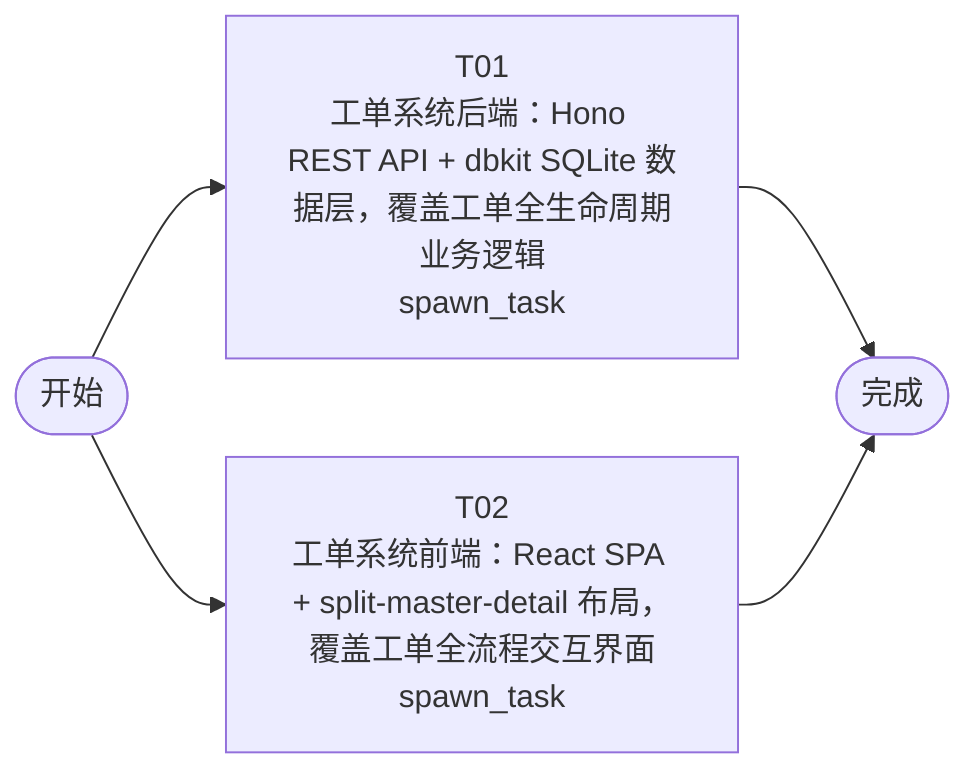

# 开发任务编排

<!-- sourcePlanId: plan:309cd4b4-4ed4-4db2-8634-118ad9645be1 | rendererVersion: 4 -->

## 任务

| 任务 | 一句话目标 | 执行模式 | 依赖 | 能力 |
| --- | --- | --- | --- | --- |
| T01 | 工单系统后端：Hono REST API + dbkit SQLite 数据层，覆盖工单全生命周期业务逻辑 | spawn_task | - | engineering.implementation |
| T02 | 工单系统前端：React SPA + split-master-detail 布局，覆盖工单全流程交互界面 | spawn_task | - | engineering.implementation |

## 依赖执行图

## 任务契约

### T01

**目标**

## 后端实现目标

实现 Hono HTTP 服务器和完整 REST API，覆盖 `technical-contract.md` 中定义的全部接口。

### 数据层
- 在 `app/jlg-ticket/src/server/migrations/sqlite/` 下创建版本化 SQL 迁移文件，建 10 张核心表：companies、users、business_groups、business_group_members、categories、category_group_rules、tickets、ticket_replies、ticket_transfers、ticket_evaluations
- 通过 dbkit `runMigrations` 在服务启动时执行迁移
- 启动前自动创建 `./data/` 目录

### 服务与路由
- 在 `app/jlg-ticket/src/server/` 下实现 API 路由和服务层，覆盖技术契约 §2 全部接口：
  - 工单接口：创建（含自动分配逻辑）、列表（含筛选）、详情（含提交人信息/回复/转派/评价聚合）、状态更新（含状态机校验）、回复、转派、评价
  - 公司接口：列表、创建
  - 业务组接口：公司下业务组列表、创建业务组、成员管理（列表/添加/移除）
  - 分类接口：列表、创建
  - 映射规则接口：列表（按公司筛选）、创建、删除
  - 用户接口：详情（含公司、部门、历史工单）
- 工单编号格式 `TKT-YYYYMMDD-NNNN`，按日递增序号
- 自动分配逻辑：创建工单时查询 `category_group_rules` 中提交人所属公司 + 工单分类的匹配规则，命中则自动分配并流转为 `pending_processing`
- 状态机校验：created→pending_assignment→pending_processing→completed，以及从 pending_assignment/pending_processing→cancelled
- 错误响应统一 `{ error: { code, message } }` 格式

### 共享类型
- 在 `app/jlg-ticket/src/shared/` 下定义 API 请求/响应类型、枚举值（status、priority）、错误码常量
- 共享类型保持平台中立，不依赖 Node/Hono/React

### 测试
- 在 `app/jlg-ticket/test/` 下编写 API 测试，通过真实 HTTP 服务器验证核心业务流程：工单创建与自动分配、状态流转、回复、转派、评价、业务组管理

### 验证
- `npm run typecheck:server` 通过
- `npm test` 通过

**角色:** general-app-development-expert  \  **失败策略:** block

**需求**

- AC-01
- AC-02
- AC-03
- AC-04
- AC-05
- AC-06
- AC-07
- AC-08
- AC-09

**输入**

- docs/wi-t1000474/requirements.md
- docs/wi-t1000474/architecture-baseline.md
- docs/wi-t1000474/technical-contract.md

**产物**

- （无）

**可写范围**

- app/jlg-ticket/package.json
- app/jlg-ticket/tsconfig.json
- app/jlg-ticket/tsconfig.server.json
- app/jlg-ticket/src/server/
- app/jlg-ticket/src/shared/
- app/jlg-ticket/test/

**阻塞码**

- （无）

### T02

**目标**

## 前端实现目标

实现 React + Vite SPA，采用 `split-master-detail` 布局，覆盖全部工单系统用户界面。

### 应用壳与导航
- 在 `app/jlg-ticket/src/client/` 下实现应用壳：左侧导航栏 + 顶部上下文栏 + 主工作区
- 导航项：工单列表、创建工单、业务组管理、分类与规则管理
- 使用 React Router 管理页面路由
- Tailwind CSS 实现 Modern SaaS 视觉风格

### 页面实现
- **工单列表**：split-master-detail 左侧，含筛选栏（状态/分类/优先级）和工单卡片列表，点击展开右侧详情
- **工单详情**：split-master-detail 右侧，含工单基本信息 + 提交人完整信息（姓名/公司/部门/历史工单折叠区）+ 回复时间线 + 转派历史 + 评价区 + 操作按钮栏
- **创建工单**：居中表单，含主题/描述/分类/SLA优先级/问题分类 + 提交人信息
- **业务组管理**：左侧公司列表 + 右侧业务组与成员管理
- **分类与规则管理**：左侧分类列表 + 右侧分类→业务组映射规则配置

### 交互状态
- 工单列表加载骨架占位、空态提示+引导按钮
- 操作成功 toast 提示、操作失败内联错误+重试
- 长文本展开/收起、标题溢出 title 属性

### API 客户端
- 在 `app/jlg-ticket/src/client/platform/api-client.ts` 实现 fetch 请求封装，处理响应归一化和错误解码
- 前端类型基于 `technical-contract.md` 定义，不发明 API 行为
- 使用内联 SVG 组件作为图标，不引入额外图标依赖

### 验证
- `npm run typecheck:client` 通过
- `npm run build:client` 通过

**角色:** general-app-development-expert  \  **失败策略:** block

**需求**

- AC-01
- AC-02
- AC-03
- AC-04
- AC-05
- AC-06
- AC-07
- AC-08
- AC-09

**输入**

- docs/wi-t1000474/requirements.md
- docs/wi-t1000474/architecture-baseline.md
- docs/wi-t1000474/technical-contract.md

**产物**

- （无）

**可写范围**

- app/jlg-ticket/index.html
- app/jlg-ticket/vite.config.ts
- app/jlg-ticket/tsconfig.client.json
- app/jlg-ticket/tailwind.config.js
- app/jlg-ticket/postcss.config.js
- app/jlg-ticket/src/client/

**阻塞码**

- （无）
