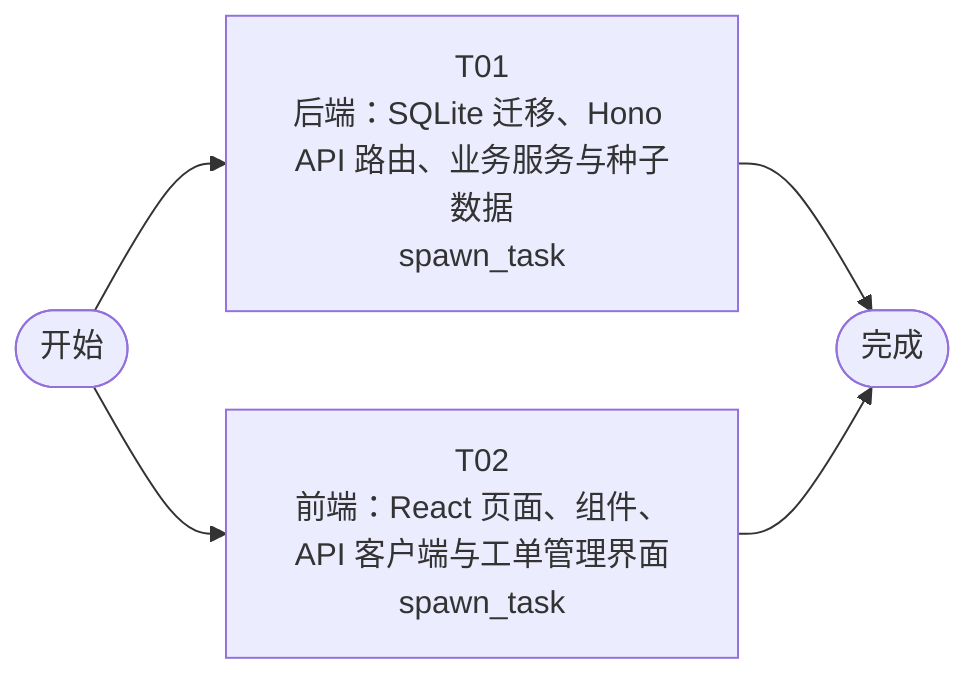

# 开发任务编排

<!-- sourcePlanId: plan:469b96e8-8667-4e88-9919-1d9240390d14 | rendererVersion: 4 -->

## 任务

| 任务 | 一句话目标 | 执行模式 | 依赖 | 能力 |
| --- | --- | --- | --- | --- |
| T01 | 后端：SQLite 迁移、Hono API 路由、业务服务与种子数据 | spawn_task | - | engineering.implementation |
| T02 | 前端：React 页面、组件、API 客户端与工单管理界面 | spawn_task | - | engineering.implementation |

## 依赖执行图

## 任务契约

### T01

**目标**

## 目标

实现工单系统完整后端，覆盖架构基线定义的全部数据模型和接口契约。

### 数据库迁移
- 创建 10 张表的 SQLite 版本化迁移文件（companies、users、business_groups、business_group_members、categories、category_assignment_rules、tickets、ticket_replies、ticket_transfers、ticket_evaluations），字段类型和约束遵循 architecture-baseline.md §3.1 表结构定义
- 通过 dbkit `runMigrations` 执行迁移

### 种子数据
- 预置演示公司、用户（含邮箱、部门）、问题分类（技术问题、功能咨询、故障报告、需求建议）
- 预置业务组和分类分配规则用于验证自动分配流程

### API 路由（参考 technical-contract.md §3 完整定义）
- 公司管理：`POST/GET /api/companies`
- 业务组管理：`GET/POST /api/companies/:companyId/business-groups`
- 业务组成员：`GET/POST/DELETE /api/business-groups/:groupId/members`
- 分类管理：`GET/POST /api/categories`
- 分类分配规则：`GET/POST /api/companies/:companyId/assignment-rules`
- 工单管理：`GET/POST /api/tickets`、`GET /api/tickets/:id`
- 工单回复：`POST /api/tickets/:ticketId/replies`
- 工单分配：`POST /api/tickets/:ticketId/assign`
- 工单转派：`POST /api/tickets/:ticketId/transfer`
- 工单完成：`POST /api/tickets/:ticketId/complete`
- 工单取消：`POST /api/tickets/:ticketId/cancel`
- 工单评价：`POST/GET /api/tickets/:ticketId/evaluation`
- 用户信息：`GET /api/users/:userId`、`GET /api/users/:userId/tickets`

### 核心业务逻辑
- 工单创建时自动分配：查找工单分类+提交人公司的分类分配规则，匹配则分配到业务组并状态变为 pending_process，无匹配则保持 pending_assign
- 状态流转校验：created→pending_assign→pending_process→completed/cancelled，终态不可变更
- 转派逻辑：记录 from/to 信息，状态保持 pending_process
- 事务保证：创建工单+自动分配、转派+记录、完成状态更新使用 db.transaction

### 共享契约层（src/shared/）
- 定义枚举常量（TicketStatus、Priority、Rating）
- 定义 API 请求/响应 TypeScript 类型接口（camelCase），供前后端共享
- 错误码常量

### 数据库列名到 API JSON 字段映射
- 服务端路由层统一执行 snake_case → camelCase 转换，映射表见 technical-contract.md §6

### 统一错误响应
- 格式：`{error:{code,message}}`，错误码：VALIDATION_ERROR(400)、NOT_FOUND(404)、CONFLICT(409)、INTERNAL_ERROR(500)

### 验证
- `npm run typecheck:server`（tsconfig.server.json）通过
- `npm test`（test/*.test.mjs）通过，验证 API 行为
- `npm run build` 整体构建通过

**角色:** general-app-development-expert  \  **失败策略:** block

**需求**

- AC-01
- AC-02
- AC-03
- AC-04
- AC-05
- AC-06
- AC-07
- AC-08
- AC-09

**输入**

- docs/wi-t1000484/requirements.md
- docs/wi-t1000484/architecture-baseline.md
- docs/wi-t1000484/technical-contract.md

**产物**

- app/jlg-ticket/src/server/
- app/jlg-ticket/src/shared/
- app/jlg-ticket/test/

**可写范围**

- app/jlg-ticket/src/server/
- app/jlg-ticket/src/shared/
- app/jlg-ticket/test/
- app/jlg-ticket/package.json
- app/jlg-ticket/tsconfig.json
- app/jlg-ticket/tsconfig.server.json
- app/jlg-ticket/src/server/migrations/sqlite/001_init_schema.sql
- app/jlg-ticket/src/server/migrations/sqlite/002_seed_data.sql

**阻塞码**

- （无）

### T02

**目标**

## 目标

实现工单系统完整前端，覆盖架构基线定义的全部页面和交互，采用 split-master-detail 布局和 Modern SaaS 视觉风格。

### 应用壳与导航
- 左侧导航栏：工单列表、业务组管理、分类规则配置
- 顶部上下文栏：当前视图标题与全局操作
- 主工作区：列表-详情分栏布局

### 页面实现（参考 architecture-baseline.md §1.7）

#### 工单列表+详情（split-master-detail）
- 左侧工单队列：按状态/优先级筛选，显示工单摘要（ID、主题、分类、优先级、状态、提交人、创建时间）
- 右侧工单详情：显示完整工单信息，含回复列表（按时间排序）、转派记录、评价信息
- 工单详情操作：回复、转派、完成、取消、评价
- 加载/空数据/错误/成功状态反馈

#### 工单创建
- 表单：主题、描述、分类（下拉选择）、SLA 优先级（P0-P4 选择）
- 提交人信息自动填充
- 创建后跳转到工单详情

#### 业务组管理
- 公司→业务组列表→成员管理
- 创建业务组、添加/移除成员

#### 分类分配规则配置
- 配置分类到业务组的映射规则
- 显示已有规则列表

#### 提交人信息查看（嵌入工单详情侧边面板）
- 显示提交人姓名、公司、部门
- 显示该提交人的历史工单列表

### API 客户端集成
- 基于技术契约定义的 API 接口实现 api-client 调用
- 统一错误解码（`{error:{code,message}}` 格式）
- 前端使用 src/shared/ 中的 TypeScript 类型接口（由 T01 定义），不自行发明 API 行为

### 状态与交互
- 工单状态流转通过对应 API 操作触发（创建→分配→处理→完成/取消）
- 自动分配结果在创建工单响应中体现（assignedGroupId 是否有值）
- 转派后工单保持 pending_process 状态，新接收方可见
- 评价仅在工单 completed 后可提交，已评价不可重复

### 验证
- `npm run typecheck:client`（tsconfig.client.json）通过
- `npm run build:client`（vite build）通过

**角色:** general-app-development-expert  \  **失败策略:** block

**需求**

- AC-01
- AC-02
- AC-03
- AC-04
- AC-05
- AC-06
- AC-07
- AC-08
- AC-09

**输入**

- docs/wi-t1000484/requirements.md
- docs/wi-t1000484/architecture-baseline.md
- docs/wi-t1000484/technical-contract.md

**产物**

- app/jlg-ticket/src/client/

**可写范围**

- app/jlg-ticket/src/client/
- app/jlg-ticket/index.html
- app/jlg-ticket/vite.config.ts
- app/jlg-ticket/tsconfig.client.json
- app/jlg-ticket/tailwind.config.js
- app/jlg-ticket/postcss.config.js

**阻塞码**

- （无）
