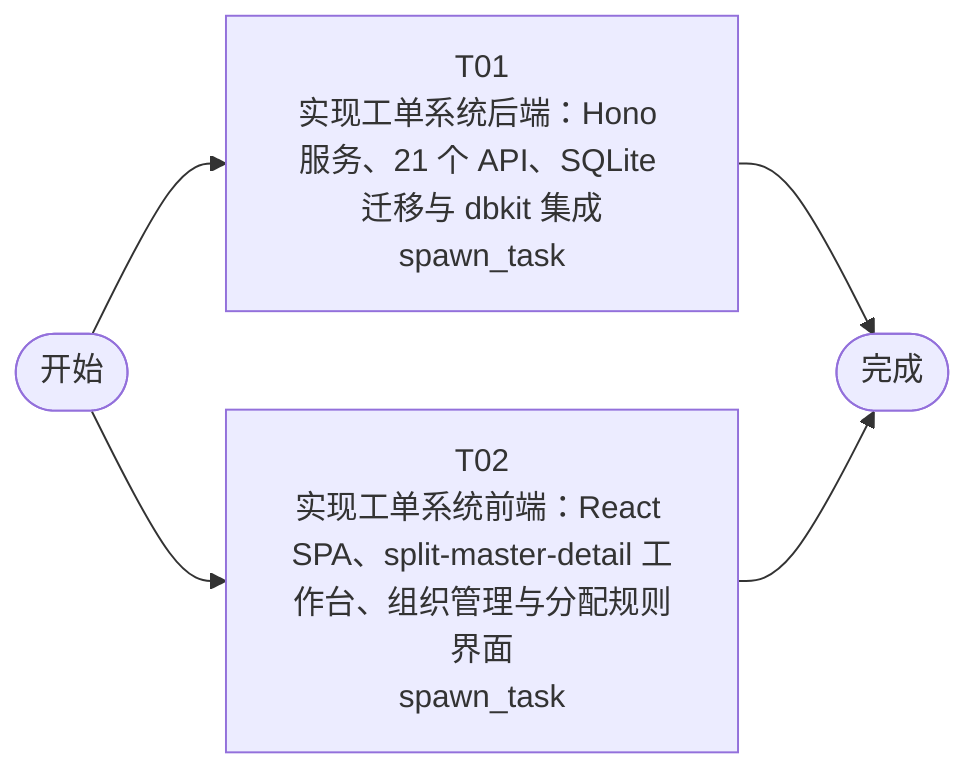

# 开发任务编排

<!-- sourcePlanId: plan:9eb2a7a8-99e2-44c7-8802-9f9acc920808 | rendererVersion: 4 -->

## 任务

| 任务 | 一句话目标 | 执行模式 | 依赖 | 能力 |
| --- | --- | --- | --- | --- |
| T01 | 实现工单系统后端：Hono 服务、21 个 API、SQLite 迁移与 dbkit 集成 | spawn_task | - | engineering.implementation |
| T02 | 实现工单系统前端：React SPA、split-master-detail 工作台、组织管理与分配规则界面 | spawn_task | - | engineering.implementation |

## 依赖执行图

## 任务契约

### T01

**目标**

## 目标

实现工单系统完整后端，覆盖技术契约定义的全部 21 个 API 接口和 8 张数据库表。

## 范围

- **数据库层**：在 `migrations/sqlite/` 下创建初始迁移文件，包含 8 张表（companies、business_groups、group_members、assignment_rules、tickets、ticket_replies、ticket_transfers、evaluations）的 CREATE TABLE 和索引
- **dbkit 集成**：通过 `src/server/platform/bootstrap.ts` 初始化 SQLite 连接，配置参数化查询、事务和迁移自动执行
- **API 路由**：在 `src/server/routes.ts` 中注册全部 21 个接口：
  - 工单管理：创建（含自动分配）、列表查询、详情查询、状态更新（取消）、手动分配、转派、完成处理、提交人信息查询
  - 回复管理：查询回复列表、添加回复
  - 转派记录：查询转派历史
  - 评价：查询评价、提交满意度评价
  - 组织管理：公司 CRUD、业务组 CRUD、成员 CRUD
  - 分配规则：查询规则列表、创建规则
- **业务逻辑**：
  - 自动分配：工单创建时根据 submitter_company_id + category 匹配 assignment_rules，匹配成功则分配到目标业务组并转为 pending_process
  - 状态转换：created→pending_assign→pending_process→completed/cancelled，校验合法转换
  - 转派：记录 from_group_id→to_group_id，更新 current_group_id
  - 完成：记录 handler_member_id、handler_name、processed_at
  - 评价：仅 completed 工单可评价，每工单仅一次
- **snake_case ↔ camelCase 转换**：在 API 层完成数据库字段到 JSON 字段的命名映射
- **共享层**：在 `src/shared/` 中放置平台中立的类型定义、常量和枚举（工单状态、SLA 优先级等）
- **应用配置**：package.json（含前后端全部依赖）、tsconfig.json、tsconfig.server.json

## 验证

- 服务端 TypeScript 类型检查（tsconfig.server.json）
- 启动 HTTP 服务器并执行 API 集成测试，覆盖核心流程：创建工单→自动分配→回复→转派→完成→评价
- 验证状态转换合法性校验和错误响应格式

## 跨任务贡献

- 为前端提供全部 21 个 API 接口的运行时实现
- 拥有 `src/shared/` 共享类型定义，前端基于技术契约自行定义对应类型
- 后续 QA 阶段负责端到端集成验证

**角色:** general-app-development-expert  \  **失败策略:** block

**需求**

- AC-01
- AC-02
- AC-03
- AC-04
- AC-05
- AC-06
- AC-07
- AC-08
- AC-09
- AC-10

**输入**

- docs/wi-t1000487/requirements.md
- docs/wi-t1000487/architecture-baseline.md
- docs/wi-t1000487/technical-contract.md

**产物**

- app/jlg-ticket/src/server/
- app/jlg-ticket/src/shared/

**可写范围**

- app/jlg-ticket/src/server/
- app/jlg-ticket/src/shared/
- app/jlg-ticket/package.json
- app/jlg-ticket/tsconfig.json
- app/jlg-ticket/tsconfig.server.json
- app/jlg-ticket/test/

**阻塞码**

- TASK_FAILED

### T02

**目标**

## 目标

实现工单系统完整前端 React SPA，覆盖技术契约定义的全部用户界面入口和交互流程。

## 范围

- **应用骨架**：`index.html`（Vite 文档壳）、`src/client/main.tsx`（React 挂载）、`src/client/App.tsx`（顶层应用与导航）
- **API 客户端**：`src/client/platform/api-client.ts`，统一的浏览器请求边界，响应规范化和错误解码
- **工单工作台（split-master-detail）**：
  - 左面板：工单列表队列，支持按状态、优先级、分类筛选和关键字搜索
  - 右面板：选中工单的详情视图，包含工单信息、提交人信息面板（含历史工单）、回复列表、转派记录、操作按钮（分配/转派/完成/取消/评价）
  - 工单创建表单弹窗
- **组织管理**：公司列表 → 选中公司展示业务组列表 → 选中业务组展示成员列表，三级联动
- **分配规则**：规则列表 + 创建表单，按公司筛选
- **UI 框架**：Tailwind CSS，Modern SaaS 视觉方向（靛蓝主色 #4F46E5，状态色阶，浅灰白背景，白色卡片细边界）
- **全局状态**：加载骨架屏、空数据引导、错误提示与重试、操作成功后刷新
- **前端配置**：vite.config.ts（Vite 插件、开发端口、API 代理）、tsconfig.client.json、tailwind.config.js、postcss.config.js

## 验证

- 客户端 TypeScript 类型检查（tsconfig.client.json）
- Vite 构建（npm run build）成功
- 验证页面渲染、筛选交互、表单提交和状态联动

## 跨任务贡献

- 基于技术契约的 API 类型定义，不自行发明 API 行为
- 覆盖全部 10 条验收场景的用户界面入口
- 后续 QA 阶段负责浏览器端到端验证

**角色:** general-app-development-expert  \  **失败策略:** block

**需求**

- AC-01
- AC-02
- AC-03
- AC-04
- AC-05
- AC-06
- AC-07
- AC-08
- AC-09
- AC-10

**输入**

- docs/wi-t1000487/requirements.md
- docs/wi-t1000487/architecture-baseline.md
- docs/wi-t1000487/technical-contract.md

**产物**

- app/jlg-ticket/src/client/

**可写范围**

- app/jlg-ticket/src/client/
- app/jlg-ticket/index.html
- app/jlg-ticket/vite.config.ts
- app/jlg-ticket/tsconfig.client.json
- app/jlg-ticket/tailwind.config.js
- app/jlg-ticket/postcss.config.js

**阻塞码**

- TASK_FAILED
